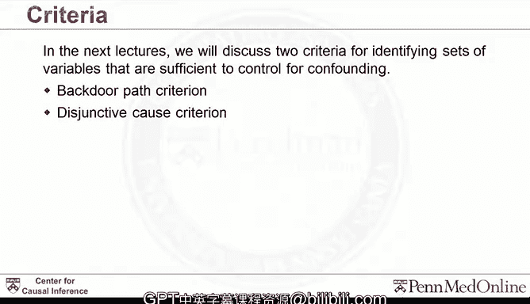

# 宾夕法尼亚大学《因果推断速成课程｜A Crash Course in Causality》中英字幕 - P14：14_02_06_混杂因素再探讨.zh_en - GPT中英字幕课程资源 - BV1Ft42137BF

Hi， in this video， we're going to revisit confounding。There are two main objectives first。

We're going to learn about front door paths and back door paths。Next。

 we're going to aim to understand why backdoor paths need to be blocked as a reminder of confounders what they are。

 we' think about an informal definition。Which is a variable that affects both the treatment and the outcome。

A simple dig that depicts confounding is here， in particular is depicting confounding between A and y。

 so again we'll think about a treatment A and outcome Y and in this case x is representing confounding。

 so here x is affecting both A and Y。In this dig， the situation is a little more complicated。

So we have。Again， our interest is in the relationship between A and y。

 so an exposure and an outcome and we see that V affects A directly。

 so there's a direct path from V to A， so V affects A。But v affects y indirectly， so v affects W。

 which affects y。So V does affect y， but indirectly through W。So in this case。

 it would be reasonable to argue that V is a confounder， it does affect treatment directly。

 and it also affects the outcome， it just does so indirectly through its effect on W。

 but you could argue that in this case， V is a confounder。However。

 it doesn't necessarily matter whether we call a variable a confounder or not。

 what matters is that we've。Sufficiently controlled for confounding。In order to do that。

 we're going to need to block。Backdoor paths from treatment to outcome。

 and I'll explain what that means。But before we get there， let's first look at front door paths。

So a front door path。From A to Y， from exposure to treatment。

That's one that begins with an arrow that's emanating out of A。So here are two examples。On the left。

 we see that。A directly affects Y， so there's an arrow directly to Y。On the right， we see that。

A does get to Y， but indirectly through its effect on Z。So here on the left。A。Directly affects y。

 and that's called the front door path from A to y and the front door you could is essentially coming from。

You could think of that。Information is flowing from A to Y。

 or you could think of swimming with the current。So you're going in the direction that you're being pushed in a sense。

That's considered the front door。So， a。To why is a front door path on the da on the left。

On the right， we have another front door path from A to Y， and this one goes through Z， so A Z Y。

 that's also a front door path from A to Y， and again。

 the word front door is coming from strictly because of the direction of that arrow。

So that's what makes it a front door path is that it's coming out of a。

So you could also think of it as something that a is affecting here a is exposure。

 so the exposure is affecting something。If you think of it from a time perspective。

 you could think of Z as occurring after A， A is affecting Z。

So that's what we mean by a front door path。If we're interested in the causal relationship between A and Y。

 we're not typically going to worry about front door paths， and in fact。

 we actually would not want to block anything on a front door path。

And that's because front door paths actually capture things we're interested in which are effects of treatment。

So in this first egg。A directly affects Y。 and that's fine。

Anything else that needs to be said about that one。 But let's look at the second case here。 So D2。

A affects Y indirectly through its effect on Z。In this case， we would not want to block Z。

 We would not want to control for Z because Z is actually an effective treatment。

 It's part of the effect of treatment。So we would not want to control for part of the effect of treatment。

Our interest is in the causal relationship between A and Y。

 and if some of that is through the causal effect that A has on Z。

 that's not something we're concerned about at this point。

 we're interested in just how does a effect why， regardless of what paths it takes to get there so we don't want to control for anything on a front door path。

So to reiterate in this case we would not want to control for Z Z is capturing some of the effect of treatment in general。

 what we're interested in is if we were to manipulate a， you know via treatment assignment。

 for example， if we were to assign treatment to people，What would the impact be on why。Again。

 we don't want to control for an effect of freement。However。

 it could be that you are interested in these pathways。

And that would be known as a causal mediation analysis。 So if you do care about。

How much of the effect of A on Y is through？A's effect on Z that would be a causal mediation analysis in that case you would care about front door paths。

 you would care about quantifying it， but you still wouldn't be controlling for Z and that is a different type of。

Analysis then will cover， but it still sort of falls under causal inference。

 but causal mediation analysis specifically focuses on quantifying how much of the effective treatment is through intermediate variables。

But our main goal is just how much does A affect Y in general and we don't necessarily care about how it does it。

 what are the mechanisms by which it does it？Next， we'll move to back door paths and back door paths are the ones I said that we need to worry about when it comes to。

Controlling for confounding so in this so a backdo path from treatment A to outcome Y our paths that travel。

From A to y through arrows that are actually going into A。Right， so here's an arrow going into a。

So in this case， a backdoor path from A to Y。Is as follows。 So it's。A to x to Y。

So that's a backdo path for A to Y in other words。There's one way one way you can get from A to Y is through the treatment effect。

 so A affecting Y， but there's this other path。ThatWhere you can get from A to y。

And so this is but this is a path that has nothing to do with A causing Y， right this backdo path。

does not involve any arrows coming out of A。So there's no treatment effect involved there。

 but A and Y are still associated with each other through that path。

So this is something we have to worry about because if we look at just marginal associations between A and Y。

Some of that association will be due to a causal effect of AN Y。

 but some of it also could be because。X causes both A and y。

So we want to be able to separate out the actual treatment effect from this kind of confounding effect。

 which is happening through this kind of backdo path so there's basically the sneaky way to get from A to Y and we want to get rid of that so in general backdoor paths canfound the relationship between A and Y。

So we want to make sure those back door paths are blocked so that there's no sneaky way to get from A to y and there's only this。

A front door path， which is a causal path。So we're going to focus on trying to block these paths。

So our big picture goal then is to identify a set of variables that block all of the backdoor paths from treatment to outcome。

 from A to y。So is sufficiently controlled for confounding and that's what we're going to have to do。

 we're going to have to block all of these back door paths so we can think of x as being as a set of variables。

And if we did block all of the back dooror paths from A to B， I mean， I'm sorry from A to Y。

 then we would have iorability， A would be independent of the potential outcomes given X。

 so this is really the key thing that we're focused on here is if we eliminate all the back dooror paths by blocking them。

Then we have the iorability of the treatment mechanism， so ignoreorability would hold given X。

 so X would have to be this collection of variables that blocks all of the back door paths so that really sets up what we're going to do next。

 which is to discuss two different criteria for identifying sets of variables that are sufficient to control for confounding。

So the two we will discuss are the back door path criterion。And also the disjunctive cause criterion。

