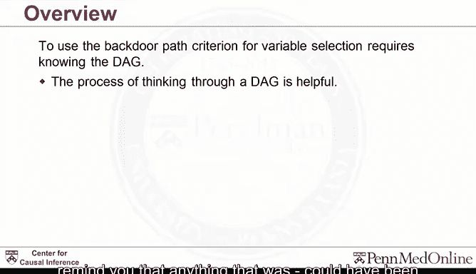

# 宾夕法尼亚大学《因果推断速成课程｜A Crash Course in Causality》中英字幕 - P15：15_02_07_后门路径准则.zh_en - GPT中英字幕课程资源 - BV1Ft42137BF

Hi， this video was on the back door path criterion。

The objective of this video is to understand what the back door path criterion is。

 how we'll recognize when it's met， and more generally how to recognize when a set of variables is sufficient to control for confounding based on a given da。

So we're going to think about when a set of variables is sufficient to control for confounding。

So based on the backdoor path criterion， we'll say it's sufficient if it blocks all backdoor paths from treatment to outcome。

And it does not include any descendants of treatment。So remember。

 a descendant of treatment would actually be part of the causal effect of treatment。

 so we do not want to control for effects of treatment。So as long as those two conditions are met。

Then you've met the back door path criterion， so that's what the backdoor path criterion is。

sYou've blocked all back to our paths。From treatment to outcome。

 and you also have not controlled for any descendants of treatment。And it's not necessarily unique。

There's not necessarily one set of variables。There strictly one set of variables that will satisfy this criterion。

 there could be many options， and we'll look through some examples of that。So。

 here's the first example。So suppose this is our day。

 So we're imagining that this is reality and our treatment is a。 our outcome is why。

 and we're interested in that relationship。 So we're interested in the relationship between A and Y。

Is there a relationship if there is， how big is the effect。

But you'll see that there's these other variables， V and W。And as we've seen previously here。

 you think of V。 you could especially think of V as a confounder because V affects a directly。

 and it indirectly affects y。What we see then is that theres exactly one backdo path from A to Y。

So that back dooror path is A V WY， so you can get to Y by going from A to V to W to y。

And you'll notice on that path， there's no collliiders。So it's actually。

 so it's not blocked by any colliders。So this is a pretty simple example。 We have no colliders。

 we have one back dooror path， so we just have to block that path。

So the sets of variables that are sufficient to control for confounding would be V。

 So if you control for V， if you block V。you've blocked that backdoor path。

 There's only one backdoor path， and you would stop it with by controlling for V。

And that would then the black back door path criterion would be met。But you also could control for W。

So alternatively， if you had W and you could control for that。

 and that would also satisfy the backdoor path criterion。Or you could control for both of them。

 so you could control for both sets of variables。 So in this case。

 there's three collections of variables that would satisfy the backdoor path criterion， So V alone。

 W alone or V and W。And so you could actually just， if this was a correct egg。

 you could actually just pick any of these you wanted。Typically。

 people would prefer a smaller set of variables to control for。 So you might choose V or W。Okay。

 so here's another example。Imagine that this is the true da。And again。

 we're interested in the relationship between treatment and outcome here， A and Y。Again。

 there's one backdo path from A to Y。The back door path A to Y is A， V， M， W， Y。

But this one is blocked by a collider， so you'll notice there's a collision at M。Therefore。

 there's actually no confounding on this， on this stag。There。

There's there's actually not any confounding in the senseed， if you look at。

What is affecting treatment， Well， that's V。RightSo V directly affects treatment， but V。

 the information from V never flows back over to y。Similarly， there's W affects Y。

 but information from W never flows all the way back over to A。

 so there's actually no confounding on this graph。So I'll say one more thing about it。

 so you actually just in general would not have to control for anything so if this was your graph。

You wouldn't。 You could just do an unadjusted analysis looking at the relationship between A and Y。

However， you might control for M。It's possible that you might even do this unintentionally。You know。

For example， you might not realize that you might control for a variable that and you don't realize that it is a collider。

 So if you did that。What you'll do is you'll open a path between V and W。

So that's what I'm showing here in this figure。 there's a box around M。

 meaning I'm imagining that we're controlling for it。The instant we control for it。

 as we've seen in previous videos， is we open a path then between V And W。 So V And W war。

Independent， marginally， but conditionally， they're dependent。So if we control for M。

 we open this path。Then， what that means is。The sets of variables that are sufficient to con for confounding。

Is this list here， So the first。1 I list is the empty set。 So again。

 you actually don't have to control for anything based on this stag。You could just control for V。

These's not a collider。 So controlling for it doesn't hurt anything。In in a biased sense。

 so you could just control for V。 You could also just control for W。 No harm done。

But if you control for M。Then you're going to have to control for either V W or both V and W。

So you'll see the last three sets of variables that are sufficient to control for confounding involve M。

 and then some combination of W V or W N V。So you could control for any of these that I've listed here。

However， if you could not just control for M。 if you strictly control for M。

 you would have confounding。They would。Controlling Fm would open a back door path so you could then go from A to V to W to Y。

So that would be a path that would be unblocked， a back door path that would be unblocked。

 which would mean you haven't sufficiently controlled for confounding。

So let's look at another example。In this case， there are two back door paths from A to Y。 Again。

 we're interested in the effect of A and Y。 So that's our relationship of primary interest。

Because that's what we're interested in， we want to block back door paths from A away。

So the first backdo path from A to Y is A Z， V Y。The second one is A W， Z， V， Y。

So there's two roundabout ways you can get from A to y。 So two indirect ways through back doors。

So we'll look at these one at a time so the first path。A Z， VY。

You'll notice there there are no colliders on that particular path。If you just focus on the A Z。

 V Y path， there's no collliiders。Therefore， on that path。

You could either control for Z or V if you want to block just that path。

So to block that back dooror path， you could control for Z or V or both。

But you do have to control for at least one of them。Because there is a unblocked back door path。

 So you have to block it and you could do so with either Z V or both。There's the second path， A， W。

 Z， V， Y。And you'll notice in this one， there's a collision at Z。Right， so。

V and W are are both parents of Z。So their information collides and see。

So that backdoor path is already blocked。However， if you were to control for Z。

 then you would open a path between， in this case， W and V。Right。Whenever you control for a collider。

 you open a path between their parents。So if you control for Z。

 you would open a path between W and V， which would mean you would have to control for W or V。

So in general， to block this particular path， you could actually control for nothing。On this path。

 then you would be fine， or you could control for V。 You could control for W。If you control for Z。

 then you also have to additionally control for V or W to block that new path that you opened up。

So we looked at these two paths。 there's two backdo paths on the graph。 We looked at them separately。

 but now we can put it all together。So the following sets of variables are sufficient to control for confounding。

 so you could just control for V。That would block the first back door path that we talked about and the second back door path that we talked about。

 we don't actually need to block because there's a collider。You also could control for V and Z。

You can control for Z， and。W。Because remember z would Z blocks the first path。

Or you could control for all three。But you it wouldn't be enough to just control for Z。

If you just controlled for Z， it would open a path between W and V， which would。

And would that would form a new backdoor path from which you could get from A to Y。

You also couldn't just control for W。 If you just control for W。

 you could there's still an unblocked back dooror path。 You could go A， Z， V Y still。So in this case。

 the minimal set would be V least。You could control for and and still block all the back door paths would be V。

So that would be typically the ideal thing。Would be to pick the smallest set if you can do it。

 if you know what it is。We'll look at one more example here， so this one's a little more complicated。

Now， there are three back door paths from A to y。And we'll look at these separately。

Coloring them to make it easier to see since there's so many past this time。

 So here's one that's A Z， V Y。And you could block you'll notice there's no collisions on that one。

 we've already talked about this path， in fact， and you could block that with Z or V or both。

Here's the next path， which is A W Z， V Y。In this one， there's no colliders on this path。

 you could block out with WZV or any combination of them。Here's one more backdoor path。

Where you could go from a to W to M to y。You could block this path with either W or M， or both。

And then you could put all of that together。And you'll see that there's many options here as far as which sets of variables would be sufficient to control for a confounding here。

 you just have to block all three of these back door paths。Next。

 I want to just quickly walk through a real example that was proposed in the literature。

 and the reason I'm doing this is because。If we look back at this graph， for example。

 this looks kind of complicated。And you might be wondering， well。

 who's going to come up with graphs like this。While in practice。

 people really do come up with complicated graphs。So this is an example from the literature。

Which was the main focus here was on the relationship between maternal pre pregnancyn weight status。

 So that's the exposure of interest。And the outcome of interest was cesarean delivery。

But then they proposed all kinds of variables that might be affecting the exposure or the outcome or both。

And the point here is that if you think carefully about the problem。

 you can write down a complicated da like this， but now that we know the rules about what variables you would need to control for。

 we could actually apply our rules to this kind of a problem and figure out which variables to control for。

So this leads to a couple of questions。 So one is， how do you come up with a dig like this in the first place。

And so this is， of course， based on expert knowledge。So， you know， you do your best。

Based on the literature to come up with a dig that you think is reasonable。

 But this kind of a picture， this kind of causal diagram。Is an assumption。

It's an assumption that where it might not be correct。Nevertheless， there is some room for error。

 So if you get the day slightly wrong。It still might be the case that the variables you're controlling for are sufficient。

 So as we saw， for example， on this previous slide。

 there is a lot of different options in terms of which variables you could control for。

If the day looks slightly different。It might be the case that you would still。

Sufficiently control for confounding。 So this is really a starting point to have a。

 have a graph like this to get you thinking more formally about the relationship between all the variables。

 If you assume the dag is correct， you know what to control for。

The fact that we're not sure if the day is correct， suggests that。

We might want to think a little more carefully about sensitivity analyses。

Which will be covered in future videos。So we could think about， well。

 what if the da was a little bit different， what if our assumptions are wrong。

 what could we do about it， how much would inference be affected。But in general。

 I think it's useful to write down graphs like this to really formalize your thinking about what's going on with these kinds of problems。

So。The big picture then， is that if you want to use a vectordo path criterion for variable selection。

 you need to know what the Dg is。If you know the Dg。

 then you're able to identify which variables to control for。

So I think the process of thinking through a day is helpful。And。It even sort of helps for。

 to remind you that anything that was。

Could have been caused by the treatment itself is not something you would want to control for。

But as I mentioned， it might be difficult to actually write down。啊。The day。

So this leads to an alternative criterion that we'll discuss in the next video， which has to do with。

Suppose you didn't actually know the De， but you might you might know a little less information Well。

 this alternative criterion that we'll discuss next。

Is one where you don't actually have to know the whole day and you can still identify a set of variables that are sufficient to control for confounding。

