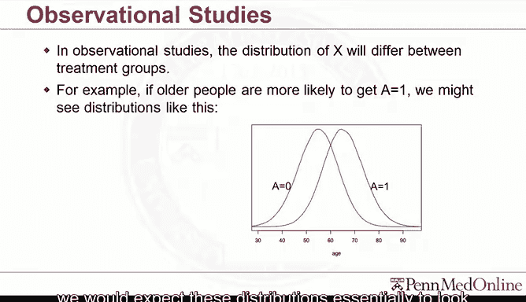

# 宾夕法尼亚大学《因果推断速成课程｜A Crash Course in Causality》中英字幕 - P17：17_03_01_观察性研究.zh_en - GPT中英字幕课程资源 - BV1Ft42137BF

Hi， this video was on observational studies。We're first going to。

Attempt to understand the difference between randomized trials and observational studies。

 and then we'll look at how matching， which is one method to control for confounding。

 attempts to make an observational study like a randomized trial。And then we're also going to。

Discuss some of the advantages of matching。So it's more of a big picture kind of setup。

We can just consider a simple dig like this。Which sort of the classic confounding setting where you have a set of variables X。

 and that affect both a and y。And therefore。Controlling for x would be sufficient to control for confounding。

 But just really， you can think of x as a set of variables that are sufficient to control for confounding。

 And this could be based on the disjunctive cause criterion or thebacterdopath criterion。

 So it couldn't come from a much more complicated da than this one here， were just simplifying。

 So just imagine in general， X is a set of variables that are sufficient to control for confounding。

 So you've already selected those。You've already selected the variables you want to control for and so our。

The key assumption here is the iorability assumption。

 And this is just a reminder that what this is saying is that our potential outcomes are independent of treatment assignment conditional on these covariates。

 So essentially， we're imagining that treatment is effectively randomized。

 given the set of confounders。So how do we deal with that in a randomized trial？

So we have this problem where in the real world。That。

Treatment assignment is partially determined by some variables X。

 and these variables X also affect the outcome。Well， in a randomized trial。

 the way that's dealt with is by actually randomizing treatment assignment。

So what that effectively does is that eraseses arrows from an arrow from x to a。So now。

 if you randomize treatment， right， So now X is not affecting A because you've randomized。

 So now there are no vectoror paths from A to Y。So that's what randomization tries to do is basically erase that arrow from x to a by manipulating a directly via randomization so you could think of it as a coin flip。

 for example。So what else happens with a randomized trial？Well。

 what this means is that the distribution of acts will end up being the same in both treatment groups。

 So we have some population of interest， which I'll depict with a circle。

And then from that population， we randomly select people to get treatment A equals 0。

Which is the grayish color。Circle， and then we also randomly select people to get a to get treatment a equal1。

 That's the bluish color circle。But because we've randomized。

The distribution of these covariates these x's。Will be the same。In the the two treatment groups。

 as it was in the original distribution。There's no reason that。

The distribution of x would be different in the cong group and in the treatment group。

Because we just randomly selected these subjects from the big population。

So the distribution of X should be the same in the two treatment groups。

And so this is one property of a randomized trial。 and this is a kind of property that we would like to make true。

 essentially in an observational study。So in a randomized trial。

 the distribution of pre treatmentrement variables。

 and I just I wanted to emphasize pre treatmentment variables because confounders are things that should be occurring before the treatment decision。

So that distribution of x。Are this should be the same in both treatment groups。

So we should have covariate balance in essence， so this is basically what we mean by balance is that the distribution of these covariates should be the same in the two treatment groups。

 so they should be balanced。So if the outcome ends up differing in these two treatment groups。

It won't be because the distribution of x differed between these treatmentman groups。

 We've already made sure that that's the same。In a randomized trial， we did that by randomizing。

And so therefore， we've really isolated the treatment effect。So x。

 these covariates is basically dealt with in the design phase。All right， so by design。

 through randomization， we're dealing with these confounders X。

 We're getting rid of them through randomization。So。

Then you might be wondering why not always randomized then。

 because that seems like a straightforward way to get rid of confounding。 Well。

 one issue is that randomized trials are expensive。For a number of reasons。

 they're much more expensive typically believe in observational studies， but you have to。

You have to have it re for ethics so there're。You also have to enroll people in the study。

 You have to follow them over some period of time。There's lots of protocols， lots of people involved。

 so it costs a lot of money。And sometimes randomizing treatment or exposure might be unethical。

 you know a classic example might be smoking， we want to know if smoking causes lung cancer。But。

It would be considered unethical to randomize people to smoke。And also。

 a lot of people will probably refuse to participate in a trial。 So we might ask people。

 do you want to be randomized to receive。An active treatment or placebo。

 And some people won't really want to be experimented on in that way。 So some or they just might not。

Want to be bothered because if you're in a trial， there's going to be follow up。

 You're going to be contacted。 Maybe people don't want to bother so。

The population that we'll end up being able to make inference about is kind of shrinking， right。

 It's shrinking in the sense that people who would refuse to participate in the trial when we can't make inference about。

 So it's a less general population。And they potentially take a lot of time。So you randomize people。

 and then you have to wait for outcomes。So maybe you're interested in the survival rate five years from now。

Or your。Whatever the outcome is， typically some period of time will have to pass before you can see it。

 and so you have to wait。In some cases， you might have to wait a long time。

And it could even be the case that by the time you get your outcome data back。

 the question might no longer be relevant。 Maybe you were interested in comparing drug A to drug B。

 You have to wait seven years for outcomes。 and maybe within that seven years。

 a new drug is available that's even better。So there's many reasons why you might want to do an observational study。

 sort of the sort of counter argumentsments to the previous slide。

So you can generally have more a broader population， you can get results much faster。And so on。

So we'll think about two different types of observational studies。

So there's sort of more of a classical kind of observational study。

 which is really a planned prospective observational study where the research investigators are doing active data collection。

So in this case， you would actually typically involveroll people in the observational study and maybe meet with them periodically every six months or every year to collect data from them。

So like trials， you would collect data on a common set of variables at plan times。

You would measure outcomes carefully， using set protocols。But unlike trials。

 regulations would be quite a bit weaker because you're not typically actively intervening。

 so you're not manipulating treatment， you're not randomizing people to treatment。

 you're just sort of observing what happens in reality。

And a broader population would typically be eligible for this kind of study。

If you're randomizing people with the treatment， there's a lot of rules about who you would have to exclude from a treatment。

Who you would have to exclude from the study， Whereas if you're just observing people。

 it's a much larger group that is eligible。So that's one type of study and those are actually have some of the drawbacks of randomized trials in the sense that they're still expensive and they could be slow to carry out because you have to wait for outcomes。

But they have some advantages over for randomized trials。Because you're not randomizing。

 you don't have to deal with the ethical issues。And things like that。

So another type of observational study， which is becoming more common， has to do with databases。

So some databases that exist for other purposes that we can use for research。 So these involve。

Retrospective data where there was passive data collection。 So passive meaning。

The research investigators aren't actively collecting data。

 Data are already being collected for some other reason。

 So an example of that would be electronic medical records。So。

Electronical medical records now are very common。 so if you go see your clinician。

 they record information about you。 there's a good chance of doing that electronically。

But the purpose of that is not for research。It's for the clinician to have as much information as possible to make treatment decisions。

However， those kinds of databases then can be used for research。

Another example would be administrative data like insurance claims。

There's registries like cancer registries。So advantages of these kinds of data are that you typically have large sample sizes。

Electronic medical records， for example， you might have data from everybody in some health system。

They can be quite inexpensive because the data already exists， so it's a matter of pulling the data。

And there's a potential for very rapid analysis because the data already exists。

 we might already have information on treatments， we might already have information on outcomes。

 It's a matter of pulling the data， analyzing it， so it should be much faster。However。

 the data are typically lower quality， there's no uniform standard on data on collection。

 so for example， if you have laboratory measurements。

The labs might might be actually different labs for different people in the study。With。

Different procedures and protocols and so on。al。And even things like taking blood pressure。

 there might be variability in how somebody actually goes about getting blood pressure measurements。

 so that could vary within clinic。Vary across clinics and so on。And it's。

Another aspect of this is that。Research investigators don't have control over when data are collected。

So there might be some people， when it comes to electronic medical records， for example。

 some people might have very frequent encounters with the health system。For example。

 somebody who's sick show up might see their physician very often whereas somebody who's in good shape and healthy might not show up very often at all。

 so some people will have a lot of data on and some people not as much。

So these are two sort of general types of observational studies that we could consider。But。

 of course， we're not randomizing treatment。 So that's。

 that's the big challenge with these kinds of data。 So in an observational study， typically。

 the distribution of these confounders， these variables that we are concerned about。

 will differ between the treatment groups。 As an example。

 imagine that older people are more likely to get。Treated。

And younger people are more likely to have the control treatment or no treatment。

 So I have a hypothetical graph below where you'll see that this is what it might look like where you'll notice the treated the distribution for the treated people。

 which is this blue curve。 In this case， there's more data to the right。

 So the peak tends to be maybe around mid to upper 60s， whereas the graph on the left。

 which is the untreated or the control population， they tend to be younger。

 where the peak of that curve is maybe in the mid 50s。 but you also see there's a lot of overlap。

 So there are older people who are treated and there are younger people who aren't treated。

 but in general， older people1 tend to get treatment a equal1。

 So again this is unlike a randomized trial where we would expect balance。

 we would expect these distributions essentially to look the same between the treated and untreated。

 So now we'll start to think about matching So matching is with matching。

 we're going to attempt to make the observational study more like a randomized trial。

 So the main ideas。

Will match individuals in the treatment group。 So a equal1 willll match them to people in the control group a equals0。

 but we'll match them on covariates x。 so we'll have a treated for each treated person we'll try to find a control person who has similar or the same values of X。

 So imagine in our example where older people are more likely to get treated a equal1。

 So then in an observational study there are actually at younger ages。

 there are more people with no treatment or control treatment a equals 0 at older ages。

 there are more people with a equal1 in a randomized trial on the other hand， for any age。

 there should be about the same number of treated and untreated people。 by matching。

 we'll try to accomplish the same thing where at any particular age。

 there should be about the same number of treated and controls。

 So what are some advantages of matching here we're basically doing the hard work of dealing with confounding at what you could think of as roughly the design phase。

 And what I mean by that is without looking at the outcome。I'll call that the design phase。

 So imagine that we have the outcome separately。 and we're not going to deal with it at all。

 What we'll do then is using matching。 we can control for confounding without using the that outcome just blinded to the outcome。

 So the hard work has to do with finding good matches。

 So we're going to match treated people to control people on these covariates X。

 and we're going to do that blinded to the outcome。

 So this is similar to randomizing in a trial where we're controlling for X without looking at the outcome in a randomized trial。

 the outcome doesn't yet exist。 In this case， in matching。

 the outcome exists but when we're going to be blinded to it， we're going to ignore it。

 Another advantage of matching over other methods for confoundunder control is it can reveal a lack of overlap in a covariate distribution。

 So there could be some treated people who are unlike any of the control people。

 So that would suggest that those treated people essentially had no chance of getting the control treatment。

That's very useful because we really would like to exclude them from the study。

We don't want to make inference about people who had no chance of getting the other treatment because that would involve extrapolation。

 We couldn't have any information about the effect of treatment on people who had no chance for the other treatment。

 And if you remember the positivity assumption， the positivity assumption has to do with。

For any set of covariates， there should be a nonzero probability of getting either treatment。

 So this revealing this lack of overlap could help you identify a positivity assumption violation。

 But then you can exclude those people from the study and have the positivity assumption met if you don't if you don't do matching。

 you might not notice this kind of lack of overlap。So now imagine we've already matched。

 once the data are matched， we basically then can treat it like a randomized trial。

 So we we should have balance in the covariate distribution between treated and controls。

 Now we can do an outcome analysis that could be relatively simple。

 just like in a randomized trial where because you've randomized， you can typically do very simple。

 you know， for example， comparing the mean of the outcome between the two groups。

 We should be able to do something very similar here。 So it feels a lot like a randomized trial。

