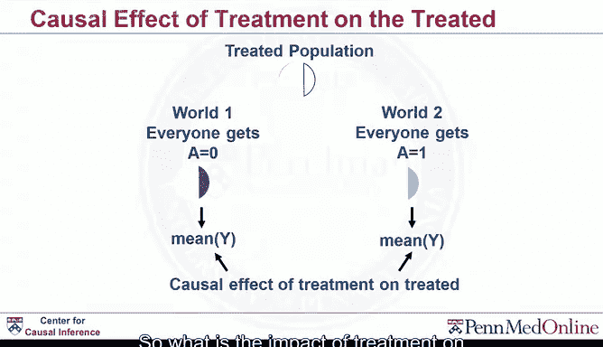

# 宾夕法尼亚大学《因果推断速成课程｜A Crash Course in Causality》中英字幕 - P18：18_03_02_匹配方法概述.zh_en - GPT中英字幕课程资源 - BV1Ft42137BF

Hi， this video will provide an overview of matching。

 The goals are to provide a better motivation for matching in general。

 So what is the motivation behind matching。We also want to understand what population is targeted。

And finally， we'll try to understand the subtle difference between stochastic balance and fine balance。

We'll begin by thinking about matching in terms of a single covariate。

So remember that the goal of matching is to match treated subjects and control subjects on their covariates。

 So on the set of covariates that we identified as sufficient to control for confounding。

In this case， we'll imagine that there's just one covariate。 And let's say it's hypertension。

So hypertensive patients will say we'll color with red。

And patients without hypertension will color in blue。 So the main idea here is that imagine that。

Hypertension， a hypertension diagnosis， partially。Determines what treatment somebody gets and also might be related to the outcome。

 So that's a variable we want to control for。And here's our imagine that we have this small population here where we have these treated subjects。

On one side， in the control subjects on the other。One thing you'll notice then is that there's imbalance on the covariate on hypertension。

So for treated subjects， it 67% are red。So 67% of control subjects have， I mean。

 of treated subjects have hypertension。Whereas for control subjects。

 it's the opposite kind of situation where the majority are blue。So for control subjects，20% are red。

 So only 20% have hypertension。 So there's big imbalance。On this covariate。

Whereas we call that for a randomized trial， we would expect the percentage of hypertensive patients to be the same or roughly the same for treated and controls。

But what we can do then is we can match each treated subject to a control subject。

So you'll notice here。 we just paired up。啊。A red treated subject with a red control subject。

Now we've matched a blue to a blue。A red to a red。Another red to or red。A blue to a blue。

And a red to a red。So， we found。6 matched pairs here。And we've just erased the rest of the controls。

So this is essentially what happens in matching is。You find the best matches you can。

 And then you get rid of the people who weren't matched。

And now you'll notice that we have perfect balance on this covariate。

 so in both the treated group and the control group， we have 67% red circles。

So this is not unlike what you would see in a randomized trial where you would have perfect balance on thevari or covariance。

But， of course， it's going to become much more complicated when you have many covariates。

 So in the previous slide。We had a single variable that we wanted to control for。

 and it was just a yes or no binary kind of variable。But if you have many covariates。

 some of which might be continuous， it gets much more complicated。And， in fact。

 we will probably not be able to exactly match on the full set of covariates。

 We almost certainly won't be able to。 They're going to be treated subjects who don't have any。

Conl subjects who are exactly like them in terms of the covariates。However， in randomized trials。

Treated subjects and control subjects won't be perfect matches， either。In a randomized trial。

 there might be for a given treated subject， there might not be a single control subject who would be a perfect match。

But the distribution of covariates will be balanced between the groups。In a randomized trial。

And we'll call that stochastic balance， that type of balance。So if we match closely on covariates。

 we'll be able to achieve the same kind of stochastic balance。

So it doesn't mean that we match exactly， but we'll have close matches。

And the distribution then of the covariage should be。Very similar in the two groups。

So here's an example where we have two covariates now。So it's just sex。

 which is just M&F for male and female and age， so age in years。

 and I'm just imagining in a simple case where we have two treated subjects。And then more controls。

 And typically， if you're going to do matching， you'll need one of the groups to be a lot bigger。

 So you have a lot of a lot to choose from to find a good match。 And most often。

 that's going to be the control group where there's more to choose from。So， first。If we。

 you could imagine。One way you could try to find a good match here。To this first treated subject。

Is by looking at men， the first treated subject as a male age 56。

 so in the control group we could try to find another male who's about the same age。

So you'll notice that there is a male that's age 55 in that group。

 And so we could select that as a match。So next we can look at。The next treated subject。

 which is a female age 47， and in fact， if you look at。All of the women in this。In the control group。

 we find one that's an exact amount。So what we're doing then is we're making the distribution of the covariates in the control population look like that in the treatment in the treated population。

And this is。Perhaps a subtle distinction。But and just going back to the slide。

 we started with the treatedy group and we tried to find people in the control group who are like them。

So ultimately what that's going to do is。Make the distribution of covariance in the control group look like that in the treated group。

So what will ultimately then estimate if we follow that kind of procedure is the causal effect of treatment on the treated。

So this is a figure that we've seen before where。If you start with the treated population。

So that's this little partial circle。 If you start with the treated of population and you were to then。

Consider two hypothetical worlds， one where。Everyone in this population。

Didn't get the treatment or got treatment A equals 0。

 And then it a separate world where the same people。We're actually given the treatment。And equal1。

 And then we took the mean of those。 That would be the causal effect of treatment on the treated。

 So this is in contrast to the average causal effect in the whole population。So often in matching。

 we focus on the causal effect of treatment on the treated。And。That would be the case， if you start。

With the treatment group and find matches for each treated person from the control population。

 because then you're making the control population have the same distribution as the treated population。

 So therefore， who we are making inference about is the treated population。

 you can do matching where you， where you try to make。The treated and control populations。

Not only look like each other， but look like the population as a whole。 So that involves。

Slightly more complicated。Techniques， but it can be done， but typically when people match。

 they focus on。Esimating the causal effect of treatment on the treated。

 So this is a  validiled causal effect。 But we're making inference about the population who actually received treatment。

 So what that's doing as a reminder is you take the population who were treated。

Were comparing their outcome to what their outcome would have been been had none of them received treatment。

 So what is the impact of treatment on those who actually receive treatment。

 So that is a causal effect on the population of people who receive treatment。 So as I mentioned。

 there are methods that can be used to target a different population。

 but we're not going to discuss that in this video。 So just remember that typically in matching。

 if you if you begin with the treated group and and then try to find controls that are good matches for them。

 you're essentially making inference about the。

The treated population。So you'reestimating the causal effect of treatment on the treated。

So there's also this concept called find balance。So the idea here is that sometimes we might not be able to find great matches。

So probably for a lot of subjects， we'll be able to find a very good match。

 but there might be somewhere we can。However， we might be able to tolerate。Some non ideal matches。

If we still end up with the same distribution， the same marginal distribution of covarias between treated and controls。

 And we'll call that fine balance。 So I'll get。To make it more clear。

 we'll look at this a particular example where we have two matches。So。The first match we have。

A treated subject。Who's a male age 40。 And they're matched to a control that's female。 That's age 45。

So you'll know this here。 It's not really a great match。We have a male matched to a female。

 so that's not ideal， and they're not the same age。So it's not a great match。Match 2。

 we have a treated female age 45 who's matched to a control male age 40。 So again。

 that's not a great match。So in that case， we don't have great stochastic balance。

But we actually have fine balance here， because。Now if you combine these two， these two matches。Now。

 the treated population is 50% male。The average age in the treated population is 42。5。

In the control population， it's 50% male， and the average age is 42。

 We have the same distribution of。And sex。And age in the two populations and the treated and control populations。

 even though these weren't great matches。 So this would be considered fine balance。

 So we've achieved fine balance in this case， even though the matches aren't great。

 So this is something we might be willing to tolerate。

So remember willing to tolerate non ideal matches if we still get fine balance。

So there's a lot of software that can impose fine balance kinds of constraints on matches。

 So it's always going to look for。The best pair pairwise kind of matches。

 but it will tolerate some bad matches as long as we get fine balance。 So this is something that。

In software， you could actually ask for。 You could tell it， I wantt find balance。

And it would use that kind of a constraint as it's trying to find matches。

 So another issue has to do with the number of matches。So so far I' focused on pair matching。

 which is one to one matching。So this is for each treated person。

 we'll find a match that's a control。 But we'll just find one match。

One matching control for each treated person。And then we discardoured anybody who wasn't matched。

But you could do many to one matching。So we could decide ahead of time， okay， we're going to match。

K controls to every treated subject。 For example， you could do 5 to one matching。

 So for every treated subject， we might find five good matches。So that's one option。

 Another option is variable matching， where sometimes we might match one。

 Sometimes we might match more than one。And that would depend on。How many good matches we can find。

 So you could say。You could specify that。 We'll always find at least one match。

 but we'll take more than one match for a given treated subject if we can find good matches。

So that would be a variable match。 Where will we allow the number of matches to vary。So。

We'll think about trade offs between these various approaches。 But in the big picture。

 one to one matching should result in better matches。

Because you're not trying to match as many control subjects to a given treated subject。

But you are discarding some data so you might lose some efficiency。

