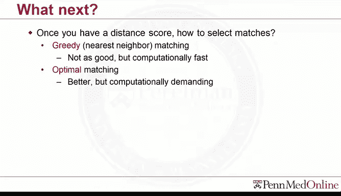

# 宾夕法尼亚大学《因果推断速成课程｜A Crash Course in Causality》中英字幕 - P19：19_03_03_直接基于混杂因素匹配.zh_en - GPT中英字幕课程资源 - BV1Ft42137BF

Hy， this video was on matching directly on confounders。

We're going to begin by understanding why a distance matrix is needed， and understand。

Options for distance matrices。And then we'll move on to discussions on how distance matrices could be used for matching Here。

 We'll begin to think about how to match。In order to find close matches。

Will need some metric of closeness。So we'll look at two of them。Mahaa Nos distance。

 which I'll just call M distance for short， and robust M distance。

And these are two distance measures that will look at how。Similar。

 two sets of covariates are from each other。As a reminder， we won't be able to match exactly。

Because we will typically have a lot of variables that we need to control for。

 and it's very likely that no treated person will have exactly the same set of variables or values of their variables as a control subject。

 So we'll look at these two different distance measures， which will look at how similar。

 it'll measure the degree to which these sets of variables are similar to each other。

So now we'll look at M distance and we'll begin with some notation。 So first。

X subscript J is just a vector of covariates for subject J。So J is a person in your data。

 subjectject J is a person in your data， so you could think of it as like one row in your data and。

X is some collection of covariate set you decided ahead of time， you needed to control for。

 So these are the set of variables that are sufficient to control for confounding。

 So just picture X as values of those variables。 So it could be age， sex， blood pressure and so on。

 So it's it's a set of values of those variables。 So then。The distance then。

Between subject I and subject J on their covariates will denote with D。So D of X I， X J just means。

That we're going to。 that's a function。 that's going to。As input you。

You submit the values of the covariance for subject I and subject J， and as output it。

 it'll give you a score， a single value， which is a distance。And so we can。

 we can look at this formula。 We'll try to break it down in some detail。 So first。

 the inner part here。This is just just a difference between the covariates。 So X I and X J。

 So remember， it's a vector of covariates。 So for each of the covariates， let's say， for example。

 blood pressure， we would take the difference。In blood pressure between subject I and subject J。

If the next variables age， we would take the difference in age between subject I and subject J and so on。

 We would run through the whole list。 So we would get， Then we would have a vector of differences。

The the tea here。That's just a transpose。 So that's just the transpose of a vector。

And then here we have the difference again。So in， in matrix and vector world， well， what if you have。

A vector transpose times another vector like this。What you're essentially doing is summing these squared differences。

 so you could roughly think of this as。Squaing the differences， and then adding them up。

But there's one additional complication is this part here， this S inverse。So， S。

That's just the covariance。Of x。So remember， x is a bunch of random variables。

 so x is a random vector。And those might those will have some covariance， so that of course。

 each of the x's has a variance， but they also might covariate together。

So S is just your standard kind of covariance matrix。 and we're inverting it。

So that's what S inverse is。So you could roughly think of that as just。嗯。

It's just as a scaling kind of thing where we're。Scaling by the unit of measure。

And the reason we want to do that is because we have different kinds of variables here。

A one unit in difference in age。Will probably mean a lot will mean something a lot different than a one unit difference。

In like diabetes status， where diabetes is a 01 variable。 So， for example。If， if you compare。

Somebody age 67 to somebody age 68， their age differs by one year if you compare somebody who has diabetes versus who doesn't。

That variable differs by one。But we don't necessarily think those are the same thing and differing by one unit of age probably isn't if it's years。

 it's probably not very significant， whereas differing on diabetes status probably is。

So what this SNverse is going to do is scale things。You could。

You could roughly think of this as if you had one variable。

 what we would do is we would take the difference， let's say it's age。

 you would take the difference in age， square it， divide by the variance。

 and then take the square root。So what we're really doing then is just scaling。

 we're scaling each variable。Essentially sort of by its variance and that's basically then putting all of these different variables on the same kind of scale so that hopefully once we rescale。

 a difference in one on one variable means something similar to a difference in one on another variable。

So that's the main idea here。 So that's what the formula is。

 You could roughly think of it as a sum of squared。Differences that are scaled。

 and then we take the square root。But the details maybe aren't quite as important as just the big picture is。

啊。If these collection of variables differ by a lot， the distance value will be bigger。

 if they don't differ by very much， this distance measurably small。 And so we can get。

 we'll get this value of D for any pair of subjects。In particular， we're going to get it。

For a given treated subject come compared with all the different controls。

So we'll have a list of distances， and then we can use that to help us find good matches。

 So we can walk through an example here。Where imagine that we just have three covariates。

 So we have age。COPD， which is just equal to one equals E0 equals no。

 so that's chronic obstructive pulmonary disorder， COPD。

 and then female which equals one if yes zero equals no。

Imagine now we have this treated subject on the left。

And we want to find a match for them in the controls。

 And imagine there's like  six controls available just for simplicity。 Okay。

 so this person is age 78。17。They don't have COPD， and they're female。 So as a candidate match。

 we could look at this first person。So this person is fairly close in age of 70。25。But they。

 they have CO， P， Where the treated person didn't。 And their male， wears the treated person's female。

 So this is not really a great match overall。 They differ on COPD and sex。

 And you'll see the distance。 If you use that formula on the previous page。

 we would end up with a distance of a little over 4。 Here's here's a different person。 This person。

 they actually match on COPD and sex。But they differ on age by a lot。

 So this is this is an 18 year old compared to a 78 year old。 So they're not a good match。

 And you see that reflected in the distance。 The distance there is 3。6。

 So that wouldn't be a good match。Whereas this person， you'll see that they agree on COPD and sex。

 And on age， they don't differ by very much。 So it's a 75 year old compared to a 78 year old。

 So it's a close match。 And out of out of this list， you would probably say， okay。

 this is the best match。 The distance between their sets of covariates is the smallest。

And we would probably be pretty happy with this particular。 So that distance， you can actually。

 you can， you can use a formula on the previous page。

 You can calculate it pretty easily with software， such as our。😊，So now we'll look at an alternative。

 which is this robust version of a distance。And the motivation here is that has to do with outliers。

 So outliers could create a great distance between subjects。

 even if their covi rates are otherwise similar。 So imagine。

2 treated subjects on a control subject to maybe all of their covariates are very close。

 But maybe this control subject has one。Really extreme value of one of the covariates。

 unusually large value， for example。 Well， then the distance would be very large here。

 even though they seem like otherwise theyre a good match。 So an outlier can， you know， create。

Create a great distance maybe greater than we would want to so an alternative is to use ranks so it's like robust statistics。

 like classical kind of robust statistics where instead of using the original values you use ranks。

You can do the same kind of thing here， where we could replace。Just for the purpose of matching。

 we could replace all of our variables with their ranks。If we looked at age， for example。We would。

 we would。You would ask yourself whatever software you use you would ask it to rank the age variable so a person who was the youngest in that data set might get a rank of one if you had 100 people in your data then the person who was the oldest would maybe get a rank of 100 and so on。

 so you would replace the original values with ranks。And this should help with。The issue of outliers。

 So now the difference between the largest and second largest value would would be just a difference of one in the in the ranks。

 whereas it in。If you cut the original values， it could be very extreme difference between the first。

 the largest and the second largest。So that's the basic idea is that if you want to use this robust distance measure。

You could replace it， place the original values with ranks， and then apply the same kind of distance。

Measure to it。So that's the big picture idea is you you replace them with the ranks。

 And then there's a subtle thing having to do with the。The diagonal of the covariance matrix。

 Remember we take we have that S inverse。Well， if you're going to use a ranks and typically you'd want the diagonal of the covariance matrix to be a constant。

 and that's because now ranks should all be on the same scale now。

So you really don't want to weight one variable more than others in that sense。 So again。

 there's statistical software that could just automatically do this for you。But that's the main idea。

 And so then you could use this distance matrix on the ranks。

So those were just two distance matrices that you could use or distance metrics and hopefully you know it's very clear why we need distance right。

 we need distance because we need to figure out like what does close mean when we're trying to find a matchsh we want to know well。

You know how similar are these covariates？So you could use either of the two measures that I just talked about。

 there's other things you can do as well。So one of the nice things about matching is you can you can do some kind of clever things to。

Get exact matches on some variables and be more willing to tolerate inex matches on others。

So if you want an exact match on a few important covariates。

 what you could do with then is you could just essentially set the distance to infinity if they're not。

If they don't match on those variables。So， you could。Apply the M distance kind of formula。

 but then you could take an additional step says which says， oh， if on these important variables。

They're not an exact match。Replace the original distance with infinity。

 essentially to make it impossible for them to match。

So sometimes there's going to be a couple of covariates that you think are the most critical。

 the biggest confounders。And you exact you might want to do exact matching on those and then tolerate inex matching but good matching on others。

 so that's one thing you could do。There's also a common approaches to use a propensity score and then do a distance match on the propensity score。

 So this is a topic。For another video。But I just wanted to raise awareness of it here。

So where are we going from here？ So we figured out that。

We need we need to be a calculated distance between sets of covariates on different subjects。

But then once you have that， how do you actually select matches？

So we'll look at a couple of algorithms， and these aren't the only ones。

 but these are probably the most popular。 So we'll look at greedy matching。

 which is also known as nearest neighbor。And this has the advantage of being very computationally fast。

 so this you can apply to large data sets without a problem typically。

Then there's optimal matching which should be better， but it's very computationally demanding。

 and so you might have more trouble with this on large data sets。

