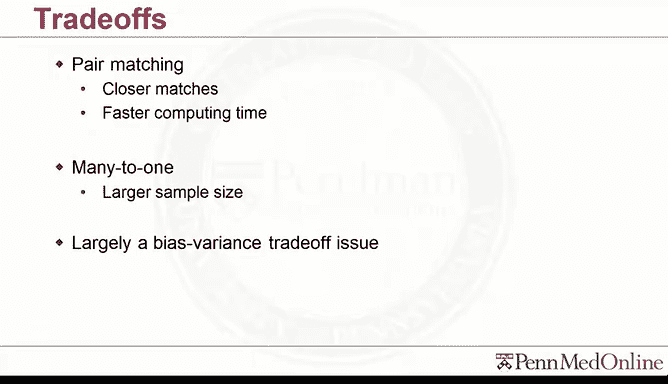

# 宾夕法尼亚大学《因果推断速成课程｜A Crash Course in Causality》中英字幕 - P20：20_03_04_贪婪最近邻匹配.zh_en - GPT中英字幕课程资源 - BV1Ft42137BF

Hi， in this video， we'll talk about greedy or nearest neighbor matching。

And our goals are to understand what greedy matching is and how the algorithm works。

Will discuss advantages and disadvantages。Of greeting matching。

 we'll also look at many to one matching versus pair matching and discuss trade offs with the two approaches。

And finally， we'll introduce the idea of calipers。So just to begin as a setup here， again。

 we're going to imagine that。You've already identified a set of variables that are sufficient to control for confounding。

 Again， these are pre treatmentreatment covariates， and we。In these variables。

 we believe will satisfy the iorability assumption。And we've calculated a distance。

 which we'll call here D I J。Between each treated subject and every control subject。

 So here you could。Think of subject I as being a treated subject。

 and that subject J is being one of the control subjects。 We would have a distance between them。

 meaning between their covariates。 But we would also。

 we would have a distance then between that same treated subject in every control subject。

 So for a given treated subject， imagine we have a distance score with it and every other and every control subject。

So imagine we've already done that。 We've already accomplished that。 We have our distance measure。

And we've already selected our covariance。And now。For this part of the talk， we'll imagine that。

We have more controls than treated subjects and hopefully many more controls and treated subjects。

 we want to have a big pool of subjects to choose from for matching， and this is often the case。

 but it doesn't have to be the case and you could potentially still do matching。

 but ideally you have a lot more controls in treated subjects and that gives you a lot of options in terms of selecting matches so for now we'll just assume that's the case。

We're also going to focus on pair matching for now， which is also known as one to one matching。

So now we'll introduce greedy matching。And so the here。

 the ingredient matching is really relatively straightforward。

 And so we'll just kind of walk through the steps here on how you would actually。

 if you were going to。Program this yourself。 What would you actually do， So the first thing。

woWould be to just randomly order your list of treated subjects and control subjects。

 you wouldn't actually have to do this necessarily， but it's probably good practice。Could be that。

Maybe you've already sorted your data in some way。 and you would you really don't want it sorted。

 You would rather have it randomly sorted。 So you might as well just。Random，ly order your data set。

So we want this。To have the treated subjects kind of in some kind of random order。Especially。

So you could do that first。Then what we'll do is we'll go to the top of that list。 So now we。

 we have a list of treated subjects。Willll go right to the top of that list。

And then what we'll do is we'll match it to the control that has the smallest distance。

 So we already have our distances。 So we'll look through the whole list of distances and we'll just find the one that's the smallest distance。

 Okay， And so this is， this is the greedy step。 You're not sort of。

You're just sort of going for whatevers the best without sort of thinking about a bigger picture。

 So you you're just grabbing whatever seems to be the best match。So that that's the， that's。

Basically why it's considered greedy is your。You're always going to basically take whatever the best match is。

Once you have a match， then you'll remove that control from the list of available matches。

Then youll move on to the next treated subject。And then you'll again。

 you'll find a control that has the smallest distance with that。Treated subject。

And then you'll just keep repeating these steps until you've matched all treated subjects。

 So you just go， you'll go one at a time。Finding the control that has the smallest distance with that treated subject。

Then you'll remove their control from the set of possible matches for the next person and can continue on like that。

So I think this is a really sort of straightforward and intuitive kind of algorithm and。

Then therefore， it should be pretty easy to implement and practice。So as an example。

Let's imagine we have just two treated subjects and six controls。

And we're going to try to find we're going to use the greedy algorithm to try to find matches for these two treated subjects。

 And again， we just have we'll have three variables， age， CO，PD and female。

So let's find the first match。 So here's。The first person has is 78 years old。

 they don't have COPD and they're female。And you'll see that we've calculated the distance between these between。

This treated subjects covariates， and then， in each available controls covariates。

And so you see that distance on the far right。And we found a match。

 So the match is the one with the smallest distance。

 So we're just going to match this treated subject up with this control。And you'll see that。You know。

 they agree on COPD， they're both female and they're pretty similar in age 78 versus 75。

 so now that I found a match。I'll start creating my match data set。So， I have。

You'll notice on the far left there I have what I'm calling match underscore ID。

 so you can name it whatever you want， but you need some kind of identifying variable to identify a matched pair。

So， this。I'm going to I'm going to call this match I 1 for this first set。

And then I also have a variable that I call treated， so treated can either equal yes or no1 or0。

 So here's treated。So one equals yes。 So one means you're treated，0 equals control。And you。

 if you recall from the previous slide， the treated person was 78 years old。

Didn't have so COPD and was female， and you'll see those values here。And then that was。

 they were matched。To a person who was untreated。 So this is a control。They were age 75。

 we can see from the previous slide， they were age 75。They didn't have CPD and their female。

 And you'll notice they have the same match I D。So this is the match idea is what's going to tell us that this is a match pair。

 these we want to link these two together。So we found， we found a match pair， and then we。

Are basically now adding them to our data。 And we're using an I identifying variable to let us know that。

 yes， these two are linked together。So next， we're going to find a match for the second treated subject。

 So this。This person is。About 68 years old don't have COPD in their male。

 So female equals 0 means they're male。So again， we've already calculated a distance between that subject and all of the available controls。

But you'll notice we're crossing out that second control there， that person's already been matched。

 so that person is not a candidate to be matched with the second treated subject。

And we find a match here。 So the smallest distance here is 0。78。If you look at it。

 you'll notice that。The treated subject and the control subject here that we matched。

 They're both male。 Neither has COPD。And age wise， they differ by a fair amount。

 but it's the best we could do so。One's 55 years old， the other's about 68 years old。

So they're as close as we could get in age， but this was our best match， and of course。

 because we only have six available controls， we're probably not。Going to get great matches。

 But this is just a simple example to illustrate the main ideas。 So again， we were greedy。

 We just went for the best match。That we could find。And now we can add that to our data set。

 So you'll notice here that。The key here is that。I have a new match ID， which is to。

 this is the second match。So I want to make sure to link these two subjects to each other。

 so they're paired up by this match ID。You know， one is treated。And one is not。

 And we saw from the previous slide。 one's about 68 years old and one's about 55 years old and so on。

 So you would just continue in this way until you have a big data set full of matched pairs。

So in this particular example， I only had two treated subjects， but in practice。

 you might have thousands and you would create a big data set。So greedy matching in general，s。

 it's intuitive。 it's easy to explain。 I just explained。

Exactly how you would carry out the algorithm if you wanted to code it yourself。

It didn't take very long to explain。It's computationally very fast because it just involves a very simple series of steps。

 Imagine we've already calculated， we already have these distances。

 So then we just go one by one through this。The treaty group。 And just。

Then find the minimum distance and line them up。 So any software should be able to do that very quickly。

 So even if you have a very large data set， this isn't very computationally demanding。

There are packages that can do it， for example， there's one called matchup。It's。

It's not invariant to the initial order of the list so in other words。

 the order of the list actually does matter。So I said let's initially randomize the order of the list。

 But whatever order that list happened to be that it does matter。

 You're not going to get the exact same matches if you if the list was ordered differently。

 And that's actually I would consider that a drawback of this approach。

 It would be nice if it wasn't dependent at all on。On randomization， on how you randomized the list。

嗯。More importantly， it's not optimal。And really what I mean by that is globally optimal。

So always taking the smallest distance。For each mesh does not necessarily minimize the total distance。

 So let's imagine that。By total distance， I mean， let's say we add all the distances up of all the match pairs。

What we might consider optimal would be something that minimized that total distance and greeting matching is not guaranteed to do that。

And it even could lead to some bad matches as a result。Now let's imagine instead of pair matching。

 let's say we want to do many to one matching， well you could actually use this greedy algorithm to do many to one matching as an example suppose we wanted K to one matching where K is some integer greater than1。

 so for example， we might want three to one matching。

What you would do then you would proceed with the algorithm just as before。

So you would find one match for everybody。 would go through the whole list。

But then what you would do is once you got to the end of the list。

 you would cycle back up to the first person again。You would find a match for them。

 That would end up being their second match。And you would go through and find a second match for every single person。

And you would keep doing that until you had K matches for each person。So。

 you would still use the same kind of greedy algorithm。

 You would just cycle through the list multiple times。

So there are trade offs between pair matching and many to one matching。 So with pair matching。

you'll find closer matches in general。Because you're finding the best match you can。

For for a treated subject with the control。If you want to find multiple matches for a treated subject and controls。

 you're guaranteed that some of the matches aren't going to be as good because you're trying to match more people essentially。

 so you're going to have to accept some matches that aren't as good。And para matching is also。

 of course， it would have faster computing time because you're。

You're just matching a single treated subject to a single control subject。

 as opposed to a single treated subject to many controls。 So it should be faster。

An advantage of many to one matching and probably the only advantage is you get a larger sample size。

So with pair matching， the second you have， you found a match for everybody。

 then you discard all the rest of the controls and you won't use them。In many to one matching。

 you are going to end up using more of the controls。 So we have a larger sample size。

 which should mean more efficient。Estimates of of， say， causal effects。However。

 there are a couple caveats there。 So one is that。Even though you gain sample size。

 the gain isn't perhaps as much as you might think。If you were to add。A new pair， you know。

 if you were add if you would add a new treated subject to your data set。

That would be more of an efficiency gain than if you just add another control to a match set。

So essentially， the efficiency gained by adding additional controls in a match set as not as much as there would be if you were actually adding new treated subjects that you could find matches for。

So there is some power gain， some efficiency gain， but it's not very large。

But essentially this comes down to a bias variance for off issue， so para matching。

 there should be less bias because the matching is closer。

But it also should be less efficient because you're discarding data。

So the many to one matching should lead to a little more bias but smaller variance。

 and so you have to think about that kind of a trade off。

 Are you willing to tolerate some bias for more efficiency or not。

The next thing I want to mention was this idea of a caliber。And so。

You could imagine that There might be some treated subjects for which they're really。

Aren't even reasonably good matches in the controls。

 There might only be bad matches like where the distance is kind of big。

So we might want to not allow that Okay so you can use a caliper for that where a caliper would be the maximum acceptable distance。

So the main idea would be we would go through this reading matching algorithm。

One treated subject at a time， finding the best match。 But now we would say。

 only accept that best match。 if it's within the caliper。

 So if the best match has a distance that's greater than the cap caliper。

 then we just won't match anybody to that treated subject。 We'll get rid of that treated subject。

 We'll say there was nobody in the control group。 That was a good match for them。So， you could。

So you would pick a value for the caliper， the maximum distance you're willing to tolerate。

Then you could go through this greedy algorithm in the same way。

 but it would exclude any matches that were not within your tolerance limit。And this。

Gets back the also gets back to this positivity assumption where the positivity assumption says that the probability for each treatment for a given set of x's should be nonzero。

 so given for given values of x。There should be some probability that's not0 of getting either treatment。

But if there's nobody that's a good match for a given treated subject。 and in fact。

 if there's only bad matches， that kind of suggests that。

This treated subject really didn't have much of a chance of being a control subject because there's nobody like them in the control group。

So caliper matching will help make this positivity assumption more plausible。

A drawback is the population becomes a little bit harder to define。

 so you start with this original population， you know， let's say which is all treated subjects。

But now we're saying okay， it's all treated subjects except for those for which there's no match available。

 so that's a little harder to。To define to one of your collaborators， for example， nevertheless。

 it's。It's probably a useful idea to use a caliper and not accept matches at are。Really bad。

But there are tradeoffs between the two。