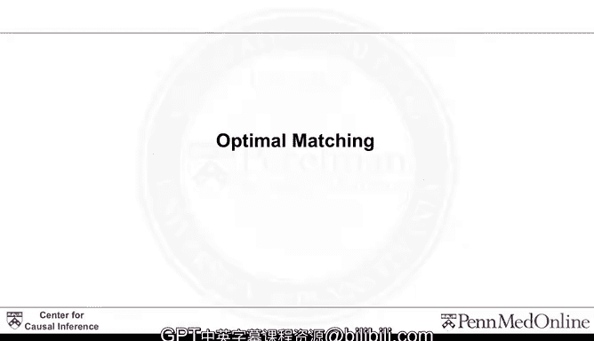
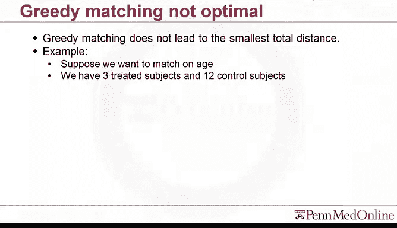
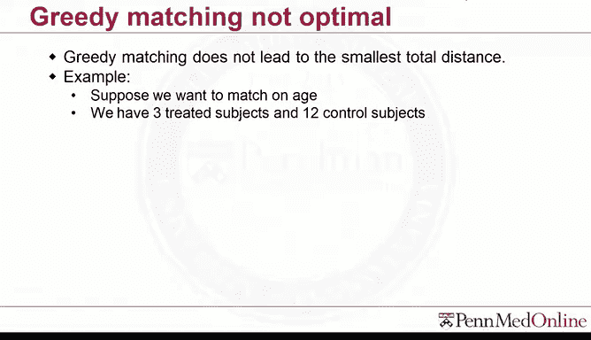
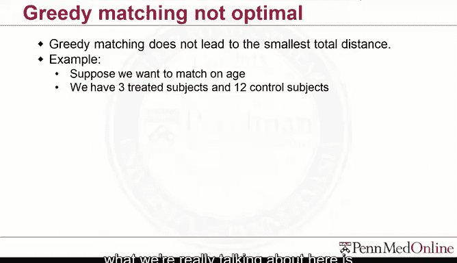
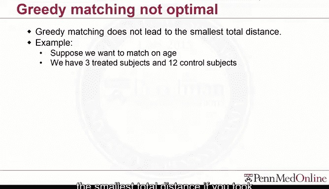
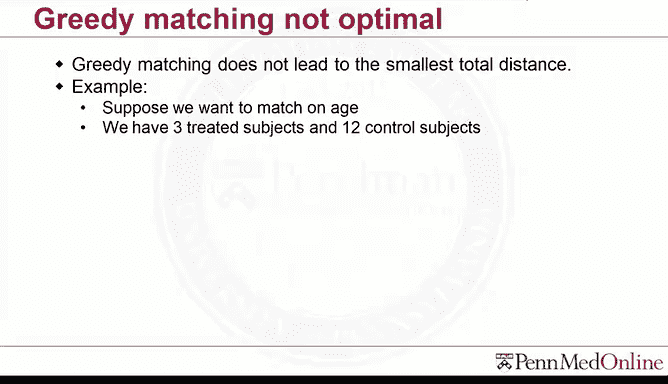
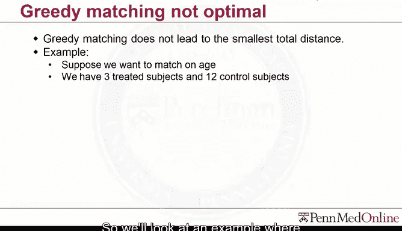
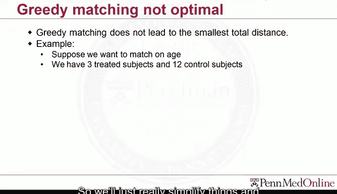
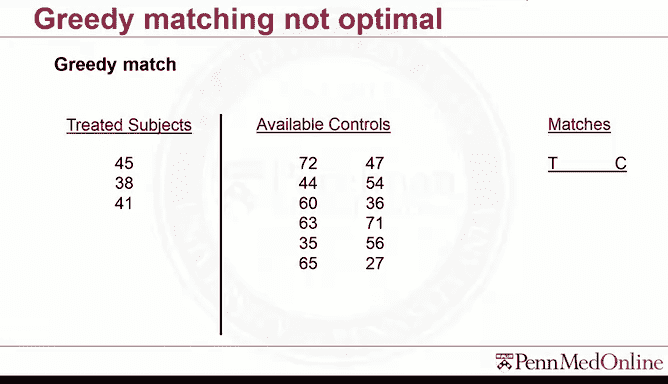

# 宾夕法尼亚大学《因果推断速成课程｜A Crash Course in Causality》中英字幕 - P21：21_03_05_最优匹配.zh_en - GPT中英字幕课程资源 - BV1Ft42137BF

Hi， this video is on optimal matching。 We're going to begin with an example that illustrates why greedy matching is not optimal。

 and then we'll discuss what optimal matching actually is。

So we'll begin to think about why greeting matching is not optimal。 And remember by optimal。

 what we're really talking about here is in terms of a global distance measure。 So， for example。

 optimal would mean the smallest total distance。 If you took the distance of all match pairs and added them up。

 Ially， that would be the smallest possible。 And we'll call that globally optimal。

 And greeting matching is not globally optimal。 So we'll look at an example where suppose we want to match on age。

 So we'll just really simplify things and say there's one confounder， its age。

 And now we'll imagine that we have three treated subjects in 12 control subjects。

 So here's our treated subjects here that in their ages。 So we have three treated subjects。

 their ages are 45，38 and 41。 And then we have available controls。

 And these are just the ages of the controls。 and you'll see that there's 12 different ages there。

And what I'm going to do is。Use the greedy algorithm and match them one at a time。

 And so we have treated subjects and control subjects over here。 And， as I find matches。

 I'm just going to put them over in that right hand column。 So we'll begin here。

And so the first subject is 45 years old， and the best match for them was a control subject that's 44 years old。

So I placed that over here。So we have。 we matched a treated subject to a control subject。

 The first treated subject was 45。 The best match， meaning the smallest distance in age was a 44 year old。

 So next， we'll look at the second treated subject， which is a 38 year old。

I put a I crossed off the 44 year old because they're no longer available to be matched。

And we find that a 36 year old is the best match， meaning。We're being greedy here。

 So we're just going to。Find the person who。Whose age is the closest to the treated subject in absolute value。

 So now we've matched a 38 year old with a 36 year old。

 And we also crossed off the 36 year old from the list。

 That person is no longer available to be matched to a treated subject。So next。

 we'll move to the 41 year old。 The 41 year old， we could actually either match to a 47 year old。

 which is what I did here。But they also could be matched to the。35 year old。

 and the distance would be the same。 So I just， I just picked one of them。 But in either case。

 the distance is 6。 And now we could add up the just the absolute distance here。And you'll see that。

The first match pair has a distance of one。 The second match pair has a distance of two。

The third match pair has a distance of 6， and so we have a total distance of 9。

 So overall the ages between treated and controls differ by 9。 So that's with greedy matching。

But you could actually find a better overall set of matches， so here I list a better set of matches。

So。Rather than using the greedy greedy matching algorithm。

 I just selected a set of matches that are better。So again。

 we have treated subjects over here and the treated subjects are 45， 38， and 41。And I matched。

This control with the first treated subject。This control with the second treated subject。

And this control with a third treated subject。 And we'll see if you add up those distances。

We have a different， a difference of two for the first pair。

 a difference of two for the second pair and a difference of three for the third pair。

 So the total distance here is 7。Whereas if we go back， the total distance， there was 9。

 So we have a smaller total distance here。 So you'll， So this just illustrates that。

With the greedy algorithm， by always。啊。Taking whatever the smallest distance is。

You're not I't thinking about the big picture。 There might be times when you want to save。A match。

For a later subject。And except a slightly less good match now。But the greedy matching。

 you're never looking ahead。 you're not thinking about the big picture。

 You're just always grabbing the best match。And so you're not necessarily going to be optimal in terms of this global kind of distance。

So this is just illustrating the main idea that greeting matching is not necessarily optimal and usually will not be。

 in fact， in terms of。Minimizing a total distance。 So what does optimal matching do， Well。

 Op matching is going to。Minimize the global distance。So global meaning the total distance。

 So you could imagine the the big picture would be like。

 let's say Ive considered all possible matches between。Treated subjects and controls。

 So imagine that I。I matched。 I did every possible combination， and I calculated the global。

 the total distance。And then I chose a set of matches that had the smallest total distance。Well。

 that would involve a lot of computation。 So it's something that could be done。

 But if you have a big data set， that would involve a lot of calculation。So it's a difficult problem。

It can be solved using basically a network flow optimization approach。

Details of which are way beyond this course， but essentially it's。

It's a difficult optimization problem， but one that people have solved。

 but even though people have solved it or figured out how to do it。

 it's still computationally demanding。So in general。

 optimal matching is if you have a small data set， it's very feasible on a big data set。You know。

 it might。The computational burden might become too much。But the。

The big picture idea is is optimal matching is going to minimize this global distance。

And there are packages that can do this， such as。Opt to match in R C balance。 Okay。

 so is it computationally feasible as a question， So is optimal matching computationally feasible。

 Well， it really depends on the size of the problem。

 And what we mean by size typically here would be the number of possible treatment control pairings。

 As an example， if you had 100 treated subjects and 1000 controls。

 Theres there's 100000 possible pairings。And， in fact， that would actually be the kind of。

The size of a problem that this could actually solve in a reasonable amount of time。In in fact， you。

Your computer probably could handle even a million treatment control pairings。

 but it will take a while if。Once you get into thousands of subjects and possibly you know a million treatment controlled parents。

Your computer might be working for a long time， but it is typically feasible to have about that many。

 but once you got to something like a billion pair， let's say 10，000 treated patients and 100。

000 control subjects。It's， it's likely that you're not going to be able to。系。Use optimal matching。

Your computer might be running for a month or longer。 you know， so it's not really feasible。

 So this is something to be aware of that， even though optimal matching should be better than greedy matching。

 there's sometimes when optimal matching just isn't going to be feasible。

There is something you can do about it， though， and there are different methods that can make optimal matching。

More feasible。 And if this wouldn't really be full global optimal matching。

 but sort of some kind of compromise。 So you could play some kind of constraints。

You can impose constraints to make optimal matching feasible。 So， for example。Imagine there。

We might want to match within hospitals in a multis clinical study。

 so maybe we have a study that has several hospitals and then patients within hospital。Rather than。

Do an optimal matching on the entire dataset set all at once。

 You could do optimal matching within hospitals。 So the idea would be that you'll only accept match pairs。

So matchs treated to control pairs within a given hospital。So within a hospital。

 you're doing optimal matching。 Well， this has greatly reduced the size of the problem。

You know let's say there's 10 hospitals all of equal size。You know， if you're。

You would basically be reducing the size of the optimization problem by a10。

You'll be dividing by 10 essentially， so it might become feasible。

So this would be you could think of these as blocks， you might want to match within blocks。

Another example might be matching within primary disease category。 So primary disease category。

 you know what might be if somebody goes to the hospital， what their primary diagnosis code is。

 you know。so， they could have。Heart failure， they could have COPD and so on。

 and so you might want to match。Treated and control subjects within primary disease category。

 and that would be an example of a block and if you。

You potentially then can optimize within these blocks and have something that's computationally feasible。

 So this is also known as sparse matching。And you can do this in the R package RC balance。

 and you can also with this kind of approach in this software package in particular。

 you can also tell it to tolerate some mismatches as long as find balance is achieved so we've discussed fine balance a little before。

 but just as a reminder you might be willing to accept。Matches that aren't perfect。

 Maybe you're matching a male to a female。As long as the overall distribution of sex， for example。

 is the same in the treated and control groups。So there's a number of different ways that you can make these matching problems a little more feasible。

 where maybe you're optimizing given constraints and so on。There's software that can that is。

That sort of makes all of these things feasible where you can really tailor what you want in a particular study。

Using the software。And it's。Relatively straightforward and computationally feasible。

