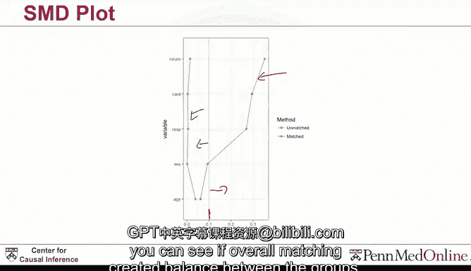

# 宾夕法尼亚大学《因果推断速成课程｜A Crash Course in Causality》中英字幕 - P22：22_03_06_平衡性评估.zh_en - GPT中英字幕课程资源 - BV1Ft42137BF

Hi， this video is on assessing balance。The main goal is to understand how to check covariate balance after matching。

 so we'll assume you've already matched and now you want to determine whether matching was successful。

 so in order to determine whether matching was successful。

 one thing we can do is we can check covariate balance。So remember， in a randomized trial。

 the covariates would automatically be balanced just due to randomization。

And one of the goals of matching was to create a similar kind of situation where we'll achieve balance after we match。

 So to assess whether balance has been achieved， we can look at a couple of things。 So one is。

Something known as standardized differences。And so that has to do with whether the means are similar between the two groups。

And you can do this and you should do this without looking at the outcome so at this point we're still at the stage where we're not looking at our outcome yet。

 we carried out matching and now we want to see whether matching worked and if matching didn't seem to work well we could go back to the first stage and think about how to match。

More effectively。And so in a lot of cases， what we'll do is we'll start by looking at at a table one。

 essentially， so a table that looks at pre matching versus post matching balance。

Alternatively as opposed to looking at standardized differences。

 you could also carry out hypothesis tests so you could test whether the means in the two groups are the same after matching so for example。

 you could use two sample T tests for continuous covariates or chi square tests for。

Discrete covariates。 you could report P values for those tests。

 And the main drawback with that approach is that the P values are dependent on sample size。

So if you have a large study， there's a very good chance you're going to have。

Some of the covariates will be significantly different in the sense of having a small P value。

 but the actual difference in the means might be very small。In a lot of cases。

 people have large data sets， and so we don't necessarily want something that's an assessment of balance that's so dependent on sample size。

And in particular， because we probably don't care about very small differences。

 a P value might not be the best way to do that， so typically people prefer to use standardized differences。

So here's what a standardized difference is， what you'll essentially do is for each covariate。

Say a given covariate x， will'll just take the sample mean in both groups。

 so sample mean in the treatment group。Which I'm denoting。With。です。Here。

 so that's the sample meaning of the treatment group so that's you've stratified。

 you just look at at the matched pairs on the treated side and you take their average value of their particular covariate that you're interested in。

You do the same thing with the control。 So you're just taking sample averages， taking a difference。

 But then we want， we want to scale that。And so what we'll do then is we'll just take a pooled standard deviation。

S square treatment。That is just the sample variance in the treatment group for that covariate S squared control is's just the sample variance in the control arm we're just dividing by two because we're averaging it so we've just taking basically the average variance between the two groups and then taking the square root to essentially get a pooled standard deviation and so SMMD stands for standardized mean difference。

And basically， what we have is a difference in means in standard deviation units。

So an SMD of one would mean that there's a one standard deviation difference in means which will be a large difference。

 so it's always going to be relative to the standard deviation and again the reason for that is because if we change scales we don't want the standardized mean difference to change so if you go from recording age in years to age in days the standardized mean difference will not change and that's how we would want it so it shouldn't be sensitive to changes of scale。

And so a key feature of the standardized difference is that it's not directly dependent on sample size。

 if you look at the formula here， you'll see that。ThereThere's no sample size in there。

 so there's no n。 if you think of n as a sample size， for example。It doesn't appear in there。

So it's not dependent on sample size and the way a P value would be and often people report the absolute value of the standardized difference。

 So you'll notice here this could either be a positive or negative value because we're just taking in the numerator we have a difference in means and that could either be positive or negative so a lot of times people actually take the absolute value。

Of the whole thing。And would then we would do this for every variable that we matched on。

 so one at a time we'll go through and we'll calculate a standardize difference。

And then there's some rules of thumb that are commonly used。

 so a standardized mean difference of less than0。1 in absolute value would typically indicate adequate balance。

 so if you have a randomized trial， for example， when you calculate a standardized difference between groups on each covariate。

 typically they'll all be less than0。1。Vals between 0。1 and。2 are considered。

not balanced to necessarily but small enough where maybe you're not very worried about it so even if you do a good job of matching a lot of times there'll be a couple of covariates that are between 0。

1 and 0。2 in terms of standardized difference and usually people don't worry a lot about that but values greater than 0。

2 are considered serious imbalance。So now we'll look at how you could construct。

Or what a table one would look like。T one is kind of a generic term because it's a kind of table that often appears first in a manuscript。

 so it's just a generic name for this kind of a table。So next， I'll show an example of a table1。

 So table one is is just a generic term for the kind of table that often appears in a manuscript as the first table。

 But it's it's just a summary of。Summary statistics of the main variables involved in the analysis。

 and if you're carrying out a matched analysis or if you're comparing treatments。

 typically you'll stratify the table on the treatment groups。

 So here's an example of data from the right heart catheterization study where。

Right heart catheterization is a treatment or R，HC。So here we'll see。RHC is the treatment group。

And no RHC is a control group。And you'll see that in this table。

 there's a few thousand people in each group。So we begin with just the sample size。

And it says how many subjects are in each group？Then the first variable that we see is age here。

And so this is showing then the mean and standard deviation of age in the two groups。

 so this is unmatched， you just stratify on treatment group and then calculate a mean and standard deviation。

For each of those， so we see that。The average age in the two groups is roughly 61。

 They're very similar， and the standardized mean difference is 0。06。The second variable is sex。

 so percent male， and then we have a few other variables that have to do with medical diagnoses。

I'm only showing a few variables just for illustration in practice that would typically be。

Dozens of variables that you would include in a table one。 So this is just for illustration。

 but you can see here for this neuro covariate。The prevalence is 16。2% in the control group versus 5。

4% in the treatment group with a standardized mean difference of 0。35。

 And recall that we said that anything greater than 0。

2 is something you would probably be concerned about。

 And so this is suggesting that there is imbalance there。And next。

 if you were carrying out a matched analysis you would typically include in a table。

The same information， but for the matched groups。 So now we've matched and you'll see that now we have。

Exactly the same number of people in both groups， so we did paired matching so we for everyone in the control group we found somebody。

In the treatment group。That was matched well on the Covariates。

And now we see that these standardized mean differences here。Are all much smaller， and in fact。

 they're all less than 0。1 in absolute value。And。In particular。

 we could highlight the narrow category where previously was 16。2% versus 5。4%， now it's 5。

3% versus 5。7%。And so table， the second half of this table here， the matched case。

 looks these numbers look much more like what you would see in a randomized trial where you basically have the same number of people in each group and you have a lot of balance between the two groups。

 So this is what we hope will happen after matching is that the table should then look like it would have looked had we randomized。

You can also plot the standardized mean differences and this is especially useful if you have many covariates。

 so here I just included these five covariates， but typically again you might have dozens of them in a plot like this。

Can really show overall how well matching did。 So the。The red curve here， the red， the red lines。

 those are from the unmatched。啊是。Unmatched population。

 it's displaying standardized mean difference for each variable。

 and so these are this is just plotting the numbers that I had on the previous slide。

But what you can see is that for the and we have a solid line at 0。

1 here just as's because that's sort of a default cutoff that people often use for what's considered a good match versus not。

 and you'll see that the red line， a lot of the variables are to the right of the 0。1 cutoff。

 so they're on this side of it。Whereas for the blue。They're all to the left。Right， in the blue here。

You know， the blue line is the matched。So what this is showing is that matching was able to。

Create much better balance on these covariates。 so this this kind of graph is very useful if you have。

 you know dozens of covariates and you can see if overall matching created a balance between the groups。

