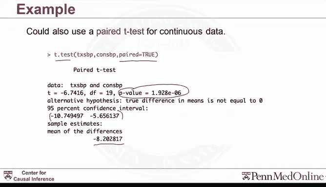

# 宾夕法尼亚大学《因果推断速成课程｜A Crash Course in Causality》中英字幕 - P23：23_03_07_匹配后数据分析.zh_en - GPT中英字幕课程资源 - BV1Ft42137BF

Hi， this video is about how to analyze your data， your outcome data after matching。

 so we'll assume that you've already matched your data。

 you've checked for balance and you're happy with that and now you're ready to analyze your outcome data so we'll identify appropriate statistical methods for analyzing matched data and we'll especially talk about randomization tests what they are and why they might be useful again。

 we'll imagine that we've successfully matched so we've checked for balance and we're ready to proceed with the outcome analysis。

And so there's a few things that you might want to do， and so one is to test for a treatment effect。

 so you might be interested in hypothesis testing， just answering the question。

 is there a treatment effect？You're likely also interested in estimating a treatment effect and a confidence interval。

And whatever method you use should take matching into account。

So we'll begin with randomization tests， and these are also known as permutation tests or exact tests。

And these are the kinds of tests that you could use if you actually had randomized。Data。

 data from a randomized trial， but since we've already matched。

 we're going to basically at this point， treat the data as if it was from a randomized trial。

And so the main idea here would be to first choose a test statistic。

And then to compute that test statistic from your observed data。Next。

 you'll assume that the null hypothesis is true， meaning that there's no treatment effect。

Then we'll just permute the treatment assignment randomly， so within each pair。

 and then we'll recompute the test statistic。We can do this over and over again so we can keep permuting the treatment assignment。

 calculating into test statistic。And recording that， do it over and over again。

 and then what we'll do is we'll see is the test statistic that you observed unusual relative to these permuted ones which were calculated under the assumption assumption。

That the data were actually randomized， that the treatment assignment was randomized。

So if the no hypothesis is true， your observed test statistic should be pretty consistent with the ones that you see from permuting the data in this way。

So we'll consider an example here to make the ideas more clear， so suppose we have a binary outcome。

 so just a yes or no kind of outcome。And 13 matched pairs。

 So we'll just consider 13 matched pairs so that we can see it， and it'll be easier to understand。

And so what we'll choose as a test statistic here is just the number of events in the treated group。

So we'll discount how many events there were， meaning how many times the outcome occurred in the treatment group。

You could pick a different test statistic。And。You should essentially get come to the same conclusion。

 but we'll just pick account of the number of events in the treatment group。

So here's some hypothetical data of 13 matched pairs。And。

What we have here is we have on the far left here matched pair， this is just。

 you could think of this as just an identification variable saying which matched pair it is。

Match pair one is you could think of that as the first match pair and in that case。

And then what we're showing in the numbers in the table are the actual outcomes。

 So the first match pair， the person in the treated group。Did not have the outcome。

 so their outcome was equal to zero。In the control group， they also had an outcome of 0。 So this is。

These individuals were matched based on their covariates。

 and then we looked at their outcomes and their outcomes happened to be the same。

 and they happen to both be 0。So that's a concordant pair。 They， They agree with each other。

You'll see。Match pair 2， the second match pair， the treated subject， had the outcome。

 whereas the control did not。So the treated head of the outcome of value of1， and for the control。

 the value was 0。 So that's a discordant pair。Now， our test statistic we said was count of the number of events in the treatment group。

So all we would do was we would look in the treatment group。

And count the number of times you see a one。 So we'll just add up those。

 And if this was done correctly。We should get a six。

 so just we should see that there's six ones in the treatment group。

 so that's our test statistic from the observed data。And what we want to know is。

 is that an unusual number？And what we mean by is that an unusual number is if the null hypothesis was actually true where。

Treatment didn't matter at all， so treatment doesn't do anything。

Then would we see a test statistic like6。Or is it unusual So the way we're going to。

Tell whether6 is an unusual number or not。Is by randomly permuting the values in each row。

So we're going to actually randomly perute these outcome values in each row。

 and I'll show you an example of that。So what I first did was I highlighted or colored in red。

A row where there's discordant pairs。And this is important because in the concordant pairs。

 permuting isn't going to do anything right so for example。Match pair1。

Therere always going to be a 0，0 pair。 Whether I change the label of who's treated and whose control or not。

 That's always going to be a 0，0 group。 So there's nothing interesting happening there。

So all of the information about a treatment effect should come from discordant pairs。

And you'll see in this case， there's。The ones that are in red。There's seven of them。

Those are the discord pairs and what we're going to do is just randomly shuffle those zeros and ones。

And what you could think of that as doing is just randomly relabeling who's a treatment and who's a control and again。

 the reason we're doing this is that under the no hypothesis it shouldn't matter who's a treatment and who's a control because treatment isn't doing anything treatment has no impact so I should be able to just randomly permute these labels and so you could do that just by randomly drawing from a binomial distribution with probability 0。

5。And so I'll show you an example。Here's permutation 1。 if we kind of slide back and forth。

 you'll see that a couple of these changed。So here's the original data。Here's the perma data。

 so I did this at random。啊。So basically。Just to make clear extra clear what we're doing here。

 let's take this one， for example。Match pair 13。 you can think of it as I'm going to flip a coin。

 And if heads comes up， I keep them the same。 If tails come up。

 I change where now treatment is a 0 and control is a one。

 So if there's a 50% chance I'm going to flip and there's a 50% chance I'll stay the same。

And so I did that。 And now a couple of them have changed。

And what I do now is I recalculate the test statistic， so I count。

How many ones appear in the treated arm。And that ends up being a five here。

And now I'll just keep doing that， here's a second permutation。This1， I get a test statistic of 7。

I permute again， I get a test statistic of three。And I'll just keep doing this。

And recording the test statistic。Now you could do this thousands of times and then see whether the value that you observed is unusual relative to all these permed ones。

So if we carry out the permutations a thousand times and record this test statistic each time。

 then you could plot the distribution of the test statistic。And that's what we've done here。

 So what you'll see is that。We have T is a test statistic。

 so that's just the count of the number of times the event occurred。

And so we see here that this is an actual account and there was a thousand total times that I did this。

And you'll see that， for example， a value of one is quite unusual。

 it probably only occurred about 10 times out of 1000。

 whereas values of four and  five are quite common。 So this is again。

We're permuting under the assumption that there's no treatment effect。

We record the test statistic each time。 And then this is the distribution of that test statistic。

 And what we want to know is then is the test statistic that we observed unusual。

And so here's the one we observed was a value of 6。So our observed dataH test statistic was a six。

 and you'll see that that is quite consistent with what we would see if there was no actual treatment effect。

So。It's kind of right towards the middle of that distribution。

 so what we've observed is not inconsistent with the null hypothesis of noll treatment effect。

 and therefore we really don't have evidence that in this case that treatment is really doing anything。

If you wanted to calculate a P value， the intuition here is what we would really do is calculate the probability of something more extreme than our particular value。

 or as extreme or more extreme than our particular value。

 so we would in this case what that would mean is we would add up the probability of being a six a seven or an eight。

That's as extreme or more extreme than our value。 But because this is symmetric。

 we would also need to。And up the probability of being a one， a two or a three。

 those are equally unusual in the sense of。Remember， Wis County number of events。

But we also could have just counted as the number of noneven。

 so either of those are the same kind of statistic。 So in other words。

 having a test statistic of a one is equally unusual to having a test statistic of an8。

 so we want to count both tails So if you were going to actually get a P value you could just add up the probabilities of being1。

2，3，6，7 or8 and that would tell you how。Likely it was to have a test statistic as unusual or more unusual than ours。

Another way you could get that a P value is actually to use this magnaR test。

 which is a test that's often used for paired binomial data。

And here I've created the kind of table that you would typically use for this type of test where。

What we have is a count of treatment and control pays based on the outcome。

So here we have the treatment group。We have the control group。And then we have the outcome。And so。

 for example。This first cell here。It's a account of how many pairs。

Were there where both the treated and untreated subject had a value of one。 and remember from。

Our original data， there was one。Person， one pair where the value was one for both of them。

 and so that's where that count is coming from。The other concordant kind of pair is when both individuals。

Have a zero for the outcome， and there were five of those in our original data。

And then there's discordant pairs。So our discordant pairs are here。

This is when the treatment group had the outcome， but the control group didn't。

 There were five cases like that。And then there were two cases where the treatment group did not have the outcome。

 but the control group did。 And so in the。Really all of the information about whether there's a treatment effect comes in those discordant pairs and in fact comparing that five versus the two。

 so if there's no treatment effect， you would expect those numbers to be about the same。

In this off diagonal here， we would expect them to be about the same， but if they're very different。

 then there would be evidence of a treatment effect。

 And so you can actually test that in our using the following commands。

 So the first thing I do is I just create this matrix。 So I have a matrix here。A two by two matrix。

 and I can enter that。Right into。Are as follows。 So I just use the matrix command。

 I enter the numbers 1，5，2， and 5。 I tell what it's a 2 by2 matrix。And I name it。X。

So I just happened to name my matrix X。Now I can just use a magmer that test。Package。

 and I tell it my matrix is this， and the output then is displayed below。

And what we see is that we end up with a P value here。Of about 045。So 0。45 is。It's very far from 0。

 So it's saying that we really don't have evidence of a treatment effect。And in fact， that 0。

45 you get that we got from the magnamar test would be the same， roughly the same as if you add up。

You know， these。six。Regions here and then divided by 1000。

 so that you'll end up with the same result。So this is one way you can analyze or test on null hypothesis using a randomization test if you have matched data。

 so this isn't appropriate for matched sort of paired binomial data and you could just use this test if you wanted strictly to test the null hypothesis。

So randomization Tesla， it's really a general idea。

So could you don't have to just have binomial data， you could also have continuous data。

And as a hypothetical example， let's imagine that our outcome is systolic blood pressure。

And we have that from 20 treatment control pairs。And so a test statistic that you might want to use then is just a difference in sample means。

 so the average sytolic blood pressure in the freedman group minus the average systolic blood pressure in the control group。

So here's some hypothetical data where we have。20 pairs of observations。

 so these are 20 paired subjects who were matched on covariates。So we have。

The control here treated here。 And we have the pair I D。 So， for example。This is the first pair。

Our outcome is systolic blood pressure。 So what you see in the actual body of the table is a systolic blood pressure。

 So， for example， in the first matched pair。The control had a systolic blood pressure of 106。

The treated patient had a systolic blood pressure of 101。

I've said that a test statistic we might want to use is the average systolic blood pressure in the treated group minus the average systolic blood pressure in the control group。

So could we would actually just stratify。On the treatment group。

 calculate a sample mean for each and then take the difference。 And if you do that。

 you get a difference of。8。2。And it's actually a negative 8。2 if you take that difference。

 So that's what I'll call T。So we have 20 individuals。The difference in means is about 8。

And what I want to know is， is that unusual， is that the kind of thing that you would see if the null hypothesis was true？

So what we can do is the same idea here where we can just randomly permute the labels。

And recalculate the test statistic， and then just keep doing that。 So what we're going to do is for。

Each of these pairs。We're going to flip a coin。And to decide which ones a control and which one's a treatment。

 So we're just going to reassign。The label on whether they are treated or control， though。

 still will be one treated in one control in each pair， but we're going to randomize which is which。

Again， the idea is that if treatment doesn't matter at all。

These are just arbitrary labels and we should be able to just randomly assign them。

So that's exactly what I did here， I did this a thousand times。

 and this is the distribution of the test statisticsistic Ot。Is the difference in sample means？

In systolic blood pressure between treated and control。

And here is a frequency of how many times that occurred out of a thousand times。

And what you'll see is that typically， this is centered around zero。

 which is basically what you would expect if there's no treatment effect， right？

It's centered around  zero。 and then we we see how far the tail sort of stretches。

 So if there was actually no treatment effect， it might not be unusual to see a value sort of out here。

 you know， around4 or five wouldn't be。You know， extremely unusual or to see one， you know。

 negative3 or negative four。But our value， our observed value was。Around negative 8。

 which is what this vertical bar is。So in this case。

 what we see is that our value is actually quite unusual。And in fact。

 the P value is about  zero here， you'll notice that。All these I permed the。

Labels a thousand times and kept recalculating this test statistic。

 And never did I get a value this extreme， never did I get a value as small as negative8。

 So the P value is about 0 there。 The P values， the proportion of times that you would see something as extreme are more extreme。

 And and we really never saw anything that extreme。So we reject our hypothesis。

 reject the no hypothesis that there's no treatment effect， so now in this case。

 we have evidence of a treatment effect。You could do this。

Another way you could do this is with what's known as a paired T test。

Ho you're familiar with this idea where if you have continuous data， but you have matched pairs。

 you can use what's known as a pair T test。This is our code to do that， so we say T test。

And I let it know。That it's paired。And what it shows is that the mean difference is that we observe our point estimate is a negative 8。

2。A 95% confidence interval is here。So it goes from negative 10。7 to negative about 5。7。

And we have an extremely tiny P value。So we have strong evidence of that there is a treatment effect。

In the direction of。A negative effect。

So other outcome models are also possible， so besides the kinds of outcome analysis methods that I just talked about。

 such as pair T tests and permutation tests，Some of the kinds of models that you're more familiar with could also be used。

So for example， you could use conditional logistic regression。

Which is appropriate for matched binary outcome data。

You could use a stratified tax model if you have time to event or survival type of data。

So this is exactly like the usual CoX model， except you would stratify the baseline hazard function on match sets。

 so you would have in your data set a match ID variable。

 and you would let the software know to stratify on that match ID variable。

You could also use generalized estimating equations or GEE。And again。

 you would tell the software to cluster on matchch ID。

And this is especially useful for binary outcomes because you could use GEE to estimate a causal risk difference。

 a causal risk ratio， or a causal add ratio。And which one of those you want。

Would sort of determine which link function you use。 So if you want a causal risk difference。

 you would use an identity link。 if you wanted a causal risk ratio， you could use a log link。

