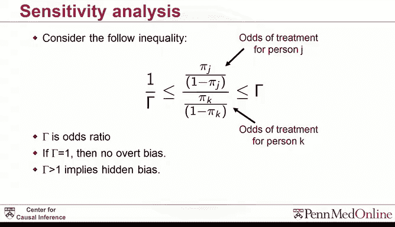

# 宾夕法尼亚大学《因果推断速成课程｜A Crash Course in Causality》中英字幕 - P24：24_03_08_敏感性分析.zh_en - GPT中英字幕课程资源 - BV1Ft42137BF

Hi， this video is on sensitivity analysis。The primary objective is to understand the concept of sensitivity analysis。

In addition， we will look at one particular way that you could go about carrying out a sensitivity analysis in practice。

So we'll begin the discussion of sensitivity analysis with the idea of hidden bias。

 so we call that when we're matching the main goal is to achieve balance on observed covariates。

 so these are the covariates that you selected ahead of time that you decided that you needed to control for to achieve iorability。

 so the set of covariates that you believe are sufficient to control for confounding。

But these are all observed covariates。So avert bias would occur if there was imbalance on these observed covariates。

In other words。If we did not fully control for these variables。

 so we would have hope of identifying this kind of overt bias。So after you match。

 you can check balance and if you saw imbalance， we could identify that and try to rectify it。

So that would be overt bias would occur if you had imbalance and carried out your outcome analysis anyway。

 so this is something that you could possibly identify。However。

Matching is not guaranteed to result in balance on variables that we did not match on。

So there's going to be some unobserved variables， variables not captured in your data。

 or maybe variables that you chose to not match on。And those could be imbalanced。

 so this is different than randomized trials where randomized trials should achieve balance。

 both onobserved and unobserved variables。Because it's truly randomizing flipping a coin。

Treatment assignment shouldn't depend on anything。So in a randomized trial。

 you should have balanced on all the variables。In a matched analysis。

 we really can only expect to achieve balance on observed variables。

So hidden bias would occur if there's imbalance on unobserved variables and these unobserved variables are actually confounders。

 So these variables are important。We don't have balance on them because we didn't match on them。

But we can't really。 We can't see that， right， because we don't have those variables。

 So this would be known as hidden bias。 And this would be a situation where the iorability assumption is violated。

You could also think of this as。That there's unmeasured confounding in your analysis。

So the main idea of sensitivity analysis。So what we want to think about this idea of if there is hidden bias。

 how severe would it have to be before conclusions changed？

So what do we mean by conclusions changing well for example。

If you have a statistically significant result。Where we assume there's no hidden bias。 Well。

 how much hidden bias would there have to be before。We would have。

 We would not have a significant result。Another example would be a change in the direction of effect。

 So maybe we see a positive treatment effect。 Well。

 how much bias would there have to be before this sign actually changed。

So where we'd have a different。Direction of the treatment effect。

So this is a very useful kind of concept， because we typically believe that。

There's likely to be some degree of unmeased confounding。

 hopefully a small amount of unmeaured confounding， but there it's likely that there's some。

 And so we want to know are the conclusions we're making sensitive to just minor violations。

Of our key assumption or is it very sensitive to violations in order to discuss sensitivity analysis in more detail。

 it'll be useful to introduce some notation。So let pi J be the probability that person J receives the treatment。

Similarly， Pi K is the probability that person K receives the treatment。So pi here is a probability。

 and then it's indexed by a particular person identifier。

So let's imagine that person J and person K are perfectly matched on their observed covariates。

 In other words， xj is equal to x K。So the set of covariates for person J are exactly the same as person K。

So then if。Pi J is equal to pi K。 Then there's no hidden bias。

So what we're saying here is that we have a matched pair， we've matched person J and K。

 their observed covariates agree。Now， if the probability of receiving treatment is actually the same。

 then there couldn't be any hidden bias， there couldn't be any。

Varis that we're not capturing that are affecting the treatment decision。

So there's no sort of unobserved variables that are affecting the sort of treatment assignment probability。

To think further about sensitivity analysis， let's consider the following inequality。Again。

Pi J is a probability that person J。Ha receives a treatment and Pi K is a probability of treatment for person K。

And we'll assume that we've matched person J to person K on their observed covariates。

So person day in person can have the same observed covariates。

What we see then here is that in the numerator of this inequality。

 we have the adds of treatment for person J。Recall that in odds is just a probability divided by 1 minus a probability。

 So the numerator is just the odds of treatment for person J。In the denominator。

 we have the odds of treatment for person K。And so then this ratio is just an odds ratio。

So capital gamma here is an o ratio。And then if。If this odds ratio is equal to one。

Then there's no overt bias。 So this is what we said on the previous slide。If pi J and Pi J are equal。

 there's no overt bias。If they're equal， the odds ratio would have to be one。

So that would apply no overt bias。However， if this capital grandmma was greater than one。

 we would have hidden bias。 So this would mean that。

Person J was more likely to receive treatment than person K。

So even though they have the same observed covariates。

There's something about person K that made them more likely to receive treatment。

So you could think of that be the case because of hidden variables， unobserved variables。

So gamma then is can quantify the degree to which are。Assumption of。No hidden bias is violated。

So if gamma equal 1， our assumption is fine， if gamma is very close to one。

 then our assumption is barely violated。 if gamma is much larger than one。

 then our assumption is very violated。

So now we'll discuss how this idea of gamma representing hidden bias can be used in practice。

 so as an example， suppose that we have evidence of a treatment effect。So in other words。

 you carried out the kind of analysis that we've discussed in previous videos where you match。

 you make sure you have good balance， then you carry out an outcome analysis。

 and imagine that you found evidence of a treatment effect。 Well。

 that evidence of a treatment effect was under the assumption that there's no hidden bias。

In other words， that this capital gamma， this odds ratio is equal to one。

So that would typically be your starting point as your primary analysis is to assume that the assumption is of no unmeasured confounding or no hidden bias is met。

Next what we can do is then carry out the sensitivity analysis part。And so in this case。

 what we would do is we would increase gamma this odds ratio until the evidence of a treatment effect went away。

 in other words， that it's no longer statistically significant。So how you would actually。

Sort of redo the analysis at different values of gamma is really beyond the scope of this video。

 you know the actual ways in which you would do it， but there isn't our package that can do this。

 and there's a couple of them。 So I mentioned them down here。

 and also there's a lot of details on this。In the design of observational studies book by Paul Rosenbaum。

 which can give more details。 But what we're shooting for here is just the main concept。Okay。

 so what we would do then is。Gradually increase gamma and each time for each gamma that you choose。

 you would reanalyze the data assuming that that gamma is correct。

And then what would happen is if you find out you don't have to increase gamma very much before you change your conclusions。

 then we would say that。Inference is very sensitive to unmeaured confounding。

 So I give an example of， let's say。You know you start with gamma is equal to one where there's no hidden bias and let's say you increase it to 1。

1 and then we change our conclusions so 1。1 is a fairly small odds ratio。

So that what we would say then is that inference is very sensitive to unmeasured confounding in that case。

So we the probability of treatment for。One subject relative to another doesn't have to differ by very much in a matched pair before our conclusion has changed。

So that would be very sensitive。Whereas if you。Don't see a difference。

In conclusions until let's say this odds ratio， the gamma is five。

 then we would say it's not very sensitive to hidden bias。So an odds ratio of five is quite large。

If you're comparing two people in the same match pair and you say that one person's odds of treatment is five times higher than another。

That's much higher， right？And if it needed to be that large， if hidden bias needed to be that large。

 before we change our conclusion， we would we would say that it's not our conclusions are not very sensitive to hidden bias。

 so we would be more confident in our conclusions in that case。

