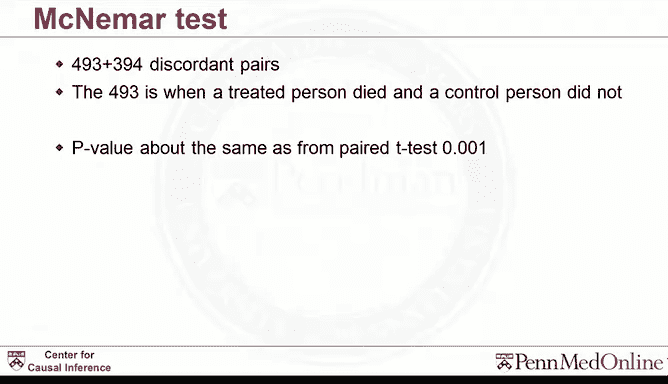

# 宾夕法尼亚大学《因果推断速成课程｜A Crash Course in Causality》中英字幕 - P25：25_03_09_R语言数据实例_1.zh_en - GPT中英字幕课程资源 - BV1Ft42137BF

Hi， in this video we'll go over how to carry out an actual data analysis in our， so in particular。

 a matched causal kind of analysis。The data set that we'll use as an example is this right heart catheterization data。

 which is publicly available on this Vanderbilt website。

It has been available for a long time and it's been analyzed。

By many different people just to illustrate the main ideas。

 and so what involves ICU patients in five hospitals。

 the main treatment is right heart catheterization， which we'll just call RHC。So RHC or not。

 is the treatment。The outcome that we'll look at is death， so just died or not。

And there's many confounding kinds of variables， demographics， insurance， disease diagnoses。

 and so on。This data set is fairly large， so there's over 2，000 treated subjects and about 3。

500 controls。Its on the Courtra website we have posted the actual R code。

 but here we'll kind of walk through some of the main points of the code。So to begin。

 we'll just load the data and load the packages that we'll use and view the data。So， I'm。

Going to start with just using two different packages。 So the first one is this table 1 package。

So table one is a really useful package if you're going to。

Be doing a matched analysis so it's a package that can very easily create the kinds of table ones where you're comparing the balance between treated and control subjects。

 either in matched or unmatched data， and then we'll also use the matching package that we'll use to carry out the actual matching。

So we can read in the data and then we can also well also would typically you would want to view the data as well just to understand what the variables are like。

 get a sense of if there's missing values and all of those kinds of details。

And here what I'm putting as an optional step。Is to just create convert some of the character variables into numeric variables。

 so in this actual data set， a lot of the variables are character variables。

And that in some our packages handle that fine and others prefer numeric。

 So just to kind of make things simpler。 I have a bunch of lines of code here that just are creating new variables。

That are saying， convert these to a numeric variable。 So， for example。啊。The data set RHC。

 there's the outcome variable is deaf。In the data set itself。Death is either coded as yes or no。

 And here I'm going to convert that to a binary 10 variable where one。Means yes。

 so you'll notice I say our RHC de。Equal， yes。 so that's just an indicator kind of function。

 and it's saying。Convert that to a one。 If yes， and set it to 0 otherwise。

So I create a whole bunch of these numeric variables。

That willAnd then I'll create a new data set that just includes those variables。

So that's what I do next is what I'm calling my data as a data I'm going to use and I just。

I just took a handful of confounders。And also， the treatment variable and the outcome variable。

This data set actually has many more confounders and what I'm using。

 I'm just using a shorter list just to make the presentation easier。And so the covariates。

 the list of covariates that I'm going to consider here， I'm calling X virus。

And this is a list of them。And now we can create a table one premat and so we can use this table one package and in fact you can just say create table one。

 and what I want to do is summarize have summary statistics form the variables that I just called X bars。

 that list of covariates that I just went over。And I'm towing it then to stratify on treatment because we want to compare。

 we want to look at the balance。Between the treated and controlled groups。 So I tell it。

 use my data set， my data。And this part here is just saying。

 I don't actually want a significance test。Just give me the means and standard deviations and so on。

AndThen I have it print the table， and here I say SMD equal true。

 which means standardized differences。True， so that means print the standardized differences。

So here you'll see what this table looks like， this is table that I just copied directly from our。

 so this table one package will just create a table like this for you with just that simple line of code。

And so here we have。These are all of our different covariates。

 again this is a shorter list than you would probably want to use in practice just to illustrate the main ideas。

And again， we see in the control group。3500 subjects。 And in the。Treat a group about 2，100 subjects。

And。Then we see the means and standard deviations of these different variables。And over here。

 we have the standardized main differences。And remember that。

We're especially concerned about standardized mean differences that are greater than 0。1。

So we see a few of those。So we see one there。We see one there and so on。

 So there's a few of them that。Are showing some imbalance。 So for example。

 this variable here is mean blood pressure。And that is an 85 roughly versus a 68。

 so we see a pretty big difference there。So this is how you can create。

 you a table one and just get a sense of what the data are like and how。

And how much confounding you might be dealing with。And next we can go on to matching。

 so here we'll carry out a a greedy matching analysis。And here we're going to actually match on the。

Whole set of covariates。 we're going to calculate the distance between the covariates。

And match on them。 So we can use this。The actual match package。And here is very simple code。

T R is they they want they want to know what is your treatment variable。

 Well ours happen to be named treatment。 So that's straightforward。 Does M equal1。

Has to do with whether you want pair matched or maybe you're interested in more than one control per treatment。

 So here I'm just doing pair matching， so I'm saying match。

One treated subject to one control subject。And now。

What I'm saying here is here are these are the variables I want to match on。

 So what they're calling x is a set of variables you want to match on。 So I say in my data。

 just use what I call X barss。So it's going to match on those。So if you run that command。

That will actually do the matching for you。And then what you can do is。Well。

 that what that'll do is it'll end up。There will end up being an index， index do treated and index。

 controll， which will tell you sort of who the treated and controls are。

What their actual I D variable is。Based on their sort of original Id。 And if you unlist this。

 then you can end up。Looking at it。And I'll sort of show you how you can look at it here so we can use again。

 create table one is's just this table one package。

So this is going to look very similar to what we did before。We say created Cha one using X virus。

 stratify on treatment。But now we're saying the data are the match data。

So if you look at the previous slide。Here。I said， I called that new data set that matched data set I called it matched。

 so that's what I put here。Again， I'm not interested in a hypothesis test。

 I'm not interested in statistical testing。Now we can print this。

Matched what I'm calling match table1， we can print that and also ask for the standardized mean difference。

And here's what that looks like。So first thing you might notice is that we matched。21。

86 controls to 21，86。Treated patients， so these are exactly equal。

 which is what you would expect since we're doing paired matching。

So here's the same list of variables。And if you look at。Standardized mean differences。

 now they're all very， very small。So we did a。Great job of matching here， there's。

This is a kind of table that you would expect to find if you actually randomized treatment so that it looks like there's great balance here on all of these variables。

 the standardized mean difference is never even close to a 0。1。

If you remember previously the mean blood pressure variable。

 there was a lot of difference in the unmatched and now very， very similar。So， this。

We're not matching on very many variables here， but it seemed to do a really good job and so at this stage you would probably feel pretty happy about。

How the matching worked。Now that now that you're happy with the matching。

 you could actually carry out an outcome analysis and there's a lot of different ways you could do that here I'm just going to show you how you could carry out a simple paired T test。

So all I'm doing is I'm defining two new variables。Why for the treated and why for the control。

 remember our outcome variables died。And I'm from why treated。

I'm saying only use the subset the data， subset this outcome。

For those who have treatment equal to one。So I'm just removing from the whole dye variable those。

The dye variable for those who were treated。I do the same thing with control。

And now I have two outcome variables of equal size， of one for the treated， one for the controls。And。

The rows of these correspond to the same match pair， so the first row of y treat。

 the first observation of y treat corresponds to a match with the first row。

 the first value of y control。So I can just take a pairwise difference then I can actually just calculate a new variable。

 which just takes the difference between your two variables。

Your your outcome under treated versus outcome under control。 It's a pair wise difference。

 So that's preserving the matched pair。 So you're taking a difference one pair at a time。

 essentially。AndNow a pair T test is actually just a regular T test on the difference in the outcome among match pairs。

 so I can just use a standard T test command now on this difference variable。

And this is what the results look like。And so， we see。Our point estimate is about a。045。

 and this is the 95% confidence interval。And we have a very small P value here。

And so this is actuallyest this is estimating a causal risk difference。

 that's a causal risk difference and the reason we know it's a risk difference is because we're just we're taking a difference in outcomes and taking the mean。

So that's just a risk difference。So to summarize。Our point estimate is about 0。045。

 so that's the difference in probability of death if everyone received the treatment here。

 RHC versus if no one received the treatment。So in other words。

 there's a higher risk of death in that treatment group。And the 95% confidence interval。Is here。

 And so when you've given you a sense of sort of plausible range of sort of the true risk difference。

And it's highly significant。I should just remind you that this is。

Just an analysis to illustrate the main ideas， we haven't controlled for all of the confounders that are in the data set in practice you would match on a larger set of variables and so your conclusions might end up being a little different if you did that so here we're just trying to illustrate the main ideas。

You could also carry out a magnabar test。嗯。So what I could do then is just ask for a table。

 remember these are paired up outcome observations。

 so I could just ask for a table and it will show the counts of each type of pair。So for example。

 994。Pearers had an outcome of one for both groups。So outcome of one。

So 994 pairs were concordant with an outcome of one。

There were 305 pairs that were concordant with an outcome of 0。

And then the more interesting cases are the discordant pairs where we see 493 pairs。

The treated person had an outcome where there's a control person did not。 so in this case。

 493 people treated subjects died when their matched control did not。Whereas you see 394。

Pairers had the opposite situation where the control died when the treatedy did not。

So among the discordant， we see that there's a bigger number。

Where the treated is the person who died。 So this is， again。

 suggesting that the treated group is at higher risk。And this is all for match data。

 So this is already controlled for the confounders that we matched on。 Now。

 if we want to carry out the test again， we can just use this magnaar test。

 We can tell it what the matrix looks like。It'll carry out the actual hypothesis test and we get a really small P value。

Just like we did with the pair T test。 So either of these methods would。Is getting at the same thing。

 it's testing the hypothesis of no treatment effect。

So this is just summarizing what I said previously， and so in both analyses， we're concluding that。

The treated subjects were at higher risk of death。So this was just again。

 a relatively simple kind of outcome analysis， but you could。

And we were just estimating a risk difference， but if you were interested in a risk ratio or an odds ratio。

 you could use GEE， for example。If you wanted a causal odds ratio， you would use use a elogit link。

 for example。I've already mentioned that I just used a subset of covariates for simplicity in practice you would use more variables。

And I just， in this case， I illustrated the matched package。

But there are other packages that can do matching。 and what I like in particular is RC balance package because that has a lot more options。

 but it's also。啊。Slightly more sophisticated， but there's a really great description of。

This package in the journal observational studies， which is open source so you're。

Free to download and it really describes in detail how you could carry out sort of more sophisticated matching kinds of analyses where。

 for example， you could have a fine balance constraint or you could do optimal matching and so on。

And I also'm just mentioning here that this this table one package actually goes into a lot of detail about steps that you could use to carry out a matched analysis。

 including some very nice figures that assess balance， and so I'm recommending。This particular。

A document。