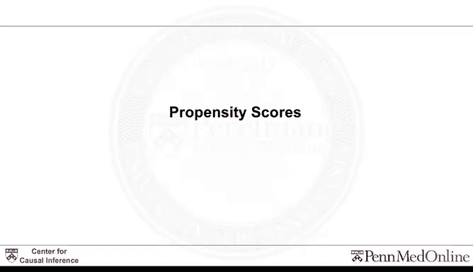

# 宾夕法尼亚大学《因果推断速成课程｜A Crash Course in Causality》中英字幕 - P26：26_03_01_倾向性评分.zh_en - GPT中英字幕课程资源 - BV1Ft42137BF

Hi， in this video， we will discuss propensity scores and also talk about the balancing property of propensity scores。

So a propensity score is simply the probability of receiving treatment。Given covariates。

 So in particular， we're thinking about the probability of。

Receiving treatment as opposed to the control condition。So we'll define。Treatment as a equal 1， and。

Conl will define as a equals 0， as we've done in the past。So then formally， the propensity score。

 which will'll denote by pi I， is just。Probability that a one。Given X I。So here。

The pi I is referring to or's this notation for the propensity score for person I。

 so it's really a function of x， so you can think of the propensity score as a function of x。

 but we' using we're just indexing it by I because person I has a unique set of covariates。Xi。

 so this is probability of treatment。Given that person's particular set of covariates。

 so that's what we mean by a propensity score。So as an example。

 just imagine that age is the only x variable。And that older people were more likely to receive treatment。

So in that case， a propensity score would be larger for older subjects。

I give an example where the probability of treatment。

Among people who are 60 years old would have to be greater than the probability of treatment。

 among people who were 30 years old。In this case。Another way you could look at it is。

Pi I would have to be greater than pi J。If person I is older than person J。Another。

T thing we should think about is how we interpret this propensity score and as an example。

 if a person had a propensity score of 0。3。That would mean that given their particular covariates。

 there was a 30% chance that they'll receive the treatment。Next。

 we're going to think about a balancing score property of the propensity score。So to motivate this。

 we'll think about two subjects that have the same value of the propensity score。

 but they might have different covariate values x so remember the propensity score is a function of x。

 it's a function of the covariates but。Typically， there's not going to be。

A unique value of the propensity score。That's associated with。Just one set of x's。 In other words。

 there could be multiple。Setets of x's that could lead to the same propensity score。

 so the same probability of treatment。So what we're imagining now is that there's two subjects。

 they have different x's， but their pi of x of propensity score is the same。So in that case。

 they're equally likely to be treated。Right， so you have。

Because they have the same propensity score and the propensity score is just the probability of treatment。

 they're equally likely to be treated despite having different covariate values x。So。

Then a given person's set of x's。Is just as likely to be found in the treatment group as the other person's set of X's。

They both had the same probability of getting treatment。

 so we would expect to find those type of X's at about the same rate。

So we could think of it as like in this example， there's two sets of x's。

 two unique values of x that we're thinking about， and we would expect them to appear in the treatment group at about the same rate。

So what this means is that if we were to restrict。To some populationops of people that had the same value of the propensity score。

 then we should have balance in the two treatment groups。

And so this is what would mean that the propensity score is a balancing score。

So a balancing score is something where if you condition on it， you'll have balance。

And so the propensity score is an example of a balancing score。

 so if we were to only consider people who have the same value of the propensity score。

If we restrict our analysis to that group of people。

 then if we stratify an actual treatment received， we should see the same distribution of covariates in those two treatment groups。

To make this a little more formal， we could state it as follows。Here we have the probability of x。

So the distribution of the covariates themselves。Conditional on the propensity score。

 which we're writing as a function of x。 remember the propensity score depends on x。

Conditional on that propensity score being equal to sum value P。

So this is just some fixed value and conditional on equal1。

 so conditioning on equal 1 means let's only look at treated subjects。And in fact。

 we're only going to look at treated subjects who have a particular propensity score。

That's equal to little P。So we want to know what is the distribution of the covariates among treated people who have this particular propensity score。

 well it turns out that that's the same as the distribution of covariates。Among controls。

Who have this， have value of the propensity square equal to P。So。

By conditioning down the propensity score equaling P。

 what we're saying is let's think about all possible combinations of x that would lead to this one propensity score so p could be 0。

3， for example， it's just a fixed value So imagine p is 0。3， let's say okay。

 what are the set of x's that lead to a propensity score of 0。3。Now。

 let's restrict to people who have those X's。Now let's also look at treated versus control。

Then we'll see that the distribution of those xs is the same in the two groups。

You could prove this with an application of base theorem and it's not very many steps。

 but hopefully the intuition is clear as to why that would be the case。

 the main idea is really from the previous slide where a propensity score being the same。

For different sets of xs would mean that you would expect to see either type of X about as often in the treatment as in the controler。

The implication is then that matching on the propensity score should achieve balance。

So previously we had talked about matching on the full set of covariates by taking a distance between them。

And that would achieve balance if we do that well。 Well。

 the same thing would work here where if we simply just match on the propensity score。

 if we do that well， we should have balance and。This makes sense because we because we assumed iorability。

 So remember， iorability essentially means that treatment assignment is random given X。

 So what we're really doing by conditioning on a propensity score is we're conditioning on an allocation of probability。

So all we're really doing by conditioning on a propensity score is conditioning on the rate at which treatment should be assigned。

 so if we condition on a propensity score that's equal to 0。3。

We're really in a randomized trial world where the allocation probability is 0。

3 where you're going to randomly assign treatment with probability 0。

3 and the control with probability 0。7。But because at that point， we're in randomized trial world。

 we expect to have covariant balance。Next we'll talk about。

The propensity score itself and how we actually need to estimate it。 So in a randomized trial。

 the propensity score is generally known so。People who are planning the randomized trial will typically decide what the allocation probability is in the simplest case。

 the allocation probability。The probability of treatment given covariates would actually not depend on covariates。

 and it would just sl 0。5 so the standard kind of randomized trial where each person has a 50% chance of getting treatment。

 the allocation probability would just be 0。5 for everyone。You， of course， could have some kind of。

Sttraatified random sampling， where。He might be conditioning non X and so on， but regardless。

The allocation probability would be known ahead of time。

 which means the propensity score is known ahead of time in a randomized trial。

 so it's known by design。But in observational study， it's unknown。

 so we don't know the probability of treatment given X because we haven't designed this study。

 we haven't been actually determining who gets treatment and who doesn't。However， the。

It's important to note that the propensity score just。Involves observed data。So the propensity score。

 the probability of treatment， given covariates， only involves observed data。

 it just involves A and X， both of which we observe together on all of our subjects。

What that means is that we should be able to estimate it。So we。

Observe which subjects are treated and which are not we observe the values of x for each of those subjects。

 so we should be able to estimate the relationship between those。

 So most of the time when people actually talk about a propensity score。

 they're really referring to an estimated propensity score。

So how do we actually go about estimating a propensity score？ So here what we'll do is we'll treat。

The treatment itself， A， as if it was the outcome。 so for just for the purpose of a propensity score model。

 we're going to treat the treatment itself as the outcome。

So you'll see it appears at the left hand side of the conditioning。

And treatment is just binary so you could use any kind of models that you would use if you want to predict a binary outcome given a set of variables。

 so the most popular approach for doing that is probably logistic regression。

But I do note that you could use whatever you wanted。

 So this is really a classic kind of machine learning problem as well。 So you could use。

Any sort of machine learning kind of method as well。

 it's the importance isn't how you go about it at this point， it's just。

We need to estimate a probability of treatment given X's for every subject。

 So let's imagine we're going to use logistic regression， So we have outcome a covariates x。

 So we'll just fit that model using standard logistic， you know regression methods。

But the difference between the usual kind oflingistic regression approach and what we're doing here is I hear our interest is not in the coefficients of。

Of the x's， but in actually getting a predicted probability。

So our second step after we fit the model was actually get predicted probabilities or fitted values for each subject。

 and usually that's one line of code in statistical software。

 we can actually get a predictive probability for each person。So for every person。

Willll have a predicted probability。 So we'll have a number between 0 and1。

 and that will be their propensity score。 And， in fact， it's an estimated propensity score， but。

From here on out， we'll just call it propensity score。

So it'll be a value from0 and1 between  zero and1 for every subject。

