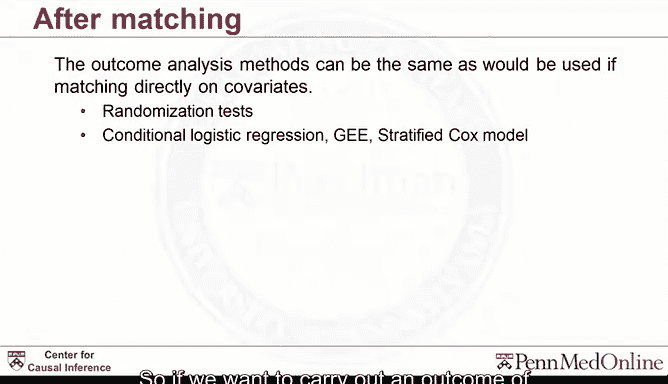
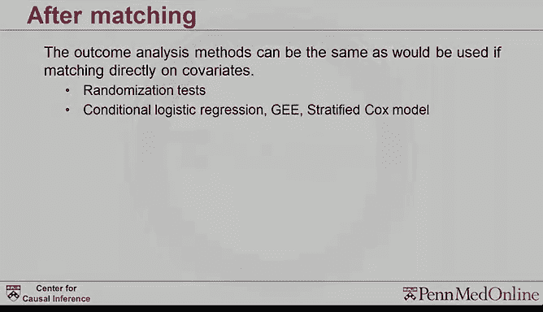

# 宾夕法尼亚大学《因果推断速成课程｜A Crash Course in Causality》中英字幕 - P27：27_03_02_倾向性评分匹配.zh_en - GPT中英字幕课程资源 - BV1Ft42137BF

Hi， this video is on propensity score matching。Some of the concepts that we will cover and include calipers。

 propensity score overlap， and trimming the tails of a propensity score distribution。

So previously we noted that a propensity score is a balancing score。

 so matching on a propensity score should achieve balance， so it should achieve balance。

On the covariate distribution between treated and control subjects。

 even though we did not directly match on the covariates。

 so even though we match on the propensity score， we should still end up with balance。

And it also should be noted that the propensity score is a scalar。

 So each person will just have a single value of the propensity score。

 So it'll just be one number between 0 and1 for each person。

So this greatly simplifies a matching problem because we just have to match on one variable as to。

 as opposed to a whole set of variables。 So essentially。

 the propensity score summarizing all the x's。And then we can just match on that summary。

So once we've estimated the propensity score， but before we actually carry out matching。

 one of the things that people typically do is look for overlap。In the propensity score distribution。

What we mean by this is comparing the distribution of the propensity scores for treated and controlled subjects。

And we're basically want to look for overlap between these distributions。 So we。

 we're interested in whether。All of the subjects had at least some some positive probability of receiving either treatment。

 and this is typically done with a plot。So here's an example where of。

A propensity score distribution for the control and treated groups。

And you'll notice that the propensity score。Is between 0 and1 as it should be。

 So it's the probability of treatment。And you'll notice that the。The treated group here。

 which is in blue。That their propensency scores shifted over a little to the right relative to the control。

So the propensities。For the treated group， the peak of the propensity score distribution is about there。

 so they have a higher probability of receiving treatment compared to the on average compared to the control group。

 which has a peak that's a little lower。 So this is what you would expect， right。

 because the treated group you would think on average。

 would have a higher probability of receiving treatment。But in this case。

 what we see is that there's overlap everywhere， so this is actually the kind of plot you would like to see if you're going to do propensity score matching。

So what we mean by overlap is that there's。No matter where you are。

 where you look and the propensity score， like let's say you look out here。At one of the extremes。

 even though there's more blue。Then， red， there's still。Some people in the control group。

That have a probability of getting treatment。that high。So we're seeing overlap wherever you go。

 same thing on the other tail。Is theres。Some people in both the treated and control group have a very。

 very small probability of getting treatment。 So there's overlap everywhere。

 And what this means is that our positivity assumption is probably reasonable。 Remember。

 positivity refers to。The situation where。All of the subjects in the study。

Have at least some chance of receiving either treatment。And that appears to be the case here。

 So this would be a situation where you would。Feel good about doing propensity score magic。

Here's an example of a propensity score distribution where there's poor overlap。So what we see。

 again， the control group is in blue， and I mean I'm sorry。

 the treatment group is in blue and the control group is in red。And we would know that。In part。

 because the probability of treatment is much higher for the treatment group。

But what we there's a major lack of overlap here in that at the high end of the propensity score there's。

Hardly anybody in the control group that had a propensity score like that。 So out here， for example。

It looks like there's。Possibly nobody in the control group who had a propensity score quite that high。

So what we mean by positivity assumption being violated then is what it means if you have a set of covariates that such that your propensity score。

Is basically in this range。You know， close to one。Then you essentially had。

No chance of getting the other treatment， getting the control treatment in this case。So really。

 where all of the sort of。Interesting。Things that we could learn about are taking places in this box here。

 is in this range of the propensity score。So that。I marked off this area where there is overlap。

So we really can't expect to learn about a treatment effect。In the extremes。

 so we can't expect to learn about a treatment effect out here because。

These are people with covariates。Such that they were guaranteed。To get the control condition。

 not the treated condition。So we can't learn anything about a treatment effect among people who had no chance of getting treated and the same thing out here。

We can' expect to learn about a treatment effect among people who have covariates such that they were guaranteed to get treatment。

 but in this box。These are a subpop of people who have covariance such that they really could have gotten either treatment。

 And so treatment is effectively random。嗯。Within that range。 So one thing that in this case。

 you might want to do is actually。嗯。Get rid of。Individuals who have extreme propensity scores and focus on that box。

 So we'll talk a bit more about that in a minute。And so this is what's known as trimming tails。

 so if you have a lack of overlap trimming the tails is an option and this really just means removing subjects from your data that have extreme values of the propensity score and。

What extreme means is a little bit is up to the。Analyst， but one。Example would be the following。

 So one thing you could do is。You could， first。Remove any control subject whose propensity score is less than the minimum propensity score in the treatment group。

So remember that。We expect treated subjects to have higher propensity scores in general。Then。

 the control group。So here， if we think about a control subject whoseity propensity score is less than the minimum of the treatment group。

 those are people where。You wouldn't they would be。Out in this area。And we would want to remove them。

 That's one option。Another example is on the other tail。

 treated subjects whose propensity score is greater than the maximum of the control group we could potentially remove from the study or chop off。

 so let's say the maximum propensity score in the control group is right about here。Then we could。

Remove these people from consideration。So that would be one way to do it。

 you wouldn't you could think of other ways of trimming the tails， but that's the main idea。

So you could do this step first， which makes a positivity assumption more plausible。

 and then you could carry out matching after you trim the tails and this also one of the main points here is that it should prevent extrapolation。

And。Again， what we basically mean by that is。You know。

 if you were to try and estimate a causal effect， say from people who have a propensity score。

That's very small。 You would have to be extrapolating because we don't actually have any data on treated subjects with a propensity score like that。

 So there's not information on the data。About。That relationship。

The mean difference in the outcomes for people who have a small propensity score。

 so if we're going to use that data to estimate a causal effect we would have to extrapolate。

 so we would really prefer not to do that so you could trim the tails。So next。

 so the trim that tails is an optional step， but it's certainly good to look at。

The propensity score distributions and see what overlap is like and then make a determination on if you want it trim the tails or not。

After that then we could proceed to match and what we'll do now is we'll just match on the some distance measure based on the propensity score。

 so now we have a single number for each person that we're going to match on this propensity score and so we could just calculate a distance between any two subjects on the propensity score and then try to minimize distance so again we could use greedy or nearest neighbor matching or we could use optimal matching。

We're basically taking the same steps as before， except our distance measure is now a distance based on propensity scores as opposed to a distance based on a collection of covariates。

Next， I'm mentioning it something that might be helpful and something that people often do。

 which is rather than use an untransranformed propensity score。

A lot of times people will first transform it using a logit transformation。

 so alllogit is just a log adds。So before you actually match， you could。

Take the log adds of the propensity score。And the reason you would do that is basically to kind of stretch it out in a sense。

 so the propensity score sort of between it's between0 and1 and a lot of times。

 you know if you have if let's say you had a rare treatment。

 well the propensity scores would tend to be very small for everybody and so it would be sort of very bunched up in a small range。

But if you transformed it by taking a load of transformation， it will essentially stretch it out。

 It's a one to one transformation， but it will basically spread it out and make it easier to find。

Matches。The load of the propensity score is unbounded。

 so it could take a value anywhere on the real line。

 but it still preserves the ranks of the propensity score itself。

So you could match on logit to the propensity score rather than the propensity score is。

You could do either， but this is something that is often done I think。

There's a lot of situations in which it ends up being helpful。

Another thing that we could do is use a caliber， and that we would do this to make sure that we don't have any。

Bad matches， so。So a caliper would basically be our definition of what a bad match is。

So the caliper is just the maximum distance that we are willing to tolerate。

 So it's sort of the threshold between an acceptable match and an unacceptable match。So in practice。

 a lot of times people use a caliper based on standard deviation units， and in particular。

 the most common thing I see used in practice is the following where your caliper is。

02 times the standard deviation of logit of the propensity score。So that sounds kind of complicated。

 but we can just look at it in steps， so imagine first you just estimate the propensity score。

RightSo we use logistic regression， for example， we get a propensity score for each person。

 and that's just a value between 0 and1 for every person。

Then we take a logit transformation of their propensity score， so we just take the log odds。

So that's a simple one step calculation and now we have logit of the propensity score for every person。

So that's just a variable in our data set。 Loit of propensity score。

Now we could just take the standard deviation of that， so because it's a variable in our data set。

We could just ask our statistical software for the standard deviation of that variable。

So that'll be a number。 So we have a standard deviation。And then we could set our caliper to 0。

2 times that value。So when I say 0。2 times a value from3， I mean the value from this step。

Point2 times the standard deviation itself。 So what this is really getting at is。

We want to have some idea on how much the propensity score varies。

 so that's what the standard deviation will tell us。

And then what we'll consider an acceptable match will be based largely on that so if there was a large variability in the propensity score we might be willing to tolerate a bigger absolute difference in the propensity score on a match then if the propensity score were sort of very tight you know it's very narrow range then we might have to be a little pickier so that's the main idea。

You know， 0。2 times the standard deviation is a somewhat arbitrary value。

 but it seems to work well in practice。And this， but this。

 this value point2 is something that you can change。 And， in fact。

 you definitely would want to consider changing it in the sense that。You could， you could start。

 for example， with the caliper of 02。Times the standard deviation。And then carry out the matching。

Assess balance。 And if you're unhappy with the balance， you could then。

Make the caliper a little smaller so you could change to 0。1， for example。

 you could set the caliper to 0。1 times the standard deviation。

 then you end up with fewer matched pairs but they should be better matches。So again。

 there's going to be a bias variance tradeoff where if you make the caliper small。

 you're going to have less bias， you're going to have better balance。

 but you're also going to end up having fewer mesh pairs。

 which means it'll be ultimately your treatment effect estimate will have more variability。

 so we have to think about these bias variance tradeoffs。

Then once we've carried out a propensity score matching。

 everything proceeds exactly as if we had matched directly on covariates。

 So if you want to carry out an outcome of analysis， we could you know。

 carry out randomization tests or we could use。

Conditional logistic regression， stratified cox models and so on。

 So once we've matched on the propensity score， we treat it like any other matched analysis。

