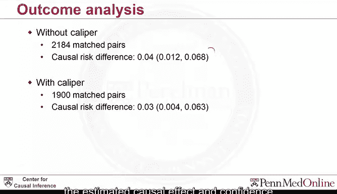

# 宾夕法尼亚大学《因果推断速成课程｜A Crash Course in Causality》中英字幕 - P28：28_03_03_R语言中的倾向性评分匹配.zh_en - GPT中英字幕课程资源 - BV1Ft42137BF

Hi， in this video， we will discuss how to carry out a matched propensity score analysis in our。

This will involves several steps， including how to fit a propensity score model and R。

 how to actually match on the propensity score， and then how to analyze the data after matching。

For the example， data， well use the right heart catheterization data。Which is publicly available。

So this involves ICU patients in five hospitals， the treatment is right heart catheterization。

 which we'll call RHC。The outcome is death。 yes or no。The confounders involve demographics。

 disease diagnoses， and so on。And there's a couple thousand subjects in each group。

And we've included on the website the actual R code that we'll discuss here。

So you would begin by loading the packages that there you'll want to use。

 reading in the data and viewing the data。And。In this analysis。Will use both。

The table 1 package and the match package。The the data itself has a lot of character variables。

 so this step just involves converting them to numeric variables。

And then we'll create the data set that we'll use。 So this is。What I'm calling my data。

Is a collection of covariates。Along with treatment。And outcome。So first。

 we'll begin by fitting the propensity score model itself。

Let's imagine that we're interested in a logistic regression。Proensity square kind of model。

So we can use the GM。Function here， where。Treatment is actually our outcome。

 so in a propensity score model， treatment is the outcome。

And then we list all the covariates that we want to control for。We tell what family equal binomial。

 So this is telling in。Are that our outcome is binary and by default it's going to use a Loit link。

 so what's going to carry out a logistic regression。And I tell it to use my data。And。

You might be interested in just looking at the some summary statistics from the model。

 So summary P model will what that will do is show us。Coeics and P values and so on。

 And this would just give you an idea about which variables were predictive of treatment。

 So this might be of interest。To is to have a better sense of， well。

 who actually receives the treatment， what is different about them？

It also can be used as a check to make sure that。What you're doing is sort of sensible has face validity that there's not any coding errors。

 for example， because you might have prior knowledge that certain variables will likely be associated with a much higher probability of treatment。

 and you would want to kind of confirm that that's the case。To actually create the propensity score。

 then is one additional step。 So we fitted the model when I called that P model。Now。

 if we want to actually create the propensity score itself， I just say， I'm naming it P Cor。

That I'm saying use。The model that we just fitted。And then extract the fitted values。

 which are just the predicted values。So this is all you actually have to do to get a propensity score for each person。

And here's an output from this particular propensity score model。

So this is just showing you the relationship between these covariates and the probability of treatment。

So as an example， if you look here for the variable female， so in this case。

 the coefficient is negative。So women are less likely to be treated。Thenhan men。

Significant P value and so on。 So this this is just something you might be interested to sort of understand better who is more likely to get treated。

And now we can look at the actual。Ppen distribution of the propensity score。

 And this is pre matching。 So before we've matched， we've calculated the propensity score。

 and now we'll look at。The probability of treatment。

And what we'll see here is the main thing here we're looking for is overlap。

 and what we see is that there's a lot of overlap between these。Two distributions。

And so that's really the main thing is that this everything looks good from this plot。

 we don't see any cases where at the tails of the propensity score。

 either everyone's treated or no one's treated that there seems to be overlap everywhere。

So now we'll use this。Package called matchet。So this is one way that you can carry out propensity score matching is with this package and。

So we going our output is going to be called M dot out。We're going to use Mant。

 And what we're doing here is with Man， you actually wouldn't have had to have fit a propensity model。

 propensity to score model first。I just wanted to sort of illustrate how you would do it if you wanted to carry it out directly but in match it they'll actually do that for you so what you begin by just giving it the formula。

 which is your outcome which heres in a propensity score monois treatment。

Then you list all of your variables。You tell what your data set。

And what I'm saying here is the method means what matching method you want to use。

 so I'm using nearest neighbor， which is greedy matching， you could also put optimal there。

But you would only want to use optimal if。You have a reasonably sized data set。

And so what this is going to do is it's basically going to calculate the propensity score and then do matching。

And I'm going to summarize the output。And I'm also going to create two plots。

 So this match package makes it very easy to create some plots to look at balance。

 So I previously just calculated the propensity score directly and created my own plot。

 But if you use the match package， it has some built in features that allow you to do that rather easily。

 I picked two particular types of plots。😊，Jitter and histogram。 And I'll show you what those are。

So this is the jitter plot。 I think this is quite useful in general。

 So you'll notice it's broken up into。Four different sections， so we have unmatched treated。

 we have matched treated， matched controls and unmatched controls。

And one thing you'll notice is that there， there actually are no unmatched treated。

So that's just empty。Everybody in the treated group。Was matched to somebody in the control group。Now。

 this part here。These are the actual treated and control subjects who were matched。

 And what you want to look at there is just make sure that these distributions look similar。

 So this is， again， propensity score distribution。And they should look very similar because now we've matched。

And in fact， I think they do look quite similar you if you look at these plots。

 they' sort of they're dense here in the middle and sort of sparse out on the tails and they look quite similar。

And this other part here is quite interesting， this。These are people。

In the controls who there were no matches for。Right so if you look。There's this one person out here。

Who there was there was just， there was nobody in the treated group who was a good match for them。嗯。

So there was this treated person had a fairly high propensity score and se it could have conceivably got matched to that person。

 but they got matched to somebody over here probably。

But what you'll see is the bulk of the people in the control group who didn't get matched were over here。

So they're people with low values of the propensity score。And so this makes a lot of sense。

 because the。Proreensity score distribution for controls were sort of skewed in that direction where they tended to have smaller values of the propensity score。

 So once you match， you're going to exclude a lot of end up excluding a lot of the people who were on that tail。

 because that was over representedpresented。 essentially， you can think of。

Controls who have small propensity scores is being overreed。And therefore， when we match。

 a lot of them get left out。So this is very useful for telling us。

Who got included in the match and who was excluded？And this is also some。

 this is the histogram output。 that's an automatic feature from matcht。 and this is。m raw here。面上。

Before matching， you can look at the propensity score distributions。

 and you'll see that for the controls， there's sort of more weight out here。You know。

 compared to treated。Which is what we'd expect。On the matching side， when we look。

For the propensity square distribution， you see that the shape of these are a lot more similar。

Then prior to matching。 And I should note that。I just use the default。Plot。

 but you'll notice that this axis here goes up to 2。 whereas this one goes to 3。

 and they would look more alike。If the one over here went to 3。 So that's why。

 they probably appear a little more different than they actually are。 So if I was going to。

Create the plot a publishable version of the plot I would have changed the access there。

 but I wanted to illustrate what sort of the automatic kind of output looks like and how easy it is to get useful information from。

A package like this。So I want to also illustrate how you can match with and without a caliper。

So now I'm going to illustrate doing greedy matching where we take a load of transformation of the propensity score。

And I'll do it with them without a caliber。 And this time。

 I'm going to use a package match rather than match it。 And the main reason for that is。

Just to illustrate how you can do this with different packages so you can see that。

A lot of these packages are fairly easy to use。WellFor the match package， I just tell what。

What the treatment is。I tell what we're doing one to one matching。And now， in this case。

 it's not going to calculate the propensity score for me。

 I'm going to have to tell what the propensity score is。

So I say match on Loit to the propensity score。 So P score is something I've already created。

And I say， take logicit transformation。So it's just going to do the logicit transformation of the propensity score。

 replace equal false means that I'm not going to allow people to be rematched once they're matched。

 they're removed from the data set。And now what I'm going to do is so it's propensity score matching。

 I haven't told it a caliper， so it's not going to use a caliper。

 And then I'm going to create a table 1 using the table 1 package。

So this is matching on load to the propensity score without a caliper， and you'll see that。

We've matched。21，84 controls and 21，84 treated subjects。And we can look at standardized differences。

 and we see that some of the standardized differences are a little bigger than what we would like。

Some of them are greater than 0。1。They're not bad， but they're a little greater than 0。1。

 So at this point， you might be not totally satisfied with matching because we would really like all of these to be less than 0。

1。So but just one additional step， we could also carry out an outcome analysis on that matched。

Data set， and if you did that， you would get a point estimate and a confidence interval。

Using a paired T test。But as I mentioned， maybe we're not happy with that previous match because。

 you know， some of those standardized differences were a little larger than we would like。

 So here I'm going to use a caliper。So I I'm going to use the match package again。

I'm going to tell it to match and load you to the propensity score。 But now I'm saying use a caliper。

And the important thing to note here is that。This value point2。This means。

02 standard deviation units。And so， because。I told it to match on logitude to the propensity score。

 a  point。2 means 02。times。The standard deviation of lo to the propensity score。

So the caliper isn't actually 02， it's 0。2 times standard deviation of lowi to the propensity score。

All the other steps are the same。 So this is so using a caliper is relatively straightforward。

 you just tell what the value。And now what we see is that on our table。

 the first thing you might notice is that there's fewer subjects who were matched。

So we have 1900 matched pairs。So that means there were some subjects that we were not able to match。

 And that's because of the caliber。 So previously， we matched them because。We didn't use a caliper。

 but now that we've used a caliper， we we identified， oh。

 some of these people that we were going to match。Were not now going to matchsh because their distance was too large。

 It was larger than we were willing to tolerate。So these should be better matches now because we are forcing good matches in a sense。

 we're not allowing bad matches。And so what you see now is if you look at the standardized differences。

 everything is less than 0。1。So just by having this caliper and preventing a small number of a relatively small number of matches。

 we're able to have much better balance here。So this is what the caliper should accomplish。

You'll notice that there's better matches， meaning。Standardized differences are smaller。

 but the trade off is there's fewer matched pairs。 so our data set is smaller。

So we would expect to lose a little bit of efficiency by having a smaller sample size。

 but we should have less bias because we have better matches。

We could then again carry out a outcome analysis。 I'm just doing a simple pair tea test。

Point estimate，95% confidence interval。p v you。And we can summarize that without the caliper。

 we found 21，84 matched pairs。And this was the estimated causal effect and confidence interval。

And without the caliper， we had 1900 mash pairs。And this was the risk difference in confidence interval。

 So in this case， the actual outcome analysis looks pretty similar。

The general conclusion would be the same。It didn't end up making a big difference on the outcome analysis。

So but this is something that you could do is。changenge the caliper to enforce better matching。

And then see if your conclusions change。 so here we see that even when we get a little pickier about who we match and end up matching fewer people。

 the conclusion basically would stay the same。