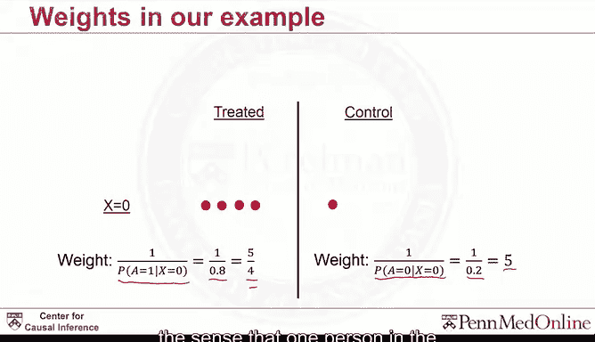

# 宾夕法尼亚大学《因果推断速成课程｜A Crash Course in Causality》中英字幕 - P29：29_04_01_逆概率加权处理的直观理解.zh_en - GPT中英字幕课程资源 - BV1Ft42137BF

H， inverse probability of treatment weighting is a method for estimating causal effects。

 In this video， our objective will be to gain an intuitive understanding of inverse weighting by relating it to matching。

As a motivating example， we'll focus on the situation where there's just a single binary confounder that we'll call x。

 so there's just a single variable that we need to control for。Now。

 let's also imagine that among people who have。This confounder value equal to1， so x equal to1。

 the probability of treatment is equal to 0。1。 So among people with x equal 1。

 only 10% of them would receive treatment。What this means is that the value of the propensity score for people with x equal 1 is equal to 0。

1。So everybody who has the value of x equal to 1 has propensity score。

1 so this is a subgroup of people who are unlikely to receive treatment Now let's look at the other group of people。

 those are individuals who have x equal to zero here the probability that a1 which is the probability of treatment。

Given x equals 0 is equal to 0。8。So in other words。

The subpopulation of people who have x equal to zero， their propensity score is 0。8。

 which means that。80% of people who have x equals0 will receive the treatment。

So people with x equal1 are unlikely to receive the treatment。

 whereas people with x equal0 are very likely to receive the we could depict this in a picture where we separate the treated and controls。

Fia this vertical line。And then we're using just blue and red to indicate the values of x so blue is for x equal 1 and red is for x equals0。

And this is just a hypothetical kind of situation where。

But that's corresponding to what we saw with the propensity score where。

For the people with x equal 1。The large majority of them， and in fact。

 90% of them are in the control group， and for x equals0。

 we see that four out of five of them are in the treatment group。

 which again corresponds to what we saw with far assumption about the propensity score。

So let's just focus on one of these groups for now。 So this is the x equal1 group。

 So this is a subpopulation and in that subpopulation。For every one treated subject。嗯。

You would expect to have nine control subjects， or in other words。

 one out of every 10 people with x equal1 is treated。 So that's what we would expect on average。

 So of out of 10 total people with x equal1， we would expect for one of them to be treated。

Now let's imagine we're going to do propensity score matching。

 so you see we have this imbalance here in the sense that。Among people with x equal 1。

 they're way more likely to be in the control group。

 whereas if you had a randomized trial and you were strictly randomizing people to treat it in control groups。

 you would expect an equal number of treated and control subjects in this subpopulation。

 So propens what propensity score matching would do then。

I remember that because there's only one covariate here。

Everybody with x equal1 has the same value of the propensity score。So all these 10 blue dots here。

 they all have the same propensity score。 So if we' were going to do propensity score matching what we would do is we would match one treated subject to one here randomly selected control subject So with propensity score matching the data that we would end up using is right here。

 we would just use all of that。And what we see then is that there's one person in the treatment group now。

 there's also one person in the control group， but there was originally one person in the treaty group。

So this one person in the treated group。So this person here， they just represent one person。However。

 in the control group， we now have one person that we've matched。

 but they actually count the same or。They're representing nine other people。Right， so。

This one person in the treatment group。Is essentially counting the same as nine people from the control group。

So that with that is an with that is a motivation right so the way we sort of we're creating balance with matching。

 we do this one to one kind of matching and then。In this example。

 a treated person ends up representing other nine control subjects or that represents nine people。

But rather than actually match， in which case you would discard some of your data。

 so in the previous slide， we saw that we would end up discarding eight controls。

But rather than do that， what we could actually do is downweight some of these individuals and upweight others。

So this particular treated person should end up having nine times more weight。

thanhan any of these individuals from the control group。

 so we saw that from the previous slide when we did that one to one matching。

 and we saw that the treated person counted the same as nine people in the control group。

So what could do then is just wait these observations to make that happen。

So that's what inverse probability of treatment weighting is actually going to do。

So inverse probability of treatment waitinging will wait based on treatment actually received。

 so for treated subjects we will wait by the inverse of the probability of treatment。

So that's a propensity score for so for treated subjects。

 we'll weight by the inverse of the probability of。Treatment。But for control subjects。

 we would actually wait by the inverse of the probability of not getting the treatment。

So in other words， you're always。Waiting by the inverse of the probability of whatever it is they actually received。

So treated subjects receive treatment， so we rate by the inverse of that probability。

 control subjects we receive the control， so we wait by the inverse of that probability。

So this is what's known as inverse probability of treatment weighting。Or I P， T W。

So we could go back to this example。Where we have one treated subject and nine control subjects。

And now we can wait by the inverse of the probability of， of their particular treatment。 So in the。

In the treated group。We want to wait by the inverse of the propensity score。

And recall from an earlier slide that the propensity score for treated subjects with x equal 1 was equal to 01。

So here we end up taking one and dividing by 0。1， which is a propensity score， or in other words。

 they get a weight of 10。So this one treated subject will have a weight of 10。

Whereas for the control subjects， we wait by one over。

The probability of getting the control treatment。So the difference here is we're looking for the probability that a equals 0。

Well， the probability that equals  zero。I's just one minus a propensity score。So this 0。9。

 that comes from 1 minus0。1。Because the probabilities have to add up to one。

 So if you have a 10% chance of getting the treatment， you have a 90% chance of getting the control。

So then our weight is 1 over 。9， which ends up being 10 nights。

So that's how much weight each person in the control arm would get。So in other words。

 one person in the treated group counts the same as nine people from the control group。

And in case that's not clear， just imagine applying。This 109th weight to each person。

 and then adding those up。And there's 9 of them。 There's 9 people in this control group。

 So in other words， we would have 109s times 9， which would equal 10。Which is the same。

As what we see in the treaty group。So by waiting in this way。

 we end up counting the collection of treated subjects the same as the collection of control subjects。

So among people who have the same value of the propensity score。

 though all treated end controls will end up getting collectively sort of counting the same。

 even though there might be more control subjects，The amount they contribute in the data analysis will be equal。

So there was a southern group of people which had x equals0。So let's focus on them for a minute。

And remember for that group， the propensity score was 0。8。So in that case， if you have x equals 0。

 you are。You had an 80% chance of getting treated。 so that's why we see。

F out of five individuals are in the treated group in this case。Now。

 imagine we want to do propensity score matching。So we would just。

Take there's only one person in the control group。 We would find a match for them in the treat group。

 In this case， they all have the same value of the propensity score。

 so we would just randomly select somebody from the treated group。

 And now we've done this one to one matching。So now one person in the control group counts the same as four people from the treatment group。

So that's what matching would do， propensity score matching here would end up。

What would end up happening is that one person in the control group would count the same as four people from the treatment group。

So now if we want to think about weights。Again， we would just wait by。1 over the probability of。

There is specific treatment。 So on the treatment side。On the treatment side。

 we see we would wait by one over the propensity score。

 So one over the probability of treatment given x equals 0。Well。

 the propensity score in this case was 0。8， so we have1 over 0。8。For a weight of five fourth。

In the control group。Now， these are people who did not get the treatment。

 so we would wait by one over the probability of no treatment。Well。

 the probability of no treatment is equal to 0。2， which is just 1 minus 0。8。

So we would take one over 。2。4 a weight of five。So in this case。

Waiting is accomplishing the same thing as matching in the sense that one person in the control group is counting the same。

As four people in the treatment group。So again， if you think of each person in the treatment group。

As having weight54， if you added up all those weights， you would get a five， which is the same thing。

As in the control group。So whether we do propity one to one sort of propensity score matching。

 or we do inverse probability of treatment waiting。

 we end up basically accomplishing the same thing where for a given value of X or for a given value of the propensity score。

 we're，End up counting the collection of treated subjects in the same way as a collection of control subjects as if it was a randomized trial。

