# 宾夕法尼亚大学《因果推断速成课程｜A Crash Course in Causality》中英字幕 - P2：02_01_02_因果关系的困惑.zh_en - GPT中英字幕课程资源 - BV1Ft42137BF

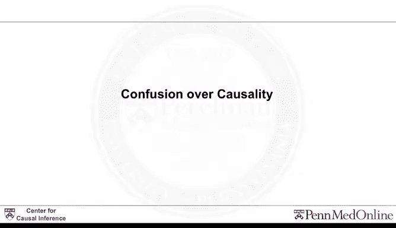

Hi， welcome to a crash course in causality。 I'm Doctor Jason Roy。

 associate professor of biostatistics at the University of Pennsylvania。😊。

This video is on confusion over causality。 We're going to focus on why causality is sometimes controversial or confusing。

We're going to use that to motivate why causal inference is an important field of study and also use it to motivate the rest of the course。

So our first topic is spurious correlation， and we're going to use this as one of the examples of a reason that causal effects can be confusing and it can be unclear whether one thing really does cause another and what we mean by spurious correlation is that。

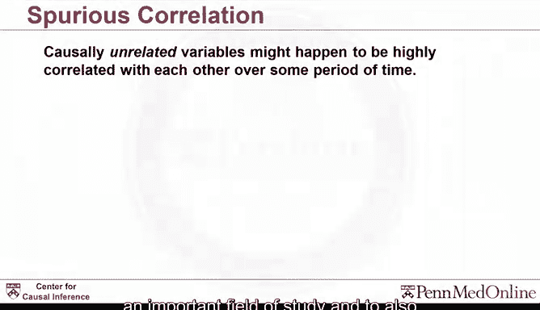

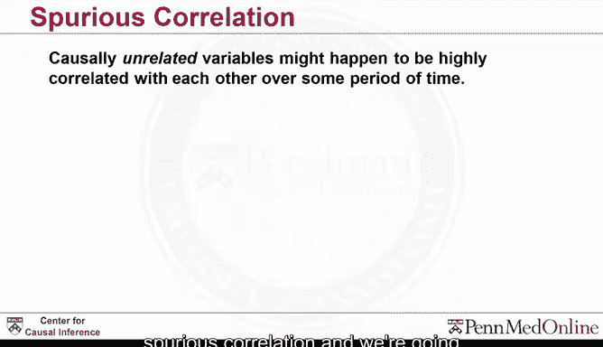

You could have unrelated variables that might just coincidentally be highly correlated over some period of time。

 There's a lot of examples of this， but one example of this is illustrated in this figure where we have divorce rates in Maine。

 which is the red curve and these are divorce rates from 2000 to 2009 and then we also have per capita consumption of margarin which are the black curves here。

 and you see that they follow each other very closely。

 So if you didn't know what these variables were， you might assume that these variables are related to each other are affecting each other but given that their divorce rates in mainine and and consumption of margarin。

 we suspect that these are actually causally unrelated。 And so in this case。

 it's kind of obvious that this is spurious correlation。

 we don't really think that divorces affecting consumption of margarine or the other way around。

 But you can imagine that these could be two variables where it's not quite as obvious。

 and then we would be left wondering as。

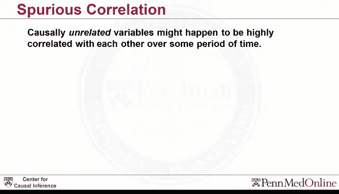

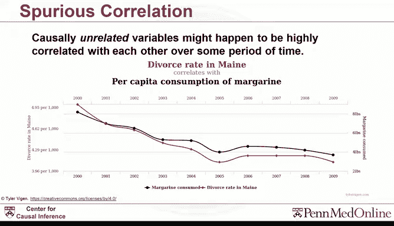

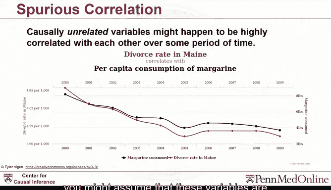

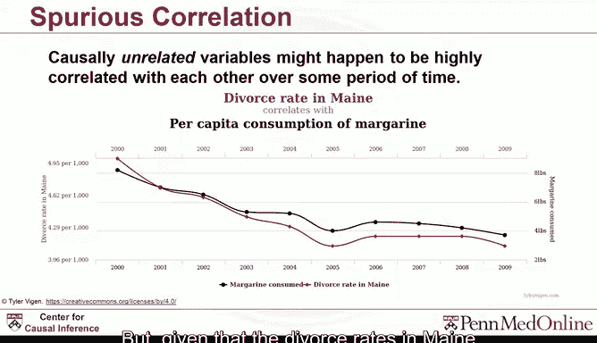

Surious correlation or is it actually causation So identifying these kinds of spurious correlation examples that people see in practice in the real world sometimes makes it it makes causality seem like something that we can't know because we see these kinds of curves and you say well if these look like they're correlated or causal and they're not then what about these cases that you're presenting me with where you're claiming there's causation how do we know it's not spurious so the field of causal inference is going to help us answer that Another reason that causal inference can be confusing sometimes is because of personal anecdotes So a lot of people have strong beliefs about causal effects in their own lives and they like to tell us about it so they share these stories with us and they sound confident they really believe that they know that。

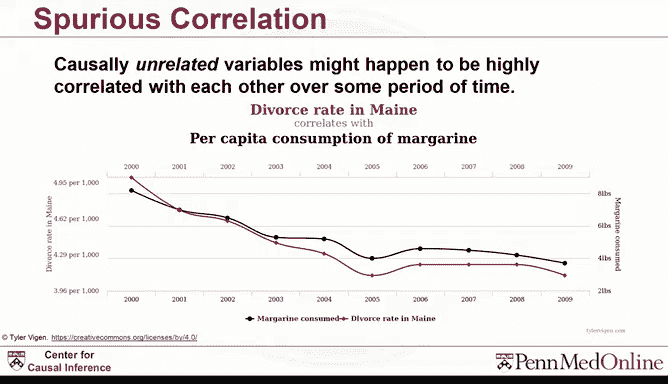

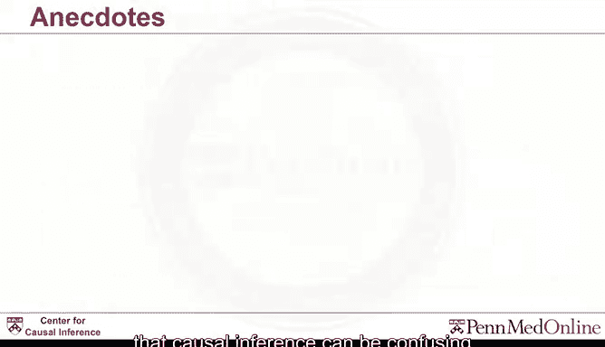

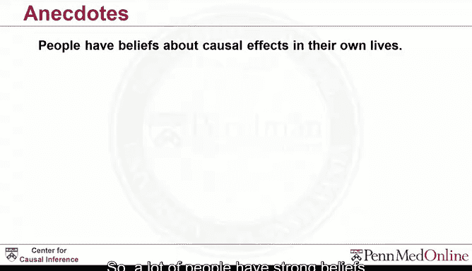

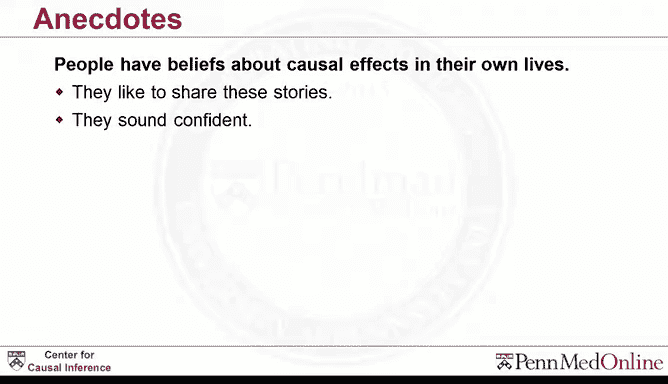

About actual causes in their own lives。 But it's not clear if they're actually right。

 So somebody might tell you a story about the last time I had this injury。

 I put this ointment on and it worked for me。 But how do we know they're actually right。

 So this is one question that we have to answer。 And I'll give you another example。

 which is a very common situation is that if somebody lives to be an old age lives to be an old age that will ask them。

 well， what was your secret。 So here， Bill Smith lived to be 1005 years old。

 One thing that he does unique that most people don't do is he has his habit of eating a turnip every day。

 And because he's one of the only people he knows that does that， and he's lived to be an old age。

 he he believes that that really helped with his longevity。

 But what do we actually know We know two things。 We know that he has lived to be 1005 years old。

 And。

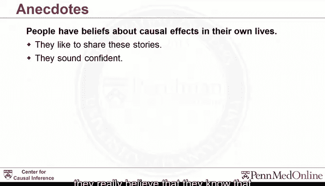

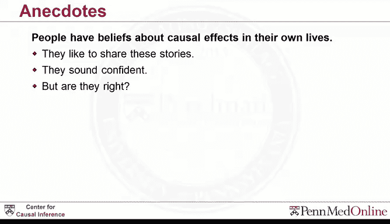

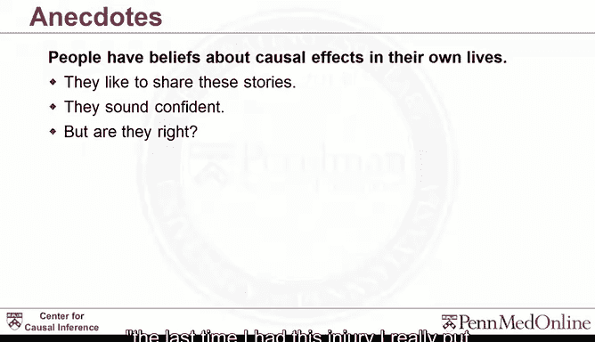

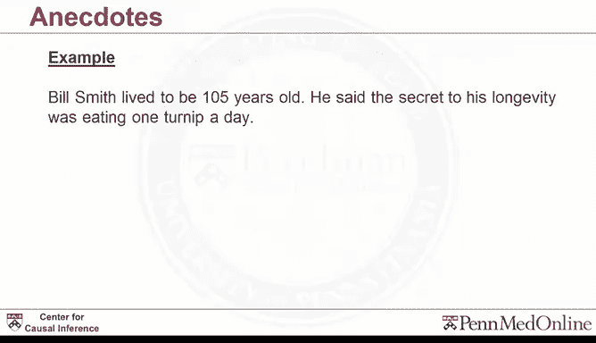

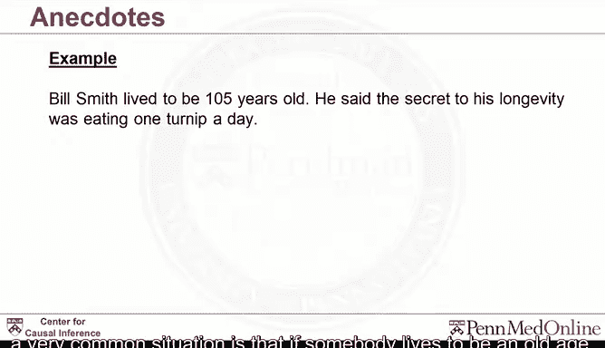

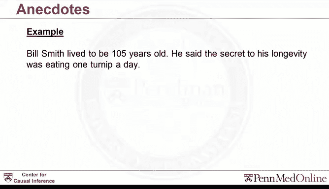

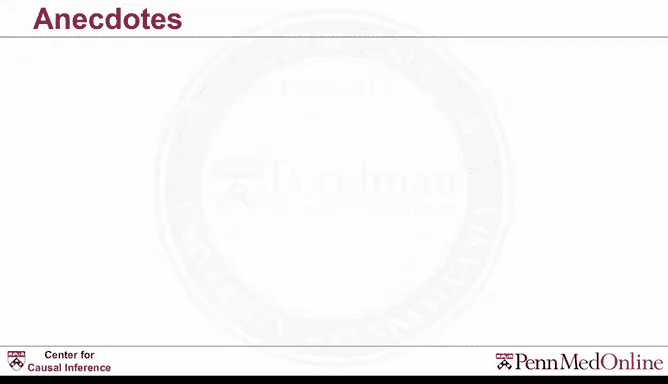

We know that he ate one turn up a day。 So we know those two pieces of information。

 but we don't actually know if what he ate contributed to his lifespan and you'll notice I say contributed because it also could be that his diet shortened his life。

 even though he lived to be an old age he lived to be 105 years old。

 maybe he would have lived longer had he and other things。 but we don't know if it's causal at all。

 So we don't know if it increased his lifespan decreased it or had no impact。And in particular。

 we don't know what would happen if other people adopted this habit。

 and this is really the implication of these kinds of anecdotes is that not only did it work for me。

 but I'm recommending that you do it because it would work for you。

 but we don't actually know if that would be the case。

 So another area that's controversial or it leads to a lot of conversations and skepticism and debate about causality has to do with science reporting and headlines。

 And a lot of times science reporters are careful to not use any form of the word cause but a lot of the words they use are kind of loaded and and get interpreted causally。

 So this is an actual headline that I found in the last few years。

 and it says diet high in red meat linked to inflammatory bowel condition and so people who read that headline might think okay。

 I shouldn't eat red meat and you'll notice the word here that's kind of loaded is linked when it's not clear what linked means so。

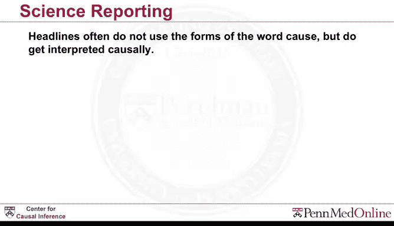

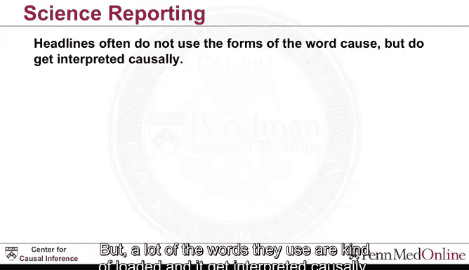

Are they saying that it's a causal relationship where if you eat less red meat。

 you'll be less likely to have an inflammatory bowel condition？Or by link。

 do they just mean something like the spurious correlation I showed a few slides ago where happen they happen to be related。

 but they're notly causally related。 So it's unclear from the headline what it really means you would have to dive into the study and read how the study was conducted before really making a decision on whether this is a causal relationship。

 So another example is that。There was a headline that said positive link between video games and academic performance study suggests。

 So again， the word link appears。 So this is very common with headlines where they use the word link。

 and it's not clear what it means。 They do temper it a little by saying study suggests。But again。

 it's it's not clear if this is causal in the sense that people who play video games might happen to。

B students who would have stronger academic performance regardless of whether they played video games or not。

 or it could be something about playing video games that helps with academic performance。

 Maybe it increases your concentration， for example。So from this headline， it's unclear。

Here's another example， prostate cancer risk soars by a quarter。 if men drink just one or two beers。

 So this certainly sounds causal because when they say risk sores。

 they're basically implying that the drinking affected the risk。

 that's the word soer sounds like that。 but certainly they weren't randomizing men to drink more alcohol to drink more beer。

 So this is a study that must have been observational And so men who consumed more alcohol seem to have higher risk of prostate cancer。

 But is it but if we made modifications， if people change their drinking behavior would that affect prostate cancer risk and it's unclear from the headline。

 whether that's the case。 although it's implied。 So again。

 we would need to really look carefully at the methods involved to see whether we can make causal conclusions。

 And finally， we have the clever headline health bracketet Ten reduces risk of death at any age。

Study suggests so one of the same。Situation where。The word here is risk of death。Is reduced right。

 so reduced is sort of the operative word。And again。

 of this does sound causal if you play more tennis， you're less likely to die at a young age。

 for example。But whether this is causal to me is unclear。And。

One thing about all of these headlines that I should note is because causality is unclear in general。

 it's sort of for any kind of headline like this， you can easily say， well， this is just correlation。

 correlation does not equal causation， but you could also share this headline if you were excited about the results。

How skeptical people are about headlines like this。 A lot of times depends on their point of view。

 So if you're a tennis player and you see this headline， you might share it on social media。

 You're very excited。 It feels good whereasas if you don't have as active of a lifestyle。

 Maybe you don't believe tennis is good for you。 You see headline like this。

 You might be very skeptical and you might say this is just correlational。

 So a lot of times how skeptically people view headlines depends on what their the prior beliefs are。

 And we want to move away from that to a large degree。

 we really want to look at the evidence as it is， how was a study designed。

 what statistical methods did they use， what assumptions did they make and then to make a judgment about causality based strictly on the evidence and not based on our prior。

😊，Beliefs so that so we covered spurious correlation headlines。

 Now we can get into what I'll call reverse causality。

 And here what we're thinking about is these situations where。The causal direction could be。Well。

 the relationship between two variables could be causal and in either direction。

 so if you think about a causal arrow， you could imagine it could be either direction。

 so I'll give a lot I'll give one example of this。 So let's say we're interested in the relationship between urban green space and exercise。

 So one hypothesis is that if you have more green space in a city。

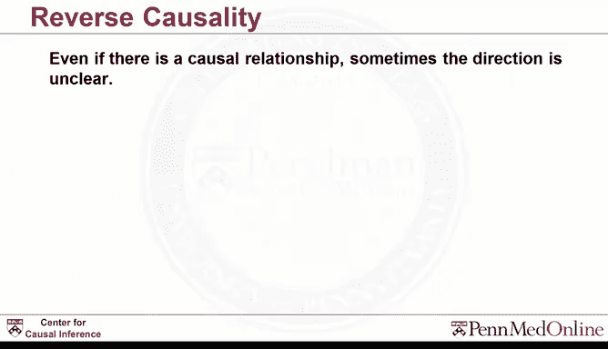

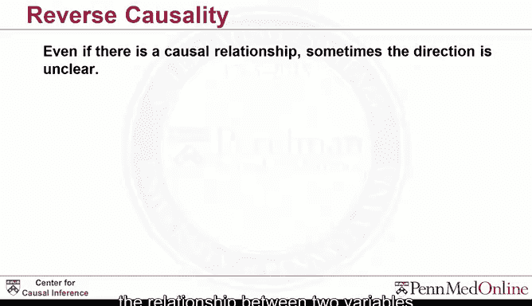

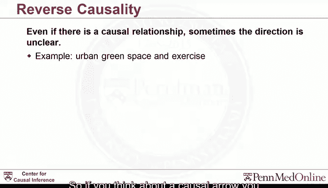

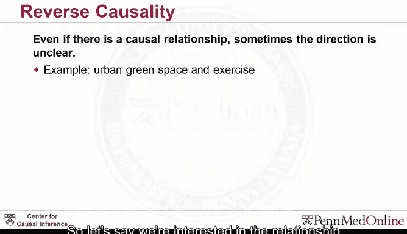

Then， that will。That would sort of be related to exercise， but how so I have a question here。

 are physically active people more likely to prioritize living near green space？

If there's a nice park in a city。Perhaps people who already exercised a lot would want to move there。

 right， So these people here say， because we like to exercise， we plan to move near this park。

So it could be that a city with a lot of green space will attract people who exercise a lot。

Alternatively， and this is probably the question that researchers would be more interested in who are perhaps interested in motivating people to exercise more。

 they might prefer the question， does green space and urban environments cause people to exercise more。

 so perhaps people who are already living in a city maybe how much they exercise would increase if you were to。

Build more green space if you had more parks。So these people here are saying if there was a park like this near where we live we would exercise more right so there's this relationship between exercising green space in a cross- sectional kind of observational study we might see when there's more green space there's more exercise but here the causal arrow could go in either other direction so the green space might cause people to exercise more or it might attract people who exercise to live there or some combination of the two and so to sort that out。

 we would need to carefully examine the temporal kinds of relationships between these variables and and try to have make sure that our data would be able to have some kind of signal about when there was a change in green space did that cause a change in exercise among people who already live there so these studies would have to be very carefully designed otherwise we're stuck in the space of wondering which direction the causal error goes so we've covered a lot of examples of why causality is。

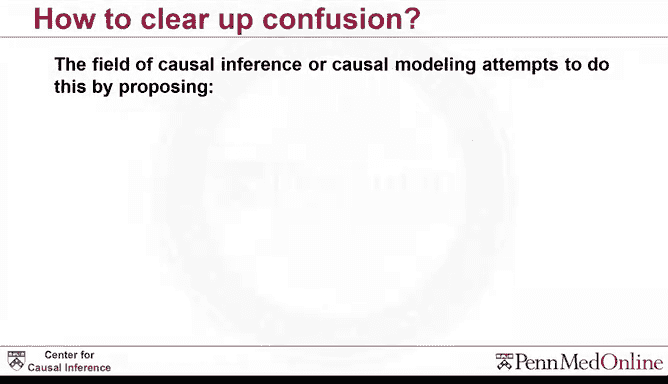

Confusing。And this is meant to motivate why we need a formal field of causal inference and why。

 for example， you're probably interested in taking this course。

 So the field of causal inference or causal modeling is attempting to sort of clear up a lot of this confusion。

 So one way is to come up with formal definitions of causal effects。

 what do we even mean by a causal effect And then once we know what a causal effect means and in particular what causal effect we're interested in for a particular research question or study。

 then what assumptions do we need to identify causal effects from data So we're either designing a study ahead of time and we know what kind of data we would like to collect or we already have data。

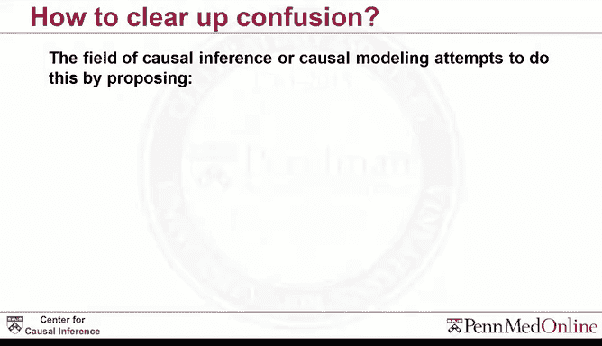

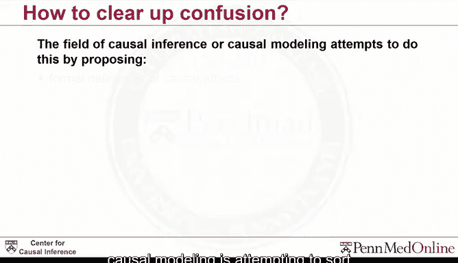

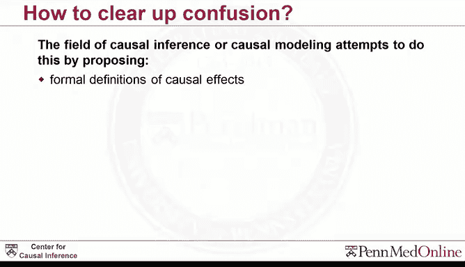

And we would like to know well， what assumptions would be necessary to be able to use these data to identify causal effects so the field of causal inference researchers in causal inference really worked hard at identifying causal assumptions what is it that we would need to assume to be able to get at these causal effects and related to that is in observational studies we're going to have to control for variables。

 control for what are known as confounding variables so variables that would affect our exposure or treatment of interest and also the outcome and then there are rules about what variables we would actually need to control for so we're going to spend a fair amount of time in future videos talking about what variables you would need to control for to be able to estimate causal effects and another important contribution of the field of causal inference is sensitivity analysis and what sensitivity analysis has to do with is looking at how sensitive your results are to possible？

violations of some of our causal assumptions so we have to make causal assumptions to identify causal effects but what if those assumptions are violated so sensitivity analysis tries to quantify that What if our assumptions are violated by a small amount would that change our conclusions what if our assumptions are violated by a large amount how much would that change our conclusions and so sensitivity analysis is an important part of causal inference and。

That is something that we will discuss later on and an important contribution of the field。

 I just wanted to give a very very brief history of the field of causal inference and in doing so I am going to leave a lot of important contributions out so my apologies to people who I left out but this is a very broad overview but these statisticians have been thinking about causal modeling for a long time so some of the key original contributions date back to the 1920s with Wright and Naman and but it's really become its own area of formal statistical research since about the 1970s and it's really been growing ever since so there's been a lot of research in the field of causal inference since the 1970s。

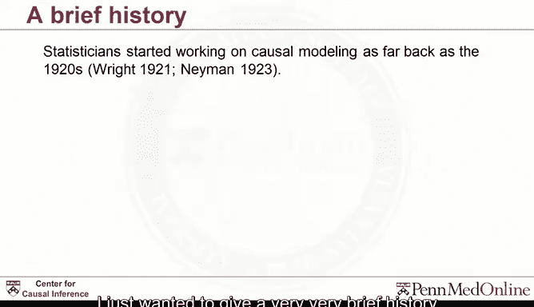

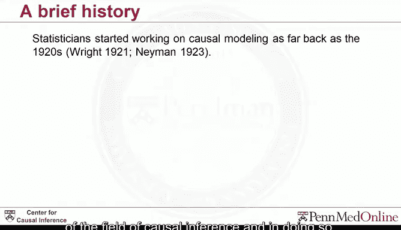

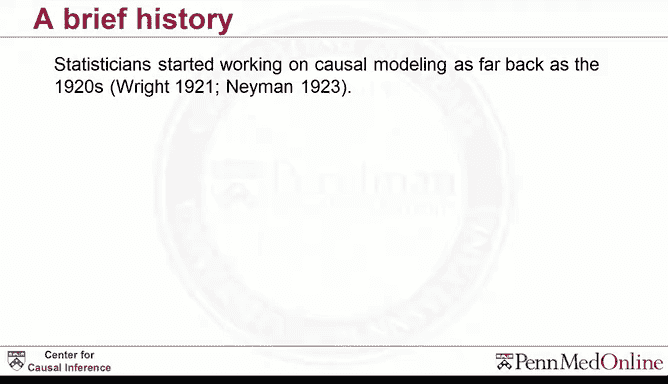

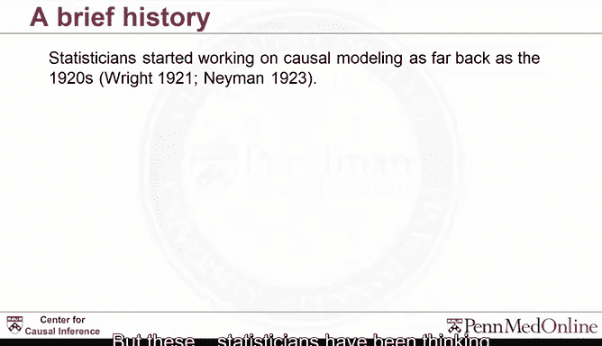

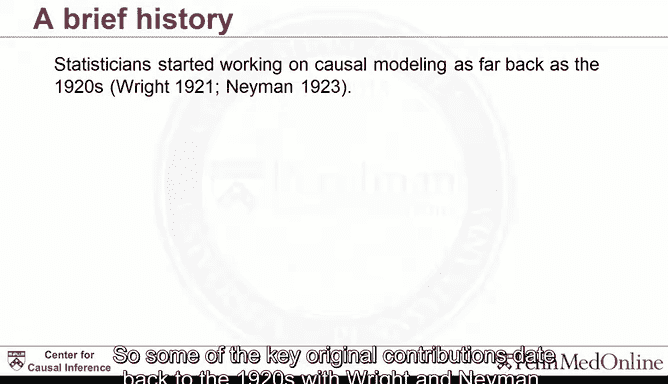

And I'll just provide a few highlights here。 So one of the most important things has been the reintroduction of potential outcomes。

 and one example of this is in the Reen causal model。

 which was from Reubens's classic paper in 1974 and we say the reintroduction of potential outcomes because this was actually talked about back in the 1920s in the papers I refer to above but it was to a large degree kind of forgotten over a few decades but since the 1970s it's been a regular part of the vocabulary and the thinking about causal effects。

 Another important contribution has been in causal diagrams with some key contributions by Robbin's Greenland and Perarl and will spend a fair amount of time in future videos talking about causal diagrams but they're generally thought to be very helpful in getting us to write down what we believe is happening in the world around us in particular with regard to the variables that we're interested in studying and once you write down these causal diagrams theory has been developed about then。

What variables you would need to control for to identify causal effects so we'll see that these causal diagrams are related to potential outcomes and the link between the two of them will help us in determining what statistical methods we use to actually estimate causal effects when it comes toestimating causal effects one major contribution has been in propensity scores which was first introduced by Rosenbaum and Reen and another major area of research in the last two to three decades has been related to what's known as time dependentent confounding。

 but you could roughly think of this as situations where treatments or exposures vary over time and exposures at one time affect a lot of different variables of future times and those variables affect treatment of future times so you get these feedback sort of loops happening and then how do you estimate the sort of joint causal effect of treatment over time on outcomes when all of these variables are affecting each other so this was a very difficult problem but a lot of progress has been made。

The key contributions were by Jamie Robbins and what are known as some of his G methods and so that's been from the 1980s onward there's been a lot of work in that area and another exciting area has to do with optimal dynamic treatment strategies and this is another very difficult research area where a lot of progress has been made in the 2000s and this has to do with what we mean by dynamic treatment strategies is not just is treatment A better than treatment B but for this patient that has these particular characteristics which treatment should I give them what's the optimal treatment for somebody as a function of some of their actual variables which some of those variables might change over time and how do you identify an optimal strategy as a function of some important clinical variables and so there's been a lot of progress in that area and then finally in the machine learning area there's this general method called targeted learning which has become popular recently which really is more of a machine learning type of approach。

Based on semi parametric theory and high dimensional data。

 which I think has had a lot of promising results， and this was mostly developed by Mark Vananderlannon。

His collaborators。So going forward now we want to think about where do we go from here so this video was meant to be to provide some background and motivation for the rest of the course so what we're going to do from here on out is focus on causal inference。

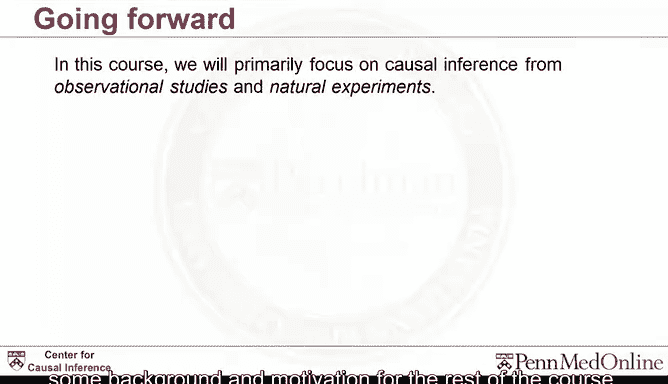

From the perspective or for observational studies and what are known as natural experiments。

 to a large degree we're going to ignore randomized trials although randomized trials will be part of our causal reasoning in randomized trials you're actually randomizing the treatment or exposure in observational studies。

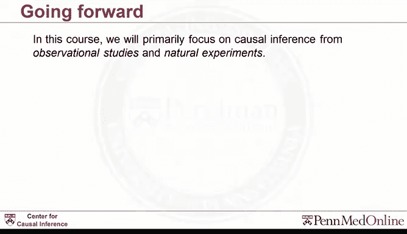

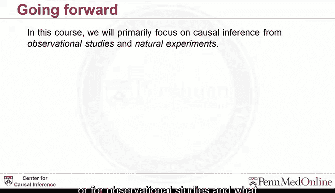

The treatment or exposure is just as it is in the real world。

 there was no direct manipulation and natural experiments we'll get into later。

 but theres sort of situations in the real world where something seems like it's randomized。

 even if we didn't formally randomized。

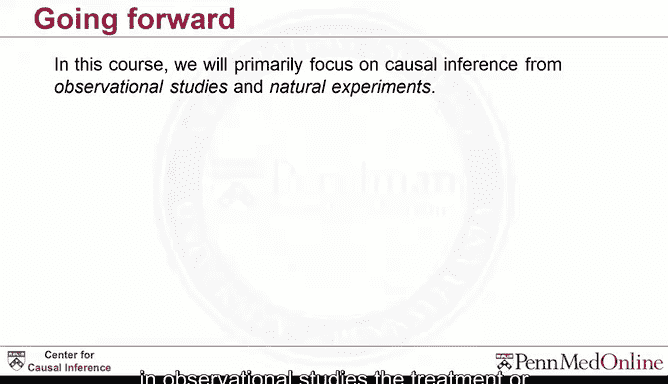

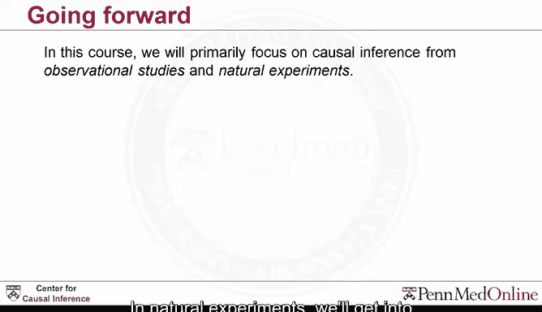

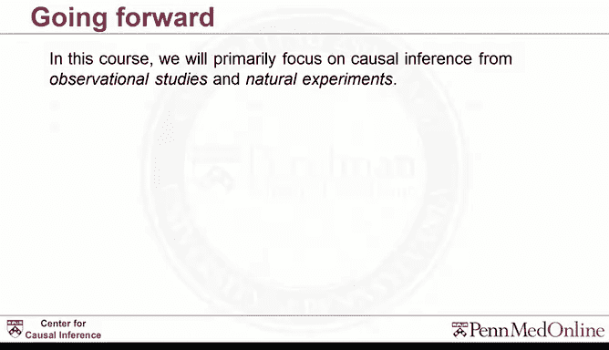

But it's important as we dive deeper into causal modeling to remember a couple of things。

 so one is that we will have to make some untestable assumptions。

Those are referred to as causal assumptions and what we mean by untestable is something that we can't really check from data to see if it's true。

 we're going to have to have some assumptions that are somewhat based on faith。But a lot of times。

 based on faith also means。Not just blind faith， but we will be able to tell to a large degree whether these assumptions sound plausible or not。

 But because we can't test them， they are assumptions that。We'll have to just trust is true。

 which is also why we。Carry out sensitivity analyses。

And there was this classic paper by Cochrane in 1972 on observational studies。

 and he reminded us that observational studies require a good deal of humility because we can only claim to be groping toward the truth。

 so even though we're studying the field of causal inference and we believe we'll do a better job at getting that causality。

 we're not going to know for sure whether we're there and so we need to have humility and sort of always keep that perspective in mind。

