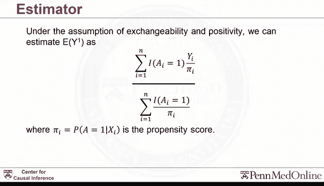

# 宾夕法尼亚大学《因果推断速成课程｜A Crash Course in Causality》中英字幕 - P30：30_04_02_逆概率加权估计的进一步理解.zh_en - GPT中英字幕课程资源 - BV1Ft42137BF

H， in this video， we're going to further build intuition for inverse probability of treatment waitinging。

 In particular， we're going to focus on how this type of weighting creates pseudopulations and in fact。

 creates pseudo populationulations that are unconfounded。As a motivation。

 we'll look at survey sampling。So in surveys it's very common to oversample some groups relative to others。

 so for example， you might ultimately be interested in looking at some minority group or older adults orese individuals or some other subpopulation that might be small relative to the larger population and you want to make sure that you get a large enough sample size of that group。

 so you might oversample one of these populations， so what you'll have to do then is if you want to say estimate a mean of the whole population。

 not just for one of these subpopulations， well then you're going to have to wait the data to account for the oversampling。

And so this kind of an approach is known as Horfords Thompson estimation。So we'll end up。

 you can over sampleample， and as long as you know the probability。

Of sort of the underlying sort of proportion of each group and the sort of sampling weights that you used。

 how much you oversampled by， then you can wait back to get the original population。

And so this is actually this relates to observational studies when we're thinking about comparing different treatments。

Because in a confounded kind of study， in an observational study where you have confounding。

 then you're typically going to have oversampling of either the treated group or the control group at various values of the covariates。

So in other words， you know， you could imagine that maybe healthier people are more likely to get one treatment than another。

 Well， you could sort of think of that as。A type of oversampling where you've sort of oversampled treated people in some sense。

 relative to your ideal situation where you had randomized。

 and then there would have been an equal number of treated to control subjects who are healthy。

So it's like survey sampling in that sense， in which case there's this potential to use waiting to get back to the original population。

 so what we're going to try to do then is use waiting to create a pseudopopulation where there's no confounding。

So as an example， let's think about a situation where we have a propensity score of 0。9。

 so this is what I mean here is that there's some subpopulation of people defined by X and the probability that they would be treated is equal to 0。

9， so these are people who are highly likely to be treated。

And so as you could represent this as follows where in the treated population。

 you see that there's nine red circles and in the control there's one。

 so that's the proper ratio where we're seeing nine out of every 10 subjects is treated so that's the original population and if you look at that that does look like oversampling right oversampling relative to the ideal you're sort of oversampling treated people relative to what you would have liked to have done。

 which is really a balance in the treated and control arms。

So what we can do is we can then apply waiting to get back to what we really want。

So for the treated group， we'll apply weights 1 over 。9， so one over the probability of treatment。

And that corresponds to a weight of 10 ninths， so each treated subject will get weight 10 ninths。

For the control arm。Will apply a weight of 1 over 。1。

That's one over the probability of being in the control arm essentially， given X。

So that's  one over 。1， which is equal to 10。So if you apply those weights。

What you would end up with is 10 circles in the treated group and 10 circles in the control group。

 because in the treatment group。Each one counts as 10 ninths of a person， there's nine people。

 so if you multiply 10 ninths times it's nine， you would get 10 people in the control arm。

 they each count as 10 people where there was one person originally in the control arm。

 but they count as 10 people。So we'll think of this as a pseudo population where we apply the weights and now we have this new population。

And in this new population， we'll see that there's no over sampling。

 it's perfectly balanced in the way that we would like as if it was a randomized trial。

So just to reiterate in the original population。Some people were more likely to get treated than others。

 and that was based on their covariates。But in this pseudo population。

 everyone's equally likely to be treated regardless of their ex values。And this is， of course。

 what you would like if you were doing a randomized trial。

 that would be the situation where everyone would be equally likely to be treated and it wouldn't depend on X because we're essentially flipping a coin。

So now let's imagine we actually want to carry out estimation。So。

Recall that if we want to estimate a causal effect。We're typically going to want to estimate。

Something like this， which here。

Is the expected value of a potential outcome。So this， and I just chose one of the potential outcomes。

 So this is the potential outcome under treatment。So the expected value of y1 is。

The average value of why if everyone in the whole population had been treated， so hypothetically。

 if we were able to treat everybody。啊。This would be the average value。

So that's one of the things we're interested in and we also would want the expected value of y superscript zero。

 so we would also want the mean of the other potential outcome。

 you would estimate that in a similar way， but I'm just going to illustrate how you would estimate the mean for this one potential outcome。

So I' walk through this particular formula。Which will hopefully make it more clear what's going on。

 But the first thing to notice is that。We have these two indicator functions。Here and here。

And we're also summing to n。 So N， let's imagine n is a total number of people in your population in your data。

 you've randomly sampled N people。 so you have n data points。

This indicatordic function is going to pick off the ones that were treated。

So this indicator AI equal1 is it's just a binary dummy kind of variable。

 so it takes value1 if treated zero if not。So it's just a on off switch if you're treated。

 it's flipped on， and that means you keep that value if it's equal to zero， we're going to ignore it。

Okay， so this is just a sort of fancy way to say we only want the treated subjects。Okay， so now。

If you didn't have any confounding right， we could just take the usual kind of sample mean if we wanted to estimate the mean of why among treated subjects。

 we would just take the sample mean among treated subjects， but here we have confounding。

So we actually want to take the sample mean of the pseudo population， not the original population。

 because the original population has confounding。So this is all we're doing here。嗯。

This part here is the。Sudopopulation， so it's a value of y in the pseudo population。

 so it's going to either upwe or downweigh the particular values of y。So if you add that up。

So this we have a summation symbol here， so we're adding。So in the numerator here。

 we're just adding all of the wises in the treated pseudo populationopulation。

 so that I say treated because we're picking off the treated subjects and I say pseudopopulation because we're waiting。

So we're adding up all the values of Y in the treated pseudo populationulation。

But we don't want to sum here right we we dont want to just add up the values of y we would then need to divide by some kind of total。

 just like if you were taking a sample mean you would add all the values of y and divide by n。

 Well here we need to divide by something。Well what we need to divide by is a number of subjects in the treated pseudo population。

So that's just essentially the sum of the weights。 so we still have to。Say only treated subjects。

 but then we're just going to add up their weights。So then if you do that division。

 we'll end up with。A valid estimate of the。啊。Mean of the potential outcome。

 and that's all assuming that。Our typical kinds of assumptions are met。 So exchangeability。

 which is also known as iorability， so that。Our exs have fully captured confounding。

So therefore treatment assignment is random given X and also positivity。

 which says that the propensity score essentially is going to be strictly between zero and  one。

 so it's never going to be exactly zero or exactly one。

 everyone has some nonzero probability of getting either treatment。

And these pis here just as a reminder， these are the propensity score。

I would like one additional comment about this， which is。

You can also kind of see why positivity is so important because you'll notice we're dividing by a propensity score itself。

 so if the propensity score is actually zero， you would be dividing by zero and we would have a problem so that's just order to further reiterate the importance of the positivity assumption。

