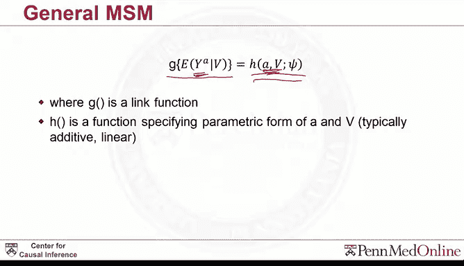

# 宾夕法尼亚大学《因果推断速成课程｜A Crash Course in Causality》中英字幕 - P31：31_04_03_边际结构模型.zh_en - GPT中英字幕课程资源 - BV1Ft42137BF

Hi， this video was about a particular type of causal model。

 which are known as marginal structural models。And our objective is to understand what these models are and especially how they differ from ordinary regression models。

 so previously we talked about inverse probability of treatment weighting estimation for just simple kinds of causal effects。

Such as an average causal effect， how could you estimate the mean of a potential outcome。

But these this general approach， this inverse probability of treatment weighting can be used to estimate parameters from more general causal models。

 so more complicated kinds of causal models， so you might not be simply interested in。

Average causal effect， you might be interested in something more complicated。

 it could involve treatment effect。Modification。Ofse。啊。Or other things of that type。

So a marginal structural model is a model for the mean of potential outcomes。

And so the word marginal is coming from the fact that it's not going to be conditional on confounders。

So ultimately we're interested in a population average causal effect。

 so an expected value of the potential outcomes。For the whole population， not conditional on X's。

 not given some subpopulation， we really want to causal effect for some whole population。

 So that's what marginal means。 So population average。

marginalgi typically you could think of it as averaging over， averaging over some whole population。

And then the structural part of the phrase here。It has to do with the fact that we're modeling potential outcomes as opposed to observed outcomes。

So to begin， we'll look at a linear marginal structural model。So。The first thing to notice is that。

Our model is for an expected value of a potential outcome。And in particular。

 it's a model for a potential outcome at some value little a and we'll say that it's linear in a itself。

 So Psi0 onces I1 our parameters。 So these are things we would want to estimate。

 So they're unknown parameters。 And let's imagine that a can just take value 0 or1 for now so this could be like control versus treatment。

And so in this case， the expected value of y0。In other words。

 the mean of the potential outcome would just be size 0。

Because a would equal 0 So this part here would just go away。Whereas the expected value of y1。

 the expected value of the potential outcome， if everybody was treated， is equal to psi 0 plus Psi 1。

So then you could take the difference of that and get an average causal effect。

So Psi 1 here would have a causal interpretation。It would be this average causal effect。

 which is the difference on potential outcomes。So this is one example of a marginal structural model。

 it's a very simple linear marginal structural model。

You would typically use a model like this if you had a continuous outcome。

So this should look similar to a linear regression model with some key differences。

Which we'll get into in a moment。But in general， the primary key difference is that we're modeling potential outcomes as opposed to ob outcomes。

So here's a logistic marginal structural model which you might use for if you had a binary outcome。

So we have now we have logit of the expected value of the this potential outcome。

 So this is just a log adds。Of the expected value of this potential outcome。 But since it's binary。

 you could also think of it as。Well， you can think of the expected value of。

Of Y A as a probability that Y a is equal to one。So we have this logistic model。

And we'll say that the logit of that propensity。I think we should redo this one。

So the key difference。Between a regular regression model and a marginal structure model is that we're modeling the potential outcomes。

收到。Further cement that idea。 We'll look at a logistic marginal structural model。

 So this should look similar to a logistic regression model with the key difference being that。

You'll see the potential outcome there。 So we have logit of the mean of why。

But here we're talking about the Y A， the potential outcome。 So logicit of that potential outcome。

 of the mean of that potential outcome is just linear N A。

So this is sort of like a linear logistic kind of model。

And I should note as a reminder that if you take the mean of a binary outcome。

 that's just a probability。 So it's a probability that is equal to one。 So the expected value of why。

A here， that's just probability。Y a equal 1。 So those are equivalent。So we have log adss。

That y equal equal1 is linear in a。And what that says is that if we were to exponentiate this psi 1 parameter。

That's a causal odds odds ratio。 It's a causal odds ratio。 and so we can。

Just to clarify what we mean by a causal odds ratio。We have the odds that y1 is equal to one。

 that's this part。And we remember， an odds is just a probability over 1 minus that same probability。

 So we have the odds that y1 equal 1。And then we divide by。The odds that y 0 equals 1。

And so that's what we mean by a causal odds ratio， so in the numerator is the odds that y is equal to one if everybody in the entire population had been treated。

And in the denominator， it's the odds out why it is equal to one if everyone in the entire population wass given the control。

So those were a couple of very simple marginal structural models。

 but you could have much more complicated marginal structural models。

So here we'll consider one with effect modifiers。 So here this is also known as heterogeneity of treatment effect。

 So in other words。The treatment effect might vary across subpopulations。

 and we might be interested in that。So let's imagine that V is some variable that modifies the effect of a。

 So let's just， for now， think of V as a single variable。

So this could be something like it could be some kind of comorbidity like diabetes， yes or no。

It could be sex or race or anything like that， so this is something that might modify the effect of treatment。

 or in other words， at different values of V there might be different treatment effects。

Well you can include that in a marginal structural model。Where now。

We have the expected value of this potential outcome， but now we're conditioning on V。

So we're not conditioning on all of the confounders， we're only conditioning on this， in this case V。

 the thing that we care about in terms of effect modification， so you would pick this ahead of time。

 you might decide ahead of time that for most of the confounders you just want to control for them。

Average over them marginalize， but there might be some small subset of them that you care about in terms of effect modification。

And if you do， that's what you could include it in this way。

So you're only conditioning on the effect modifiers V。

 in this case we'll just say we have one effect modifier。Well。

 we can then include that in a marginal structural model here on the right hand side where we just have a main effect for treatment。

 a main effect for V， and then the interaction between the two， a times V。

So then if we wanted to think about how to interpret these well one。

One way you could think about it is just if you wanted to contrast。The potential outcomes。

 the mean of potential outcomes for a given value of V。

So here we're taking a difference in the mean of the potential outcomes at a given value of V。Well。

 that's just equal to。Si 1 plus Psi 4 times v。Because you know what difference in these means。

 so the other terms just cancel out and the only things were left。

 the only part we're left with is psi 1 plus psi 4 times v。And so then you could。

 then you would know if this marginal structure model was correct。

 then I could tell you a value of V， And you would know what the causal effect is。

 So we would actually estimate these parameters。 We would estimate these psi parameters。

 And so if you knew。If you had an estimate of Psi1 and Psi 4。

 then you could also estimate the corresponding treatment effect at any value of V。

 so you could just plug in a value of V and you would get out a causal effect。

So then you could also think about more general marginal structural models。

 So I'm going to write it just。In a general sense here， so we have。

G of the mean of the potential outcomes， conditional on V。And so G here is a link function。

 So think in terms of generalized linear models， except。It's。

Except we're using potential outcomes instead of observed outcomes。

 So if if you're familiar with generalized linear models。

 this should look similar in that we have a link function G。We have a mean of an outcome here。

 it's a potential outcome， conditional on some variables。Here V。

And then we'll say that that ends up equaling。Some combination of A and V and then parameter psi。

So this H function is something we'll specify。 So an example of this H function is what we saw in the previous slide where it was just。

It was an intercept plus a main effect for A， plus a main effect for V。

 plus an interaction between the two。So that would be one example of this kind of an H function。

 but you could also imagine， let's say V is a continuous variable。

 you might want to have a quadratic term or something。

You could this right hand side should be familiar in terms of it's tip the kind of thing you would specify in a regression model。

 So it's usually some kind of additive， linear thing， but you could have a quited add term in there。

 anything like that。 But the key is that here we're modeling the potential outcomes， So therefore。

 if we estimate these size， if we're able to estimate these size。

 we can end up having estimates of causal effects。So the key question then is。Well。

 the key issue to think about is that。These potential outcomes are。Are not the same as observed data。

So it's not quite a straightforward estimate。The parameter size is it is in a regression model and a regression model。

The thing on the right here would be observed data。The stuff on the， I'm sorry。

 the stuff on the left here would be observed data。

 The stuff on the right here would be observed data。

 So since it's all observed data estimation is relatively straightforward。

So we'll have to think about how we could actually estimate these parameters。

 given that the thing on the left involves potential outcomes as opposed to observed data。

