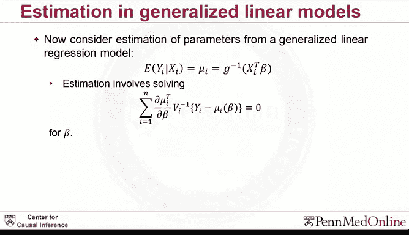

# 宾夕法尼亚大学《因果推断速成课程｜A Crash Course in Causality》中英字幕 - P32：32_04_04_逆概率加权估计.zh_en - GPT中英字幕课程资源 - BV1Ft42137BF

This video was about inverse probability of treatment weighting and in particular。

 using that methodology to estimate parameters from a marginal structural model。

 and we'll focus on how to do that on a conceptual level。

So before we get to estimation of parameters from a marginal structural model。

We'll first review how you would estimate parameters from a standard regression model。

 So let's begin with a linear regression model。So this is a pretty standard looking linear regression model。

 and you'll notice here that what we on the left hand side is an observed outcome as opposed to a potential outcome。

 So that's observed data。And。Will say that the observed outcome。Is related to， say。

 covariance x in a linear fashion plus a error term。

 which is typically mean zero constant variance kind of assumption about that。

 So the error term is just random noise。X beta means it's linear in x， the mean is linear in x。

And so then if， if you want to estimate。Beta。Then you would typically you could you could use a least squares approach and what that ends up。

 So basically， you would minimize least squares so you would have。

You would have y and you would subtract x beta。You would square that， add it up and minimize it。So。

 in other words， you want to sort of minimize the distance between y and x beta。 what value of beta。

 what beta hat would minimize that distance。Well， estimation。

 that kind of least squares estimation ends up。 you end up having to solve something like this。

 So this would be after a couple steps of。Sort of a calculus slash algebra step where you're trying to minimize least squares。

 You end up having to solve something like this。And so you'll see that so this is an estimating equation because we have something in on the left involving data and the parameter ands on the right。

 it's equal to0。 and you can solve that to get the parameter。

 So this is a standard kind of equation for estimating parameters from a linear regression model。

 And so this value of beta， which we'll call beta hat minimizes sum squared deviations。

 So it's really trying to minimize you know the distance between y。

 Now if we could also think about generalized linear models。 So in a generalized linear model。

 it would look like this where you have the expected value of y given x， we'll call that mu。

 So that's the mean And then that would be equal to some linear part x beta。 but。

Wrapped up in this function， this G inverse where G is a link function。

 So G inverse is the inverse of the link function。 So， for example。

 if you had a logistic regression model， G inverse would be the inverse of the Loit function。

So examples of generalized linear models include linear regression， logistic regression。

 Poisson regression， well。You can end up estimating beta by solving an estimating equation。

And so that is what we're showing here。 So this is anestim equation。 So you have。

The derivative of the mean with respect to beta， some variance term。

 and then the then y minus the mean。And you can end up solving this for beta。

 and that would give you the usual kind of estimate of beta in this case。

 from a generalized linear model。So now we want to think about how to do that kind of an approach except for marginal structural models。

So remember， for marginal structural models， we're modeling the mean of potential outcomes。

As opposed to the mean of observed data。But you'll also notice that a marginal structural model looks a lot like a generalized linear model。

 So， for example， we would have the mean of the potential outcomes as as one example of a marginal structural model is this one where we have the inverse of the link function and then some linear。

Term here， which is just involving treatment。So it's just a linear function of treatment。

So it looks like a generalized linear model except for it's a potential outcome。

So this is not equivalent to a regression model。 So I'm emphasizing that here and。You'll notice。

 you notice there's two things actually here to pay attention to。

 One is that in a in a regression model， we would be conditioning on the observed。

Random variable treatment， capital， a。And you'll see capital A over here。

We're not setting8 to whatever we want。We're conditioning on it。

 so in other words it's restricting to the subpopulation of people who have treatment capital A。

Whereas up here。We're setting a。 So there's little a， there's little a。

 We can set that to be whatever we want。 This is， this is a model for。Potential outcomes。

 So we're im in some world where we were able to set everybody's treatment a little way。

So we're not conditioning on capital A here。 We're setting treatment to little A。

 So in previous videos， we talked about this the important distinction between conditioning and setting。

 So for the marginal structural model， we're setting for the regression model your conditioning unit and these two things are generally not going to be the same because of confounding。

 So if you had a randomized trial。Then， then fittingging this regression model should be fine because there's no confounding and。

Pararameters from this regression model should represent a causal effect。

 but otherwise they shouldn't because of confounding。However。

 the situation isnt hopeless because we have learned that you can create a pseudopopulation using inverse probability of treatment weighting that's free from confounding。

 So as long as we assume ignoreorability and positivity。 as long as those assumptions are met。

 we can create a pseudo populationopulation。 where there's no confounding。

 And so that's the idea for estimating parameters from a marginal structural model is if we use these weights。

 then we can apply those weights to the observed data， we can create this pseudopopulation。

 now the pseudopopulation doesn't have confounding and we can just use then standard estimating equations that you would use for a generalized linear model。

 So in fact， we can estimate these causal parametersi using this estimating equation here。

 And you'll notice the key difference between this in the generalized linear model 1 from a couple slides ago is that weve stuck in this W。

 these are the weights。 So this is one over your probability of the or observed treatment。

 And all this is going to do is then。Rather than analyze the original outcome data。

 we're going to analyze the pseudop outcome data。 That's the one that's unconfounded。

 So now we can actually use standard sort of regression technology to estimate causal effect。

 And I know here that the weights， I'm writing it in the slightly fancier way where。

Because a is binary。 This is， that's just an indicator function。

And we have the same kind of thing over here。 So if a is equal to one。If a is equal to1。

 it's going to use this part of it。Because if a is equal to 1， this part over here would be 0。

 and it would go away。 Whereas if a is equal to 0， then we'll use this part。

 because this part would go away， which is exactly what we want， right， If a is equal to one。

 we want to use the first part， which is a propensity score。If a is equal to0。

 we want to use the second part， which is the probability that you're in the control group。

 So it's just a fancy way to write what we've talked about before。

So hopefully the intuition is clear here is that we can apply。

 we can't just use a standard regression model。Or fit a standard regression model and get causal effects out of it because of confounding。

But if we use weighting to create a pseudo populationulation that's unconfounded。

 then we can use standard regression technology to estimate causal effect。

So we can actually then write out the steps for estimating parameters from a marginal structural model。

So first thing you might want to do is estimate the propensity of score itself。

 so remember that's a you're modeling the probability of treatment given confounders。

So as an example， you might want to fit a logistic regression。And then you'll from that。

 you'll get the。From this propensity score model， you can then。Get predicted probabilities。

So for treated subjects you would want the probability of treatment。

 for controlled subjects you would want the probability of not getting treatment。

So we can directly output that from。A propensity score model that you fitted。

Then we can create weights。So we， you know of so far treated subjects， we would just。

We would set their weight equal to one over the propensity score。And for controlled subjects。

 we would set their weight equal to one over1 minus the propensity score。

 which is the same as one over the probability of not getting treatment。

Okay so now we have our weights， then we would need to specify the marginal structural model that we're interested in。

So are you interested in just a sort of standard kind of？

Marginal structural model with no effect modification。Are you interested in effect modification。

 You have to figure out what kind of model you're interested in and also you would want to think about what your outcome is like is it continuous is a binary。

 is it count so that would also help you decide what kind of model you want So for example。

 if it's continuous you would typically want a linear kind of marginal structural model if you had count data like number of hospitalizations you might want a poisson kind of。

Log linear model。But once you've specified a marginal structural model， then you can use software。

And specify a regular generalized linear model， But then tell it to do a weighted version of it。

 Some most software， Sta software that can fit generalized linear models。

Willll have an option where you can set weight s to something so you can do a weighted version。

So one final important point is that。You want we've done all this waiting and the weighting can kind of make the sample size look bigger than it really is。

 So we've seen examples where you might start with one person in one group in nine and the other and after waiting there's 10 in each right so。

It appears to be artificially inflating the population size。

So you wouldn't want to just report the standard errors。Out from this。

Without doing some kind of fix up for that。 So we have to account for the fact that we've waited when we estimate variances。

 Well， a pretty straightforward way to do that is to use asymptotic or what are known as sandwich variance estimators。

 So these are。Really common in statistics software。 So for example。

 if you use generalized estimating equations。It would typically automatically output these robust。

Asymptotic variances， but you could also use bootstrapping if you use bootstrapping。

 that would also properly account for the fact that you're waiting。But so it's not difficult to do。

 but it's something to keep in mind。