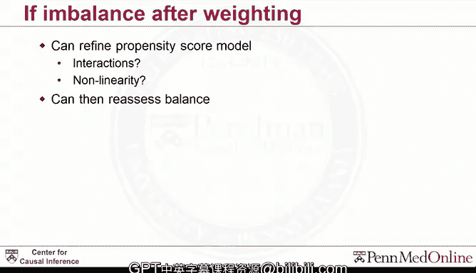

# 宾夕法尼亚大学《因果推断速成课程｜A Crash Course in Causality》中英字幕 - P33：33_04_05_平衡性评估.zh_en - GPT中英字幕课程资源 - BV1Ft42137BF

This video is on assessing balance and in particular。

 assessing balance when you use inverse probability of treatment weighting。

 so the weighting creates a pseudopopulation or a weighted population。

 and we would like to be able to assess whether we've achieved balance on the covariate distributions between the treated and control groups。

So after we've created our after we've fitted our propensity score model and we've created these weights。

 we can then。Apply the weights to our data。And then would what we would like to know is well did weighting work so did this IPTW method work in terms of do we now have balance in our covariate distribution in the same kind of way that you would expect to have balance。

If you had a randomized trial。So what we would like is for our weighted sample to really look a lot like it would look had we actually randomized？

So we can do this in a couple of ways。 So a common thing that people do is create like something like a table one。

Which is really， again these kinds of summary statistics for example。

The means of the covariate of each covariate。Straatified on treatment group。But in this case。

 using weights， so sort of weighted means and do these weighted means look similar？And。Typically。

 then we would use standardized differences to really assess whether there's balance。

 We can also look at plots so we could look at tables and also you could look at plots to see how well it's done。

So as a reminder just of what a standardized difference is in general。

So right now we're not thinking about waiting， just imagine we want to look at us。On our raw data。

 for example， where we have treated subjects and control subjects。 Well。

 what we would do to get a standardized difference is just take the sample mean for the treated subjects。

And the sample mean for the control subjects。Take the difference and then divide by what's essentially a pooled standard deviation so you could take the variance of the for the treated subjects。

 the variance for the control subjects， divide by two and take the square root as an example to get a pooled standard standard deviation。

 So this would give us a standardized difference。 So what's a standardized difference in the mean。

And you would do this for each covariant。So x this this x bar here。

 the sample mean is for a particular covariate， and we would do it for every covariate。And also。

 as a reminder， it's very common to just report absolute values。

 So you might want to take the absolute value of that。 You don't， you know， standardized differences。

Could be positive or negative， but a lot of times people just report the absolute value。

 because we're mostly interested in the magnitude of the difference。

 as opposed to the direction of the difference。Okay， so how do we。

Obtains standardized differences after waiting。 Well， it ends up being the same kind of idea。

Where we are interested in a mean difference divided by a pooled standard deviation。

 except here it's just going to be weighted means and then essentially a weighted pooled standard deviation。

So what we would do is we would stratify a treatment group。And then for each covariate。

 separately for each covariate， we would calculate a weighted mean and a weighted variance。

And then we would， we could put them together using the same kind of formula。

And so you could do this essentially by hand。 You could， you could actually。You have the weights。

 you have the data。Go ahead and calculate them。 Or there's a lot of software packages that were developed for surveys that you could use。

 So I mentioned this survey design package in our， for example。 So there's a lot of。

Statistic software have options where you can get。You know。

 weighted means and weighted variances and so。 So So we we once we can weight our our data and then get the standardized differences on the pseudo population。

 And then， of course， the goal is that hopefully these standardized differences are low after we've waiteded。

As an example， consider the right heart catheterization data。Where in that data set。

 RHC is a treatment and no RHC is a control。And here we have。

 there's a few thousand subjects in each group。So， we have n。And of about 3，500 in one group。

 2100 and the other， so that's control versus treatment。

 and then we I just chose a handful of variables to compare， so we have age sex， blood pressure。

 and then a few comorbidities， sort of medical diagnoses， such as heart failure， colon cancer。

 and so on。And then to the far right here， we have SMMD， which is a standardized mean difference。

 So that's this and this is all on the raw data， unweighted data。

And you'll notice that there's a few standardized differences that are。Fairly large。 So， again。

 we would like standardized differences to be less than 01。We see for the blood pressure， one。

 it's the standardized difference is about 0。4。We see a point4 at the bottom for sepsis。

For coma and so on。s So there's quite a few that whether it's showing imbalance。Next。

 what we'll do is we'll use the same kind of technique， but use it on the weighted data。

 So we have weighted means now。And then the。SMD。Over here。

That is based on the it's a standardized difference， but based on the weighted data。

 so this is on our pseudo population。So you could think of this as standardized mean differences on the pseudo population。

 and now you'll see that all of the standardized differences are less than 0。1 in absolute value。

In fact， our largest one is just  a 。04 here。And in general。

 you'll see that so there seems to be good balance between the two groups。

And if you look at a couple of the more extreme cases from before， for example， for blood pressure。

 previously the。Mean was 85， about verse 68。And now we have a about a 78 well about a 79 in each。

So very similar now。 So this is so the weightings seem to have achieved balance。

 and so this is how you can check for balances by applying the inverse probability of treatment weights to your covariates。

 to those data and calculates standardized mean differences on the weighted data。And in fact。

 a few were。Publishing a paper using inverse probability treatment weighted weighted methods。

 you would probably want to include a table like this。

 looking at both the raw and the weighted to see how much。

A parent confounding that was in the original versus how much balance you have after waiting。

You could also use a plot to look at this， and so this is a really common thing that's done with either matching or in our case。

 inverse probability of treatment waiting。And typically， there would be a lot more variables in this。

 You're probably controlling for， you know，20 or more confounders here。

 We just have a handful of them。 But to illustrate the main idea。 And we have， this is a graph of。

Standardized mean differences。Versus the。The confounders。And read here。That's of raw unweighted。

Where is this bluish， greenish color， I the weighted。And you'll notice that there's。

A vertical line at 01， because that's a。 that's a。Sort of common rule of thumb， you know。

 that you would want your。Standardized differences to be less than 0。1。 and you'll see so。

 and then this is， this is sorted so that the most imbalance is appearing in the original is appearing at the top。

And least imbalancesing appearing at the bottom。 And so you'll see in the raw data that there were quite a few。

Confounders that。Where there was imbalance， where there was。On the broad data。

 standardized differences greater than 0。1， whereas。For the weighted data。

 everything looks really nice and close to zero。As you would hope so in this case， it looks like。

Wting seemed to do well on the handful of variables that we considered。

So if you actually did have imbalance after waiting， there's some things you could do。

So one thing you could do is potentially refine your propensity score。 So at this point。

 you haven't looked at the outcome at all， So you wouldn't be cheating to sort of go back and refine your model because so at this point。

 this is still really more at the design stage。 You want to make sure that you have good balance。

 So you could go back and say， oh。Am I not including something in my propensity score model that I need。

 Maybe I've made a linearity assumption or something that isn't warranted。

 and then you could be assessed balance。 So you potentially you can do a little bit of back and forth in terms of model variable selection and and。

In model selection， and you can kind of iterate you have until you're happy with the results。

