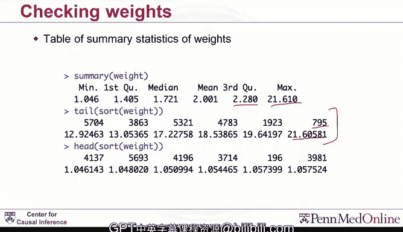

# 宾夕法尼亚大学《因果推断速成课程｜A Crash Course in Causality》中英字幕 - P34：34_04_06_权重分布.zh_en - GPT中英字幕课程资源 - BV1Ft42137BF

This video is about the distribution of weights。So we're using inverse probability of treatment weighting estimation。

But it turns out that large weights can create a problem， so in fact。

 large weights can lead to large standard errors， so we're going to look at that。

 why that is the case and also we'll look at how to check the distribution of weights。

So to begin we'll think about why do weights matter at all and what I mean by that is the actual size of the weights。

 the actual values of them， why did this that matter Well larger weights lead to noisier estimates of causal effects and so why is that the case well let's consider an extreme case where one person has a weight of 10。

000 and of course sometimes you will find this in your data if you carry out these kinds of analyses you might find somebody has a very large weight。

 it could be as large as 10，000？So imagine one person has a weight of 10，000。 well。

 that means they basically represent 10，000 people。

So imagine that our outcome is binary just for simplicity， so it's just a yes or no kind of variable。

So this one person， if they happen to have the outcome， if their outcome is yes。

That's basically counting as if 10，000 people had this outcome equal to us。

Whereas if they had the outcome equal to know， if they didn't have the outcome。

 that would be like 10，000 people having to know。So much is riding on this one person that that creates noise in a sense。

 if one person's data can greatly affect the estimate。

 then you have highly variable highly variable kind of estimate。

 so in general we would prefer for people to not have very large weights relative to everybody else。

So let's think about just。Some intuition here about why you get large standard errors。

If you have large weights。 and I think one really great way to think about it is with。

This idea of bootstrapping， so one way to estimate。Standard errors is with bootstrapping。

 and so in case you're not familiar with it。The the ideas as follows。

 So you randomly sample with replacement from the original population。 So originally。

 you have N people in your population。 So your data has， let's say N rows， you have。And observations。

Well， you can now randomly sample from that original sample with replacement now。

Some people will appear in your new data set possibly multiple times。

 some people won't appear at all， but you're creating a a new data set of the same size。

 bootstpped from the original and so you'll have some people will appear in both。

 some people will appear multiple times in the second one。

 some people won't appear at all in the second one。

But this should represent a random sample from your original population。

You can then estimate the parameters in this bootstrap data set。Okay。

 so now I have a parameter estimate from a bootstrap population。 Well I can repeat this process。

 I can do it again。 I can from my original population， I can bootstrap again。

 I can estimate the parameter。 I can record it。And I can keep doing that。

And so each bootstrap sample is like a random sample from the original population。

And then if I keep recording parameter estimates， I'll be capturing the variability of the parameter estimate。

So I'll record this the parameter estimate a whole bunch of times and then if I take the variance of that。

 that's like the variance of the estimator。 If I take the standard deviation of that。

 you could think of that as an estimate of the standard error。

So now imagine we're doing bootstrapping， but there's one person， let's say。

In our sample that has a very large weight， so it could be 10，000 or something。Well。

 in some bootstrap samples， they're going to appear in there。They might appear more than once。

 but they'll in some of our bootsottrapap data sets still be in there。

 and in some of them they won't just by chance they won't be in there。And so you can imagine that。

The value of our estimate。each of these bootstrapap samples is going to depend a great deal on this one person。

 whether they're in or out。 So if somebody has a lot of weight。

 it's going to greatly increase the variability of your estimator。

 So I just want you to picture this one person who is super extremely valuable。

 you know they count for a lot of weight。 they represent。

 say 10000 people and sometimes they're in your data set and sometimes you're not。

So you could imagine that when they're in it， it's very influential。

 they're going to pull the parameter estimate towards them and when they're out。

That's not going to happen。 So then from sample to sample。

 the parameter estimate's going to vary a lot。In large part due to this one person。

So that's just sort of trying。Capture the intuition behind why having large weights for some individuals。

Could lead to a really noisy estimator of let's say， a causal effect。

And I also want to just point out the relationship with。The positivity assumption。

 so remember the positivity assumption says that everybody should have some non zero probability of getting either treatment。

Well， what a large weight means， remember is that it's one over the probability of the observed treatment。

So if that weight is very large， it means the denominator is very small。

 so the probability of that particular treatment was very close to zero。It's not exactly zero。

 so it's not。Necessarily a violation of the positivity assumption， but it might be close to zero。

 which means you're close to having a violation of that assumption。So it means that。

 there's certain values of your covariates。For which it's it's very unlikely that。

People will get a particular treatment。So it might not be the probability might not be zero。

 but it might be very close to zero。 so we're sort of flirting with violations of positivity assumption when you have extremely large weights。

 So it's the kind of thing that。啊。It's another reason why you would want to be concerned about people with very large weights because it would make you start to question your positivity assumption。

As far as actually checking the weights， one of the easiest things to do is just to actually plot the weights。

On a graph， so I show two examples， these are both trying to get at the same kinds of information。

 so these are both plots of the weights。On the left hand side here is just a density plot。

So I have my weights， so I have one weight per person。And I could just ask for a density plot。

 And that's what this is。 And I also have， I put these tick marks on the bottom。

 which represent the actual value。 So， for example。

That means that there was somebody who had a value exactly that， which is a weight of。You know。

 maybe roughly 17 or so， so that represents one person's。Actual weight。 and you'll see that most。

 so most of the weights are occurring over here。 you can see that you know this curve that goes very high over there。

 and you can also see that's very thick。Over here。 So there's a lot of people with weights that are between 0 and 5 or and especially between0 and 10。

 most of the weights are between 0 and 10。 but then we do see some large ones。

With an upper limit of over 20， but it's not。It's not so extreme that I'm probably very alarmed。

 but we have some people who have quite a bit more weight than others。

Another way you could display this is with this。Ploot on the right here， where。

All I did was I sorted the weights。From smallest to largest。

 and then I just I asked for a plot and what it then naturally does is it just plots it in order。

 so index here just means it's really like an order statistic it's saying。One is the smallest。

 two is the second smallest and so on， and then out here these are the largest。

And I kind of like this plot because it's。It's pretty easy to see sort of how many and when the values get large and how many there are and stuff。

You can see that the large majority are under 5。 So here's a， here's a line at 5。

 So almost everybody's or their large majority are below 5。 And then if you get out to say，15。

You know， there there's only a few people above 15 and in fact， four people above 15。

 so this kind of plot makes it pretty easy to see to look at your weights。But you could。

 you could use either one of these。You could also just ask for some summary statistics。

Of the weights。 So this is some R code where I first use a summary command which gives you so yeah some quartiles。

 min and max median。 and so you'll see the third quartile， the 75th percentile is 2。28。

 so 75% of people have a weight below that and the maximum values of 21。

I also use this tail and head command， which is just saying， show me the， you know， smallest。

In this case six values and also shown me the six largest values so here these are the six largest values and it's also telling you the observation number or the idea of the person in some the 795th observation of my data set had the largest weight。

 So if I was interested in looking closer at that individual I would sort of know where to find it and I could look at their data a little more carefully so these are just a couple of ways that you could go about investigating whether you have weights that are so large that you're worried。

