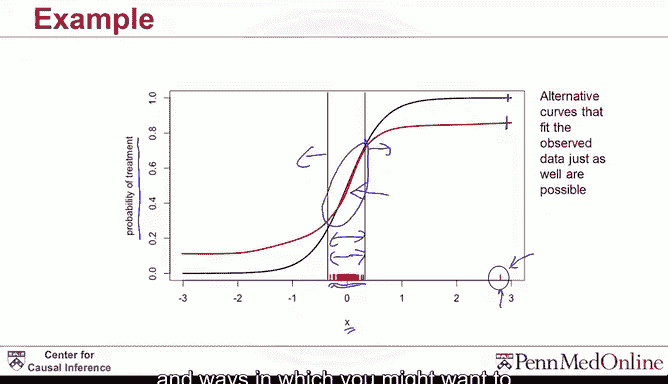

# 宾夕法尼亚大学《因果推断速成课程｜A Crash Course in Causality》中英字幕 - P35：35_04_07_大权重的修正方法.zh_en - GPT中英字幕课程资源 - BV1Ft42137BF

Hy， this video is about what you can do if you notice that you have some very large weights in your data set。

 So you're。Using inverse probability of treatment weighting。

 And you notice there are some very large weights。 You're concerned about it。

 And so what can you do about it， So we're going to discuss various options。 And also in particular。

 we'll discuss weight truncation and the sort of trade offs that are associated with it。

So the first thing I would probably do if I noticed there were some individuals that had very large weights is to actually look at their observations。

So I would identify that people with the highest weights。

 I would sort of pull out their data separately and I would look at them。

And the main thing I would be trying to do is try to understand first of all。

 why do they have large weights， so let's imagine you fitted a logistic regression， for example。

 you have all of these coefficients。And then you also have this person's data who has a large weight。

 And you could kind of look and see well what is driving it to have a large weight。 You know。

 it might be just a whole combination of variables that happen to be these particular combination of variables might happen to be values might happen to be unusual。

 But it also could be that just one of the variables takes an extreme value。 And so Id want to。

 I would first want to look at that and understand what is going on。 So what's unusual about them。

I would be interested in like just。Does this person really have data that are all plausible。

 so is there a data error， is there something wrong with it？And then I would also want to know well。

 maybe there's something wrong with my propensity score。

 so it actually could be that there's nothing wrong。

 it could be that your model correctly specify and this person really just does happen to have a large weight。

 but I would first want to make sure that that's the case。

 so I would investigate these various aspects of it。

So I'm just going to give you one example where let's imagine to motivate this that we had just a single confounder。

 and let's say it's continuous。 So we have a single continuous confounder X。

And let's imagine our propensity score model looks like this。

 where it's logit of the probability of treatment is this linear function in X。

And so let's imagine that it looks like this where。These tick marks here。

 these red marks correspond to actual observations。

And this is sort of what the fitted curve would look like。 So you'll notice on the。Left side here。

 we have probability of treatment， so that's all between 0 and1。And he。

And our horizontal axis is the actual covariate。And we'll see that。

Almost all of the our datata are in the small range。

Let's say between roughly negative04 and positive 04。 So most of our data are right in here。

So we're estimating those betas from the previous slide from the logistic regression model。

And it's almost entirely going to be based on how well our data are sort of would sort of correspond to this。

 this curve just within this narrow range。 So we would really want a particular set of betas that sort of fit well in that narrow range。

However， we， we have this one outlier value。 So one person has a very unusual value of x。

 So there's going to be very that that person isn't going to provide very much information about the fit of this logistic regression model。

 about the estimation of betas。Because， you know， almost all of the data are， you know。

 in this this narrow range。 So there's this one outlier observation。 Then you'll see that this purse。

 for this person， if you believe this logistic regression curve， you know， their value is here。

 which is extremely close to one。 So there's somebody who is very likely to get treated according to our model。

 So if they actually didn't get treated。They would have an extremely large weight。However。

 we really don't know much about there's a lot of extrapolation that is actually taking place outside of the range So like in this direction。

 in this direction， we really don't know what the true。Proensity score curve as a function of x。

 which should look like outside of that sort of narrow range defined by those two vertical bars because the data really informed the stuff inside of those。

Vertical bars。 But outside， there just really wasn't much data to tell us anything about it。

 So that actual shape。Is determined by an assumption that we had that it's linear on the logicit scale。

 So that was an assumption we made。 We don't know if it's true or not。

And so much of our sort of inference， there's a lot of extrapolation here， essentially。

So I'm drawing a hypothetical sort of alternative curve that you'll notice。That this red curve。

 this is just a hypothetical kind of curve that I drew in that inside this range again。

It seems like it probably fits just as well as the black curve does。 You know。

 they're practically agreeing with each other， but。It doesn't sort of rise as high as quickly。

 So out here。We now would have a value that would be quite a bit lower。 wouldn't。

 It wouldn't be The probability of treatment isn't one anymore。 It's more like， you know。

 a little buff 。8。 So then that person， if they weren't actually treated。

 if this person wasn't treated， they would have a much lower weight。

 And so the point is that there there's a whole bunch of possible curves that would foot fit really well。

 potentially in this area。 And the only reason we ended up with this particular black curve。

Isnt well， the main reason is because we impose this sort of linear on the logit scale kind of assumption。

 And that might be fine if we weren't doing such extreme extrapolating。

 but we have this outlier person。 So we have this outlier person here。And。

So we might end up with a large weight because our model doesn't fit well out there and we don't have enough information in our data to tell us anything about that。

 So it could be that we've just made a bad assumption in our model。

 and that could be why we have the high weight alternatively you know it could also be。

 as I mentioned that this value just as in a real value it could be a typo you know sometimes we'll see this with laboratory values if you in sort of in clinical kind of research where sometimes we'll just get a value that isn't plausible。

 So hopefully you've done data cleaning ahead of time range checks to make sure your data are all plausible。

 but those are options two possibilities two of several possibilities as to why you might have an extreme weight。

 So this is really something to think about and ways in which you might want to refine your propensity score model。

So those were just a couple of thoughts about some things that you could you should consider。

 Another thing that could help is。Really before you do any inverse probability of treatment waiting is you might want to trim the tails based on the propensity score distribution。

And this is because there's a couple of things。 So remember that trimming the trimming the tails helps make the the positivity assumption more plausible because it's getting rid of。

Really， the extremes where。People who were very unlikely to be treated。

Or people who are very likely to be these sort of the extremes in this propensity score distribution。

 we can sort of trim them off and。Then， what we're left with our。

Just strictly people who had a reasonable chance of getting either treatment。 Okay， so one way。

 so what you actually trimm the tails really means just getting rid of subjects from your data。

 removing them。So I mentioned a common trimming strategy。And so what you would do。

 this is just one thing that I've seen people do is。

Let's say we're interested in the second and 98th percentiles。 this is somewhat arbitrary。 but。

 you know， we're talking about the extremes。So imagine we are looking at treated subjects。 Well。

 what we could do then is treated subjects are going to tend to have higher values of the propensity scores that can than control subjects。

 So people with the very highest。People treated subjects who have very high values of the propensity score。

 there might be nobody in the control group like them when we want to trim them off。

 So you imagine taking the 98th percentile of the propensity score among those in the control group。

 So restrict the control group。Look at the 98th percentile。

 so one of the highest values of the propensity score in the control group。

 and then in the treatment in both groups really then get rid of anybody above that。

 anybody who has a higher propensity score than that。

You would do the same thing on the opposite sort of side of things where you would remove control subjects who had a propensity score that was below the second percentile of the propensity score distribution from the treated subjects。

 So you take treated subjects。Take their extreme sort of。

Left endtail and then cut it there and delete anybody， remove anybody from your data set。

Who aren't in there。 So then you left with sort of this middle range where there should be a lot of overlap。

Doing that should should eliminate some of the most extreme weights。

 because the most extreme weights are going to occur out in the tail。

 So this is a reasonable strategy in in the sense of a。

 it makes a the positivity assumption more plausible and B。

 it should eliminate some of the extreme weights， but just as a reminder， we we do。

 that does involve changing our population of interest， our target population。

 who are we making inference about。 So if we don't trim the tails。

 We're focusing on the population as a whole。But if we trim the tails。

 we're now focused on a subpopulation。Who had a reasonable probability of getting either treatment。

 Whereas reason reasonable is defined by our trimming strategy。 So in general。

 I'm pretty comfortable with idea with this idea because it makes sense to sort of focus inference。

On the subpopulation of people who had some chance of getting either treatment， however。

 it's something to keep in mind because the population becomes a little more difficult to define the second you start sort of eliminating people。

Okay， so you could trim the tails Another thing you could do。

 whether you trim the tails or not is something called weight truncation。Okay。

 so here what we're going to do is we're not going once we now we imagine we have a population that we're going to stick with。

 so maybe we've trim the tails， maybe we haven't， but this is our population now。We have our weights。

 and we might decide ahead of time that there's some maximum allowable weight。

So we might only be comfortable with like， let's say a weight of 100。

 or it also could be based on a percentile， so we might say whatever let's take the 99th percentile of the weight distribution and not allow any weights greater than that。

And what truncadating then means is。It means then setting。

The weight for anyone who had a value higher than that truncation point。

To set it to the maximum value。 So if， for example， you chose 100 as a maximum weight you'll accept。

 Then if somebody had a weight that was greater than 100。

 you would actually change their weight to 100。So you're actually going to replace any weight greater than your maximum。

 You're going to set it to the maximum。 So that's when we mean what we mean by weight truncation。

So this might sound a little strange because we're in some sense， we're changing data。

 We're just going in by hand and changing values。 So this， this does introduce bias。 So if。

 if you don't truncate， you have this problem of。Potenenttially having noisy estimators。

 so you might have a very large variance， but it's unbiased。Assuming your causal assumptions are met。

Whereas if you truncate， you're going to induce or it's going to create some bias because you're not。

 you're no longer properly waiting。But it's going to lead to potential。

 you might have a much less noisy estimate。 so it to have a smaller variance。 So again。

 this is a classic kind of bias variance trade off situation。

 So if you truncate if you decide to truncate what you you're deciding to do is accept some bias for a smaller variance and you're hoping that that trade off is worth it。

There could be situations where。You trunccate， and that induces only a small amount of bias。

 but it greatly reduces a variance and variance。 in which case you'll probably be very happy with that trait。

 And so a lot of times people judge this sort of whats was the trade off worth it based on based on what's known as the mean square error。

 So you could think of that as bias squared plus variance。

 And so it's been shown in at least in some simulation studies that if you do truncate the weights。

 you can improve the mean square error。 So you can end up with a trade off that's acceptable。 But。

 of course， if you truncate you know， to an extreme degree。😊。

You'll end up creating probably too much bias。So there's some question about， should you truncate。

 and if so， where's the right place to truncate。So typically。

 what people are really trying to do is get rid of， you know， very extreme values。

 So it's not unusual， for example， to just truncate it like the 98th or 99th percentile。 You know。

 alternatively， you could pick an actual。 The main thing we're trying to do is get rid of their really extreme values where they're much larger than any of the other ones。

 In which case， I think there's reason to believe that。You know。

 if you don't trucate too many peoples， it's just a small number that had extreme weights that you'll probably be better off in terms of mean square error。

