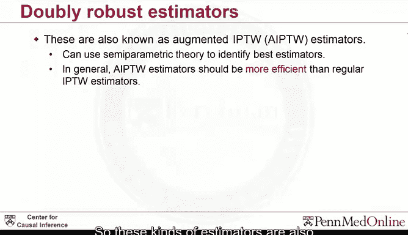
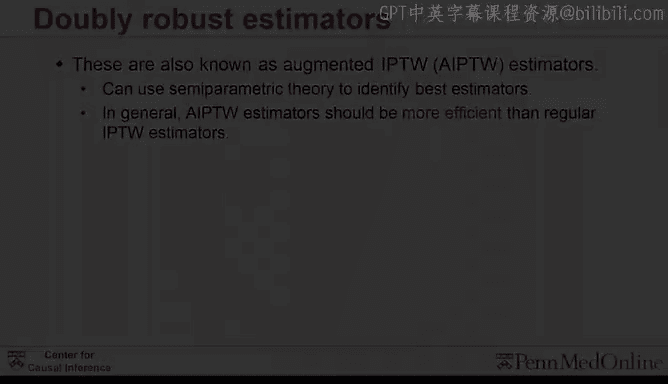

# 宾夕法尼亚大学《因果推断速成课程｜A Crash Course in Causality》中英字幕 - P36：36_04_08_双重稳健估计量.zh_en - GPT中英字幕课程资源 - BV1Ft42137BF

This video is on doubly robust estimation， also known as augmented inverse probability of treatment waiting。

And so we're going to focus a lot on the intuition behind these kinds of estimators and talk a little bit about some of the properties。

As background， let's first revisit inverse probability of treatment weighted estimation。

And so here we'll think about just estimating the expected value of the potential outcome among treated among。

Treated subjects mean if everybody was treated。We're just going to focus on this one potential outcome just for illustration。

 but if you want to estimate the other potential outcome。

 the equation would look very similar except the weights would be different。So。As a reminder。

If we wanted to estimate this mean of the potential outcomes， if everybody had been treated。

We could do it as follows， where。First， and I want to note that the denominator involves the propensity score。

 so we're looking at treated subjects， and so our denominator is going to involve the propensity score because we wait by one over the probability of that group's treatment and that group happens to be the treated group。

And I wrote it as a function of x。 So pi of x， just to。

This sort of reiterate remind you of the idea that the propensity score does depend on the x's。

A here is just an indicator variable。 It's just treatment。

 and it's what we're thinking of it as binary， yes or no。 So a equals one if treatment0 otherwise。

And so putting that right next to the Y is just sort of guaranteeing that it's going to。

Only include values in the sum。That were among treated people。

So control people are going to have a equals 0， and so their values aren't going to get counted。

And remember， we're trying to estimate。The mean of why， if everybody had been treated。So we sum。

Overall all end subjects。 But we pick off only the treated， but then we wait。

By inverse of the propensity score。 So we are just essentially you could think of this as a sample mean of y in the pseudo population。

 So this weighted population where there's no confounding。 And so that's。

The standard sort of I PTW estimator for。The mean or the potential outcome for treatment。

And so if the propensity score is correctly specified， then the estimator is unbiased。

So correctly specify means you know we got this model right so that。The probability of treatment。

 the true probability of treatment given X， is actually equal to pi of x。Okay。

 so that's what we mean by correctly specified。 If we get the model right， then。

Then this is an unbiased estimator。Now， let's imagine a different approach to estimating this mean of the potential outcome。

 So again， we're going to just focus on estimating the mean of this one potential outcome。

 but the same kind of idea would apply if you were going to try to estimate the other one。

 So you could use some kind of outcome regression model。

 So we haven't yet actually done that that in this course。 but this is something you could do。

 And so what we'll do is we'll specify a model that we'll call M1 of x。

 The one here is just indicating that it's for treated。 It's among treated subjects。

 So it's an outcome model restricting to the subset of patients who were actually treated。

 So you'll notice that this model， it looks like a standard kind of regression model。

 it's expect value of y conditional on equal one。 So among treated subjects and also your confounders X。

 So this is just some model some model for the mean given A and X。

 But if we actually wanted the mean of the potential outcomes。

 What you would have to do is you would have to get take this conditional mean。

M1 of X and basically average over the distribution of the confounders。

 You'll have to kind of integrate out the x's， or。In this case。

 what we're doing is we're averaging over an empirical distribution。

But I can give you some intuition， so here's an estimator。The expected value of y 1。

 But I'll give you some intuition。 So this first part of this is， is， is really just。

If you you are in the treated group。Then it's saying， okay， we'll use your value of y。So we're going。

 we're taking a sum over N subjects。 We're going to take an average。 So we're dividediding by n。Well。

 if you're in the treaty group， we're just going to use your value of of y。

 because remember by our consistency assumption。If you're treated。

Y is actually equal to U of y1 to the potential outcome if you so if you're in the a equal1 group。

 we're just going to use your value of y。However， if you are in the control group。

And this  one minus a here is going to pick off those control group members， right。

 because if you're in the control group。A is equal to 0。

 which means one minus a will equal to 1 will be equal to one。 So it's identifying those individuals。

And then what we have here is the。Regression kind of model or this mean model for y conditional1 x。

But remembers what I have here is M1 of x。So these are people who were not actually treated。Right。

 because I've picked them off here。 So these are people who weren't actually treated。

 But now I'm going to apply this regression model from those who were treated to this other population。

What I'm trying to do essentially is predict what their value of y would have been had they been in the in their treatment group。

 So that's what this is doing。So if you combine these two， what we're doing is we're。

Either if you're in the treatment group， we use your value of y。 If you' are in the control group。

 we use the value of y that we think you would have had。In other words， our best guess at it。

 the mean from this model。If you had actually been treated contrary to fact。

Add those up divide by end。 That's a thou would us submit of。The mean potential outcome。

 as long as you have unconfounding this is given X， you've controlled for confounding。

So if the outcome model is correctly specified， this is an unbiased estimator。

 the outcome model being correctly specified again means that。V。Expect a value of y。

Given equal1 and x is actually equal to whatever our model is and one of x。

 So we have some model there。 Maybe it's a regression model or something。

 We have to get that model right。But if we do， then this is a valid estimator。

So we've seen two different ways that you could estimate this mean potential outcome so one using。

Kind of like a regression model then where you actually average over the distribution of the x's or this inverse probability of treatment weight。

Doubly robust estimators are going to essentially try to use both of those。

And I should note that the next couple of slides will be a little more technical than。

Most of the rest of the material in this course and it's not。

 but we're going to try and get the main ideas across since these these kinds of estimators are becoming more popular。

 so the goal is really to sort of introduce the main ideas try and sort of get at understanding the concepts which will it'll make it easier then to sort of if you want to implement these in practice to take the next step and learn more about it。

So a doubly robust estimator is an estimator that would be unbiased if either this propensity score model is correct or the outcome regression model is correct。

 but you don't actually have to get both of them right。So you can get one wrong。

 It doesn't matter which one as long as one of them is right。

So I'll show you one example of a doly robust estimator。

And you'll what we'll see here is that there's one part that looks like the standard IPTW kind of estimator。

And then there's this other part that I'm going to call an augmentation， but this involves。

A regression type model here。And then there's some other stuff that we need to just kind of make it work。

 And I'll show you how it works in a minute。 But， you know， you see。

 there's this regression kind of part on the right hand side。

 this I P T W part on the left hand side。 And if you put these all together。

 you'll end up with something that has this double robustness kind of property。

 And we're going to explore that in a minute and see how it works。

So let's imagine first that the propensity score is correctly specified。

 but the outcome model is not， so our outcome model is wrong。So so this M1 is wrong。

 And by being wrong， what we mean is that。The expected value of y given equal1 an x does not equal M1 of x。

 So M1 of x is some model。 We got it wrong。 And so that the expectation doesn't line up with M1。

But the propensity score is correctly specified， we'll assume for now。

Which means that the expected value of a given x， or in other words。

 the probability that a equals one given x is equal to pi of x。

And this is our one version of a w robust estimator。So because we。

 because we got the propensity score， right， And I'm just what I'm going to do now is。

Just kind of walk through the intuition， this is not a formal of proof。

 but just trying to sort of give you the intuition as why this does actually work。

The thing that this is estimating。So we have a sum over N。

What this is estimating is really the expected value of the stuff that's inside these curly brackets。

 So out here， we have an average， assignment sum that we divide， then we divide by N。

 So that's a sample average。 So if if it as a sample size grows that becomes an expectation。

 So what we really are interested in is。Is the expectation on the inside there equal to the thing we want。

 And remember， the thing we want is the expected value of y1。Okay。

 so what we you want to know is is that thing is this stuff inside the curly bracket。

 Does it have expectation equal to that？Vue of y1。 Well。

 what I'm noting first is that the expectation of this one part here。The expectation of this。

This is equal to the propensity score。Which means that you could think of this as this whole part here as having expectation of 0。

 so essentially。You would expect the part that I'm putting in brackets here。To you。

 that part should go away。And expectation。 So if you imagine you were averaging this over a large sample size。

The expected value of a should be equal to pi。 And so you would expect those that difference if you averaged it to get very small and in fact。

 become0。So you expect this part on the right to go away if the propensity score model is correctly specified。

Let me say one more thing about that。 And if that goes away。

 what are you left with Well you're left with this part。And if the proprenency score model was right。

 we already said that that part is a bow estimator。 That's just our standard I P T W。

So if we get the regression model wrong， we're still going to be fine as far as this estimator goes。

 because。This part will go away。 That'll get small。 That'll be 0。

 And this part is a valid estimator of。The expected value of y1。

So now let's kind of flip things around and say， what if the propensity score model was wrong。

 But the outcome model was correct。 So remember， we don't know。You know， we have models。

 which means we're sort of。Doing the best we can to get them right。

 but we don't really know if either of them is right or if both are right。So we would like。

 it would be nice if we had robustness where we could get one of them wrong， potentially。

 So here we're going to imagine the propensity score is wrong。 And the outcome model is correct。

So if the propensity score model was wrong， what that means is the expected value of a given x。

Is not going to equal pi of x。ok。But if the outcome model is correct。

 what that means is the expected， if you take expectation of y conditional nx。

 that should equal m1 of x。That's just his background。

What I'm doing first then is you'll see this equal sign here is going from this step。To this step。

 I just rearrange some terms with some algebra， and that'll just make things easier to see。

 So from the top line。To the bottom line here， I rearranged some terms。

 but otherwise it's equivalent。So now I want to look at this this lower equation。

 So I rearrange things for a reason because it makes it a little easier to see。

So the first thing to note is that。Now， if the outcome model is correctly specified。

 then the part that I bracketed here should go to 0， right， because。The expected value of y。

 conditional on x should be M1 of x。 So that difference should go to 0。Now， it's being multiplied by。

You know， something and there's something in the denominator。

 but those things are just going to converge to some constant essentially like they're。

That's not going to blow up or something and make the。The product。Not go to zero。

 So this is this is not a formal proof， but just giving you within one intuition。 So if we。

 if we got the outcome model right， the part and brackets there should go to  zero。And so。

 what are you left with then， Will you just left with this part。

And this part here is just an average of this。Regression model。啊。Over over and subjects。

 This is just the expected value of y， given equal1 and x averaged over the distribution of x。

 marginalizing out x。 That is just what the expected value of y 1 is， so。

If we get the regression model right， then this estimator should be fine as well。So as I said。

 this part goes to expected value of Y1。So these kinds of estimators are also known as augmented IPTW estimators so。

Kind of standard andverse probability of treatment weighted approach with this augmentation kind of approach that typically well does involve an outcome model。

So you might see these kinds of terms augmented IPTW or AIPTW。

And that's what the estimator I just showed you was an example of one of them。

 and there are a lot of these kinds of estimators。So a lot of this comes from semi parametric theory and you can use that to identify the best kinds of these estimators。

 meaning most efficient。 So there's a there's theory that says。

What the sort of most efficient versions of these would be so that you know。

 that's beyond the sort of scope of this。Video， but just to make you aware， and in general。

 besides having this doubly robust property。You know。

 which is obviously an property because you could to specify two models and only have to get one right。

 they also tend to be more efficient than regular IPTW estimators。

So they give you an extra bonus that they tend to be more efficient。

 meaning they have a smaller variance associated with them。

 so these are a little more complicated implement practice， but they tend to perform better。

