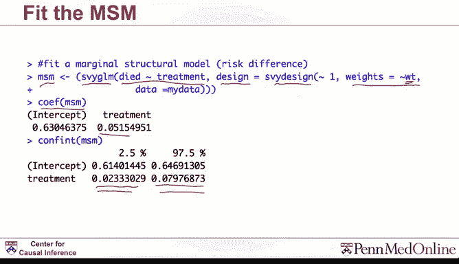

# 宾夕法尼亚大学《因果推断速成课程｜A Crash Course in Causality》中英字幕 - P37：37_04_09_R语言数据实例_2.zh_en - GPT中英字幕课程资源 - BV1Ft42137BF

In this video we're going to go through a data analysis in R。

 and in particular we'll go through an analysis where we fit a marginal structural model using IPTW or inverse probability of treatment weight。

So as a data example， we'll use the publicly available data on right heartt catheterization。Where。

This was data on ICU patients in five hospitals。 The treatment was right heart catheterization or not。

 so RHC versus not。 the outcome was death， yes or no。

There were many confounding variables and there were a few thousand two to 3，00 people in each group。

And for this analysis， we'll use a few different our packages。So we'll use table one。IPW。

Which is a package that is basically used to get。Inverse probability weights and so on。

 There's this the sandwich package， which is used to get robust variance estimation。

And I also use the survey package that which is really。

It was why it was designed for surveys we can use it for to get weighted estimators。

And then you could begin by just reading in the data。

And viewing it and to get a better understanding of what the variables are。And in a previous video。

 we looked at this code in detail。 So I'll just very briefly talk about it。

 But the this particular data set has a lot of character variables and some。Our packages are sort of。

Less accepting of that than others。 And so a lot of times I like to just convert everything to numeric just to make things easier and also then I can rename。

All the variables to。Make it a little more meaningful to me。

So that when I see the variables in table， I know what they mean， so for example。

You originally there was a variable called sex。But I'm going to change that to female and that means's an I know it's an indicator variable and I know it takes value1 if female。

 so I change these all to indicator variables， so for example。

 COPD will take a value of one if the person had a COPD diagnosis and take value zero otherwise。Here。

你。What I'm calling treatment。Is this RHC， yes or no kind of variable， so treatment takes value 0 or1。

1 is the treated group。Our outcome， I'm calling died。

And then there's a bunch of confounders that we'll look at。

And so I'm just creating a data now with just a subset of variables and the reason I'm doing this is just to make things easier to follow along。

 but in practice you would want to use more variables in this。

 so I'm calling it my data and I'm just putting a handful of these variables together into one data。

So first， if we wanted to carry out inverse probability treatmentment waiting。

 then you might a natural first step would be to fit a propensity score model。

And so here I'm just going to fit a logistic regression model and because it's a propensity score model。

 as a reminder， that means。Our outcome in the propensency score model is actually treatment。

 So yes or no。 And then we include as confounders a few variables， such as。Age， sex， blood pressure。

 and then some diagnoses。So these are different medical diagnoses。

I'm going to just use a logistic regression， so I tell it to use a Loit link。

And I tell what it's binomial data。 So this is going to fit a logistic regression model。 and then。

And I named it PS model for propensity score model。So it fits this model。

 but then what I actually want out of this is the propensity score itself。

 so I'm going to call that PS。And I can get that by using this predict command。

Predict and then I'm saying my propensency score model was PS model。

And then give me the type equal response means it's given me the predicted value。So this is actually。

 this is one way to get the propensity score out of your propensity score model。

And then this is just some output if you wanted to look at it from so I fitted a logistic regression model where treatment is the outcome and then these are coefficients and standard errors and so on。

You might be interested in what variables are。Associated with。Receiving the treatment， in this case。

 right heart catheterization。And so as an example， let's just look at age。

Age has a negative coefficient。 So older people tended to be less likely to get RHC to get this treatment。

 although the P value was 008。 So the evidence isn't extremely strong that it's related。

 but that's just an example。 So you could you could look up and down this table and just see if things kind of make sense。

诶。AndOr maybe your collaborator who might be an expert on this particular topic would probably want to look at it and make sure that things are generally in the direction that they would have expected。

And you could also then look at a plot of the propensity score。嗯。This one is。

I say pre matching or pre waitinging like this is just raw。The raw propensity score distribution。

 and so this would be。This would be for the treated group。And this would be for the control。

And you see a lot of overlap， and so it doesn't look like there's anything too concerning here。

But now I want to move on to。The thing that's more specific to IPTW so so far the previous slides were。

Things that you could do if you wanted to do propensity score matching， for example。

 But now we're doing something a little different。 Now we're going to。Get into weights。

So the first thing I'll do is create weights。So I'm calling it wait。And I'm using this F L command。

 There's a lot of different ways you could do it， but I'm saying。If treatment equals  one。

 then the weight is one over the propensity score。If it's not else。

Make the weight1 over the1 minus the propensity score， because remember treated subjects。

 the weight is one over the propensity score， control subjects。

 it's one over one minus the propensity score。And mirror P S is my propensity score。

 So with one additional line， I'm able to get a weight for everybody。

So there's a few ways that you could actually apply the weight to your data。

 so one thing I'll first show you is the survey design function。And all this is going to do here。

 as I'm saying， apply it to my basically the big picture is apply weight。This particular weight。

To my data， that's essentially all it's doing。And it's。 And then my new。

What it's outputting is something called weighted data。

And now I can use weighted data to get a weighted table。

 remember we're interested in a table one type of thing where we can look at standardized differences。

Well， now I have a weighted sort of version of the data set。 and now I can use the table one。

Our package。And so this is a command I could use。And I'm telling it stratify on treatment。

And I'm telling it to use weighted data。And test equals false again just means I don I'm not interested in significance testing here。

 I'm really more interested in standardized differences。

 so then when I print the weighted table I tell it yes， print this standardized differences。

And then you'll see output that looks something like this。So we have treated versus control。

 we have standardized mean differences， and the actual table itself will be means and standard deviations。

This is just automatic output from our， I would actually just ignore the standard deviations here to a large degree because。

We're not this is from weighted data。And so it's really based on these weighted sample sizes。

 which aren't your real sample sizes。So I would actually ignore the sample sizes and I would ignore what they're calling standard deviations and I really did the means are right though。

 that these are weighted means， these are means of the pseudo populationop and so this is what I care about and what you'll see is that there's very good balance here。

So， for example， on age， the age is 61 versus 61， very tiny standardized difference。

 And if you look at all the standardized differences， the're very small。

 I think this is the biggest one is a 。04。 And again， we want them to be less than 01。

 So this weight seemed to do really well。 And it was pretty easy to have。

I just output a table like this for me。But you could also sort of get the。

A weighted mean directly using more brute force in a sense。

 where you could actually just do the calculation yourself。

 So I'm just kind of reminding you here what。A weighted mean formula would look like。

So let's say I was interested in in fact。In fact， what I'm going to do is I'm going to try to get。

This value here。I'm going to try to get the weighted value of age in the treatment group I'm going to try to get that with brute force as opposed to using this survey command。

So let's imagine that X' is age here。 And I want it for the treated group。 So I say。

 restrict to the treated group。 So the syndic function is just saying。Restrict to the treated group。

 and then I'm waiting by the propensity score。So this is just。The sum。

This is like the song the of these weighted versions of age in the numerator。

 and in the denominator is basically the。Weighted sample size。So we need to。

Sort of account for the fact that。We might be inflating our sample size with using these pies。

 but our denominator here is going to add all that up and do the proper kind of division。

So what you could really just think of this as。啊。I've created a pseudo population that's bigger than my original one。

Now I'm going to just take the average of age in that pseudo population。

So how do I do that in practice in our？So here's the division symbol， so to the right of that。

Is what appears here。So let's look at that first。So all I'm saying is take the mean。Of weight。

 which is one over pi。Among those who are treated。You also could have said take the sum because。

 in fact， to make this really。To make these two things align。

 you would probably want to take the sum， but what's going to happen is you could also just take the mean because。

I'm also going to take the mean and the numerator and those。Onent over Enzel' cancel out。

 So I could have said some I also could say， mean。So that's all it is about。

 but the key is that I'm saying。What I want is the weight among the treated because weight is one over propensity score。

Now in the numerator， it's the same kind of idea。I also have wait for the treatedy group， but。

I also am multiplyied by the age in the treated group。

And so then if you do that and do the division what we end up with here。Is a 61。

I see race sets so you can see it at 61。4 and hopefully。That is what we saw。

And I'll just circle it in green。So we get the same answer。

 so I use kind of more of a brute force like I just calculate it directly myself and I get the same answer。

 so that's all the survey that survey kind of command is doing is the same kind of thing we're just taking this average of in this case of age in the treated population but weighted so it's the pseudo population。

Now let's get to marginal structural models and let's imagine that we're interested in fitting。

A simple marginal structural model where。It's just going to be this a linear function of treatment。

So here treatment is。Right heart catheterization yes or no， the outcome is died yes or no。

 and then we have some link function G， and I'll look at two examples。

 one where we use a log link and the reason you might want to use a log link is if you're interested in a relative risk。

But I'll also look at an identity link in which case which you would use if you were interested in a risk difference。

 so I'll look at both of those。So the first one way you could do this is。Of remember。

 I already have my weights。 So at this stage， I have my weights。

 so I could just fit a generalized linear model。But to the weighted to the pseudo population。

So that's what I'm going to do。 I'm going to use the DLM command。In fact， let me I'll change to red。

 So it's easier to see GLM command。 My outcome is died， yes or no。Treatments， my only。You know。

 variable that's appearing on the right hand side。From remember the。

 I said it's just linear in treatment。But so the important thing here is to have is to let it know you want to wait it。

Sort of generalized linear model。And here I'm going to say， okay， I have outcome data that's binary。

 but let's use a log link because I'm interested in a relative risk。So I fit that model。

 I'm calling it just this generic TlM。 object， so just it's a TLM object。But from that。

 then I can extract the coefficients， so I just say give me the coefficients。

So beta IPTW are just the coefficients， those size 0 andsi1 from the。Margiin instructional model。

But now if what I want is an asymptotic sort of sandwich variance， this robust variance estimator。

So what I'm going to use is this V Cove。HC， this is coming from that。

ThatThat sandwich package that's that gives you the sandwich kind of estimator。

 So this is just to account for the fact that I have weighted data。

 So the weights will sort of make it seem like my sample size is bigger than it is。In a sense。

 and we need to correct for that。 So that's what this robust covariance matrix will do。

 So the V cove will give you what in this case， a two by two covariance matrix becausesi 0 andsi 1。

 those estimates also covariary， but I really probably just care about the diagonal of it。

 So I'm just asking for the diagonal。That'll give me the two variance terms。

And then I take the square root to get a standard error。So my the standard error of my。

Of the intercept and coefficient of treatment。The standard error of those is just SE。

So now if I want to causal relative risk， I just have to exponentiate。My parameters， and in fact。

 the causal relative risk is going to be。Yi。To the。The one that the coefficient of treatment。Right。

 so if I if my model was。Expected value of Y a。Log。Expected value of Y a equalssi 0 plus Psi 1， a。

 then exponential。Of Psi 1。Is going to be a relative risk。And so that's what I'm doing here。

 so what I'm calling causal RR is se relativeative risk。

I can also get a lower confidence limit and an upper confidence limit。

 and what I'm doing is I'm just taking point estimate minus roughly two times the standard error。

And then， I exponentiate。So this inner part here has given me， in this case， the upper bound。

For the law relative risk。But then I need to exponentialonentiate to get the upper bound for the relative risk。

 and now I could just up print these out for you all three of them。

 So this is the point estimate of the causal relative risk。

And this is a lower lower 95% limit and upper 95% limit， so our 95% confidence interval is about 1。

0421。13， and a value of one greater a value of the relative risk greater than one is indicating higher risk of death。

For the treaty group， for the right heart catheterization group。

So I I also quickly show you how to get a risk difference， so I just showed you a relative risk。

 but you might be more interested in a risk difference。So we'll do the same thing as before。

 except now I'll say linking to all identity， so now the model I'm fitting is expected value of y a equal Psi 0 plus P psi1 a theres no log in front。

So it's just this， that's what identitydent Link means。I also again， I'm telling it it's aed。

Situation， do it on the pseudo population。I can output the coefficient。

 I can get the standard error again。And then using the same kind of method I can get a confidence interval。

And now we see that for the risk difference， the point estimate is about 0。05。

 The confidence interval goes from about 0。02 to 0。07， and census is a risk difference。

 a value greater than one is saying that there's a greater risk of death in the treated group。

 So it's the same message， but as a risk difference as opposed to a ratio。

But let's we can do the same thing now using this IPW package。

 So I showed you how if you have a generalized linear model kind of package。

 you can just do a weighted approach。 But then you have to do this extra thing where you're asking it for the。

Robust variance and so on， but we could also use this IPW package。

So I'm going to show you that quickly。 So the first thing you could you would do is I'm going to use this IP IPW point function and the point part of it means。

It refers to point treatment， which just means we don't have。Longitudinal kind of data。

 you don't have a bunch of treatments over time。So it's a one time kind of treatment situation。

So we use IPW point。And we let it know our exposure is called treatment。And at this point。

 what we're doing is really we're kind of setting we're basically specifying the。

Proensity score model at this point， so this you could do with instead of the whole propensity score model that setup that I showed you so this is an alternative。

So you tell it link equallogit， and then when it says denominator what it means is' the denominator of your weights。

 which is really this propensity score model。And then you tell the variables that go in your propensity score model。

And what this is going to do is it's going to then get the weights for you。And so then I ask it to。

I ask it to summarize in what they call I W dot weights。Is the actual weights。

 and so we see the maximum weight here as a 21，21。6。

What nice thing about this package is that you can get。You can pretty easily get out plots。

 so for example， IPW plot。Is going to just plot the weights for you。

 so you tell it what the weights are。And I told it。

Restrict to 0 to 22 because I already know the maximum is 21。6。And then that's what it'll do for you。

 so it's basically like a density kind of plot， and it's showing you the distribution of weights。

And now you can fit the marginal structural model and the way you could do that。

Another way you could do that as opposed to the GLM function that I use with weights。Previously。

 as you could use a survey DLM command。And the main advantage of this is it's sort of it's basically going to automatically give you the right variance estimator it's going to do the robust sandwich estimator for you。

 so that's the main advantage of using Sur GLM。But again。

 you specify the marginal structural model here。And now you have to use this design command and this is really where you're going to tell it about your weights。

 and so it's not very it doesn't end up being very complicated。

 you say survey design and you tell it what your weights are。

So from that you can extract coefficients， so why we named this MSM， so I could say， okay。

 tell me what the coefficients are。And those are the two coefficients。 And this one is fitting。

 and this is for。Identity link kind of situation。 So this  point05。

2 should be the same as what I had on the previous slide。 Let's take an earlier。Take a look。

Thankfully， it is the same。So these are just two different ways to get the same。Answer。

 and then if you wanted a 95% confidence interval for the treatment effect， it's right here。

So this is maybe a little easier。 And that there's。Fewer steps。

So you could use this IPW package along with survey GLM and get the same kind of answer。

And as one additional point， I just want to quickly show you how you could use trunccate the weights if you wanted to。

 so our this particular example， I'm not very worried because the largest weight was just over 20。

So I probably wouldn't be。Very worried about weights that are too large， but。

I want to at least show you how to do it。 So there's， I'll show you two quick ways you could do it。

 So one way is。I remember earlier I created a variable called weight。

Well what I can do is I can just I'm going to call a new I'm going to name a new variable trunk weight。

 which means truncated weight， and I'm just going to say replace user replace function。

 replace weight。If weight is greater than 10， so I'm going to truncate at 10， I just picked a value。

 I'm going to trun at 10。 If it's greater than 10， replace it with 10。

So what that's going to do is anytime it sees weight greater than 10。

 it's going to replace it with 10。So then my new maximum weight will be and now once I have the truncated weights。

 I could do the same thing as I did before， I could use GLM。

 but this time I'll tell what use truncated weights。So that's all there is to it。

 So if you wanted to fit a marginal structural model we using。Trrunated weights for your weights。

 you could do that。Finally， I'll show you how you can do that in the IPW package。

So if in in the IPW package， they have a built in truncation option。 So again， we have IPW points。

 So most of this code should be the same as before。 the thing that's new is right here。

So you can use this trunk option， which means trunkate。

For you don't put in an actual value of the weight， you have to put in a percentile。So in this case。

 I'm putting in 0。01。 and what that means is it's going to truncate at the first and the 99th percentile。

 So it's going to truncate the smallest weights。And it's also going to trunccate the very largest weight。

 So it doesn't really want any observations to have a tiny， too tiny of an influence。

 So it'll truncate at the first percentile， and it also doesn't want any to have， you know。

 a huge influence。 so it'll trunccate at the 99th percentile。To be extra clear， had I put like 0。02。

 then that would have been the second and 98th percentile that it would have truncated at so。

It's going to truncate add a percentile that you pick。If you wanted to trunccate at a specific value。

 you would have to look at your weights and see what percentile corresponds to that value that you want to trunccate at。

 but this is a thing that people commonly do is truncate at a percentile。So now we could summarize。

Our weights， but now it's called weights。 run。Fru with fnccateated weights。

 And you'll notice the max is 6，6。4 about。So the 99th percentile was even smaller than the 1。

 the truncation of 10 than I did a minute ago， so it's the trunc units at about a 6。4。

And now if we wanted to， we could fit the model， say model as before， but using。

The truncated weights so we can use the survey DLM again。And we can use。Trunated it waits this time。

And then。What should happen is we should end up with a slightly different answer this time than we got previously。

 so we end up with a 0 estimate of about a 。05 95% confidence interval that goes from about a 。

03 to a 0。082 if we look back you'll see that it is different if you just look at the confidence interval。

For example， this upper limit， when we didn't truncate it was about a 。0797， and now it's 0。0816。

It didn't make a very big difference in this case， and which we didn't expect it to because we didn't have any extremely large weights。

But。At the same time， you might find that reassuring that we're getting a pretty consistent answer。

 whether we truncate or not。So you could also view this as a sensitivity analysis of sorts where we did things two different ways and we want to make sure we're coming to the same conclusion。

 but this is how you could go about trunaddating weights if you were interested in doing so。

