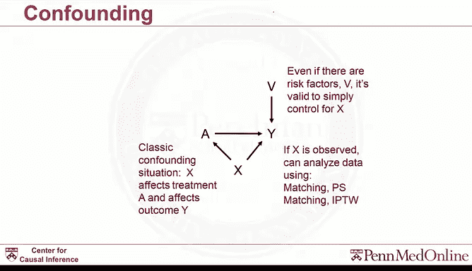

# 宾夕法尼亚大学《因果推断速成课程｜A Crash Course in Causality》中英字幕 - P38：38_05_01_工具变量简介.zh_en - GPT中英字幕课程资源 - BV1Ft42137BF

In this video， we will introduce instrumental variables。

We will begin by discussing unmeasured confounding and why that causes a problem in standard causal inference methods。

Then we will introduce instrumental variables， discuss their properties。

 and begin to motivate why they might be useful in unmeasured confounding situations。

So just as a review， this is kind of a classic confounding setting here where we have treatment A and outcome Y。

 and there's some confounders X。So X here is affecting treatment and it's affecting the outcome directly。

But as long as we observe X， then we could use causal inference methods such as matching or propensity score matching or inverse probability of treatment weighting。

 and we could still estimate the causal effect of A on y。

And even if there were some variables that only affected Y， such as what I'll call them V。

 so these are known as risk factors， variables that only affect the outcome。

 we would still be fine to just control for x。 so even a dig like this doesn't cause a problem we could simply control for x using one of these causal inference methods and would be fine。

 We also could control for V as well and that wouldn't be a problem。

However， in many cases， we might be concerned that there's unmeasured confounding。

 so I'm depicting that in this da here with the variable U。

 so we'll think of x as something that we observe so there's some set of variables that we observe。

But there also might be some variables that we don't observe。

I'll call that you and I'm using these dashed arrows just to sort of。

Extra emphasize that this is different than the x's in the sense that we don't observe them。

 So if you had unmeasured variables that affect both。

Treatment assignment and the outcome then we would have a problem the ignoreorability assumption would be violated so conditional on x treatment we still couldn't be thought of as randomized in that case we would have bias estimates of causal effects because we remember when we're for causal inference methods that control for confounding what we really do is we essentially condition on the confounders and then average over them So if you're matching you're pairing up people based on x and then we estimate treatment effects within those pairs of x and average over the distribution of x or an inverse probability of treatment waiting we create the pseudopopulation where。

where there's balance on x in the treated and controlled subjects。

 but we couldn't create that kind of balance on the unmeasured confounders just by conditioning non X。

 same thing with matching， we can't match on you directly since we don't observe it。

So we couldn't actually get an average causal effect。

So that's motivating the need for different statistical methods。

 so imagine that we're pretty sure in our study that there's unmeasured confounding。

So we know that these sort standard。Methods that can fall for confounding are not going to be good enough。

Well it's not completely hopeless as long as you can identify an instrumental variable。

 so an instrumental variable is I'm going to use Z as the notation， so Z is our instrument。

 so that's the instrumental variable。 And the main idea here is that the instrumental variable Z is going to be is going to affect treatment so you can think of it as affecting treatment assignment。

But it， it's not going to directly affect the outcome。

 so you'll notice that there's no arrow from Z direct arrow from Z to y。

You could think of Z as just as as being a。Sort of a randomizer。

 but it's randomizing to encouragement。So for higher values of Z， for example。

 you might be more encouraged to get the treatment lower values of Z less encouraged and we can we'll think of it as randomized so imagine that。

We're randomly either more aggressively motivating people or less aggressively to receive some free。

But this motivation we'll imagine， does not directly affect the outcome。

So this is what we mean by an instrumental variable， so there's some kind of。

 even though there's confounding and maybe unmeasured confounding。

 there's this one part that's sort of where there is randomization。

So some part of treatment is being explained by something that's random。

 and so that gives us hope in being able to a causal effect， even if there's unmeed confounding。

So as an example， imagine that we're interested in whether smoking during pregnancy affects birth weight okay so our treatment。

 if you want to call it that you could also think of it as an exposure would be smoking during pregnancy so just a yes or no。

 and then our outcome is birth weight and then you could imagine there might be all kinds of confounders so variables that might be related to the decision to smoke or not and also related to birth weight so it could be the mother's age for example。

There's， you know whether she's given birth before her weight and so on。

 But there also could be unmeasured confounders。 So we might。

 it's possible that we haven't collected enough variables to really explain this。

Why the decision is made to smoke or not and also to sort of capture variables that would affect birth weight。

So we might be worried about how to measure confounding。

And we also have this problem of if we wanted to do a randomized trial。

 we wouldn't really be able to randomize pregnant women to smoke or not。

 so there would be obviously ethical problems there with sort of asking people to smoke or asking them not to smoke。

So what we could do though， is have what's known as an encouragement design。

 so we could actually carry out a randomized trial and what could be done here is to actually enroll。

Women who are smokers。Into the study， so imagine a population of people who smoke and then once they're pregnant。

 you could basically either randomize them to one of two groups and one is this usual care group where you they just get whatever they normally would so they get the same amount of prenatal care that they normally would。

 if their physician would normally discourage them from smoking they would。

Just whatever usually happens。 So that's the Z equals zero group。

 but they also could be randomized to。The intervention arm。

 which would be an arm where there's sort of extra encouragement to stop smoking。

 so there'll be some kind of active intervention aimed at preventing smoking。

And so this actually was done in this 1984 paper。Where they actually did carry out an encouragement trial like this。

We're not actually directly randomizing people to smoke or not， we're just randomizing them。

In terms of encouragement to stop smoking， so some people get a big dose of encouragement to stop smoking and others get usual care。

So in that previous example we could think of Z as an instrument because the encouragement to stop smoking should not affect birth weight directly。

 so if I just encourage you to not smoke that should not affect the birth weight of your child other than through the impact it might have had on you to stop smoking。

 so it should only affect the outcome through its effect on the exposure。So then。

Now we'll start to think about what we could estimate from this kind of design so one thing you could do is what's known as an intention to treat kind of analysis where we just compare the outcomes under the two intervention arms so in other words we could focus on the causal effect of encouragement。

So here I'm writing that as a contrast of potential outcomes and you'll notice these potential outcomes are indexed by Z here。

 so for example， we have the expected value of y with superscripts z equal1 so what this means is。

It's the。You could think of this as the average birth weight if we had given everybody in the whole population encouragement to quit smoking。

So imagine everybody had actually been in the encouragement arm。

What would the average birth weight be， And we could then contrast that with。

The average birth weight if everyone had been given usual care。Okay。

 so then that difference would be a causal effect。And it would be a causal effect of encouragement。

 not a causal effect of smoking itself， so what impact did this encouragement have on birth weight？

So that's known as an intention to treat effect， it's just focused on。

The sort of as randomized comparison， the what is the thing we're actually randomizing in this case。

 it's encouragement。And so then we could estimate a causal effect of encouragement itself。

So that would that's potentially of some interest， especially if you want to know well。

 what impact would this kind of active intervention have on outcomes， However。

 it's not directly getting at the causal effect of smoking itself。

 So we're not contrasting potential outcomes where。

The index of these potential outcomes is treatment itself is smoking itself。

But so instrumentl variable methods are going to try and use。The instrument， this randomization。

 this encouragement to get at the actual causal effect treatment itself。So in this case。

 the actual causal effect of smoking。So in the example in this encouragement study we actually have randomized encouragement。

 so this was an actual randomized trial where encouragement was randomized。

 so there's plenty of cases like that where our instrumental variable is actually something that we physically randomized you know say with a random number generator but other times there might be instrumental variables that we believe exist。

 but they just exist in nature， so more of a natural experiment。

 so they're not necessarily literally randomized by an investigator so some examples that people have considered our Mendelian randomization and genetic studies there's quarter of birth has been has been used so。

So in what quarter of the calendar year were you born has been used as an instrument which has been shown to affect how many years of education you get。

But quarter of birth is not。You know， directlyirectly randomized by investigators。

But there's reason to think that it shouldn't be related to some other outcomes directly。

 another common example is geographic distance， especially care providers where the distance itself is thought of as sort of a natural randomizer and in future videos we'll discuss these examples in more in detail but here I just wanted to introduce this idea that instruments we think of as encouragement to either take to basically get the treatment。

And in some cases， we're actually randomizing this kind of encouragement， and in other cases。

 we just believe that this kind of encouragement exists in the real world。

 so we'll look at both of those in future videos。