# 宾夕法尼亚大学《因果推断速成课程｜A Crash Course in Causality》中英字幕 - P3：03_01_03_潜在结果与反事实.zh_en - GPT中英字幕课程资源 - BV1Ft42137BF

This video is on potential outcomes and counterfactuals。

We will start by introducing some definitions and notation and the notation that we use in this video we'll use throughout the course。

 so it will be important to begin to become familiar with it。

We also describe and define potential outcomes。And we'll describe and define counterfactuals。

 So counterfactuals and potential outcomes are。Really crucial and fundamental when it comes to defining causal effects。

 so we're going to refer to them throughout the course。

 so this video in particular will provide important background in terms of defining these and carefully thinking about what they are。

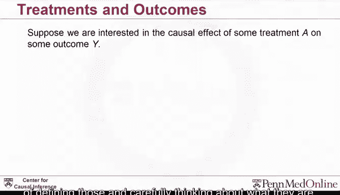

So we're going to begin by talking about treatments and outcomes。

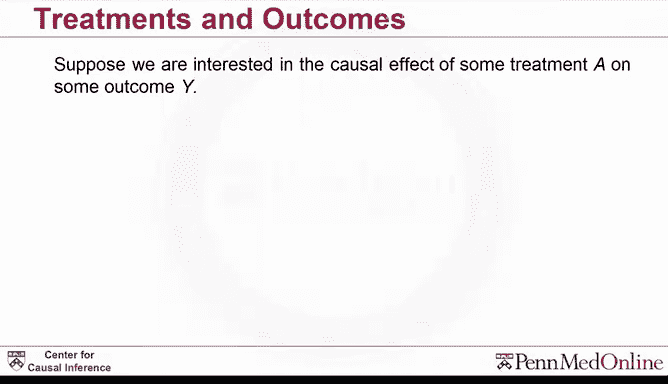

And。When weWhen we think about causal effects， we're going to really be thinking about what is the causal effect of some treatment on some outcome and there are a lot of names for treatments。

 sometimes these are also called exposures。

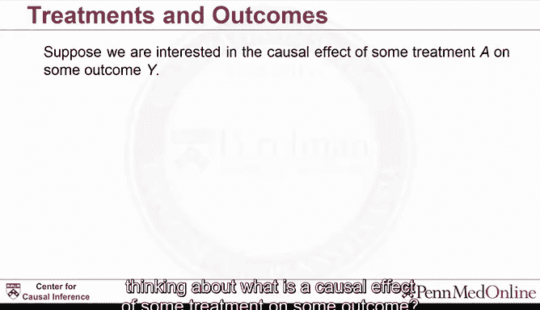

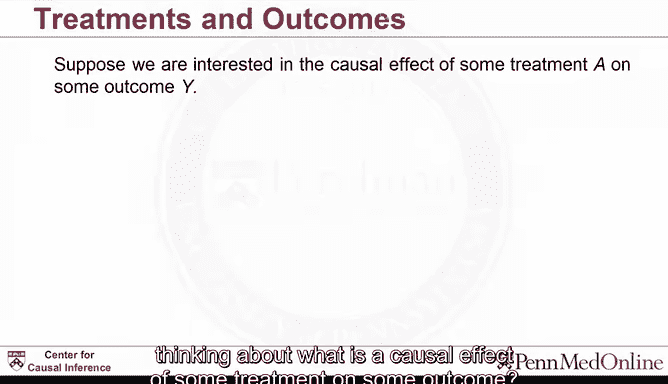

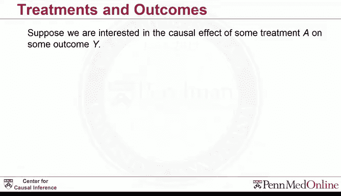

And。In exposure or treatment we could use interchangeably。 So it could be an environmental exposure。

 or it could be a medication。 So when I say treatment， I really mean it generically as。

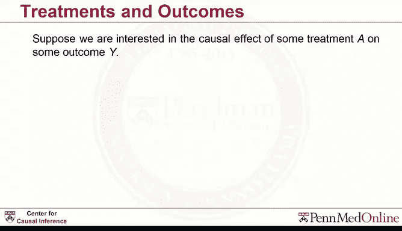

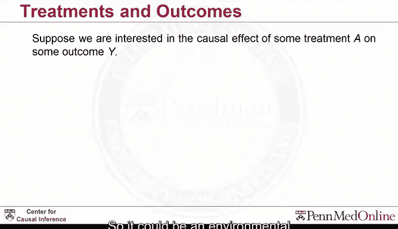

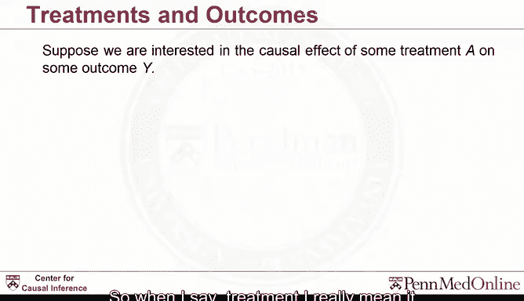

The kind of something that you might be exposed to。

 whether it happens to be in the environment or whether it is something that a clinician would give you as an actual formal treatment。

 but it's a thing that we want to know how does it affect the outcome。

 So for now I'm just going to call it treatment， but you could think about it as as an exposure as well and。

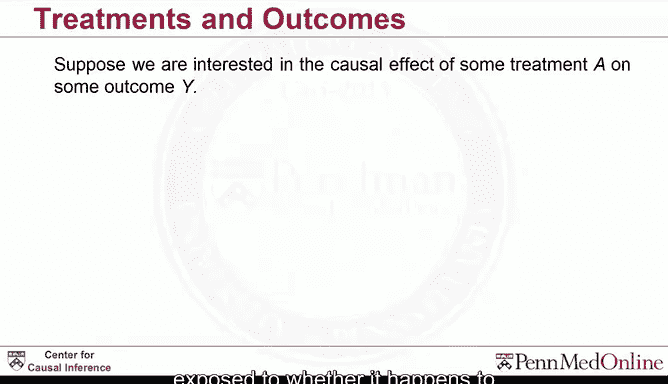

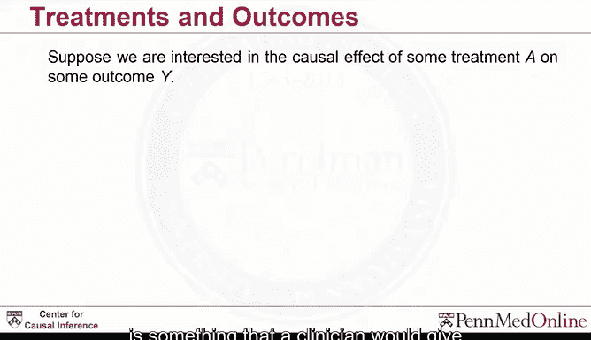

So we're interested in the causal effect of some treatment A。

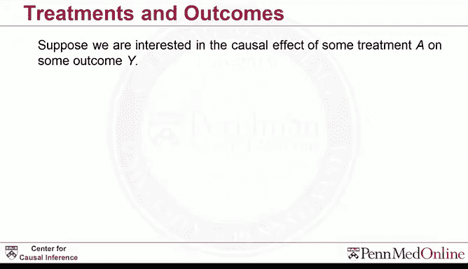

So， a is a。Is a variable name， and that's what we're going to refer to as a treatment and then there's an outcome Y。

 so our notation for the variable that's the outcome is Y。

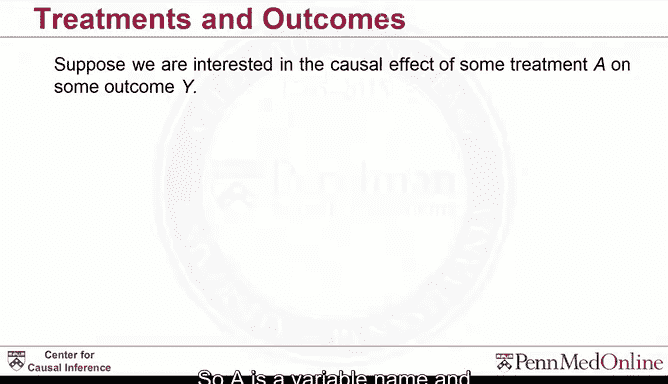

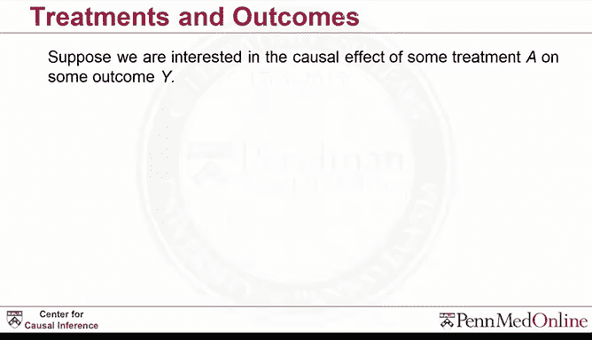

And I'll give a few examples。

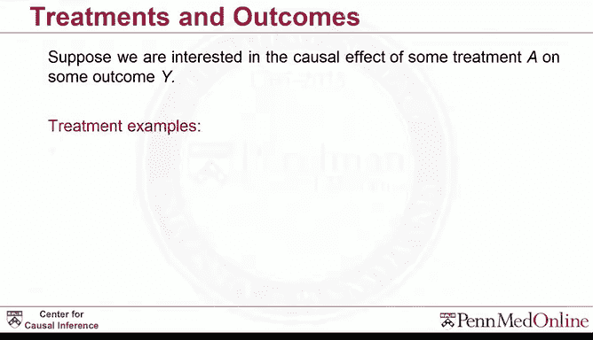

Most of the time in this course we're going to think about situations where there's just two treatment options。

 so you could think of it generically as treated versus untreated drug versus placebo exposed versus unexposed。

 but the field of causal inference is really more general than that where there could be multiple levels of treatment so you could have several different drugs that you could take you could have levels of exposure to some environmental taxin。

 for example， but to keep things simple we're going to think about just。

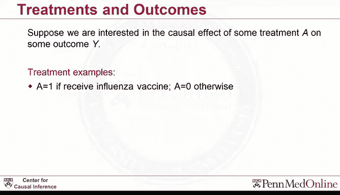

2 possible treatments that you could have。 So one example is influenza vaccine。

So remember our variable a is treatment， so here a could take two possible values。

 so a could equal1 if you receive influenza vaccine or a could equal zero if you don't。

 or another example is statins， so a would equal1 if you take statins and a would equal zero otherwise。

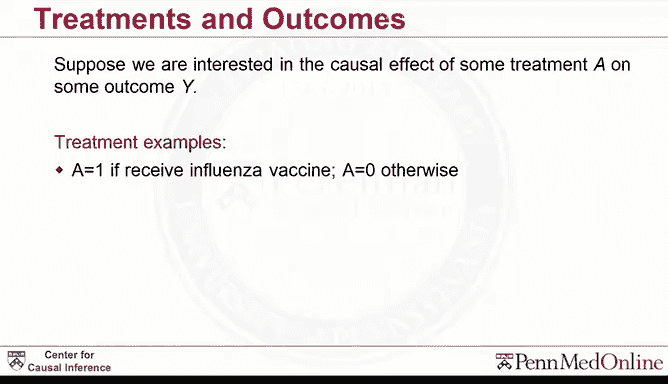

So when we're defining these variables in terms of a number。

 we're signing a number to them because ultimately we're going to be analyzing data and we need them to be numeric。

 Another example is just slightly more generic example is maybe receive an active drug versus a placebo So a equal1 is active drug equals zero as placebo What are some outcome examples So I work mostly in medical studies and biomedical research。

 so I tend to think of outcomes as you know biomedical kinds of outcomes So one example would be cardiovascular disease So why equal1 if you develop cardiovascular disease within two years and y equals zero otherwise So again。

 here's a binary outcome， meaning there's just two possible options。

 but it doesn't have to be a binary outcome why could be time until death So in this case the outcome is continuous So would actually be some period of time how long do you survive or how long until you die。

Treated versus untreated。And so on so in this case， your outcome Y is in actual time。

Those are just sort of hypothetical examples。But now we're going to move on to what are known as potential outcomes。

 So on the previous slide， what I called why would ultimately be an observed outcome。

 something we would see。

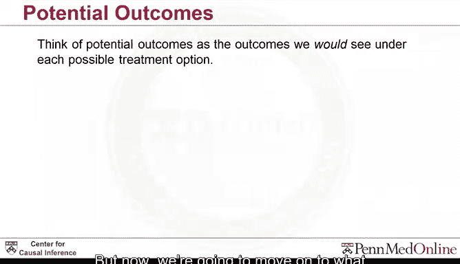

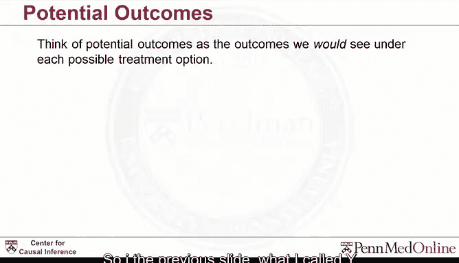

But potential outcomes we're going to think a little more hypothetically。 So we're going to think of。

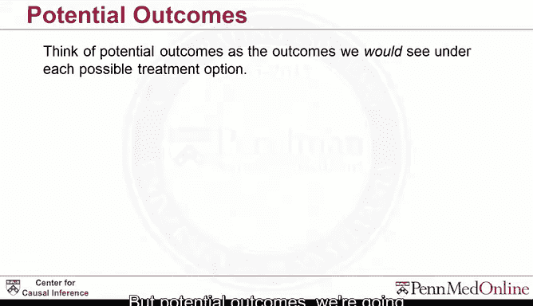

Potential outcomes is the outcomes we would observe under each possible treatment option。

 So you could think of this as before the study takes place what what could happen。

 So here's our notation。

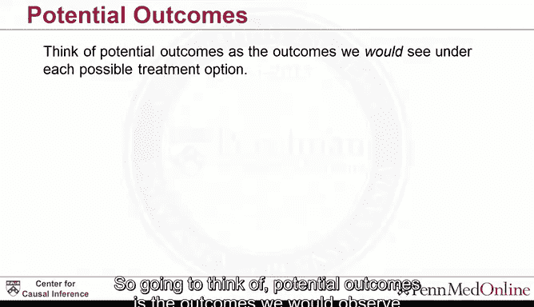

And we're going to use superscript notation to indicate potential outcomes。 So on the previous slide。

 I just had a y by itself。So that was just an observed outcome here we're using superscript notation to indicate a potential outcome。

 so why superscript little A is the outcome that would be observed if treatment was set to a equal little A。

So you'll notice that。Remember capital A represented treatment， so that's our variable。

 but we could set it to a particular value， in this case we'll set it to value little A。

If we're just in binary sort of treatment world， then little A could equal either zero or one。

Then each person we could think of as having two potential outcomes， y0 and y1。

And I think it will become more clear what we really mean by potential outcomes when we look at examples。

 so I'm going to walk through a few examples here。

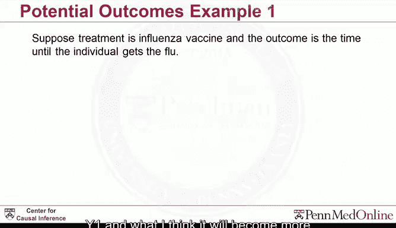

So suppose the treatment we're interested in is influenza vaccine。

So a equal1 would be you receive influenza vaccine equals0 that is that you don't and the outcome is time until the individual gets the flu。

 so that's our why。

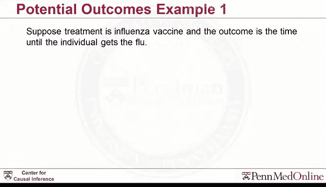

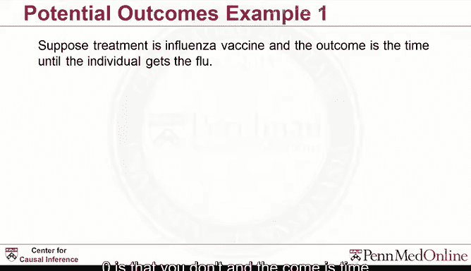

So then in this case， why superscript1 is a potential outcome， and in fact。

 it's a potential outcome under treatment， which here is influenza vaccine。

 so y1 is a time until the individual would get the flu if they received the flu vaccine。So。

You'll notice we say would get the flu。 It's， it's hypothetical。 So this is before。You know。

 any sort of data collected before even treatment's been assigned。

 just what would happen if this person。Were to receive the influenza vaccine alternative。

 Y zero is the time until the individual would get the flu if they did not receive the flu vaccine right so y superscript zero is a potential outcome。

 it's an outcome we would see if they if the person does not get the vaccine。

So this is what we mean by potential outcomes and this is what we mean with the superscript notation。

 I'll give another example to hopefully help clarify。

 so imagine that treatment is regional anesthesia a1。

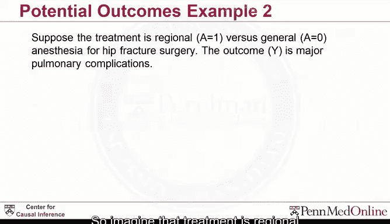

Versus general anesthesia a equals zero。 and this is among people who are getting hip fracture surgery。

 so our population is the population of people who are getting hip fracture surgery。

 and they could either be given regional or general anesthesia。

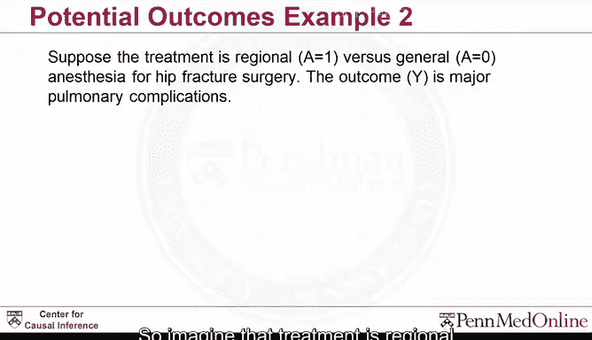

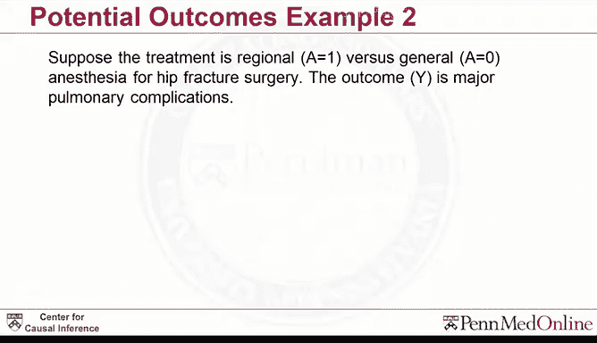

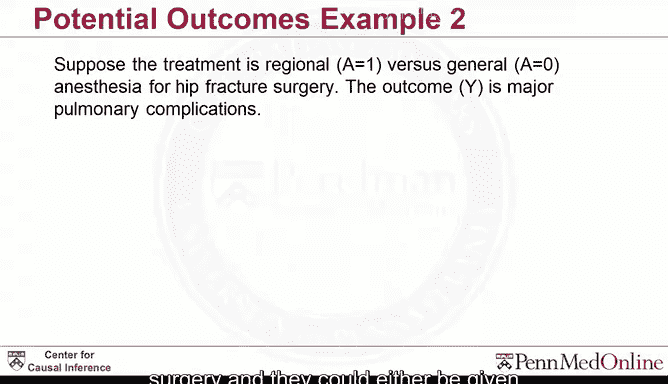

Our outcome is。

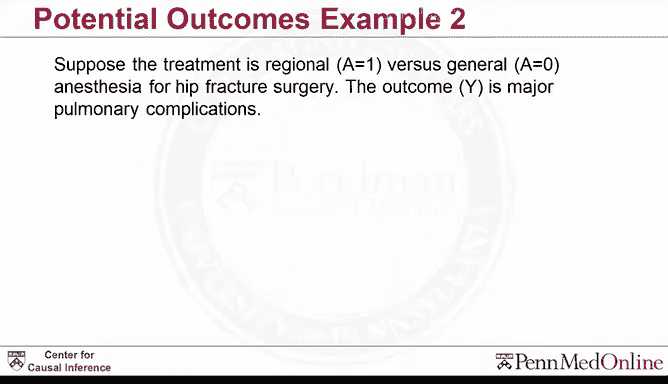

Major pulmonary complications and the outcome again is why is' denoted by why so we would be interested in does regional anesthesia lead to either higher or lower risk of major pulmonary complications compared to general anesthesia。

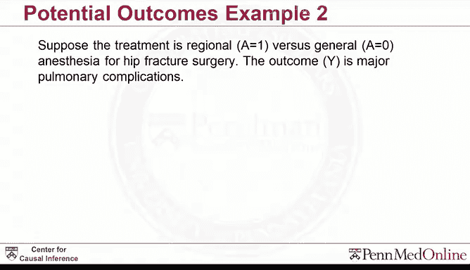

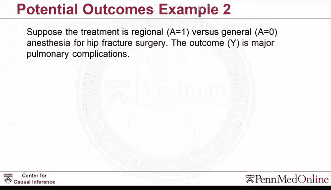

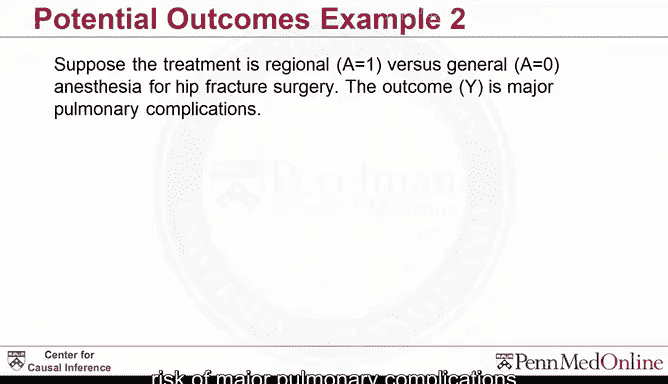

In terms of potential outcomes， then we could think of why1 as a potential outcome if you were given in this case。

 regional anesthesia， because remember we defined a equal one is regional。

 So y1 then we could define that is equal to one， if major pulmonary complications occurred if given regional anesthesia。

 and we could say that why the potential outcome Y superscript 1 would equal 0 if pulmonary complications did not occur。

 So in this case， the outcome is binary can take on two values。 remember the previous example。

 why was time time and time until the event here y is a binary kind of outcome。

 it could either be one if pulmonary complications in zero otherwise， and then the potential outcome。

 Y superscript1 is referring to pulmonary complications are not if the person was given regional anesthesia alternatively。

If the person was would be given general anesthesia， they would have an outcome Y superscript 0。

 And again， that would take value 1 if major pulmonary complications occurred and it would equal 0 otherwise。

 So the y1 and y 0， those other potential outcomes in this setting。

 So now we're going to move on to counterfactuals。 And counterfactuals， as we'll see。

 are very related to potential outcomes。 But and you'll see these terms used interchangeably。

 but they're slightly different， and we'll now talk about what they are and how they're different。

 So counterfactual outcomes， we could think of as。

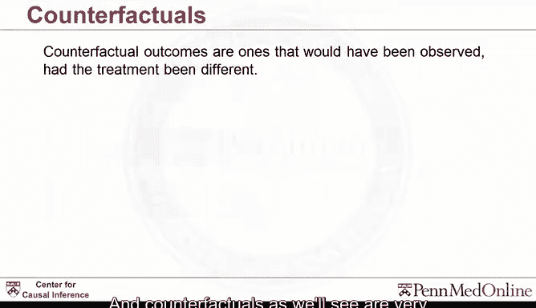

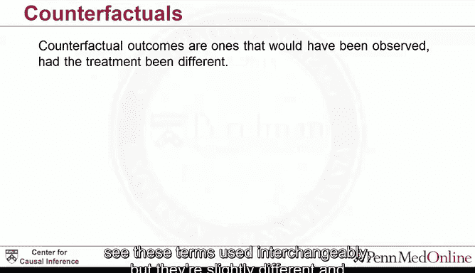

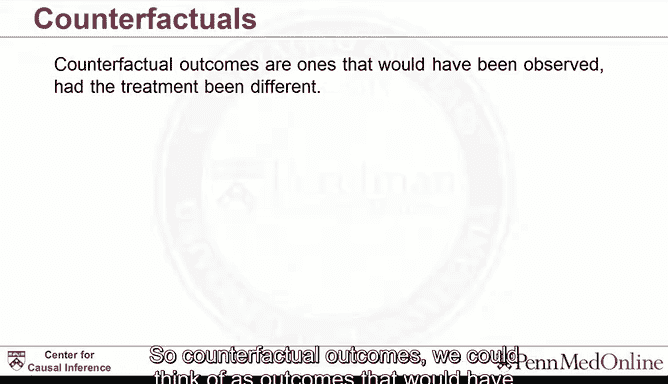

Outcomes that would have been observed had treatment been different so now we're sort of we're thinking of data have already been collected。

 things have already taken place。But what would have happened under some hypothetical alternative scenario。

 So if my treatment actually was equal1， then my counterfactual outcome is y 0 is y superscriptor 0。

 right， because that's the outcome that。Would have occurred had my treatment been a equals 0。

 but my treatment wasn't actually a equals 0。 It was a 1。Alternatively， if my treatment。

 my real treatment， my actual observed treatment was equals0。

 then my counterfactual outcome would be y1， Y superscript 1。

It would be the outcome I would see had my treatment been different。

 had my treatment been a equal one。 So let's get back to an example。

Did influenza vaccine prevent me from getting the flu， So imagine that， and you can see， by the way。

 I worded that question that I'm implying that you did receive the influenza vaccine。

 So imagine that that's already known equal1 a has value one for you。

 You did receive the influenza vaccine， but did it actually prevent you from getting the flu。

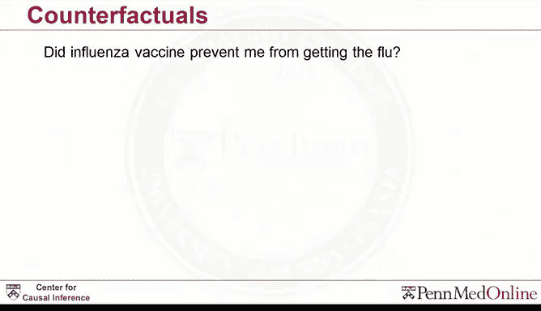

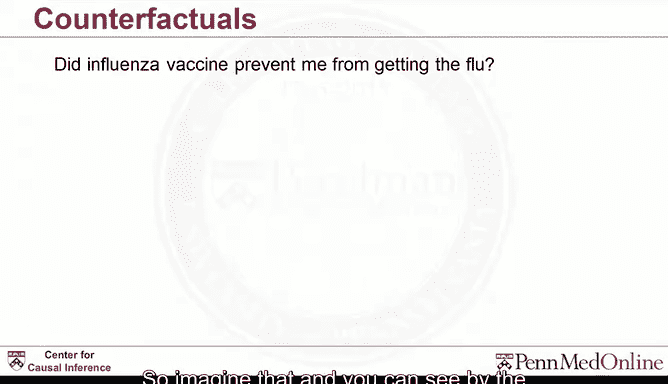

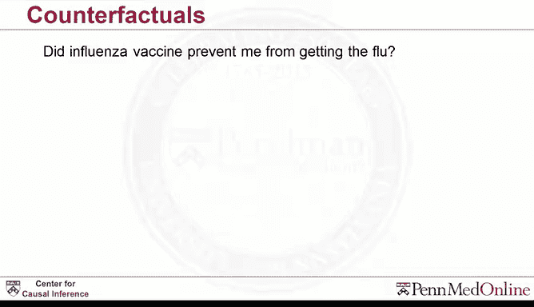

So what actually happened， You received the vaccine and you did not get sick。

 Your actual exposure was a equal one。 Your observed outcome in this case。

 Y is equal to why superscript one， right That's the outcome that would have occurred if you were given the vaccine。

 And since you were given the vaccine， we can think of that as your observed outcome。

 right So that's your observed outcome it's the outcome that you would have seen if you were given the vaccine and since you were given the vaccine。

 it is your observed outcome。 But what would have happened is what is contrary to fact。

 what would have happened contrary to fact， and we could think of that in this case as had I not gotten the vaccine。

 would I have gotten sick。

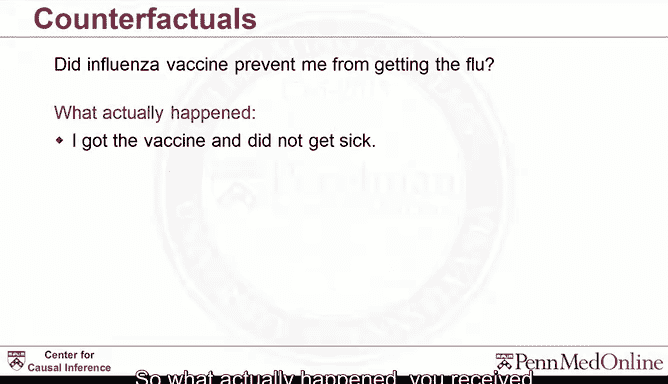

So your counterfactual exposure in this case is as 0， and your counterfactual outcome is y 0。

 So hopefully here it's clear that the difference between an observed outcome and a counterfactual outcome。

 So an observed outcome is what we actually do see。You know。

 given your whatever your actual treatment is and your counterfactual outcome is the one we would have seen seen under some hypothetical alternative scenario。

So now we can think about the link between potential outcomes and counterfactuals。

 So before the treatment decision is made。

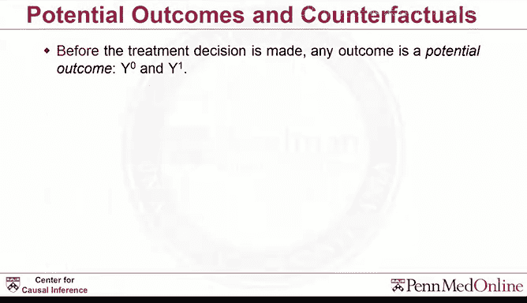

Any outcome is a potential outcome， so y0 and y1。So and that's where the word potential is coming from。

 You have the potential for y0， and you have the potential for y 1。

 And we don't see either of those until a treatment decision is actually made。

 So before the treatment decision is made before you're given influenza vaccine。

 you had these two hypothetical outcomes that we imagine could occur in the future。

 But after the study。

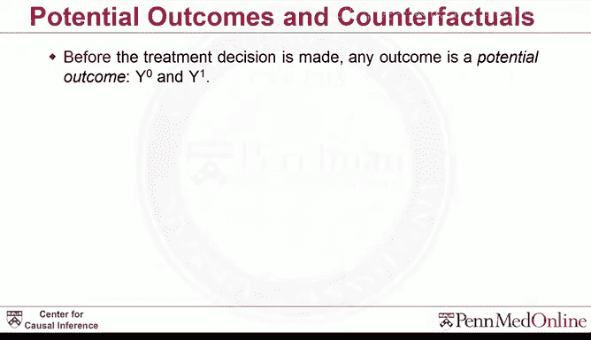

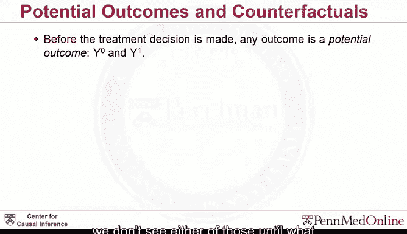

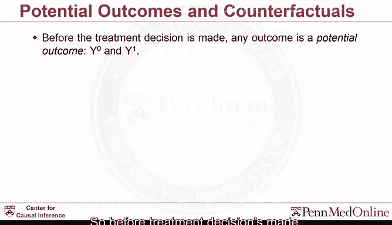

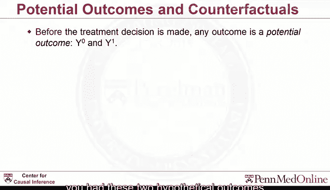

There's an observed outcome， which is the one that。Corresponds with the treatment you did receive。

 And there's a counterfactual outcome。 And you'll notice here。

 I'm using this notation Y supersscript capital A for the one we observe。

 And that's because we observe treatment capital A。

And I'm using for counterfactual outcome Y superscript 1 minus a。 And that's because。

Here're in binary treatment world is what we're thinking of， so if capital A is equal to1。

 then one minus capital A is equal to0， whereas if capital A is equal the other value。

 then you would get the opposite so。Why superscript capital A is the one you would always observe and y superscript 1 minus a is the1。

You don't observe， but we can think of it in a counterfactual sense， what would have happened？

So counterfactual outcomes are typically assumed to be the same as potential outcomes。 right。

 So there's sort of have this。Differentfferent motivation behind them and different sort of reasoning about them。

 but the ones that we hypothetically imagine occur prior to any treatment decisions that potential outcomes。

 we assume that these line up with what we would observe counterfactually。

The potential outcomes y 0 and y 1， we assume are the same sort of values as y 0 and y 1 that are the counterfactuals。

 So people use these terms interchangeably。And in a lot of cases。

 you could just use one or the other。 You could just talk about potential outcomes。

 So you could just talk about counterfactuals， But I want to walk through。

Where this terminology comes from and really help you think about what these mean。

