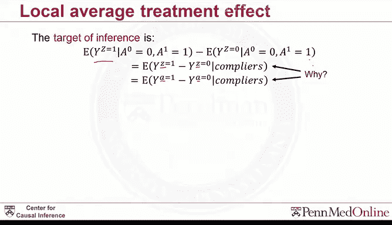
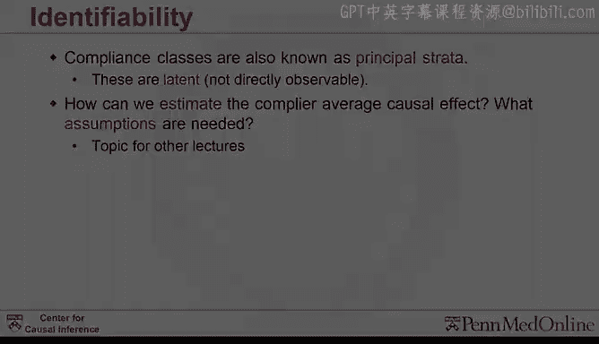

# 宾夕法尼亚大学《因果推断速成课程｜A Crash Course in Causality》中英字幕 - P40：40_05_03_依从类别.zh_en - GPT中英字幕课程资源 - BV1Ft42137BF

This video is on compliance classes。So we'll begin by looking at how potential values of treatment can be used to classify subjects into what are known as Pri Strrata。

We'll also aim to understand what is meant by compliers and then we'll distinguish between population causal effects and local causal effects。

So as a reminder， we have this idea of potential values of treatments。So。

The potential value of treatments are in this case。

 a0 and a1 where a0 is the treatment that you would received if you were randomized to the control condition or in other words。

 if the instrument was z equals0 or if you were randomized to not receive encouragement essentially so we're imagining that everyone has this potential value a0。

 so it's the treatment that that you would receive if you had been randomized to the z equal zero group。

 whereas a1 is the value of treatment that you would receive if you were randomized to the z equal1 condition。

 so if you had been assigned treatment right so these are potential values of treatment。

 and we imagine these exist for everybody we just don't necessarily see them。

 we certainly don't see them all for everybody but what we can do is we can take this pair a0 and a1。

And then classify people or label people based on their pair of values。

so if we look at this first row， for example， so the first row is people who。

 if they were randomized to the control condition， they would not take treatment。

 so that's a0 equals 0。Means if they were randomized to the control condition。

 they would not take treatment。But for these individuals also。

 if they were randomized to receive the treatment， so if they were in the Z equal1 arm。

 they still would not take the treatment。So we'll call these never takers。And that just， of course。

 means that they never take the treatment。 So no matter what you assign them。

 whether you assign them to the control group or to the treatment group。

 they're just never going to take the treatment。So they could be just people who just are not interested in that treatment for whatever reasons。

 and you can do the same thing with other possible contrasts so you have，People who。

 if they were assigned， the control condition， they don't take treatment。

But if they were assigned to treatment， they do take it and well call them compliers。

 So these are people who are doing what they're assigned to do。

 And then we also have two other groups。 So there's the defiers who do the opposite of what they're told。

 So if you assign them the control condition they take the treatment and if you assign them the treatment condition。

 then they don't take treatment。 And finally， there's the always takers and they just always take treatment no matter what they're assigned。

 So this sort of layout is also what's known as part of the ruben causal model。

 and it's also a general kind of approach that's known as principal stratification。

 So we'll briefly talk about each of these subpopulations。

 So one thing to note is is to really think of these as subpopulations of people。

 So think of never takers as one group of people。 again。

 so these are people who no matter what they're assigned， they are not going to take treatment。

So encouragement for this group does not work so one thing to note about this population is that。

 you know， if we knew who this population was， we wouldn't be able to learn anything about the causal effect for treatment for them right because there would be actual there would be no actual variation in treatment received right so in this population they never take treatment so we would never observe。

An outcome under treatment for anyone in this group so there's no way from data that we could learn about the causal effect of treatment for this population。

 at least without making some other strong assumptions。

 So in general we just we don't have variability in treatment in this group so we don't have much hope of learning about the causal effect treatment for that group then we have this population of compliers So they take treatment when they're encouraged to and they don't otherwise。

 So treatment received for this group is always equal to treatment assigned。

 So in this group get we get variation in treatment received。

 So in this population some people will take the treatment and some people won't and it's entirely based on this coin flip it's based on randomization。

 So this is a population we have a lot of hope for learning about a causal effect treatment since we're directly randomizing Z treatment I mean treatment assigned and they do what they're told so we actually are directly randomizing treatment received in this population。

So this is a population that we hope we can learn something about then we have defiers and they do the opposite of what they're encouraged to do so in this group you could think of as treatment received as randomized but just sort of in the opposite way than you intend。

 so there's still sort of randomization happening here but you know it's just they're just doing the opposite of what they were told。

 so in principle we also could hope to learn about the causal effect of treatment in this group。

As we'll see later that this is a group that we tend to think would either be very small or not exist in some cases in like in randomized trials。

 the group assigned to no treatment or to the control condition might not even have access to the treatment。

So it could be some nude drug and they might not even have access to it， for example。

 or it could be some。Specific intervention that they wouldn't have access to So in some cases that we will imagine this population doesn't exist。

 but if it does exist， typically we'll think it's pretty small because if Z is encouragement。

We wouldn't think there's very many people who will sort of do the opposite of what they're told。

If you're a parent and you have teenagers， perhaps your encouragement would cause them to do the opposite。

 but in general， we think these are probably pretty unusual then there are the always takers so they always take treatment so no matter whether you encourage or not they take treatment。

And again， this is a group that there's no variation in treatment received。

All right so we don't expect to have information about the causal effect in this population so one of the motivations for using instrumental variable methods is there's this concern about unmeasured confounding。

And just as a reminder， if there is unme confounding。

Then we can't average or marginalize over all the confounders because some of the confounders are' unobserved right。

 so we can't sort of condition or match on these confounders and then average over it because we don't observe them all。

So I'm emphasizing this here because the causal methods that we focused on in other videos really does focus on。

Causal effects in the whole population， right， but if you have unaurd confounding。It。

It would be very difficult to actually obtain causal effects for the whole population considering。

Really， the way to do that is to average over all confounders。

So instrumental variable methods are not going to focus on the average causal effect for the whole population。

So remember instrumental variable methods， we're hoping that they can still be used to estimate a valid causal effect。

 even if there's unmeasd confounding。 But as I just mentioned， if you have unmeassureed confounding。

 it's really。You shouldn't expect to be able estimated causal effect for the whole population。

So instrumental variable methods are not going to do that。

 instrumental variable methods are going to try to estimate a causal effect locally。

 so what we'll call a local average treatment effect， and I'll define what we mean by that。

So here's what's meant by a local average treatment effect。In instrumental variable methods。

 our target of inference is going to be this。First thing to note is we're contrasting means of。

Potential outcomes。So the potential outcomes are here under either z1 or  zero。

 so what you're assigned to or what you're prescribed， what you're randomized to。

And it's a valid causal effect because we're comparing the same subpopulations。

 So you'll notice what we're conditioning on。Here and here are exactly the same。

 So it's the same subpopulation of people。 So any time you contrast a potential outcome。

In the same subpopulation of people， you have a valid causal effect。So now what we need to do though。

 is think about who is the subpopulation of people？

So I'll just clear this off a little bit so you can see better。 So what you'll notice is that。

A 0 equals 0 and a 1 equal 1。 That's actually just the population of compliers。 right。

 So we're looking at the subpopulation of people who， if they were。

Prescribe treatment or assigned treatment。They would take it， so that's a1 equal1。

 but if they were assigned to the control condition。Then they wouldn't take it。

 that's a zero equals zero。 We're conditioning on that so we're saying restrict to the subpopulation of people that if a treatment take it。

 if not assigned treatment don't take it， well that's a subpopulation of compliers so what we're really looking at here is the average causal effect of treatment assigned on the population of compliers so this is what we mean by local。

 it's local in the sense that it's an inference about a subpopulation so that's what we mean by local is a subpopulation the subpopulation happens to be compliers and it actually turns out if you restrict to the subpopulation of compliers。

I can do this little thing here where I go from。Indexing by Z to indexing by a。 So now I'm actually。

Comparing potential outcomes based on treatment received as opposed to treatment assigned And so as a thought experiment or just something to think about。

 I'm asking why why did why was I able to go why was able to just swap what I'm indexing the potential outcomes by so I went from z1 to a equal1 and from z0 to equal0 So now this would be a good place to pause a video and think about it for a minute or two and have your answer I'll assume you've done that Well so now remember that we're restricting to the subpopulation of compliers So compliers of people who do what they told So z1 for compliers is always going to correspond exactly to a equal1 and for compliers z0 is always going to correspond exactly to a equal0。

 meaning z equals 0 implies a equal0 for compliers z equal1 implies equal1 for compliers So as long as I'm restricting to the subpopulation of compliers I can use z and A interchangeably。

So as I mentioned， this is a causal effect。It's contrasting counterfactuals in a common population。

 and in fact， it's a causal effect of treatment received now。

 because you see that I have potential outcomes indexed by treatment received。

 so it is a causal effect treatment received。But it's in a subpopulation。 So it's local。

 It's only looking at compliers。 And this is sometimes referred to as a complier average causal effect。

 So sometimes it's referred to as a local ever treatment effect。

 That's kind of the general term for causal effects in subpopulations。

 But in the specific situation where you are in a randomized trial with noncompliance。

 Then this is referred to as。The complier average causal effect or sometimes abbreviated Ca A C E。

 So you'll notice that what I'm saying in an instrumental variable analysis。

 the target of inference is the causal effect of treatment received among compliers。

 So you'll notice that when're not talking about defiers， always takers or never takers。

 So we're not actually an instrumental variable analysis going to make inference about those populations。

 And we'll discuss that more in other videos， but。Hopefully。

 it's especially clear why we won't be making inference about always takers and never takers and that's because for those groups there's no。

There's no variation in treatment received， and so we shouldn't expect to learn anything about the causal effect in those subpopulations。

Okay， so now we want to think about that was a concept this is we have a target of inference。

 but that target of inference involves potential outcomes。

 so we need to start thinking about observed data because we're going to somehow or at some point go from observed data to potential outcomes we're going to have to estimate this so it' would be good to sort of think about observed data here。

So what I'm writing down here is。What we observe。And then also these sort of potential treatments。

 so we have what one thing we observe is Z， so that's treatment assigned。

 another thing we observe is treatment received。And so you'll notice what I've done in these two columns is I put all。

F possible combinations of those two variables， so it could be  zero，0，01，1，0 or11。

So think of these these are the four combinations that you could observe。In your data。

And now I'm also going to write down what the corresponding potential treatments。A， so the first one。

 is this one here is the potential treatment。If assign the control。

And then the other one is a potential treatment if assigned to treatment and so you'll notice if you're in the z equals 0 equals zero group。

 we observe this one right so this is somebody who was actually assigned to the control condition and and in this case they did what they were told they didn't actually take treatment。

 so we know that a0 is equal to zero。But we don't know what they would have done had they been assigned treatment1。

 So what all we know about this group of people is that they're either never takers， right。

 They might be people who just would never take the treatment regardless of what they were assigned。

 or they might be compliers。 They might always do what they're told。

 So we've narrowed it down to two choices。But we don't know for sure which one they are。

 so you can do to have a similar exercise with these other cases so。

Somebody who was assigned the control condition， but actually took treatment。

 right Well we would know that if assigned zero equals zero， they take treatment。

Which means they're either always takers。Or defiers。So if they're always takers。

 that would mean a1 would equal 1， if they were defierers， it would mean a1 equals0。

 but we don't know which one they are。Then you could do the same thing where you have z equal 1 a equals 0。

 in that case they're either， well so they were assigned treatment， they didn't take it。

 so they're either never takers or defierers。And then finally。

 if youre assigned treatment and take it， then we know you're either an always taker or a complier。

So you'll see that from the observed data， we can narrow it down to two options for each person。

So we don't know which group you are in for sure， but we can narrow it down to two options。

So these are what I'm calling compliance classes。These are also known as principal strata。

So these things that we're labeling never takers， compliers to fires and so on。

 these are things that you could stratify and in fact to get a the causal effect we want we stratify compliers。

So these are so stratifying on those that those are the principal strata。

We could also think of those as compliance classes or sort of classes or labels based on characteristics of people。

But they're latent， meaning they're unobserved right so we don't actually know which which of these groups you're in。

 we just we can narrow it down to two based on your observed data right so that creates a challenge because we want to make inference about the compli average causal effect。

 So that's a subpopulation of people。And we don't actually know， for sure。

Who they are so how do we estimate a compiler average causal effect so we're going so in future videos。

 we're going to discuss how we would actually estimate it and what assumptions we would need to do it so。

You know， the purpose of this video was to sort of really set up the problem。

 think about why we care about the causal effect。Among the compliers。

And now we see that there is a challenge in terms of estimation that we'll have to address。

