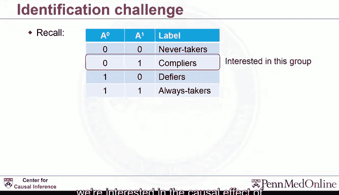

# 宾夕法尼亚大学《因果推断速成课程｜A Crash Course in Causality》中英字幕 - P41：41_05_04_假设条件.zh_en - GPT中英字幕课程资源 - BV1Ft42137BF

In this video， we'll discuss assumptions related to instrumental variables。

 so we'll begin with assumptions about what defines an instrumental variable。

How do you know if it's a valid instrument， what assumptions you have to make。

 and then we'll also introduce the monotononicity assumption。

 discuss what it is and why it's helpful for identifying causal effects。

So we'll look in some detail here at assumptions about instrumental variables， meaning。

What makes a variable of that with instrumental variable？

 So what is the definition of an instrumental variable？

 And so it has to be associated with the treatment。And it has to affect the outcome。

 I mean it can only affect the outcome through the effect that it has on treatment so it cannot directly affect the outcome so this second assumption is known as the exclusion restriction so here's this kind of common picture that you kind of dig that you might look at if you when you think about instrumental variable problems so here's Z is the instrument A is treatment。

Y is the outcome N could be， you could think of X as confounders。

 confounding the relationship between A and Y。So the first assumption was that。

Z must be associated with treatment so that you'll see that there's this arrow from Z to A。

 so Z is affecting treatment。So that's our first assumption。So if you were。

Trying to decide if a variable is an instrument。You。

One of the first things you would want to do is think about what does it affect treatment？

And hopefully it strongly affects treatment。And then it must not， it cannot directly affect why。

So you'll see that I have the x through this arrow， so you can have a direct arrow from Z to y。

 So we're excluding that as an option。 This is the exclusion restriction。Okay， so。

If we think about a randomized trial， for example， where we're randomizing treatment and then A is treatment received。

 randomization should not be affecting the outcome except possibly through the impact that randomization had on what treatment somebody received。

So that's an assumption that we have to make is this exclusion restriction。

This exclusion restriction can also take another form or can be sort of viewed in another way。

 so imagine we have some unmeasured confounders you。

And part of the reason we're interested in an instrumental variable analysis is because we think there might be unmeasured confounders you。

Well， an exclusion restriction also says that Z cannot be directly affecting U。Okay， so。

You'll notice here that。There's an arrow。From you。To Wai。And if there was also an arrow from Z to U。

 what that would mean is that Z is affecting y。Through some path that's not that's not a， right。

 So we could go from Z to U to y。 So Z could be then。嗯。Affecting why。

Not through its effect on treatment。 And that we're saying cannot happen if it's a valid instrument。

 So you could think of the exclusion restriction as satisfying both。

Of from the two slides that I just showed you so there's no direct arrow from z to y so I had next through that and also if you have unmeased confounding there can't be an arrow from Z to U in that case。

 in this case， so Z cannot be directly affecting y and it also can't be indirectly affecting it through its impact on some unmeasured confounders。

So basically think of。If Z is a valid instrument that it's affecting treatment。

And if it is affecting the outcome， it's only affecting it through its effect on treatment。

 not through some other path。So that's the exclusion restriction。

And so one of the things if you're going to do an instrumental variable analysis。

 you'll need to think carefully about is whether the assumptions are reasonable and most of the debate about whether the reasonable sort of centers around。

The exclusion restriction， that's the one that takes more justification。

But let's think about the case where we're in a randomized trial。

 so imagine Z is random treatment assignment。Well in that case we should be really confident that it affects treatment received。

 it would be a pretty terrible randomized trial if treatment assignment did not have any impact on treatment received。

 but this is also something that you can check with data。

 you can see if treatment assignment is associated with treatment received so one nice thing about this assumption is it's checkable so you can use your observed data and really see if it's true or not。

But let's think about the exclusion restriction。 This is one that people worry about more in general。

So one argument that it would be valid is if you think of randomization as just a coin flip well there's no reason a coin flip should affect the outcome or affect unmeasured confounders or anything like that。

 right we're just flipping a coin which is randomly generating a number So in general we don't see why this would impact。

The outcome， other than through， may be the impact it hand on treatment。However。

 you can imagine that in some randomized trials and maybe there's not blinding。

 so blinding would mean that so if there's blinding in a randomized trial， like， for example。

 the subjects of the patients wouldn't know which treatment they're receiving So in like a placebo controlled trial hopefully the people don't even know what treatment they're receiving So in that case there's no reason to think that whether they're getting。

The active of treatment or the placebo would be， I mean。

 that that sort of treatment decision itself would be affecting an outcome。

But imagine that they're not blinded， so they participate in a randomized problem。

 but they're told what treatment they're receiving well perhaps that knowledge could affect them in some way。

 so maybe it affects their behavior， maybe it affects other things they do so it's possible then that it could impact。

The outcome in ways that aren't aren't because of the treatment itself or if you know if you're in a clinical kind of setting where the clinician is sort of administering the treatment if they're not blinded knowledge of what they're sort of giving the patient might affect other ways in which they treat this patient So it's possible that the exclusion restriction could be blinded in that case。

 So whether or not this assumption holds really just needs to be examined within the context of any given study。

 so you need to think about what is what is the exclusion restriction and are the reasons to think that it might be violated So unfortunately this one it's not something that is technically checkable from data。

 So are sort of there's some ideas that people have come up with to kind of get at whether。

The assumption is met but。It's really more of the kind of assumption that you just have to。

You sort of your subject matter knowledge。And then have a degree of faith about it so this is one of the kinds of assumptions just like unmeased confounding where you never can know for sure if you have captured all of the confounders。

 this is the same kind of thing with the exclusion restriction you can't know for sure if it's met so how confident you are about the results will depend on how confident you are about the assumption being met so you have to think very carefully about it。

 whether it' sort of makes sense in your particular case。So as a reminder。

 if we have a valident instrumental variable， we want to use that to help us what's known as a local treatment effect or a complir average causal effect in the case of randomized trials with noncompliance so we're interested in the causal effect of treatment itself。

Among the subpopulation of compliers。 So the subpopulation of people who will。

Take whatever treatment they're assigned。Okay， so there's a challenge with identification here of the causal effects。

 so as a reminder， we can take these pairs of potential treatment values。A0 and A1。

 and then we can label individuals based on that combination。 so for example。

 if phase  zero is equal to 0 and A1 is equal to zero of those are the never takers。

And as we've discussed， we're interested in this group， so in an instrumental variable analysis。

 we're interested in the causal effect of treatment received among compliers。

But the challenge is that we don't actually know who the compliers are。Again。

 can we can write down the。Observe data Z。And based on that。

 we can narrow it down to two groups of that an individual falls in， so for example。

 if somebody was assigned no treatment and they didn't take the treatment。

 then we also know one of their potential treatment values， we know what would have happened。

 you know， if they had not been prescribed the treatment or assigned the treatment。

so we know that a zero is equal to zero so then we can narrow it down to that they're either a never taker or a complier and so we can do that for each possible combination of DNA so we can narrow it down to two but we won't actually know for any given person which group they're in and you know we call this is related to the fundamental problem of causal inference which says that we never observe both potential outcomes here we never observe both potential values of treatment so we can't know for sure which compliance class people are in unless we make additional assumptions so that motivates the need for an additional assumption so a common assumption that people make is something known as monotononicity and you could think of the monoonicity assumption in this setting is just meaning that there's no defiers。

So we could make the assumption that defiers don't exist in our particular study so there's no one who consistently does the opposite of what they are told。

 So if we think of the instrumental variable as encouragement。

 nobody takes treatment when encouraged not to in a sense and doesn't take the treatment when they are encouraged to so nobody does the opposite of what they're told so that's something that you might be willing to assume that's known as a monoity monotonity assumption in general what's called monotonity because what we're saying is that if you increase the amount of encouragement that should increase the probability of treatment So so far we've thought about instrumental variables just in cases in settings where it's binary you know either encouraged or not but you could also think of instrumental variables as being continuous where it's like a dose of encouragement and the monotonity assumption there would have to do with as you increase the dose of encouragement the probability of treatment should go up So this is an assumption we could make it's just that there's no deiers and you know if you're in a random。

Nice trial。Let's say it's a placebo controlled trial， so there's some active drug and some placebo。

The people who were prescribed the active drug might not have access to the placebo， for example。

 or people prescribed to assign the placebo， they might not have access to the active drug and they might not even。

 you know hopefully they don't even know which group they're in。

 So it might be a reasonable assumption in a lot of situations。

 So let's go back to our identifiability problem。 So the standard case where there's no monotity。

 So so far all we've done is made standard instrumental variable assumptions， which you know that it。

The variable affects treatment， and we also made the exclusion restriction assumption that the variable does not affect the outcome except through its effect on treatment。

 so we've made the IV assumptions， but we haven't assumed a monotonicity in that case。

 we're stuck in this situation where。We don't know what group people are in。

 but we can narrow it down to two。However， if we make the monotononicity assumption。

 the problem gets a little easier， so you'll notice that if the monoity assumption says there's no deiers。

 so in that case I'll know this value， which is these are people who were assigned to the control group。

But they actually took treatment。So we already knew that a0 was equal to1， but sensorus notifiers。

 we also know that they must be an always taker right they can't be a defifier。

 so a1 couldn't be zero in that case， so they have to be an always taker。

 So now if anybody who has z equals0 and a equal1， we know they're an always taker。

 so as long as we make the notifier assumption or the monogenicity assumption。Then if。

 if we observe a z equals 0 and an a equal 1 together， we know they're an always taker。

 It also works the same where if you， if you observe somebody to have Z equal 1。

 but they don't take treatment。 So these are people who were assigned treatment， but didn't take it。

 right， So we already knew then that a 1 was equal to 0。

 But now we also know that a 0 would have to be equal to 0。 right。

 So these are people who were encouraged to take treatment， but didn't。 And so therefore。

 if they weren't encouraged， we'll assume that they also wouldn't take treatment。 So therefore。

 they're never takers。So you'll notice now that we've for there's some people we're able to identify what group they're in。

 we're still interested in compliers。But by making this monogenicity assumption we've made the problem much easier and in fact。

 we've made the problem easier enough to the point where we can actually identify the causal effects。

 so we'll look at how we actually estimate the causal effects in another video but。

The key point here is that if you make this monoity assumption。

 now we actually will have enough information to identify the causal effect that we're interested in。

 which is the causal effect among compliers。