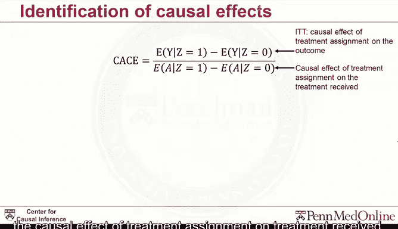

# 宾夕法尼亚大学《因果推断速成课程｜A Crash Course in Causality》中英字幕 - P42：42_05_05_因果效应识别与估计.zh_en - GPT中英字幕课程资源 - BV1Ft42137BF

In this video， we're going to discuss。Identification and estimation of causal effects from instrumental variable type of analysis。

So we'll aim to understand how the complier average causal effect can be estimated from the observed data。

And also how that effect relates to intention to treat effects。So just even before we begin。

 let's also remind ourselves what the assumptions we're making are。First。

 we'll assume that Z is a valid instrument， and so we assume that it's。That Z affects treatment。

 and we also make the exclusion restriction assumption。

 which is that Z does not directly affect the outcome。 Finally。

 we're also going to make the monotonity assumption。

 which is the assumption in this case that there's no defiers。

 So we're imagining we're in a randomized trial with non-compliance kind of setting and we're assuming that there's no defiers。

 there's no people who do the opposite of what they're encouraged to do and then also recall that our goal is to estimate the average causal effect of treatment received among compliers So among the subpopulation of people who will do whatever they're sort of assigned to do。

 So they'll take whatever they're assigned to take in terms of treatment。

 So to basically going to walk you through the steps on how we can estimate or identify this causal effect of interest。

 but to do that let's first begin by looking at something that we know we can identify which is this intention to treat effect。

 So the intention to treat effect is contrasting potential outcomes。based on treatment assignment。

 so we're looking at the expected value of why， if everybody had been assigned to treatment versus the expected value of y。

 if no one had been assigned the treatment or if everybody had been assigned assigned to the control condition and that is just a contrast of these two quantities based on observed data。

 so the expected value of y among people who were actually treated minus the expected value of y among people who were assigned to the control condition。

 and this equality holds because of randomization， so basically you could think of Z as a coin flip and so we have the then one to one correspondence between these sort of conditional distributions and the distribution of the potential outcomes。

But we also could write we can also write this kind of conditional expectation。

In terms of these sort of compliance， like classes。 So let's just look at for now。

The expected value of y given is equal one。 So this is the expected value of the outcome and the subpopulation of people who were assigned to treatment。

 Well， we could write that expectation just using standard rules about expectations and probability where you can。

Take expectation， conditional on something， but then multiply by the probability of it and then some overall possibilities to sort of essentially to condition and then average over。

 So I'll walk you through it a little more carefully than that。 But so for example。

 the expected value of y given equal1 Well we could we could additionally condition on the pair a0 and a1。

 but then integrated out or average over it。 So that's what we're doing here。 So we could say， well。

 this overall expected value of y among people is equal1。

 that's equal to the expected value of y given equal1。Among always takers。At least part of。

Part of this average over here is going to be based on the average over here。

Right so we're restricting to a smaller subpopulation of people。

 so people who have equal1 and are always takers， but then we want to weight that by what proportion of this subpopulation are always takers so that's what this is。

 and then we do the same thing we can take the mean of why among people with equal one who are also never takers。

 but then weighted by the probability of being a never taker and you can do the same thing with compliers。

So all we're doing here is saying okay， this mean of why is a mean of why in these three subpopulations and we're going to wait it by how big those subpopulations are so that's sort of the how to say that in words I think。

So hopefully that part's clear， you could just think of if I wanted to mean of some whole population here by whole population。

 I mean the population that have the equal1， why I could break it apart into somepopulations。

Take the mean in each of those but then weight them by how big those subpopulations are so that's all that I'm doing here。

 but then there's something else we can note so among always takers and never takers Z doesn't do anything remember these are people who are always going to take treatment or never going to take treatment and whether I encourage them or not has no impact so in this case I can actually drop the conditioning on z equal1 So if I'm looking at the subpopulation of always takers for example。

 also conditioning on z equal1 doesn't do anything because Z has no impact on this population and remember Z was randomized so I can just drop that conditioning。

And also， the same thing holds for never takers。 I start by conditioning on both Z equal1 and never takers。

 But among never takers， Z has no impact。 I'm randomizing Z。

 but Z doesn't actually influence anything in this population。

 And so I can drop the condition non Z equal 1。 I can't do that for the compliers because among compliers。

 Z is having an impact。 Z is affecting what treatment they receive。 So I can't drop it there。 Okay。

 so I'm just simplifying this expression。By dropping this equal1 in those couple of cases。

And then the other thing to note is that the probability of being an always taker。

Given the is the same as probability of being an always taker and so on。 So above here。

 I didn't condition on Z equal 1。Anywhere because。That's having no impact on the size of these populations。

 So the how many people are overt always takers has nothing to do with this treatment assignment because these are things that sort of exist in the population to begin with。

 so my population of compliers is defined completely independent from the result of some coin flip。

Okay， so this is why that this expression I wrote on top isveed and also I mentioned how a ways in which you could simplify it。

 which I'll show you in a little more detail， but now we can do the same kind of thing for the zs zero group。

 for the Z equals zero group I can write the same kind of expression。

And I can get rid of the conditioning on z equal1 and z equals0 among always takers and Ever takers。

 so I described previously why you can do that。All。

 so you'll see that these expectations are simplifying a little bit。

So I can write that a little nicer just like this。 So from so from this slide to the next one。

 all I've done is I've dropped。These things here， these condition does equals0 and zero equal1 from those groups。

 so that's the only difference on this slide now。And remember when we started out a few slides ago by talking about the intention to treat effect。

 which actually is a difference between this and this。Well。

 what well see is that there's some things in common between these two things。

So we'll see that there's some things that are actually equal and so that when we take a difference。

 they'll actually go away， so I have this black arrow here。And that's showing that look， the。

TheseThese two。Expectations， times probabilities are the same。 So in both cases。

 it's expected vary of y among always takers， times the probability of always takers。 Well。

 that's the same in each of these groups。And then we have you know the blue arrow。

 which is the same kind of thing， the expected value of y among never takers。

 times the probability of never takers that appears in both of these expressions as well。

 and so when I go back to my intention to treat effect， those are going to difference out。

 those are going to go away because I'm going to end up taking a difference in these two things。

And that's all I'm doing here is on the left， we have the intention to treat。

So this is just the definition of intention of treat is on the left。

 and on the right we have the simplified expression now。

 So all I've done is I've taken the difference。Of these， of these two sort of。

Big equations but dropped the things that canceled out。And so， we end up with this。So we end up with。

The difference in expected values over here。Can be written as a difference in。

In these expressions here where。This first one is the average value of y among people who are assigned treatment among compliers。

 So there's a subpopulation of。Compliers who were signs equal 1。And this the same。

 What's the expected value of y， But then times the probability that the。Compliers， in other words。

 the probability of compliers means what proportion of the whole population are compliers。

And then we have the same kind of thing for this equals0 group。Times the probability of compers。

 So this expression holds for the reasons I showed on the previous slide。

And so you might be wondering why am I doing all this， Well。

 what we're what we're trying to get to remember is we actually are and are interested in a causal effect among compliers。

 And now you'll see that we have。Compliers appearing as something we're conditioning on on the right hand side there。

 So we're starting to get closer to something that we ultimately want。So， this implies that。

If we divide the。If we divide this expression over here， this difference and expect values by。

The probability of compliers。So that's what this part is。

We've divided the left hand side by the probability of being a complier。Well。

 then that's just equal to this contrast。Expected value of y given equal 1 among compliers。

 minus expected value of y given equals zero among compliers。So I did one step of algebra there。

 I just divided by the probability of compliers from both sides。

And now we can rewrite this expectation so we can go。From this line to this line。

We can now write it in terms of potential outcomes because remember， first of all， Z was randomized。

Second of all， we're looking at the subpopulation of compliers。So because we're randomizing Z。

 and these are compliant people， among these people we're actually randomizing A。

 so we're directly randomizing treatment itself。So then we can write。

The expression now in terms of potential outcomes of treatment received。And remember。

 this is the thing we actually wanted， this is a complir average causal effect。

So the complier average causal effect。Can be written in this in the way。Right here。

So what we have on top is an intention to treat and then divided by the probability of compliers。

So we'll look at that a little more carefully。So the compr every causal effect we just showed can be written as。

What we have here， so on the top we have a difference in。

Expected values of y given equal 1 versus equal 0， and in the denominator。

 we have the probability of compliers。And I also mention here that the probability of compliers is just this thing。

Expected value of a given equal 1 minus the expected value of a given equals 0。And I ask why。

 so this is another。Good thing to think about， pause a video。

 see if you can figure out for yourself why it's true。Assuming you've done that and we're back。

 we can look at it。The expected value of a given equal1。

That's the proportion of people who are either always takers or compliers，The expected value of a。

Because a is binary a is this treatment yes or no。The expected value for binary variables is just the probability of it。

So expected value of a given equal1 is a probability that equals one given equal1 so in other words it's the proportion of people in the population who would take the treatment if they were assigned the treatment while that's the population of either always takers of compers。

 it's the union of those sets。So what proportion of the whole population are either always takers of employerers。

 so that's the expected value of a given z equal one。The expected value of a given z equals0。

That you could also think of as a probability。Of taking treatment， if you were assign equals 0。

Well that's the population of always takers because we've assumed there's not defiers， right。

 So this is those are the always takers。 And now what happens if you take the difference of those two。

Right， if we take the difference。This。Minus this。The always takers cancel out。

 and you're just left with the proportion of compliers。Okay hopefullyfully that's clear。

The proportion of compliers， the probability of compliers。That's the same thing。As。

So I can rewrite the complir average causal effect as this ratio。Where on the top here。

 this is the intention to treat effect， so that's the causal effect of treatment assignment on the outcome。

And remember， that's something like this is something we can identify from data， right。

 because these are means of。Involving observable variables， so we observe y and we observe Z。

So we can identify or estimate the intention to treat effect。

Our denominator is the causal effect of treatment assignment on treatment received。Right。

 so this is sort of。This is like the causal effect treatment assignment on treatment。

And this is also something we can observe， because。We randomized Z。

 A and Z are observed so that we can also identify this。

 so that means we can identify the complir average causal effect。

Right so everything in this expression are things that we can identify that we could estimate from data so we can actually estimate the compilelir average causal effect。

 so even though we don't know for sure who the compliers are。

We still can estimate a causal effect among compliers。

 and it's just this ratio of the intention to treat effect divided by the causal effect of treatment assignment on treatment received。

And so if you had perfect compliance， so if there was no non complianceli。

Then that denominator would just equal equal to one。

And the complier of causal effect would be the same thing as the intention to treat this effect。

 they would just correspond with one another。And also note that the denominator is going to be between0 and 1 So it's a proportion of compliers。

And so what' happens then in since we're going to be dividing by something that's between zero and one。

 it's essentially going to increase。It's going to sort of blow up the ITT effect。

 So it's going to make the。You'll take the ITT effect， which is in the numerator。

 and we're going to make it bigger。 We're going to be dividing by。

Something that's between zero and one。So the ITT effect is an underestimate of the complier average causal effect。

And hopefully that makes sense because。What happens is in the intention to treat effect。

You have some people。Sort of not。We have some people who are assigned treatment。Who don't take it。

And so in that case。It sort of diminishes the true causal effect of treatment because you have some people who you're kind of treating as if。

They were treated but they really weren't and so it sort of diminishes the causal effect of treatment itself。

 so then by dividing by the proportion of compliers。

 you sort of get back to the thing that you might want， which is a complier average causal effect。

So as a big picture kind of summary， instrumental variables require two key assumptions and the strongest of which is the exclusion restriction。

But that just having valid IV alone is not enough to be able to identify causal effects。

 we need to make some kind of additional assumption or assumptions。

 one that works as a monoonicity assumption， so if we make the monoonicity assumption。

 we can identify a complier average causal effect， which is also known as a local average treatment effect。

And it happens to just be theest of four it happens to just be the standard intention to treat effect。

Estimate， divided by the proportion of compliers。And in general。

 the ITT effect will be an underestimate of this sort of local average treatment effect or complir average causal effect。

