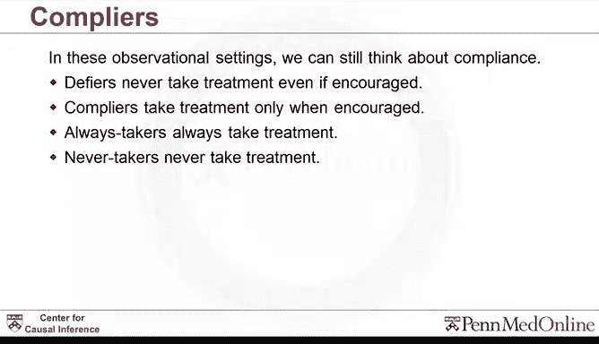

# 宾夕法尼亚大学《因果推断速成课程｜A Crash Course in Causality》中英字幕 - P43：43_05_06_观察性研究中的工具变量.zh_en - GPT中英字幕课程资源 - BV1Ft42137BF

In this video， we're going to focus on instrumental variables in observational studies。

So in other videos， we talked about instrumental variables in terms of randomized trials。

 where there's non-compliance， but here we're going to think about the use of instrumental variables in observational studies。

And so we're going to especially think critically about the validity of the IV assumptions in those settings and also go through a number of examples of IVs that have been used in practice。

As an overview， we'll think about instrumental variables in observational studies。

 but they'll look a lot like the sort of IV situation in randomized studies where we we randomized treatment and we had some noncompliance so here we'll still use the same notation so Z' is an instrument A as treatment why is an outcome and potentially you've also collected some covariates X and we'll just generally think of Z as encouragement to receive treatment so we're not actually randomizing Z but。

We're imagining Z is a variable that ends up encouraging people that either receive treatment or not。

 so if theses binary， it's just encouragement yes or no， so people are either encouraged or not。

Whereas if Z is continuous， then we could think of it as a dose of encouragement， so for example。

 the larger Z is the more encouragement somebody would get to take treatment。

And so we even though we're not actually going to randomize Z。 so as an investigator。

 we're not physically going to do the randomization ourselvesself， we are going to think of Z。

As randomizing。In nature， in some sense， that's sort of a natural experiment。So the question is。

 so how do you I find a variable like that and so the motivation might be you have an observational study where you have some research question and you have data。

 but maybe you don't have very many。Confounding variables maybe you have a pretty small list of variables and you're worried about unmeasured confounding in that case you really might want to try an instrumental variable analysis。

 but you'll need to identify an instrument。So'll as a reminder。

We have to make a couple of assumptions， so one is that the variable that you're proposing as an instrument has to affect treatment and thankfully we can check that with data and we'll also have to assume that we will have to make the exclusion restriction assumption and that's going to have to largely rely on subject matter knowledge and that assumption is where there's usually the most debate on whether something really is a valid instrument or not。

And so in this video， we'll go through several examples that have been proposed in the literature and we can think about what the reasoning was behind it and why people thought it was a valid instrument。

So one instrument that's been used or proposed in the literature is calendar time。

And so what happens in some cases， especially if you're looking at medications， for example， is that。

Or but really anything in sort of in medical practice where there might be a change in treatment preferences over some short period of time。

So I have a sort of hypothetical kind of generic example here where。

a picture where there's basically you imagine there's two drugs that are used to treat the same condition。

So drug A， I I drew that curve in red and drug B， I drew that in blue and on the horizontal axis we have year。

 So this is you could just think of this as time and on the vertical axis we have the probability of treatment。

 So what you'll see is that early on。So in the early years over here。

Drug A is the one that's not very commonly used， but drug drug B is preferred。

 So the probability of treatment is high for drug B initially。And low for drug A initially。

 But over some period of time， that changes where now。

Drug A is very popular and drug B is not popular， so you know this might happen if for example。

 there's a new drug introduced in the market where over some maybe relatively short period of time。

 drug A goes from not being very commonly used to being commonly used。

So as there's a specific example that's been proposed in the literature and that looked at Sofaoureures versus mettformin for treatment of diabetes。

 and so when mettformin was introduced， you could think of that as，Drug A。

 you could think of metformin as drug A， where when it was first introduced。

 it wasn't used very often， but over time， it became more popular。And so of course。

 at any given time who gets drug A versus drug B， that is probably not random。

 it's probably dependent on patient characteristics。

But potentially calendar time could be something that you might think of as essentially randomizing in the sense that if you look at。

 I'm going to draw。A。Two vertical lines imagine this cross section of time versus this cross section of time。

So I'll call this time one and time two。So if you happen to be。You know。

 going into if you happen to be diagnosed with diabetes at time one。

 you'd probably more likely to get drug B， whereas if at time two。

 you is when you were diagnosed with diabetes， you'll be more likely to get drug A。

 and if time one and time two aren't very far apart。

 most other things in the world might be very similar and it really might function very much as randomizing this time itself might be very much like。

The drug was randomized to some degree。Early time period versus light time period。

Has been proposed as a kind of thing that could function as an instrument。 And here in this case。

 the body mass index。Was the outcome of interest because it was concern about weight gain。

 I think with Sohanoureeas in particular， so they were looking at they wanted to know the causal effect of these different drugs on weight or BMI。

 but these treatments weren't actually randomized， so they were just sort of given in actual practice。

But could we use these time periods as an instrument？

And so is Z in this case a valid instrumental variable， so that's the question。

It's certainly associated with treatment received， and that's very easy to show。

The I hand drew essentially a graph on the previous slide， but the graph that。

The sort of real life graph was not that different than that。

 there was a big change over time in the popularity of these two medications。

And so it's very easy to show that， yes， if you use if is early versus late time periods。

 Z definitely affects treatment。But what about the exclusion restriction。

 So the exclusion restriction is saying that。This calendar time variable should not be affecting the outcome so here the outcome is BMI body mass index that should not be affecting the outcome directly。

 It should only affect it through its impact on。Treatment and so you could imagine that this is the one that there would be a lot of debate about is calendar time valid。

If the early versus late period are relatively close in time， I think you have a stronger argument。

 but an argument against it could be would be that like you could imagine that。

In the early period versus the late period， maybe other things have changed。

 So maybe how diabetes is treated。In general， has changed。

 so maybe the clinician more actively sort of encourages certain health behaviors than they did in the past or maybe more information about。

How you should sort of self-manage the disease has come out between those two time periods so people with diabetes behave differently than they in the late period than they did in the early period。

 so there could be things that have changed， so this is one of the things where there would have to be a lot of thought and discussion about whether it's a valid instrument。

So in general， whenever we identify a candidate IV。

A lot of thought goes into this exclusion restriction， is it a valid assumption。

 and if you write a paper using an instrumental variable analysis。

There'll be certainly reviewers who will be critical of the assumption。

 and it's important to look critically at these assumptions。But nevertheless。

 it seems like it seems like a good idea as far as。

It seems pretty likely that if calendar time has a big impact on treatment received and the time period is relatively short。

 that probably the main thing that's changed in that calendar time is just the prescribing preferences。

 so it's probably at least a pretty good approximation to an instrument。

 but these things would have to get thought about and debated。

So another popular instrument or type of instrument has to do with distance。

 So distance as an instrument。 So imagine you're interested in whether specialty care centers are better than。

Some sort of。Sort of general hospital， some sort of non specialty care center。

AndBut of course typically you're not going to randomize people to specialty specialty care centers or not。

 so one thing thats one idea that's been proposed is that where these specialty care centers are located might matter。

 so for example， if you have a specialty care neighborhood a specialty care center right in your neighborhood。

 you know that's a very short drive for example， or a short walk。

 you might be more likely to go there than if it was a long distance away。

So it's having a specialty care center near you could be thought of as encouragement。

 encouragement to go there。Then there's this question of， well， is distance？

Itself likely associated with the outcomes in other ways。Maybe people who live near。

Spspecially care centers differ from people who don't in other ways。

 and maybe that's related to the outcome。 So that's something that would have to get thought about。

 So as a specific example， one that's been proposed in the literature。

One paper that's been published had to do with。It focused on differential travel time。

 So this was looking at。High level Nik cu。So neonatal intensive care units。

Versus regular hospital so let's say you know you ideally you would go to an Ecu。

 but you might instead just go to a regular hospital and that might whether you which one you go to might have a lot to do with travel time because。

If you need to get to an EICcu， you probably need to do so in a hurry。

And differential time has to do with， well。You might be far away from both a hospital and a high level EIcu right so it's really the differential travel time that arguably arguably matters you know。

 if you're very close to a hospital and you're very far from an Ecu， you might go to the hospital。

But we wouldn't want to just use distance to an EQ as the instrument because you might be far away from both or you might be close to both。

 so it's a differential distance。 so we actually can calculate。You know。

 if you had somebody's zip code or if you had their address， you could calculate。

 you could figure out you could use geocoding and so on and find out how close they are to the nearest high- levelve EQ and also how close are they to the nearest regular hospital。

 take the difference of those and use that as the instrument， so if the differential is big。

 for example， where you're much closer to an EQ that's high encouragement。

If you're much closer to a hospital， that's low encouragement。

 And so that seems like a reasonable thing to consider as an instrument that certainly you would think would be pretty。

Would be related to where you actually end up going。

 So treatment itself A is delivery at a high level Ecu versus a regular hospital。

 And then you might be your outcome might be mortality。

 And so then the debate would be about whether。This differential travel time might be associated with outcomes。

 not through treatment itself， and then there's many other examples that have been proposed in the literature。

Sort of。One that's been increasingly common recently has to do with Mendelian randomization。

 so the idea is that some genetic variant might be associated with a behavior like alcohol use。

 but might not be associated with some outcome of interest。

 so there might be some genetic variant that's been shown to be associated with alcohol use。

For example， and maybe you're interested in the causal effect of alcohol use on some outcome。

 but alcohol use isn't randomized but the genetic variant under Mendelian randomizations assumptions is。

 and so sometimes that's used as an instrument。Another one that's been used as provider preference。

 this has to do with in medication kinds of studies where you want to compare say two drugs。

Your provider or your clinician might have preferences for one drug over another。

 they might not always prescribe one drug over another。

 but they might tend to prefer one over another， so the idea would be， for example。

 you could look at what they pre the previous patient。

 possibly the previous patient who was like you， you know maybe the previous patient who was newly diagnosed with diabetes。

 for example， what did they prescribe that person。O。So what they prescribed to previous person。

Is probably correlated with what they'll prescribe you because it would indicate something about their preference so if they previously prescribe someone metformin。

 maybe they like metformin， so they might be more likely to prescribe you with metformin。

So it probably is related to what you'll receive。But you could argue that what they did to someone else like what they prescribed someone else shouldn't directly affect any of your outcomes right it should only affect it through the treatment decision。

 so that's the argument that's made for provider preference as an IV so that's been used quite a few times and of course there's a lot of debate about whether that's a valid instrument is the exclusion restriction violated maybe prescribers with certain preferences。

With like maybe prescribers who prefer drug A over drug B。

Tend to be better in other ways than providers that prefer drug B over drug A， you know。

 so that has to get thought about and discussed another one that's been looked at is quarter of birth。

So quarter of birth has been shown to be associated with how long you stay in school。

 how many years of schooling you have。And you think of you could argue that quarter of birth is essentially randomized。

And yet it's predictive of years in school and so if you're interested in well what is the impact of years in school on income。

 you might want to use quarter of birth as an instrument because we don't actually randomize years in school directly。

And in fact， how long you stay in school is probably very strongly associated with all kinds of things。

 you know， socioeconomic status， how much education your parents had， all kinds of things like that。

re so years in school is far from randomized， but quarter of birth，You could argue。

Is essentially randomized and so that's been proposed as an instrument for that kind of study。

So these are just a few examples of instruments that have been used in practice。

 and you can imagine just from these examples that they usually involve some kind of clever idea about an instrument。

 what might be an instrument， but then there's also a lot of debate on whether it's valid。And then。

 we can also。If we want to sort of think about how that relates to compliance。

In other videos when we thought about randomized trials with noncompance。

We focused on trying to estimate a causal effect among compliers Well an observational study。

 what does it mean to be a complier， so just as a reminder。You know。

 defierers are people who take treatment， even if encouraged and compliers are people who take treatment only when encouraged and so on。

 So here what we mean by encouraged really has to do with that instrument that's used in in practice。

 So it doesn't mean actual。When we talk about compliance。

 it doesn't mean actual compliance with what an investigator told people to do。But it does mean。

Compliance with encouragement so if we look at in the previous slide provider preference what we would if we looked at what the prescriber prescribed to the previous person let's say that your prescriber prescribed the previous person metform well you would be considered a complier if you also received a metform right so we're keeping the same kind of language even though it doesn't apply quite as readily but the main idea is that if the instrument says you were encouraged。

 you know if the instrument is such that you were encouraged and you did at the treatment will call that compliant。

 so same kind of idea but applied in the observational kind of setting。

