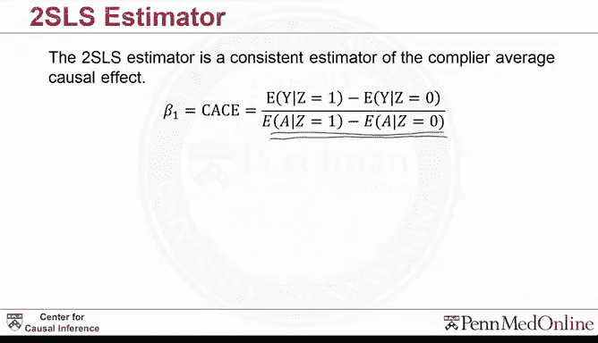

# 宾夕法尼亚大学《因果推断速成课程｜A Crash Course in Causality》中英字幕 - P44：44_05_07_两阶段最小二乘法.zh_en - GPT中英字幕课程资源 - BV1Ft42137BF

This video is about two stage least squares。 So two stage least squares is a method for estimating causal effects when you have an instrumental variable。

 So we'll look at what two stage least squares is and discuss why it works。

So before we get to two stage least squares， let's quickly review ordinary least squares and also think about why it wouldn't work when there's confounding。

 well， especially when there's unmeasured confounding， so suppose we have treatment A and outcome y。

 and then you have this simple model here where y is equal to beta 0 plus a times beta 1 plus some random error。

And let's imagine that we were going to。We're interested in sort of applying ordinary least squares kind of method to this。

 Well the usual assumption you make is that the error term and the covariary a are independent。

 So typically you assume that the random variable A is independent from the error term this epsilon kind of variable this is a kind of assumption I think in linear regression kinds of classes that doesn't usually get a lot of attention they say you know the errors are independent and possibly normally distributed with constant variance。

 but the independent part a lot of times doesn't get a lot of attention but it's actually critical if you're interested in causal effects so we need for this error term to be independent from treatment in this case。

 if it wasn't if they were correlated I mean that's what would happen if there's confounding as they would be correlated so in other words treatment assignment people would be or people who would get treatment would tend to be possibly people that tend to have a higher value of the error term for example and so if this would be causal problem so if'sund。

A in this error term would be correlated and ordinary least squares would fail in the sense that if you were to estimate beta 1 using least squares。

 it would not represent a causal effect because there's confounding here。

 confounding means that A in the error term are correlated and also you could think of this as an economics I would say this is a is an endogenous variable so endogen in this case。

 you could think of it as meaning that there's confounding or that a in the error term are correlated。

So we can't just apply ordinary least scores and in fact。

 even if we included confounders in this model， if there's unmeasurd confounding。

 we would still have this same problem。So now we'll get into we'll think about what two stage least squares is and why it might work。

 so two stage least squares is a method for estimating a causal effect in an instrumental variable setting。

So first we'll assume that Z is a valid instrumental variable。

 so it affects treatment and the exclusion restriction is met。

And so what is stage one so's two stage least squares is well named because there's two stages。

 so stage1， what we'll do is we'll regress the treatment received a on the instrumental variable Z。

 and so here our error term is assumed to be independent you mean zero constant variance and so we've randomized Z or we've assumed Z is randomized。

 it's an instrument we've assumed it's randomized。So by because of that Z in the error term should be independent。

 so we have what looks like a standard kind of linear model， so Z related to a。

And then we can obtain a prediction so we can estimate these two parameters so we have two parameters。

 alpha0 and alpha1 we can estimate those using least squares and we'll call that alpha hat alpha0 hat and alpha1 hat and then we could obtain a predicted value of a for each person so we'll call that a hat So a hat I is a predicted value of treatment for subject I and that can be just written as alpha 0 hat plus Z times alpha1 hat So Z is the value of Z for person I So in other words what we're doing here is we're getting a predicted value of a given z So for person I for example。

 they have a particular value of Z and then what we're recording this a hat is what we would predict based only on their Z as to what their treatment would be so this isn't treatment received this is just based on their instrument based on the value of the instrument what did we think what treatment that we think they would get So that's what a hat is。

This is in stage one， is you just carry out a standard regression a standardly squares。

Then you can just get a predicted value of the outcome， the outcome here is treatment received。

 so if the stage one is very standard， you could just use regression software and get a predicted value for each person。

In stage two。We're now going to regress the outcome on the fitted value that we obtained from stage one。

So you'll notice here we have this a hat， so this looks like a standard regression model except the variable。

 the regressor here in this variable is actually a hat and not the original treatment variable。

 it's what we predict treatment would be based on Z。Okay， so then we have this error term。

 which you assume has mean zero constant variance。But because of the exclusion restriction。

 Z should be independent of a I mean I'm sorry z should be independent of y given A。

 because Z only affects y through its effect on treatment， so if you condition on treatment。

 Z should not be affecting Y。And technically speaking。

 a hat is a projection of a onto the space span by Z that's more of a technical point from least squares in general。

 but the point I'm making here is that a hat itself will be independent it functions a lot like Z in the sense that it should be。

Independent from Y。 So a hat， because we've done this projection because we're using a hat and not the original A。

 So remember， a and y， of course， we be， you know， there's confounding of this A Y relationship。

 but that shouldn't be the case what they had anymore。 because a hat is really is's like a given Z。

 It's a projection。 And so this a hat should be。Unconfounded， when it comes to。

The relationship with why。 So hopefully that'll make more sense and。On other slides as well。 But。

 you know， we have confounding with a itself between A and Y。 But a hat。

 it's just determined from Z and Z is randomly assigned。 Z has the exclusion restriction。

 So we should be okay there。 And it turns out that then if you would estimate beta 1 using least squares from this second stage model that would represent a causal effect。

 And so we're going to look at this in a little more detail as to why that's the case。

 But just in practice， this is exactly what you would do as you would carry out on the first stage you would regress A on Z。

 you'll get a predicted value out of it。 You'll use that predicted value in a second stage model。

 wegress y on that predicted value。 And then the coefficient of that predicted value would be a causal effect。

So in practice， how to actually implement this， you know。

 it's pretty straightforward if you've fit regression models before。

And this is known as a two stage least squares estimator。So you have two stages of least squares。

So we're going to try to motivate a little more why this ends up with why you end up with getting a causal effect out of this。

 So let's just think about the simple case where Z and A are both binary right so Z is encouraged yes or no and A is treatment yes or no。

 And in stage1， a hat is just an estimate of the expected value of a given Z。

RightThat's whatever regression is。Essentially so。That's what A had is。

 so you could also think of it as representing the probability of treatment given a particular value of Z given so A hat I is a probability of treatment given personalized value of Z。

And in stage 2， we have this regression model。 So then what is the interpretation of beta 1。 Well。

 when in regression， if you if you remember the slope and a regression model has to do with a one unit change in the predictor and the value of the predictor。

 right？ So if I were to set a head equal to one and take expected value of y I would end up with。

This would just be beta 0 plus beta 1。And if I were to set a hat equal to 0 and take expected value of y。

 that would just be beta 0。And if I take the difference， I just get beta 1。

 so beta 1 is this contrast。Between the expected value of y given a hat equal 1 and the expected value of y given a hat equals0。

 But the question is， what does that actually mean？Okay， so。

But remember what a hat is from the first stage model right so when by the time we get to the second stage model。

 there's only two possible values of a hat that you can have right So a hat is a predictive value and in the case where z is binary。

 there's only two possible values you can have so if somebody had equal to one。

 then their value of a hat would be alpha hat zero， if somebody had equal to one。

 the value of a hat would be。Alpha had 0 plus alpha hat 1。

 So there's only two values of a hat that are that you could observe。And in fact。

 they're equal to these you know these coefficients from the first stage model。

 if you happen to have no or if you have some noncompliance， those are not going to be zero and one。

But there are two values between 0 and 1。So in practice。

 what do we observe like let's now let's say we focus on the second stage model and we treat a hat as just a variable Well。

 what we observe is we observe some people with a hat zero。I an alpha had  zero。

 and some people with。Alpha had0 plus alpha hat 1。 So we observe two unique values that a hat。

So the how much a hat varies is just by this amount。Right。

And so that corresponds to what happens when we go from z0 to z equal 1。

 when we go from zero0 to zero1， we're going from a hat equal this to a hat equal that。

So then if now， if we think about a mean difference of。This here。 So if we thought about now。

 let's imagine a change from  equal 1 to  equal 0， that's corresponding to。

That's the same thing as a hat changing by Alpha1 hat units。Right， so remember。

 z equal1 corresponds to alpha hat 0 plus alpha hat 1 z equals 0 corresponds to alpha had0。

 If you take the difference， you get alpha hat 1。So if Z changes from 0 to 1。

 a hat changes by alpha hat1 units。 Okay， so this is really critical。

 So this intention to treat effect， which is this， that's the intention to treat， right。

 The intention to treat effect is really all about a change in a hat。By alpha one hat units。

But what we really， what beta 1 is。Going back to the other slide。

 what is beta 1 beta 1 is a change in a hat of one full unit。

So beta 1 is essentially sort of blowing up this intention to treat effect。Byy this amount。Okay。

 so this is really critical because the thing in the numerator here。

Corresponds with a change of in Z by alphapha 1 hat units， so to make that actually a change。

In one unit， which is what we want， we would have to divide by alphaphaha 1。So what is。

 so what is that then， right？ Well， we've seen before that。The complier average causal effect。

Is this ratio of the intention to treat effect divided by the causalmo effect of treatment on compliance？

Well， that turns out to be， I'm sorry， that turns out to be exactly equal to beta 1 because。

This denominator here。That is exactly Al1 hat that's this is what the slope of the stage one model is。

Okay， so I know that was a lot of steps to follow so it might be worth you know sort of going back through the video and and pausing at places to sort of walk through it。

 but that I think if you sort of walk through those steps。

 you know it'll be clear so beta1 which is what you get out of a two stageage least squares estimator in this case is equal to the compli average causal effect。

So we just looked at the situation where we have binary treatment， we have binary instrument。

 and we didn't have any covariates， but two stagely squares works more generally。

 which is why we're talking about it。You could have covariates that you want to control for you might also have you know a continuous value for the instrument。

 for example， well you can still apply， you can still use two stage elite squares。

 so when in stage one in this case， you would regress treatment。On the instrument and covariates。

 Okay， so you would still do the same kind of thing， but you would also include covariates now。

 and then you would obtain a fitted value of a hat。In stage two。

 you would regress y on the value you got from stage one and on x。

 so if you had covariates you wanted to control for。

 they would go in both of these models and then the coefficient of A hat in this case would still represent a causal effect would represent a local causal effect again。

 so a causal effect among compliers。So this two stage elite squares works more generally where you can use it if you had。

Provaris that you wanted to control for and you could use it also if you had a continuous instrument。

So that's what two stage squares is and so you could fit at the two stage least squares model when you could get a estimate of the causal effect。

 you could estimate a confidence interval from that。But of course。

People are going to be very concerned about whether your assumptions are met。

 and especially about the exclusion restriction。So is your exclusion restriction violated？

And also another assumption that people will worry about is monoity。And so you would want to。

 you know， if you're going to do a careful analysis and publish a paper or even for your own peace of mind。

 you probably want to do a sensitivity analysis。 And so these kinds of methods have been developed around the instrumental variable assumptions。

 So in general， sensitivity analysis typically has to do with。

The kind of idea of what if my assumption was violated。

 what if it was violated just barely by a small amount， would I change my conclusions。

 What if it was violated by a large amount， would I change my conclusions if I wanted to sort of try know try to answer questions like that。

So for the exclusion restriction， the idea would be what if C does directly affect Y。

 maybe by some amount I'll call rh， you know， that could be like a correlation kind of parameter or something。

Would that change my conclusion， so you want to vary this kind of parameter。

 this row that quantifies how much Z directly affects y。

 and at what point would my conclusion change。So there's methods that have been developed to do that。

Sor of beyond the scope of this video， the same kind of thing with monoity。

 remember that monoity assume that。Bigger doses of encouragement meant more likely to get treatment。

But what if that's not true， what if there are some defiers。

 maybe the proportion of defiers in the population is pi and maybe pi is greater than zero。

 so we had assumed it was zero， maybe it's a little greater than zero so what if pi was you know 1% 0。

01 would my conclusion change you know what if it was 5% would my conclusions change so that's the kind of thing you could do and there's methods that have been developed to do that as well with some standard software but again beyond the scope of this presentation but I also do mention this tutorial and biostatistics which describes some of these methods in detail。

