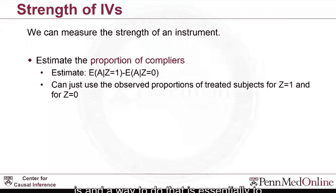

# 宾夕法尼亚大学《因果推断速成课程｜A Crash Course in Causality》中英字幕 - P45：45_05_08_弱工具变量.zh_en - GPT中英字幕课程资源 - BV1Ft42137BF

This video is on weak instruments。😊，By the end of the video。

 you should be able to understand how to measure the strength of an instrumental variable。

And also you should be able to understand why weak instruments cause problems so the strength of an instrumental variable is basically how well it predicts treatment received。

 so remember the instrumental variable we can think of as encouragement。

 so encouragement to receive treatment and so if it's a strong instrument。

 then this encouragement works well and most people who are encouraged will actually take the treatment。

So a strong instrument is highly predictive of treatment。

 which means encouragement greatly increases the probability of treatment。 A weak instrument is。

 on the other hand， is weakly predictive of treatment。

 so an encouragement might increase the probability of treatment a little bit， but not very much。

So we can actually quantify this so we can measure how strong the instrumental variable is and a way to do that is essentially to estimate the proportion of compliers。

 so this is something that we can identify from observed data。

 so we can simply remember that the proportion of compliers is just simply the probability of receiving treatment。

 given that you were encouraged， so that's this part here。

 the expected value of a given z equal1 so that's the probability that as  one given z equal1。

 which is the probability of receiving treatment given that you were encouraged。

Minus the probability of receiving treatment， given that you weren't encouraged。

 so that difference is the proportion of compliers。 So these are just。

 you can estimate those from just sample means in your data。

 So the proportion of compliers is estimated as the observed proportions of treated subjects for z equal1 minus the observed proportion of treated subjects for z equal0。

 So it's a contrast of two proportions。And then we'll get an actual number。

 so we'll be able to estimate what proportion of this population our compliers and that will tell us then how strong our instrument is So if you if is if this number is close to one。

 it's a strong instrument and if it's close to zero， it's a weak instrument。

So if you have a weak instrument this can cause problems so as an example I'm imagining that only 1% of the population are compliers。

 so this getting encouraged only bumps up your probability of actually receiving treatment by just this very small percentage so now remember that an instrumental variable analysis we're interested in estimating local treatment effects。

 so local causal effects or complier average causal effects。

 so we're sort of focused on this subset of compliers but if the proportion of compliers in the population is very small。

 then essentially our effective sample size is also very small。

 so if our original sample size the sample size of our data set is N then you would have 1% of N would be how many people really are contributing information to the causal effect estimate。

So you can imagine that if you essentially have a small sample size， a small number of compliers。

 then we'll end up with noisy estimates of causal effects。

 so the causal effect estimates will have a very large variance associated with it。

 so we have these unstable estimates of causal effects。

 and also weak instruments can also lead to bias but I think probably the larger issue is that these estimates will be very unstable so if your confidence interval will be very wide if you have a weak instrument。

And。So then if if you did have a weak instrument， then an IV analysis might not be the best option。

 so a lot of times the first thing that people do when they have a proposed instrument is to see is it really predicting treatment？

So that's that's a lot of times a first step you might take is you have an idea on I think this variable might be a good instrument and then you want to check。

 is it really predictive of treatment and if it's not， you might want to you know consider。

Trying to find a different instrument or doing some other kind of analysis。

 There's also an area of active research is that are methods to strengthen instrument instrumental variables。

 So you might have a instrumental variable that's weak overall。

 but there might be ways that strengthen it。 So one example is this methodology called near far matching。

 And the idea is that your matching on covariates。So the kinds of things that you think of as confounder。

 So you're making by matching， you're making them people a similar。It can be on these covariates。

But you're also matching in such a way that the instruments as different as possible。

 so a match pair would include people who all their covariates are similar except they differ by a lot on this on this instrument and so that's actually similar to what you would see in randomized trials where you should you know people should sort of have similar covariate distributions but their level of encouragement would differ greatly so is so there's this nearf matching approach and there's also other newer statistical methods that are focused on ways to strengthen the instrument so those are a couple of options as one if you have a weak instrument you might want to just consider a different kind of analysis alternatively you might think about ways to strengthen the instrument。

