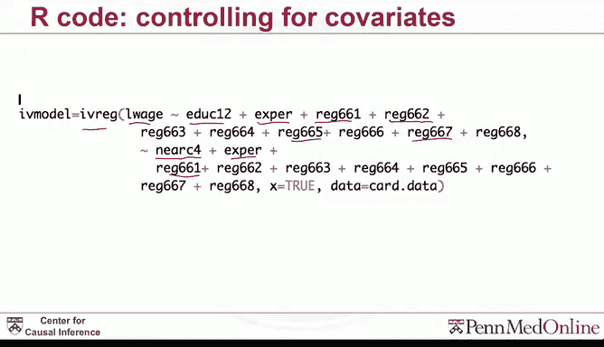

# 宾夕法尼亚大学《因果推断速成课程｜A Crash Course in Causality》中英字幕 - P46：46_05_09_R语言工具变量分析.zh_en - GPT中英字幕课程资源 - BV1Ft42137BF

This video is about how to carry out an instrumental variable analysis in our。

 so we'll walk through an example of an instrumental variable analysis in our using a real data set。

So the example we'll consider was this data set that was published a number of years ago that has to do with the proximity to fouryear college and the impact that might have on years of schooling and then ultimately income。

 and so this data set's publicly available。And so you could try it out on your own so in this study the proposed instrument had to do with how close you were to you know the individuals in the study were to a foury college so in terms of their where they resided how close were they to a fouryear college so that's the proposed instrument but the goal is to look at the relationship between years of education on income so an extra year of education。

 how much would you expect that to affect your income by the goal is to look at this relationship then between a。

 which is a number of years of education。And why， which is the income and the proposed instrument is whether you grew up near a four year college。

 and there's also covariates on the study that we can consider， such as number of years of you know。

 parents education， region of the country， age， race， and so on。

So the motivation is that you know more schooling is typically associated with higher income。

 but there's been a lot of question about you know what is the actual causal effect of more schooling so it might be reasonable to think that more years of education increases income but by how much and it's。

A little bit difficult to tease apart the actual causal effect from the sort of confounding kind of effect。

 So we might expect that。People who get more schooling than others might differ in many ways。

Beyond just the education itself。So there's always this concern that there might be unmeasured confounding in these kinds of studies。

So this particular study proposed using proximity to college as an instrumental variable and in particular we'll look at。

Living near a four year college as the instrument and you could think of that well the argument is that that's a type of encouragement so if you grew up close to a four year college you know somehow that's basically encouraging you to get more schooling and it also arguably might not be related directly to your income especially after perhaps you control for some。

Other kinds of variables， demographic variables and number of years of education for your parents and so on。

So now we'll look at some our code， so for the instrumentnstrual variable analysis。

 we'll use the our package IV Pack， which stands for Instrumental variableable package。

And within that package， there's this data set that I just described， which is card data。

So we'll use that data set。 And in that data set， the instrument of variable is called。Near C 4。

 So just that just means near a four year college。The outcome has to do with income or wages and in fact。

 in the analysis that they did in the original paper they used log of wages and so we'll do the same thing。

 so L wages log of wages and a lot of times with income data。

 people log transform it because income data tends to be skewed and treatment here is the number of years of education。

So， that's this variable。So that's what we were calling a。 So that's our treatment is education。

 outcome Y is L wage and the instrumental variable is near C4。 And so， you know。

 when any time you do a data analysis， you'll probably want to。Look at the data first。

 And so one thing I'll do right away is just， I'll take a look at how many。

 what proportion of people got encouragement。 So that's this mean。Of the variable near C4。

 and we can see that over here， so about roughly 68%。You know， we're encouraged。

Live near for your college。And I'm also going to look at histograms of the outcome variable and the education variable。

 so these are two continuous variables。So I'll just look at histograms of those。

Just in the main reason to do this is just to have a better feel for what our data are like。

 so this is the histogram of wage and well log of wages and you'll see that that's you know relatively symmetric there with no obvious outliers and then here's the histogram for education。

And you'll see there's quite a bit of variability there。 This is number of years of education。

 and you'll see。There's a big spike here which is at 12。

 so a lot of people had exactly 12 years of education or in other words finished high school and then you'll see beyond 12。

 there's either some college or you know these are people here who probably finished a four-year degree。

 and so now we have some sense of the variability in our treatment， if you will。

 variable this number of years of education。 So we do see that there's a fair amount of variability in how much education people had。

And so next we'll look at。Estimating the proportion of compliers here。And。

And we're going to do this to estimate the strength of our instrumental variable。

 and we could actually leave education as a continuous variable。

 but for the purpose of estimating the proportion of compliers and sort of making this analogous to a randomized trial。

 what I'm going to do here is just create this variable， which is。Education 12 here， which means。

It's an indicator variable that you have more than 12 years of education。

And so I'm imagining right now that treatment is we're just comparing greater than 12 years of education versus less than or equal to 12 years of education。

 and I'm imagining that's what we're interested in。

 You could leave treatment as a continuous variable and analyze it that way。

 I'm mostly dichotomizing it to just illustrate the idea of compliers。

 So what would a complier mean here。 Well a complier here would mean that。

If you lived close to a four year college， you would end up having more than 12 years of schooling。

Whereas if you didn't， then you wouldn't。 and that would that would make you a complier。

 And so we can estimate the proportion of compliers by taking the mean。

Indicator of more than 12 years of education。Among the subpopulation who live near a four year college。

And that subtracting the mean of this education variable among those who did not live near four year college。

And we see that that proportion is 0。12。So we are estimating that the proportion of compliers is 0。

12 where in other words， 12%。 and so in that case， you might argue that the instrument is not extremely strong。

 but also not so weak that we're alarmed， so it does seem like living near a foury college。

Does increase the chances that you'll have more than 12 years of education。

So now we're going to look at estimating both an intention to treat effect and a complir average causal effect。

So we've already estimated the proportion of compliers， which is this 0。12。

 but also note that that's also the causal effect of encouragement on treatment received。

so that is a type of causal effect。 If you believe this is an instrument。 Next。

 we can estimate the intention to treat effect。And I'm just calling that variable ITT。And remember。

 the intention to treat effect would then have that has to do with the causal effect of encouragement。

So that would be the causal effect of， in this case， living near a four year college。On wages。So。

 we're going to take。The mean of log of wages among people who were encouraged。

 among people who live near fouryer college。Minus the mean of wages for people who do not live near four year college。

And we get。A value of about 016。就。Log of wages be tended to be higher among people who lived near four year college。

And now we can use this to estimate the complir average causal effect。And so that， if you recall。

 is just the intention to treat effect divided by the proportion of compliers。

And so we just take 015 divide by 0。12， and we get this about a 1。

28 as the estimated sort of causal effect among compilelirs。

 So the impact of number of years of education。On wages among compliers。

 among people who will get 12 years of education if they live near four year college。

But wouldn't get more than 12 years of education if they didn't live near a four year college。

And you'll notice that this number， this 1。27 is larger than the intention to trade effect。

 which is what we would expect。嗯。As long as we make this， these no Defiers assumption， right。

 So in this example， what does no defiers mean， Well。

 Defiier here would be somebody who does the opposite of what they're encouraged to do。

 So these are people who， if they live near four year college。

Would not get more than 12 years of education， but if they don't live near four year college。

 then they would get more than 12 years of education so you would have to think about whether you believe that assumption that there wouldn't be people like that。

You can also estimate the same kind of effect using two stage elite squares。

So I'll show you some R code to actually do it in two stages。

 So we call with two two stage least squares stage1， we regress treatment on the instrument。

So stage1 regress treatment on the instrument。 Well， what is treatment here， treatment is education。

 and the instrument is living near our four year college。 So we use this linear models command。

And we can regress。Treatment on the instrument。And if you do that， then you can get。

Predicted values out of that。 So I'm going to ask it to give me predicted values。So we basically。

 for each person we want。The predicted probability of receiving treatment。

 given the value of their instrument。 But because the instrument can only take on two values here。

 will'll only get two unique predicted values。 And what we'll see here is that people with encouragement have a predicted probability of。

More than 12 years of college of 0。54。And people who。

We're not encouraged people who lived farther away from a four year college。

Their predicted probability of treatment， their predicted probability of more than 12 years。

Of schooling is 042。And these here， these are the counts of the number of people in each group。

So those are the predicted values and what we'll do then is in stage two。

 we regress y on the predicted value of treatment， not on treatment itself。

So we regress y on the predictive value of a， which is this predicted value of treatment that we got from stage one。

Pread treatment。And we put that there。 So from stage1， we get a predicted value。

 and we use that in the stage 2 model。 and in the stage 2 model， wages is our outcome。So you do that。

 you do these two stages， and then the coefficient of。

Of the predictive value of treatment is the causal effect here。 So that's a 1。28。

 And you'll notice that that is exactly the same as what we have on this slide。A 1。2 weight。

 so these are two ways of in this case of getting the same answer。

So for this simple example where we have no additional covariates。You can use the simple。

Intention to treat effect divided by proportion of compliers。

 or you can do it using two stagely squares and you get the same answer。

Now we also can do two stage least squares directly using this IV pack。

So this instrumental variable package。 So if you want to do that， instead of I sort of。

 I did two stage least squares on the previous slide by sort of brute force， in some sense。

 I actually do two separate regression models and put things together。

 But you actually can just use this Ivy rigg。Command here if you use the IV pack。

 so instead I'll tell it to use an instrumental variable regression。

 which means two sly squares here。And so I'm letting it know in this first part that my outcome is wages。

 my treatment is education， and then this part here is just telling it what the instrument is。

 so in this case it's nearer four year college。And。

A nice thing about the IV package is it will also give you standard errors onto the model sort of automatically。

 whereas previously I didn't tell you how to get standard errors you would have had to do some extra steps if you use this package you'll just get standard errors out of it directly。

 you can use this robust do Se command。And it'll give you standard errors。

And what you'll notice is then the。The causal effect will be the coefficient here of this education variable。

 And you'll see that the coefficient coefficient' is exactly the same as I've had on the previous two slides。

 It's about a 1。28。 But here you also get a standard error。And you also will get a P value。

 so you'll see that this is highly significant， and it looks like。

There's strong evidence of a causal effect， assuming that the instrumental variable assumptions are met。

So in this particular example， you might be thinking that the IV assumptions don't seem plausible。

In part， because people who live near a four year college， you know。

Might differ from people who don't in a lot of different ways living， for example。

 living near four year college that。The housing in that area might be more expensive。

 so these might be higher income families， but you so we might want to control for。

Some of those kinds of variables， demographic kinds of variables。

 number of years of parents education， but maybe once you control for a number of those variables。

Maybe given that then this does living near a four year college does meet the instrumental variable assumptions。

 so sometimes these IV assumptions you might assume are only true conditional on covariates among people with the same values of the covariates and so you can do that using this IV you can still use IV rigg and now you can just control for a bunch of other covariates so I'm not going to walk through what each of these means they have unfortunate names。

 very generic kinds of names but。In the data set itself， if you look at it。

 though you can find out what each of these variables means。

 but I just wanted to show you how you could actually do it so we have。An outcome， we have treatment。

 and then we just have a bunch of variables that we want to control for。And then in the first stage。

 we have to tell it what the instrument is， and also in the first stage we'll control for all of the covariates。

So if you do this。You'll get the same kind of result you'll get。

You want to look at the coefficient of the treatment variable。

 but now you're just controlling for a bunch of other variables。

 And so you'll see now our coefficient slightly different， it's a 1。2 still highly significant。

And so we're still seeing pretty strong evidence of。The number of years of education increase。

 you know， leading to an increase in wages。 So here。

 even after you control for all of these different variables。

And so this is how you could carry out two stagely squares kind of analysis。

If you had other covariates that you wanted to control for。

