# 宾夕法尼亚大学《因果推断速成课程｜A Crash Course in Causality》中英字幕 - P4：04_01_04_假设性干预.zh_en - GPT中英字幕课程资源 - BV1Ft42137BF

In this video， we're going to talk about hypothetical interventions。

 and we're going to think about what is meant by causal effects and what are well defined causal effects versus those that are not so well defined。

We're going to discuss manipulable variables。What is meant by manipulable variables and hypothetical interventions in general。

 and then we'll also discuss the fundamental problem of causal inference， what it is。

 why it's a challenge， and we'll start to think about what we can do to overcome that problem。

So this video is largely about hypothetical interventions。

So we'll begin by thinking about what we mean by an intervention。

And the reason we do that is because it's clean is to think about causal effects of interventions。

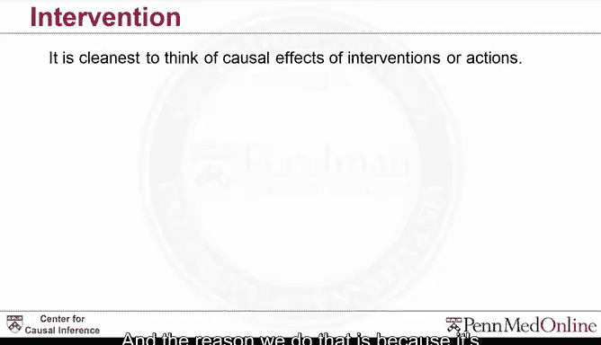

And sometimes these are also known as actions。And it's。

So what we mean by typically by an intervention is that or it's something a variable that can be manipulated。

 whether it might be hypothetically or in practice， we actually could manipulate it。

So we'll talk more about what that means， but that's really what we're thinking about here is。

The kind of variable that we could intervene on or we could manipulate or we could take an action on。

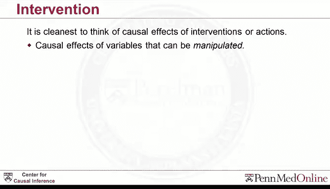

And if you can do that， even if it's just an exercise， a thought kind of exercise。

 then we can think about causal effects of those types of variables。

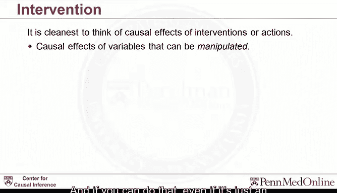

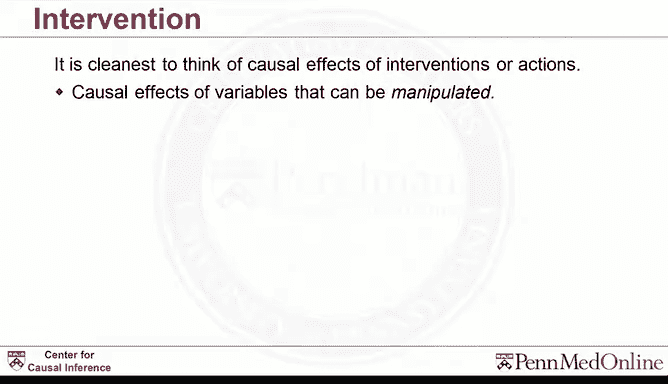

So Holland wrote no causation without manipulation。

 and this is a widely shared quote in the sort of causal inference world。

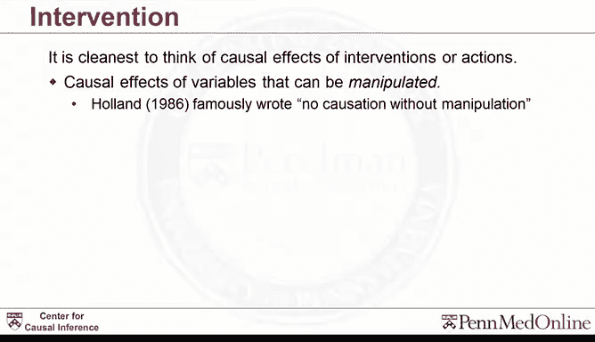

And the main idea is that it is difficult to think about causal effects。

4 variables that you can't think about manipulating。

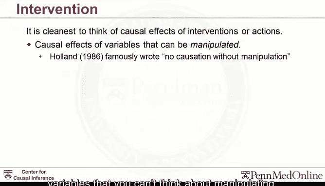

But causal effects of interventions。Are generally well defined。So for example。

Let's suppose we want to compare the causal effect of drug A versus drug B。Well， we can。

 in principle， we can imagine manipulating that。 We could give some people drug A。

 We could give some people drug B。 We could decide who gets what。And in that sense。

 we're manipulating it， we can imagine taking some kind of action。

And so if we wanted to know what the causal effect of drug A compared to drug B is。

 it's somewhat easy to understand what we mean by that， at least in principle。

 so that's hypothetically we could intervene on what drug somebody takes。

Related to that is this idea that there's one version of treatment。

And so sometimes this is also referred to as a no hidden versions of treatment kind of assumption。

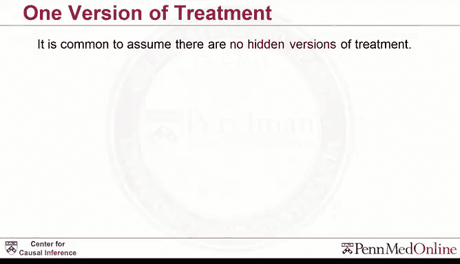

So for example。Suppose we were interested in the causal effect of body mass index， BMI。

 on health outcomes。And this is a common thing that people are interested in。

 you'll hear a lot of discussion of what is the health impact of obesity， for example。

But we have a problem here。Because there are a lot of ways that one could achieve a particular BMI value。

So whether you're thinking about body mass index in general or you could think about weight or obesity。

 imagine we want to hypothetically manipulate BMI， which is the exposure variable of interest here。

Well， we have a problem because there's many potential ways you could do that。

And these different ways might be associated with different outcomes。So。We could imagine。

 for example you might。Prescribe a weight loss medication。

And that might help somebody achieve a particular BMI or maybe they exercise and they achieve a particular BMI in that way。

Or maybe it's diet or maybe it's surgery， so there's a lot of possible ways that you could achieve a particular BMI。

 which means there's not one version of treatment if we're imagining body mass index as the sort of treatment or exposure variables。

 that's a lot of ways in which you could get it to a particular value。

And the method you use to sort of get it to that particular value。Might be related to the outcome。

In an extreme example。You could think of smoking， so in some cases。People smoke and lose weight。

 right。Smoking might be one way that you could get a lower BMI， but of course。

 smoking might be associated with the outcome you're interested in。So we're， we're into。

Difficult territory here in thinking of what is a causal effect of body mass index or what is the causal effect of obesity。

 because there's not one version of treatment， that's one reason。

 and also what's not the kind of thing that is easy to manipulate。So in this case。

 it might be better to think of a causal effect of a particular intervention that aims at manipulating weight。

So if we're interested in the causal effect of。of weight or BMI or obesity on some outcome rather than try to estimate what that is。

 because it's a difficult thing to define。 Instead， you could think of what is a causal effect。

Of some intervention that's aimed at affecting weight or body mass index。

Another difficult case is immutable variables。

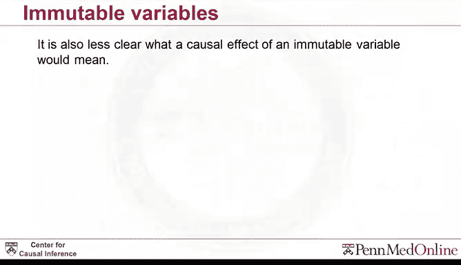

And here we're talking about things like race or gender or age。

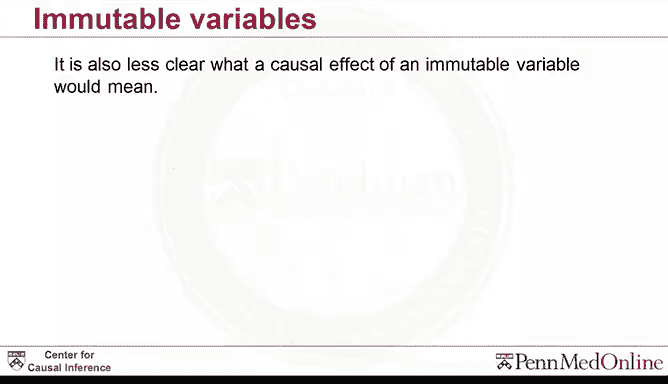

Things that。

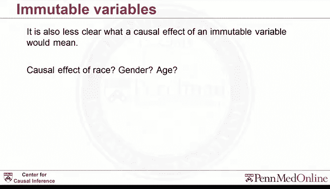

We can't even hypothetically really change or manipulate as an investigator。

 as a research investigator， right。When we think about potential outcomes or counterfactuals。

 we're imagining what could hypothetically happen if treatment was something else。So。

Suppose we're interested in the causal effect of race on some outcome。

It's very difficult to think of a potential outcome。

What would the outcome be if your race was different？Because there's no。

 there's no way for us to actually manipulate that directly。

 So that's an example of a variable that we can't manipulate。

And then it makes causal inference quite difficult。 It's the same thing with age。We can see that。

As people get older， they're at higher risk for certain outcomes。

 but it's harder to imagine what it would mean to actually physically manipulate their age。

So causal effects in these cases are more difficult to define。

So when we think about what does a causal effect mean of these types of variables， we get into。

Territory， that's just much more challenging。And so one way around this is to rather than to think about these kinds of variables and the causal effect of them directly。

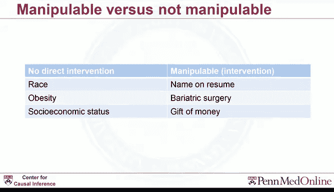

Well， you can't directly intervene on them。

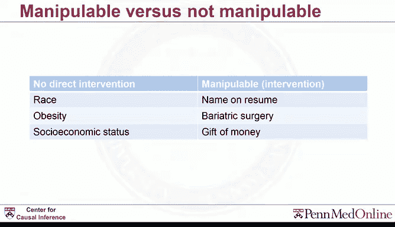

As I mentioned earlier， you could think about related things that you can manipulate。

 so interventions。

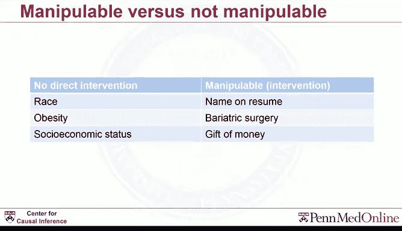

Where you can take an action。 So with race， for example。

 you might be interested in what is there discrimination in hiring practices？

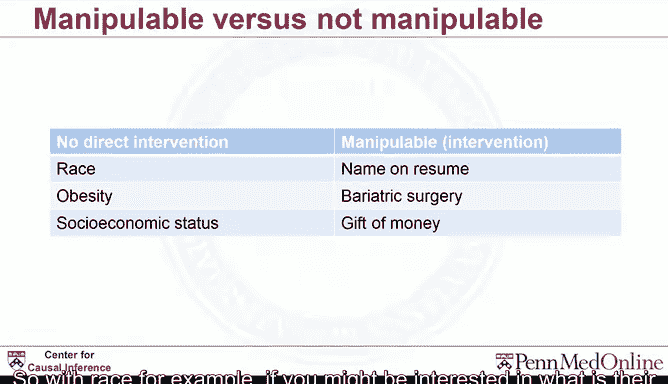

Based on race， right， But we So we can't imagine changing somebody's actual race and see whether they would get hired or not。

 but we could potentially。

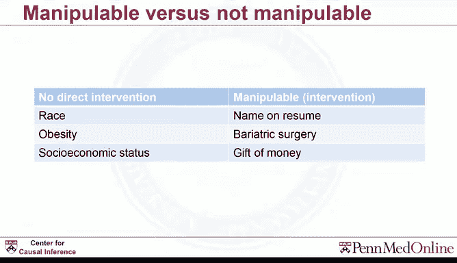

Send out identical resumes where the only difference is there's a name that sounds like people would tend to associate with an African American person versus a white person。

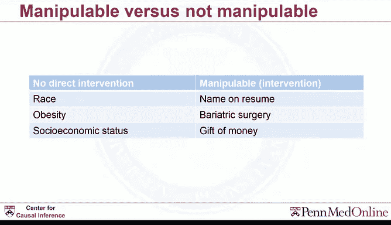

And so the name on the resume is something we can directly manipulate。

 and then we could potentially identify a causal effect。Of that particular type of intervention。

 So where is there discrimination。

In hiring， based on whether the name sounds African American or white。

 and so there's been a lot of these actual studies that have taken place。

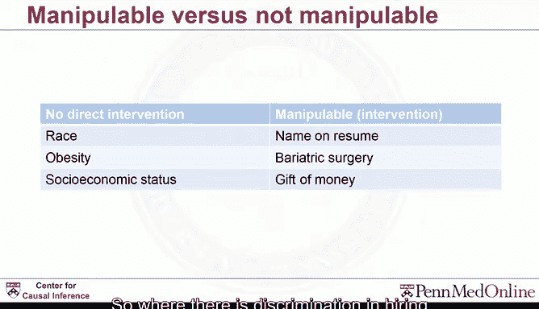

In terms of obesity， you could imagine bariatric surgery， for example。

 what is the causal effect of bariatric surgery， Because their decision is actually made。

 Should I get bariatric surgery or not， So that's something that。Inaction is taken。

 and it's an intervention， it's manipulable， and so we have some hope of identifying a causal effect there。

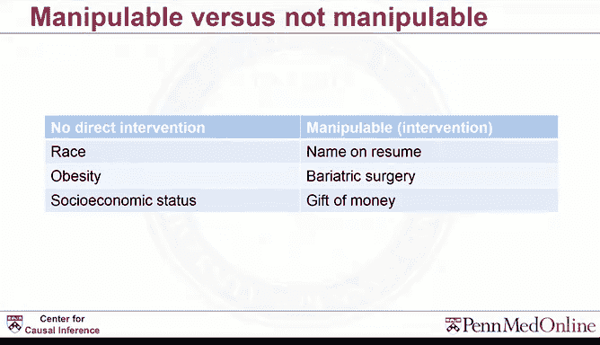

Socioeconomic status。It's really such a broad concept， socioeconomic status。

 and it's not very easy to just manipulate somebody's socioeconomic status。

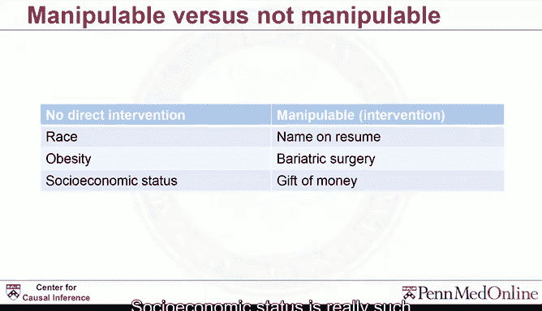

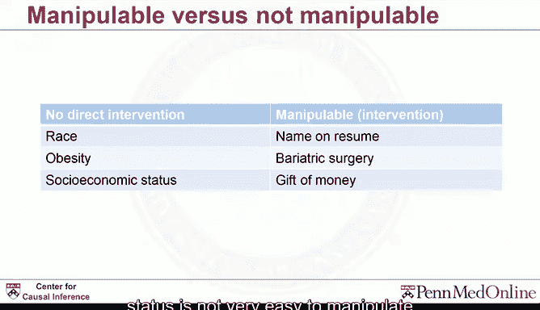

Even。But we could imagine an intervention where， for example， you give somebody a gift of money。

And what is the impact of sort of this extra income。

 this extra money on some outcome that you're interested in？

So the gift of money is something we can manipulate directly。

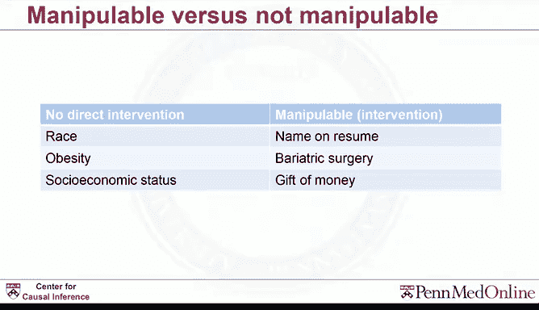

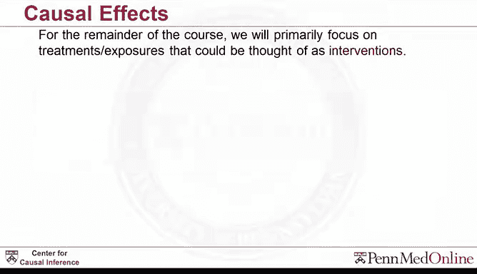

And for the remainder of the course， we're mostly going to focus on treatments or exposures that we could think of as interventions。

 So at a minimum， hypothetically， we could imagine。

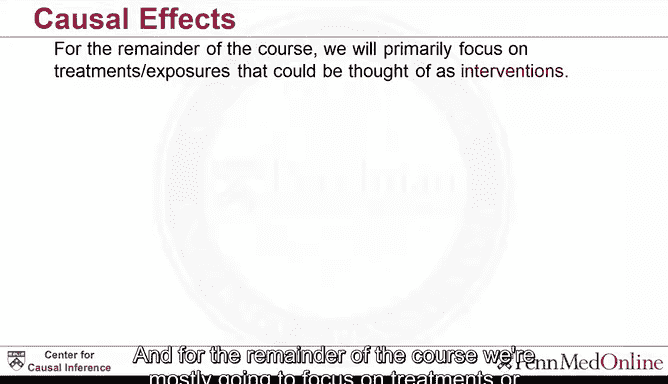

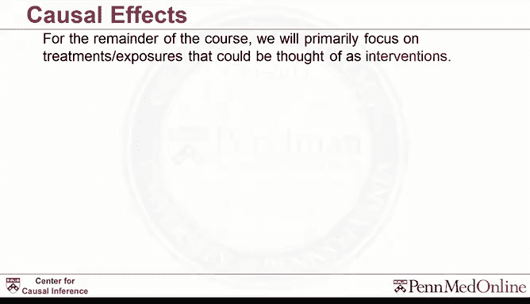

An intervention。So。One way to help sort of figure out， is this a manipulable type of variable。

 Is this a hypothetical intervention is， can we imagine。A randomized trial。

So you can think of a hypothetical trial。Can you picture a hypothetical randomized trial that could exist that could manipulate this variable。

 So it's possible that it would be unethical to actually carry out the trial。

 But we should be able to imagine that it could happen。

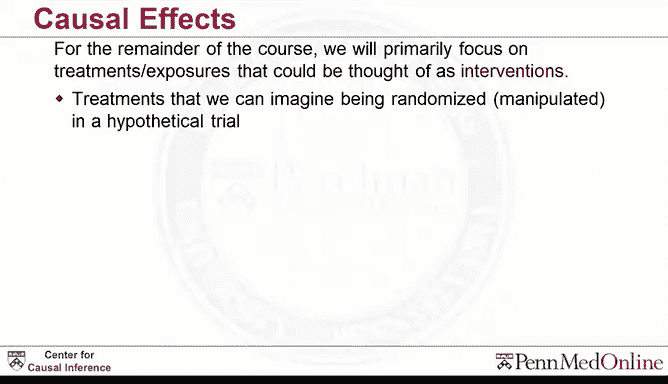

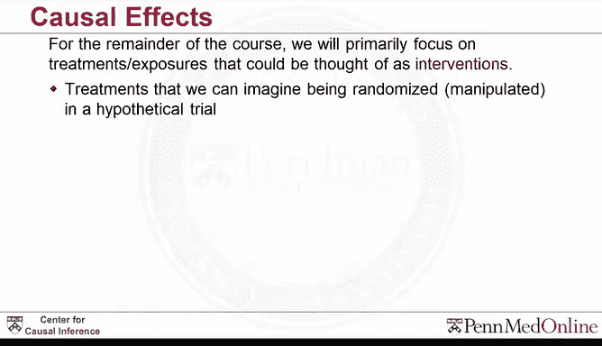

So for example。Wei。😔，Ethically， we probably can't randomize people to smoke or not。

 but we can't imagine a hypothetically， we could imagine doing it， right？

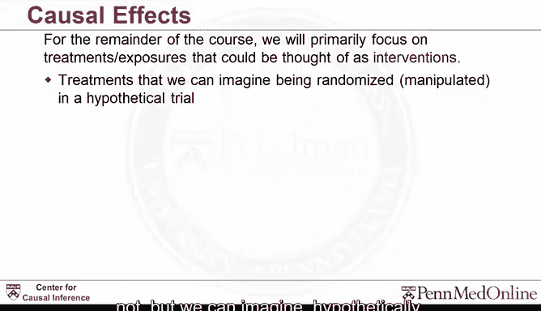

It might not be ethical ethical， but we can at least imagine it。 So in that case。

 smoking we could think of as something that is manipulable in principle。

 so we could imagine a causal effect of smoking。

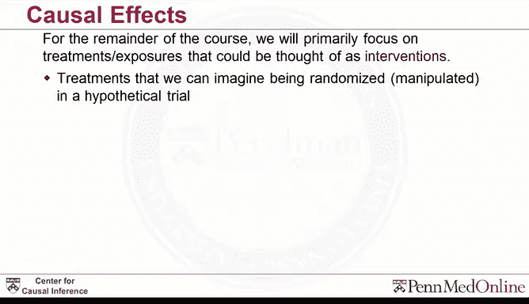

Whereas。We can't really imagine a hypothetical trial that would change somebody's race or change somebody's BMI。

But that's not to say that there aren't causal effects of age or race or gender or obesity。

 I think most people believe that there are。 It's just that。It's hard to define these。

 what formally do we mean by a causal effect in those settings。

 and we really can't fit it very well in the potential outcomes framework。

 And we're going to use the potential outcomes framework to identify causal effects throughout the course。

 So it's widely recognized that there are。That there are。Causal effects here。You know， with race。

 gender， obesity， and so on。 But it's just， it doesn't fit very cleanly into this kind of causal framework in a formal way with data and estimation and so on。

 So those are very hard problems and。We're going to focus on the slightly easier problem of。

Variables that we can think of as hypothetical interventions。

So we focus on hypothetical interventions because their meaning is well defined。

One of the key reasons， but also。They're potentially actionable。

 and this is actually a really crucial point。If you。New the causal effect of obesity。

 Let's just imagine that there is one。What could you do about it， right？ Well。

 your next step would be， well， what can I do about it， you would start imagining， you know actions。

 So if we found out that obesity was shortening people's lives。

If we really believed that was a causal effect， then we would want to figure out what we could do about it。

 We would propose interventions。And so really， we would want them to know。

 what is the causal effect of that particular intervention。

So now we're getting back to hypothetical interventions， causal effects。

 and so if we stick to this framework of hypothetical interventions。

 then we end up with output that's potentially actionable。So then what are causal effects？

So what we'll imagine now。Broadly speaking， that。A causal effect occurs when the potential outcomes y1 and y0 are not equal to each other。

 so we'll say that variable a， this exposure or treatment A had a causal effect on y。

If y 1 differs from y 0。 So if the potential outcome。

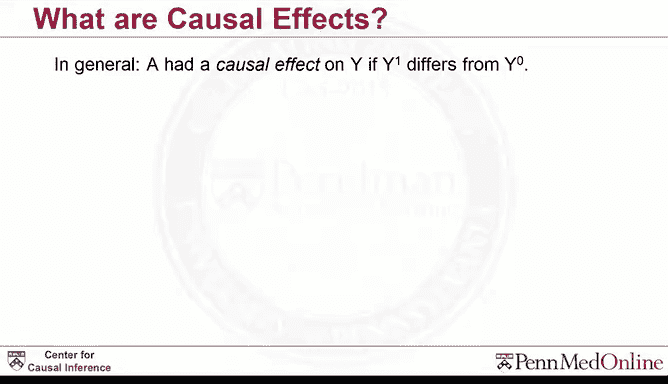

Under treatment differed from the potential outcome under no treatment。So as an example。

Let's say that。My headache is gone one hour from now。

 Well my the variable is that the headache's gone one hour from now。 so it's either yes or no。

 So our outcome， our observed outcome is y and it equals value， yes。

 if your headache is gone an hour from now and zero otherwise。

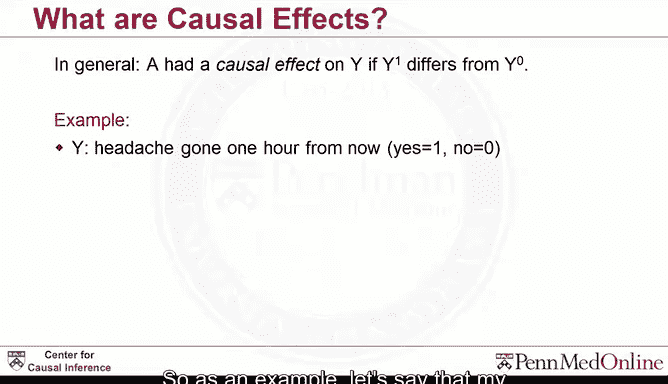

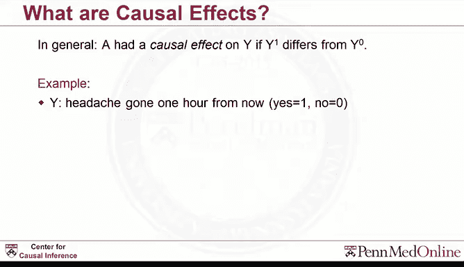

And let's imagine that your possible treatment is。Ibuprofen， and it is equal to。

Because that's our treatment， we'll call that a and a equal 1 means you take the medication and equals  zero means you don't。

And so then in reality， we only see one thing。 So you might make a statement like this。

 I took ibuprofen， and my headache is gone。 Therefore， the medicine worked。 Soll， you'll actually。

 I'm sure in real life， hear people say things like this。 I hear this all the time where。

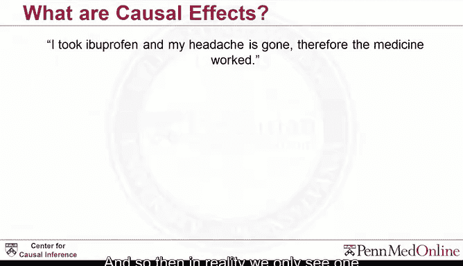

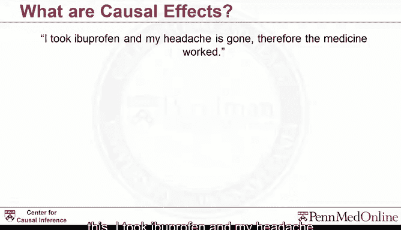

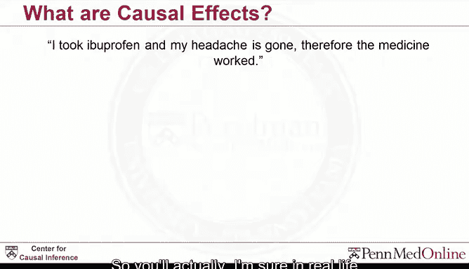

Somebody did something。

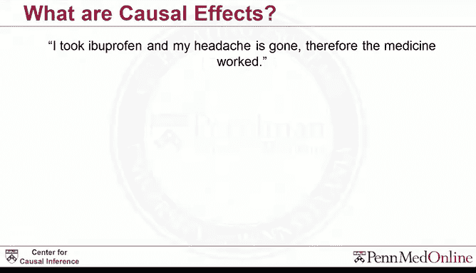

Some outcome was observed and they say therefore it worked。

But that's actually not proper causal reasoning。

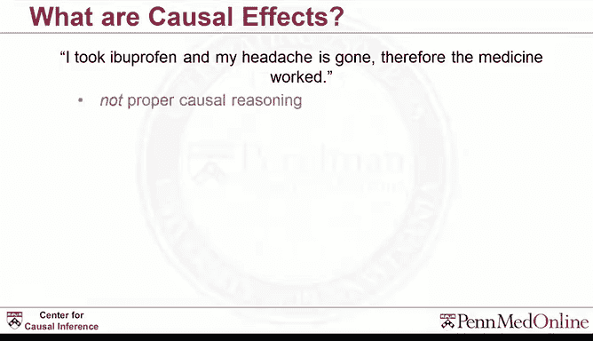

What they really just told you。 So they used， they gave you a long sentence。

 But what they really said is。Why superscript 1 equal 1？That's really all they told you。

 in other words。嗯。Remember why superscript1 means。The outcome in this case， headache。Under treatment。

Is equal to one， which means my headache went away。Yhy 1 equal to1 means。

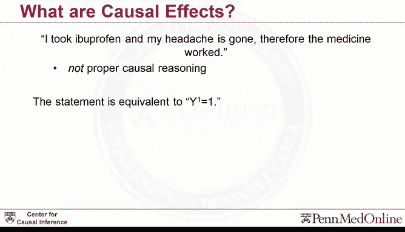

I took the tree bit， and my headache went away。But what would have happened had you not taken ibuprofen。

 right， so this is unknown at this point。In other words， what is your counterfactual。

 if you hadn't taken treatment， would your headache have gone away anyway？

So we don't actually know that。So。There's only a causal effect if these potential outcomes are not equal to each other。

So if your headache would have went away anyway， then we can't say that taking the medication caused your headache to go away。

So hopefully now you're identifying a problem。And that problem is known as a fundamental problem of causal inference。

 so the fundamental problem of causal inference is that we can only see one potential outcome for each person。

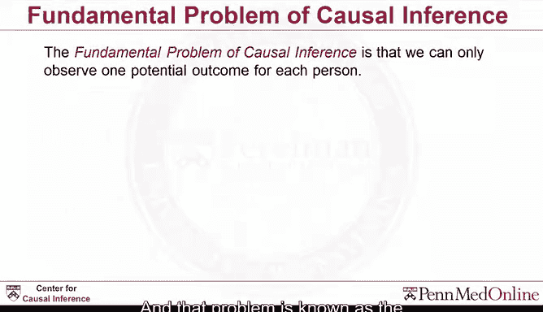

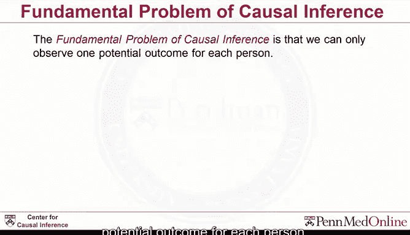

And so in the previous example， we don't know what would have happened had they not taken ibuprofen。

 right， So that's something we can never see for that person。

But we've just said that we need to know it。To know if there was a causal effect。

 so this is a problem， in fact， it's the fundamental problem。However。

You can make certain assumptions to estimate what's known as a population or a population level or average causal effect。

So rather than think about， did this？Causal effect work for or did this treatment work for me as an individual。

 we can think about a population as a whole。So what we can never know is what might be called a unit level causal effect or an individual level causal effect。

What would have happened to me had I not taken ibuprofen？I actually can't know that for sure。

 so we're not really going to think about causal effects for individual people。

So I say that that's pretty much a hopeless problem， but what is possible is something like this。

 what would the rate of headache remission be if everyone took ibuprofen when they had a headache versus if no one did。

So now we're not trying to figure out a causal effect for each individual。

 but really as a population as a whole， did one thing versus if everybody did another thing。

What would the rates of headache be in this case？So we would be able to say something about。

How well exposure or treatment sort of。Works in general as a general statement at a population level and。

So most of the course is going to be focused on that。

 estimating these kinds of population level causal effects。

 so this is how we deal with the fundamental problem of causal inference is by looking at whole populations as opposed to looking at individuals。

