# 宾夕法尼亚大学《因果推断速成课程｜A Crash Course in Causality》中英字幕 - P6：06_01_06_因果假设.zh_en - GPT中英字幕课程资源 - BV1Ft42137BF

This video is on causal assumptions。The primary learning objectives here are to understand some。

The causal assumptions that we need to make。To link potential outcomes to observe data。

 in particular， we aim to understand the following four assumptions， what's known as Suva。

 consistency， Iorability and positivity。So identifiability。

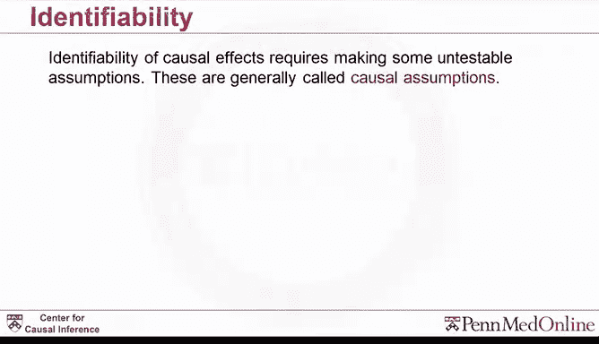

Identability of causal effects is going to require making some untestable assumptions。

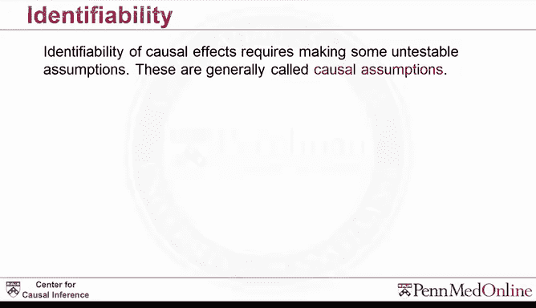

Statistical identifiability in general， has to do with。

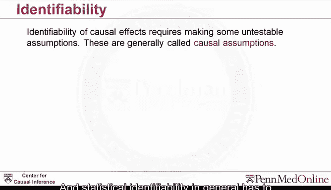

Identifying。Some parameter from actual data。

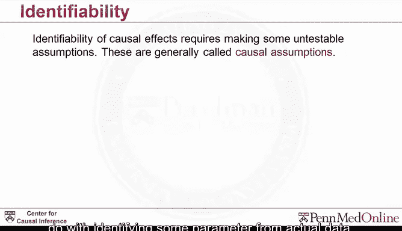

So a parameter is considered identifiable。Is if you're basically able to estimate it from data and in the causal inference area。

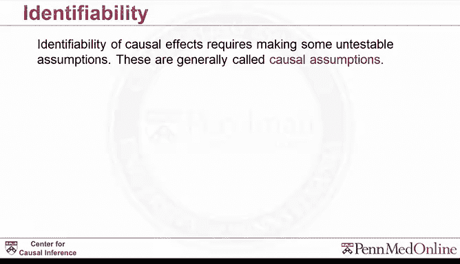

There's this， again， this fundamental problem of causal inference where。

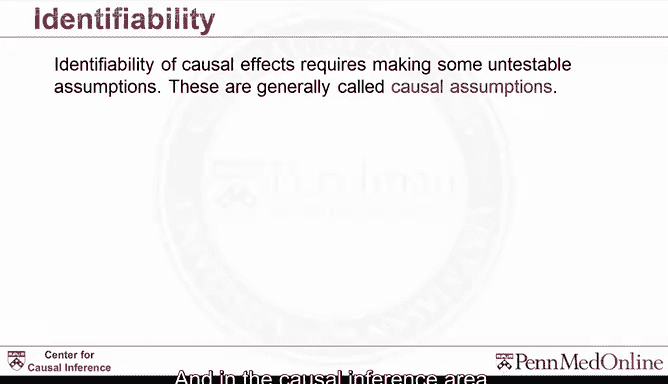

We don't see both potential outcomes。

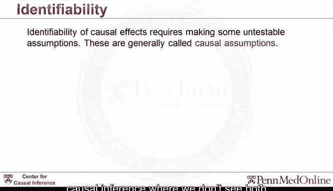

And therefore， we're going to have to make some assumptions if we want to identify causal effects。

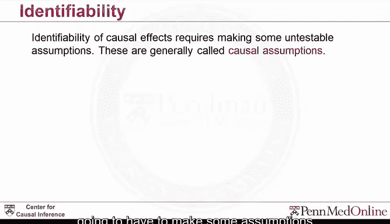

And in particular， in the causal inference world， some of the assumptions we have to make are untestable。

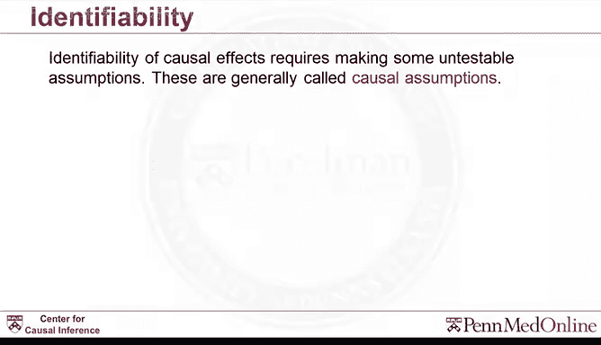

And these untestable kinds of assumptions are called causal assumptions。

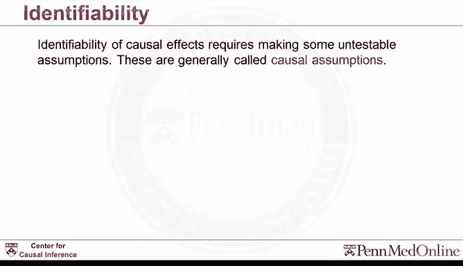

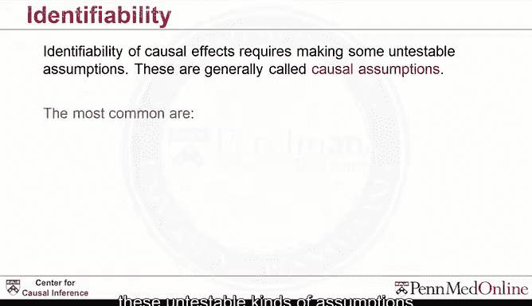

And the most common assumptions are the following， so that there's a stable unit treatment value assumption。

 which is also known as Sva。There's consistency， iorability， positivity。And assumptions。

These assumptions will have to do with the observed data。

And we're going to assume as we talk about these assumptions that our observed data consists of an outcome Y。

 treatment variable A， and then some set of pretreatment covariates x。

So X you could think of as the kinds of information you might want to collect。

For your particular study， so if you're in a medical setting， it could be you know demographics。

 age race and so on， it could be clinical variables， diagnoses。Laboratory values and so on。

 but just think of these as a collection of variables。That you might want to control for。

 for example。So we have our data consists of Y， A and X。So the first assumption known as Suva。

 you could actually think of it as being two assumptions， the first one being no interference。

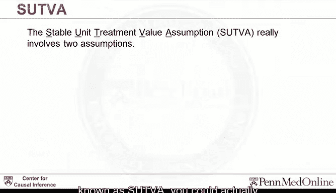

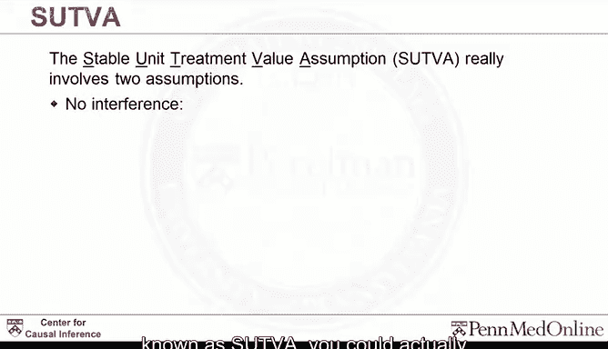

What we mean by that is that units do not interfere with each other。

 and units here would refer to typically people， whatever you。

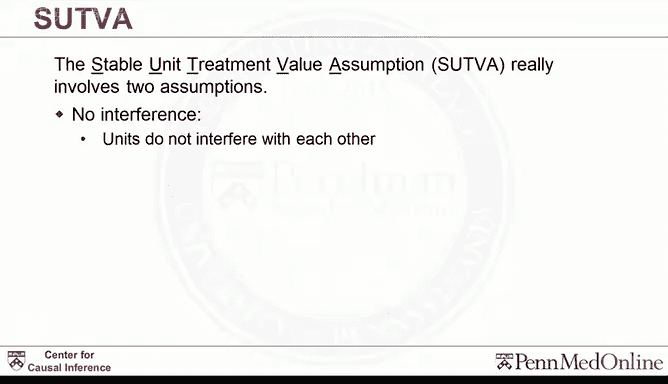

Population。Whatever your population is targeting， so typically in the biomedical research。

 we're talking about， you know patients。

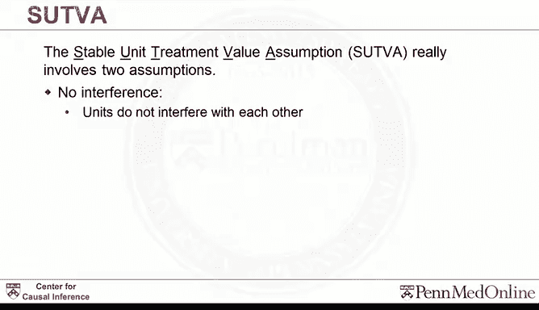

H。But what do we mean by interfere so。That would have to do with whether treatment assignment of one person affects。

The outcome or treatment assignment of another unit or the treatment effectiveness of another person。

And another word for this is either spillover or contagion。

So you could imagine a couple of of scenarios where there would be interference。 So if you were。

Maybe you were doing some behavioral intervention， so your treatment is some kind of behavioral intervention。

 but the people in your study interact with each other。

How effective the intervention is on one person might depend on what intervention the other people that they interact with got。

So that would be an example where there is interference。

So how effective a treatment is on a person and one person might depend on what treatment other people got。

You could also think of this in vaccine studies where how effective a vaccine is for one person might depend on what proportion of the population received the vaccine。

 So typically， we're going to assume no interference that this isn't happening that when we assign somebody a treatment。

How effective that is isn't dependent on what is happening with other people。

There are causal inference methods that can handle interference。

 but we're not covering those in this course。Another part of the SuA assumption is that there's one version of treatment。

And this is important because。It's going to have to do with。Having your potential outcomes be？

Liinnkked effectively to your observed data。If there's multiple versions of treatment。

 it becomes difficult to。Understand even what a causal effect means。

And it causes a number of other problems， so we'll think of one version of treatment where there's one thing。

 one variable that we can hypothetically intervene on。

And it's very well defined what we mean by treatment。So if you make the super assumption。

 the advantage of it is that you can write potential outcomes。For the I person， in terms of only。

Only their own treatments。So。When we define potential outcomes。

 we talked about the potential outcome。As an outcome。

 if the person hypothetically received treatment。You know， equal little A， for example。

We didn't define it in terms of the outcome。That would be observed。

Given what everybody in the whole population received as treatment。

 So it's a soup assumption that allows us to do that。

We don't need to write potential outcomes in terms of the treatments of everybody else。

 we only need to write the potential outcomes in terms of this particular person's。Drement。

So this really simplifies the problem quite a bit and so that's the reason that that's usually made。

 and in many situations this will be a reasonable assumption。

The consistency assumption is the there's the next one we'll talk about and this is really。

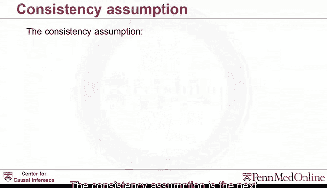

In principles， it's a pretty obvious or simple assumption。

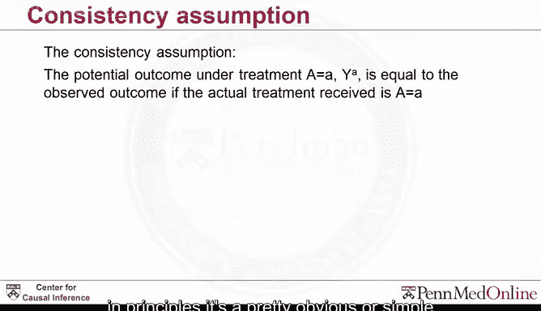

Where here with really directly linking potential outcomes in observed data， so we're saying that。

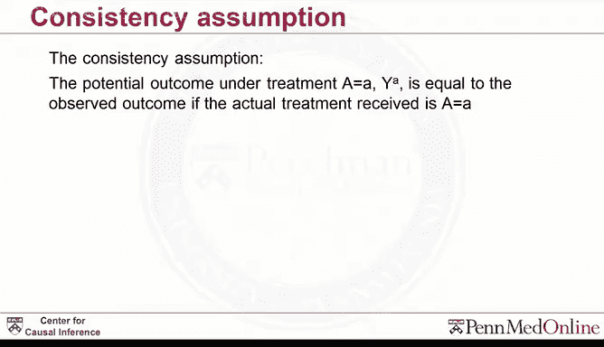

The potential outcome under treatment a equal little A， which we define as y superscript little A。

 that's just equal to the observed outcome if the actual treatment received was a equal little A。

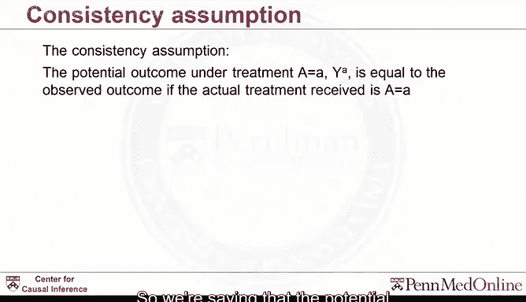

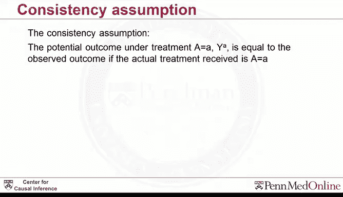

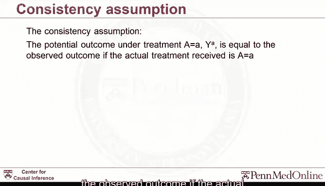

So， you'。

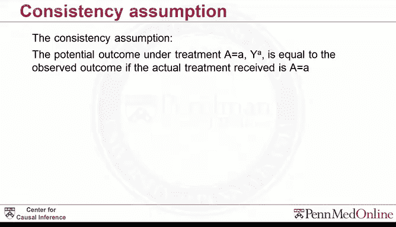

When treatment is actually equal to little A。Then our observed outcome is directly equal or corresponding to the potential outcome。

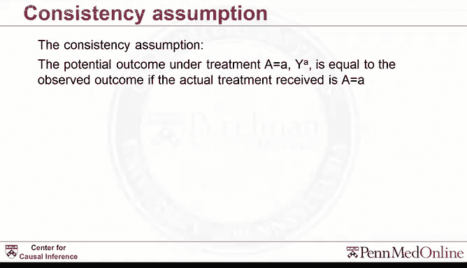

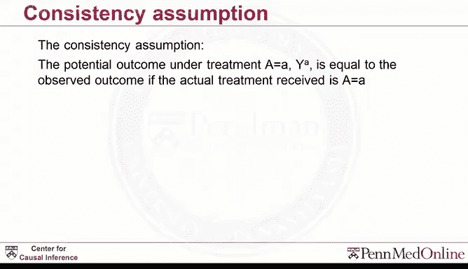

Y superscript， little a。So if you remember for potential outcomes， we imagine。You know。

 why superscript little A is the outcome that would be observed if treatment actually took value little A。

 So then if treatment does actually take value little A。

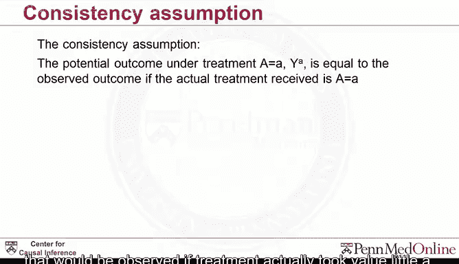

Then we're saying that the observed outcome is equal to that potential outcome。 So this。

 this is just directly linking potential outcomes and observed outcomes。 So in other words。

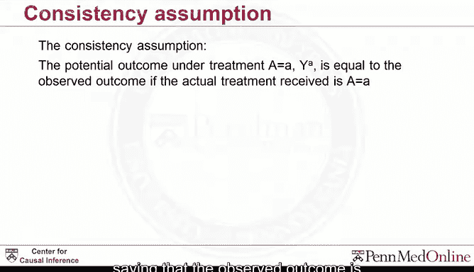

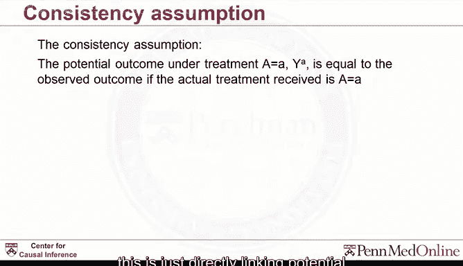

Our observed outcome Y is equal to potential outcome Y superscript little A。

 if treatment is equal to little A， and that's true for all A for any possible treatment。

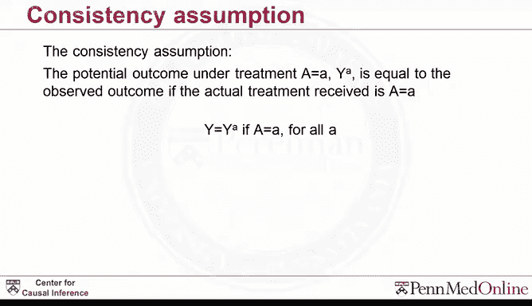

Next， we'll get into the Iorability assumption， which is probably the most important assumption that we'll discuss and the one that people usually give the most attention to。

And this is also sometimes referred to as a no unme confounder's assumption。

So now we're going to have to involve these other kinds of variables， these pretrement covariates x。

And the basic idea is that treatment assignment。Is assumed to be independent from potential outcomes conditional on these pre treatmentment variables。

 So these pre treatmentment variables are a set of variables and。

If we have the right ones and enough of them， then we're assuming that effectively treatment is randomly assigned。

So this notation here， the symbol in the middle there is it means independence。So。

It's saying that potential outcomes y0 comm a y1， are independent of treatment variable a conditional on x。

 so conditional on these sort of baseline pretreatment variables。

So you could think of these variables x as these what people typically think of as confounding variables。

Treatment might be in practice assigned to people， for example， who are older or sicker。

So it's not randomly assigned， but once you control for things like age and health。

 then we might be able to think of treatment as being randomly assigned。

 So x is that collection of variables that are going to sort of create this kind of independence。

 So among people with the same values of x。Then we could essentially think of treatment as being randomly assigned and what we mean by random here is strictly that it's independent of the potential outcomes。

So it might not be random in some other sense。If， for example， your outcome here is blood pressure。

 so let's say systolic blood pressure。If treatment was assigned completely independently from the expected response to treatment。

You know what what。If the clinician was making a determination on who should get treated。

That's independent from sort of who would benefit from treatment。 Then it would be independent。

 But of course， that's unrealistic， but。Now， imagine that they're basing the treatment decision on some variables that we observe。

 So they might be more likely to give treatment to people who are older or to people who have a history of higher blood pressure or those sorts of things things that we can capture in our data set。

 Those are a collection of Xes。 And if we have enough of those。

 the ideas that now treatment is effectively randomized。So that's the important。

Assumption known as iorability and it's called ignoorability because what we mean is that treatment assignment itself becomes iorable。

 it becomes a nonfactor as long as we have enough of these xes if we have the right covariates now treatment assignment we don't have to worry about anymore。

 it's effectively randomized。So this is the， again， the notation。

 and we'll consider a simple example。

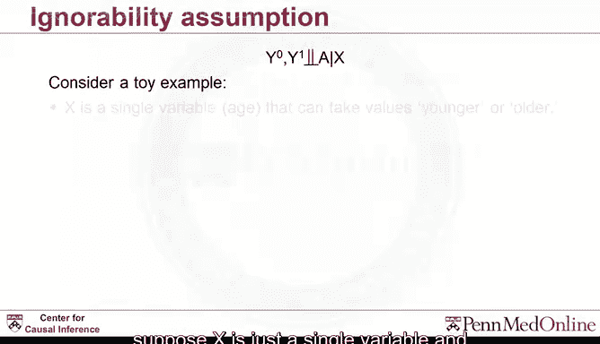

Suppose x is just a single variable。 And we'll just say that it's age。

 And let's just say it's either younger or older we're going to really simplify things。

 So let's just say。

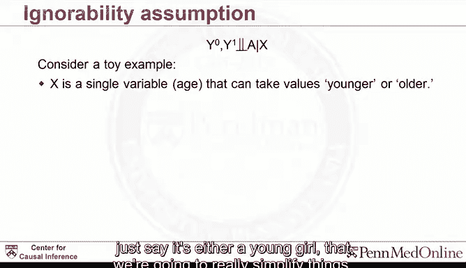

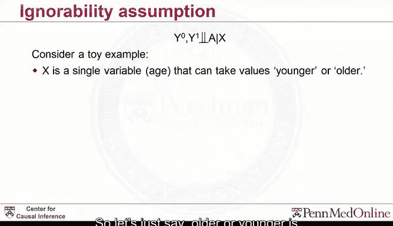

Older or younger is really。The x variable that matters。

 and let's just say older people are more likely to get treatment equal one。

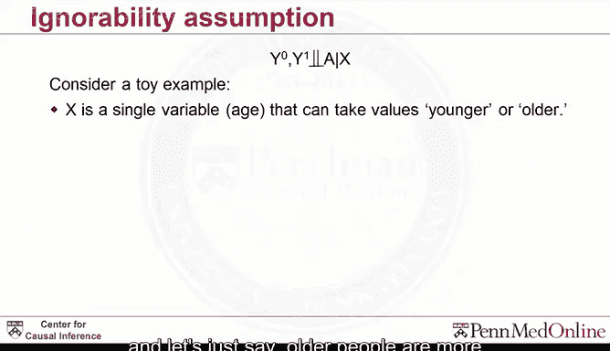

But older people might be more likely to have the outcome， let's say hip fracture。

 regardless of treatment。 so in this case， age is related to treatment， who gets treatment。

And also the。Age is related to the risk of the outcome， even regardless of treatment。So in that case。

 treatment is not randomly assigned。Because people who are older are more likely to get treated。

 it's not random。But。So this is what we mean by marginally。

 So y 0 and y 1 are not independent from a marginally， meaning not conditional on x。

So it's not random in general。But within levels of x， we might have random treatment assignment。

 Imagine that x is the only variable like this。You know， so that。

People who are older are more likely to get treated than people who are younger。

 and that's the only variable that's taken into account in that case。

We could say that within levels of x， In other words， among people who are。Younger。

And among people who are older， treatment is effectively randomly assigned at that point。

So in that case， treatment assignment is iorable given age。And so that's clearly an assumption。

And one of the things that we will try to do is figure out what are these x variables that we need to collect。

To make the ignoreorability assumption whole。Next， we'll move on to the positivity assumption。

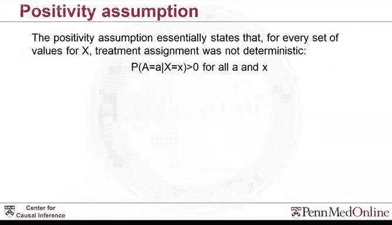

So positivity is referring to this idea that everybody had some chance of getting either treatment。

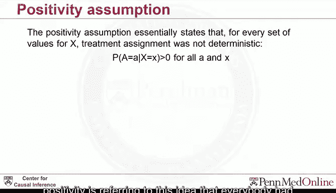

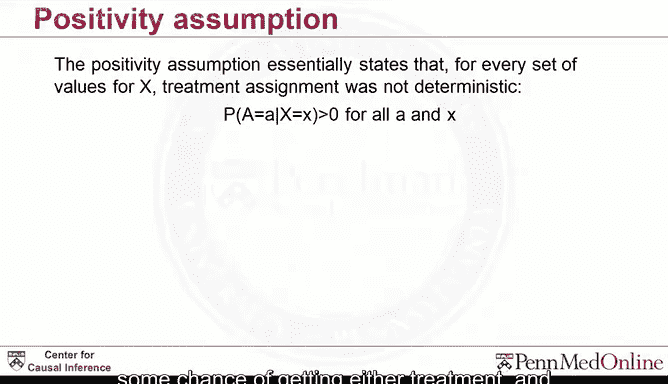

And that's sort of conditional on these x's。

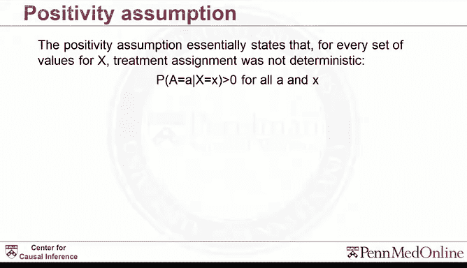

At every level of x and for every treatment， people had a non0 probability。

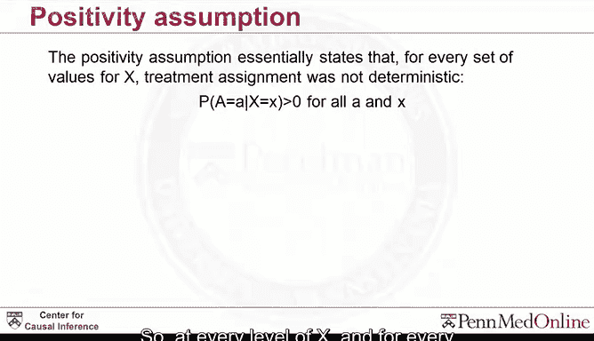

A greater than zero chance of getting treatment。

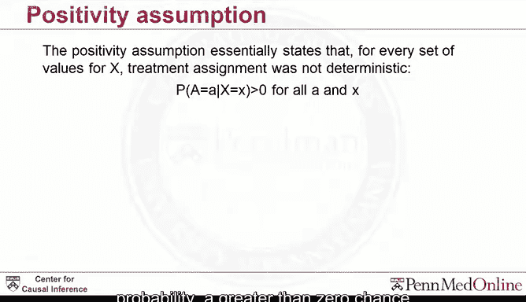

So in other words， treatment is not deterministic as a function of X， for example。

 So in the previous example， we talked about older versus younger。

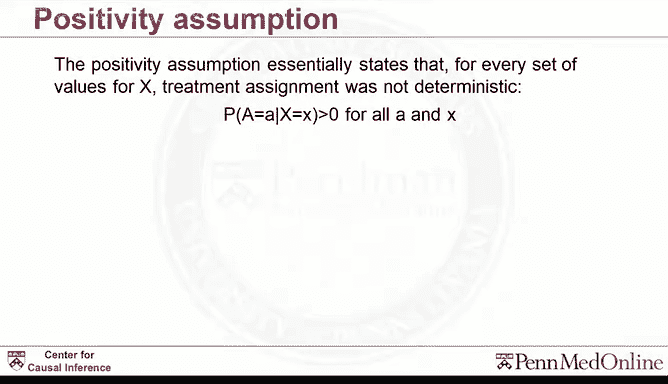

It would be a violation of the of the positivity assumption if everybody who was older got treated。

 but it's not a violation of the positivity assumption。

 If older people are just more likely to get treated， but everybody still could get treated。

 And hopefully， the reason that we need this assumption is clear。

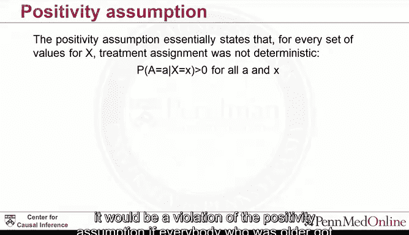

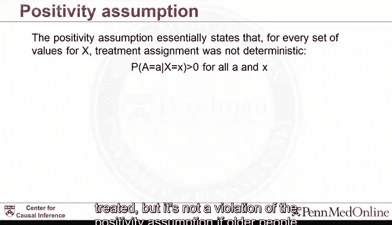

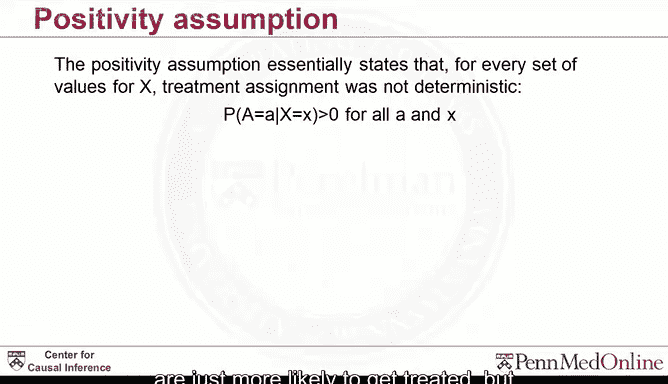

Because remember， we're going to need to。

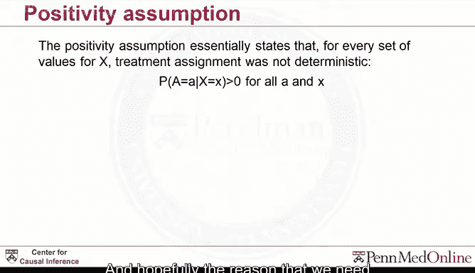

Have data where we can learn about。

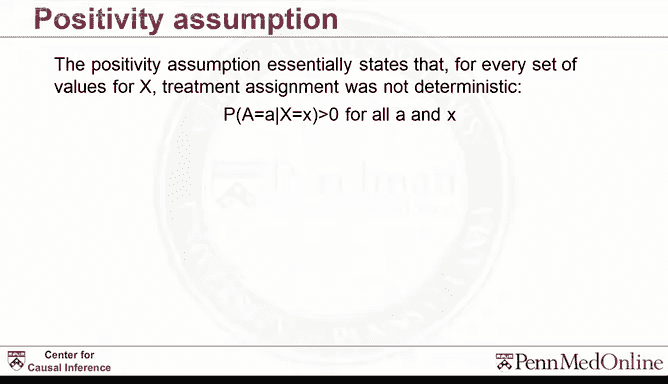

What would happen under either treatment scenario？

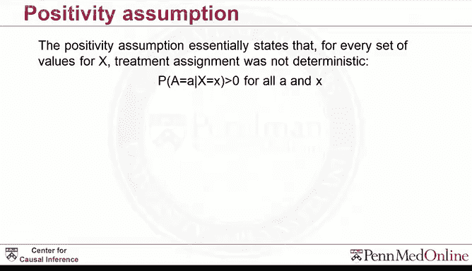

So if for a given value of x， everybody is treated。

 that there's really no way for us to learn what would have happened if they weren't treated。

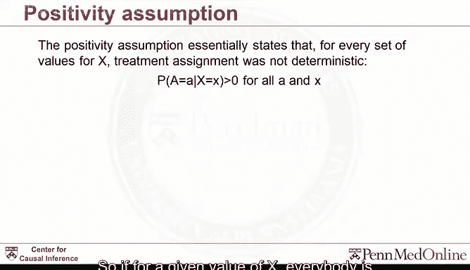

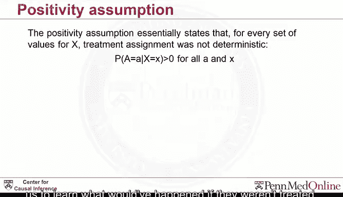

But as long as we have some people who are treated and some people who aren't within every level of X。

 then there's some hope of learning about。

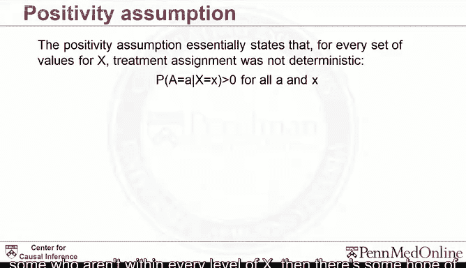

The sort of causal effects of treatment within levels of x。

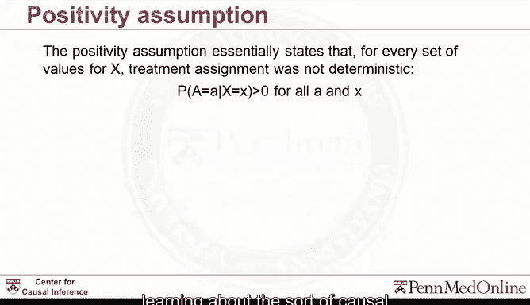

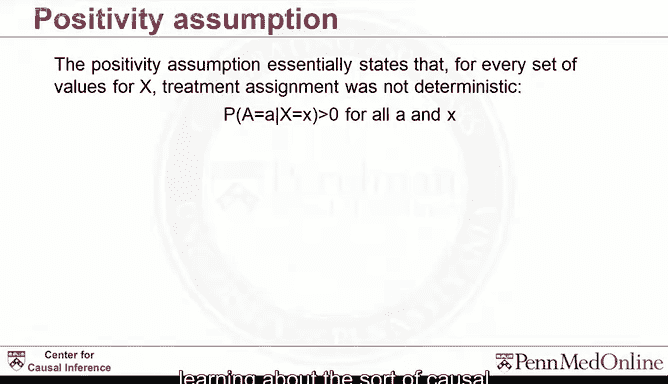

So we need this positivity assumption just so we can have some data。

At every level of x for people who are treated and not treated。

So this is just reiterating， we just need for it not to be deterministic。 if it is deterministic。

 you know， there's some cases where。you could。People with certain diseases might be in。

Ineligible in a sense， for a particular treatment well， in that case。

 we don't want to make inference about that population。

 so we would probably exclude them from the study and make sure that when we have our inference。

 our causal effect results，That we're not thinking of them as part of this population。 right。

 So positivity assumption is also helping us sort of define who our population of interest is。

 If there are people who could never get the treatment。Then typically。

 we would want to exclude them and only make inference about the population of people who have some chance of getting the treatment。

And so in general， though， of course， we need variability in treatment assignment。

If we're going to have an identification， so if everything's deterministic。

Then we're just not going to have the data that will need to identify causal effects。

 So that's a positivity assumption that at every level of x。

Everybody has some chance of getting either treatment。Next， we're going to move away from just。

Defining assumptions to then linking observed data and potential outcomes will use assumptions to link observed data and potential outcomes。

So here's one expected value that only involves observed data。

 So here we have the expected value of y。

Given a equal little A and x equal little x。 So this is the expected value of y among the subpopulation of people who have treatment。

Equal to little a and whose covariates are equal to little x。 So this is。

We observe capital Y， capital A and capital X。 Those are all observed data。

 There's no potential outcomes there。

So we can use causal。Some of these causal assumptions then to link。

The observed data to potential outcomes。We started with this this expected value that only involves observed data。

 so that's on the left。But that is actually equal to the expected value of y superscript a given a equal little A and x equal little x by the consistency assumption。

 So if you remember the consistency assumption。Said that。The outcome that we observe。

When treatment is equal to little A， it's the same as the potential outcome Y superscript little A。

So that's why we can as long as a consistency assumption holds。Then we we have this equation here。

 We can just link these two。 So you'll notice we already went from something only involving observed data to now something that involves potential outcomes。

 And we did it just from this consistency assumption。Next。

 we can think about the Iorability assumption。And what the Iorability assumption allows us to do is to drop this conditioning on treatment。

So。From the previous line to this line。Well， all we did was drop the conditioning in on a equal little way。

What allows us to do that is the iorability assumption。

 if you remember the Iorability assumption said that conditional on x。

 conditional on these covariates。The treatment assignment mechanism doesn't matter。It's just random。

So in other words， conditioning on A。In't providing us any additional information about the mean of the potential outcome here。

 because as long as you condition on X， it's randomly assigned。So we're able to drop this。

Conditioning on A here， so that's by the iorability assumption。So now we've gone from。

Our original statement， which was expected as y given A and X to now something involving a potential outcome where we're only conditioning on X。

 and that's strictly from consistency and iorability。

And now if we want what's known as a marginal causal effect。

 which is the kind of causal effect we've talked about previously something involving the expected value of the potential。

 like let's say a difference in potential outcomes where we don't condition NX。Condition on x。

 What we have to do then is we have to average over the distribution of x。

