# 宾夕法尼亚大学《因果推断速成课程｜A Crash Course in Causality》中英字幕 - P7：07_01_07_分层.zh_en - GPT中英字幕课程资源 - BV1Ft42137BF

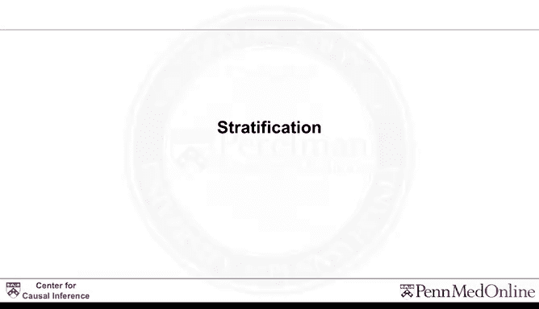

In this video， we're going to talk about stratification。Which is one way that。

Caus effects can be estimated or identified， essentially。

 you would stratify on important variables and then average over the distribution of those variables。

 which is also known as standardization。 so we're going to investigate that and see how it relates to causal effects。

AndThen we're also going to talk about limitations with the standardization approach and why it's something we normally can't do and why we need additional causal inference methods。

We're now going to talk about conditioning and marginalizing， which is also。

The combination of the two is also known as standardization。Previously。

 we saw that if you make certain causal assumptions that you're able to write。

The expected value of our observed y， given A and X。As an expected value of the potential。Outcome。

 Y superscript A， given X。

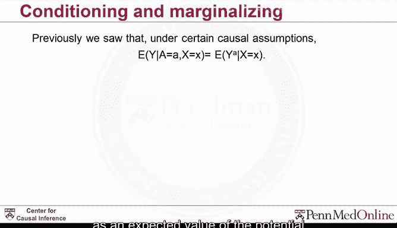

But recall that we're typically interested in a marginal causal effect。

 meaning one that does not involve conditioning on x。So previously， we had defined， for example。

 the average causal effect as the expected value of y1 minus y0。

 and you'll notice in what I just said I didn't say given x。

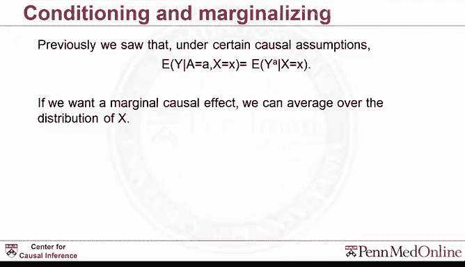

So we really want to。We needed to condition on x to be able to link the observed outcome to the potential outcome。

 but now we want to get rid of the X， and so in order to do that。

 we'll just average over the distribution of x。To make things simple。

 we'll just imagine for now that there's a single categorical x variable。 So just one x variable。

It can just take on a finite number of possible values。 it could be binary 01， that sort of thing。

 And then what we'll do is we'll link。We'll be able to get the thing that we want。Which is this。

Expected value of the potential outcome。So the expected view of Y superscript A。

And that's the thing we want， Because remember， if we have that for every value of a。

 then we can contrast it and get causal effects。 And in particular， marginal causal effects。

 So that's what we want in order， in order to get that， what we'll do is we'll。

Take the expected value of y， given A and X。And average over the distribution of x。And so。

To see what that is here first， let's note that this。Notation here。

 this capital sigma means summation， and you'll notice thats there's a subscript X。

 So that just means average or sum over all levels of x。 Okay， then we have。This part here。

Which is the。Expected value of y， given。Among people who are treated at a equal little A and among people who have their covariates equal to little X。

 So this is a subpopulation， and this is something， of course， we can observe。

In the sense that this is all observed data， we can restrict to the subpopulation of people who have values A in little X and take the expected value of y for them。

But that's a conditional expectation， right， So that's the expected value of y among people who have x equal little x。

And we can get that for every value of x。So we would have a whole bunch of those expectations of y。

 but then we need to average those and we'll average those in particular over the marginal distribution of x。

 So that's what this probability of x equal little x means。

 That's the distribution of this covariate in our population of interest。So all this is。

The thing that we want， this expected value of Y superscript A。

 the expected value of the potential outcome。Is just an expected value of the observed outcome in these subpopulations averaged over the distribution of the covariate。

So this is known as standardization。And all we're doing is conditioning， conditioning means stratify。

 and then marginalizing averaging over。So what we end up with is just a standardized mean。

 and that happens to be the same as the average potential outcome。So as I mentioned。

 standardization involves stratifying and then averaging。

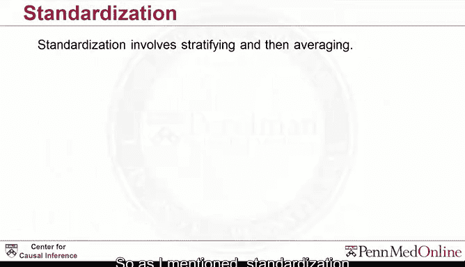

So what we'll do is we' you could essentially think of it as obtaining a treatment effect within each stratum and then pooling a cost stratum where you're waiting by the probability of each stratum。

If you actually had data， you could estimate a treatment effect then by just computing means under for each treatment。

Within each stratum and then pooling across a stratum where we're waiting by the size of the stratum。

To illustrate that， we'll look at a hypothetical example。

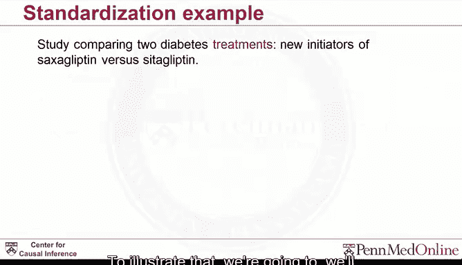

U。This will be kind of a simple example， just to illustrate the main ideas。

What we'll focus on is our population is diabetics， so people with diabetes。

 and we'll look at two different treatments。So we'll look at saxaglypin。

 which is an oral anti diabetic drug， it's a newer treatment for diabetes。Versus Clypton。

And so these are two alternative treatments for diabetes and in fact。

 we'll focus on new initiators of either。 so we'll look at people who are going to begin one treatment or the other。

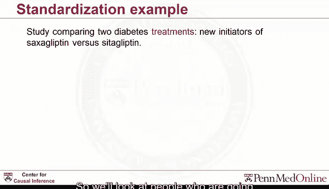

And we would like to know which of these treatments is better。

Our outcome is major adverse cardiac event， which we'll call mace。So we would like to know。

 is saxolypton better than siplypin when it comes to Macce or vice versa？

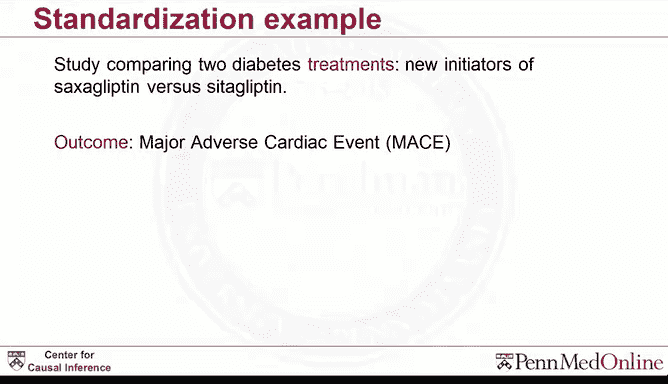

One challenge here is that。Sexeglypptin is a newer drug ands and users of saxeglypptin。

Are more likely to have had some past use of other oral antidiaabetic drugs。

And it also is the case that patients who have had past use of other oral antidiaabetic drugs。

 which we'll call OADs， are at higher risk for mace in general， so these， for example。

 could be patients who have tried a number of different oral antidiaabetic drugs and maybe treatment hasn't been very effective for them。

 so maybe they might be sicker patients or they might be patients that are just harder to help with medication。

So you could imagine that if。These patients are preferentially getting saxylypptin。This could be。

 this is something we're going to need to take into account if we want to decide how effective solyptton is relative to ciiplypton。

So what can we do about that？The key idea here is。We can then compute the rate of mace for saxolypton versus cilyptin in two populations。

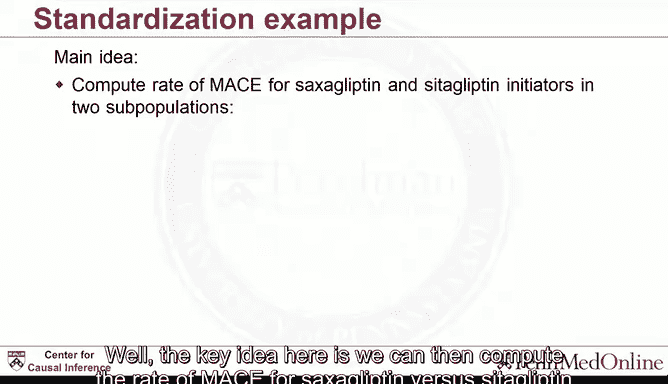

So one is patients who have had no prior OAD use。

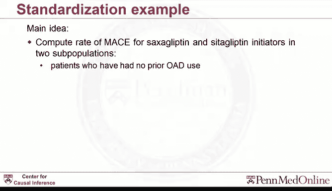

So they're new initiators of oral antidiaabetic drugs。

 so they're going to initiate saxallyptton or thateglyptin but they don't have any past use of oral antidiaabetics。

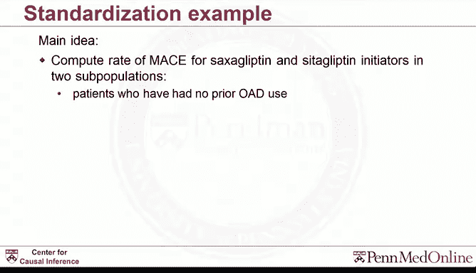

And then we'll also stratify on patients who have had prior OAD use。

So we'll look at those two populations that's our x variable， is this prior OA used yes or no。

 and then we can compute rates of mace。Among Ss， Elippton and ciiplipptton initiators。

So if we do that， if we calculate those rates of the rates of mace in these subpopulations。

 we could then average。Across these populations based on the size of each population。

And then this will end up being a causal effect if it's true that within levels of prior Oad use。

Treatment can be thought of as randomized， in other words。

The treatment assignment would would is iorable， given prior OA use。 So this would be the case if。

Clinicians。Basedase their treatment decision on。the main thing that influences their treatment decision is prior OED use。

 so they might be， for example， more likely to give sex eptin people sexeglipptin treatment to people who had prior OED use。

 and if there are not other key variables that are determining this treatment decision。

 then this is the variable we would need。And we could ignore the treatment assignment。

 we could ignore treatment assignment given that variable。Realistically， in practice。

 we would need to collect more variables than just this one。

 but we're simplifying to illustrate the main ideas。

So let's look at an actual example with some data。So what we're looking at here is raw data。

Of what we observe what we might observe in practice。 So in reality， some people receive saxylypptin。

 some people received siplypton。

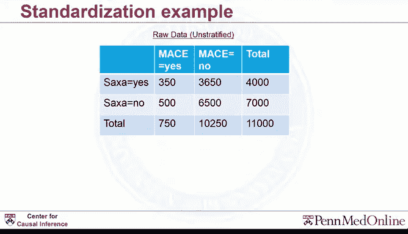

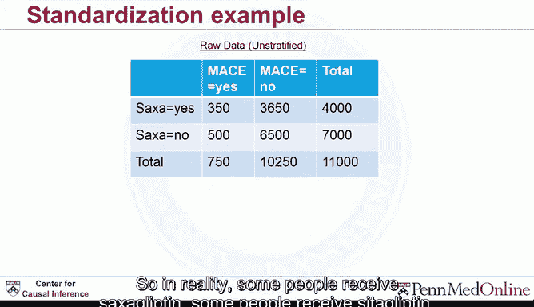

And when we say seglypt and equal no， that means cilypptton。

And then we also have some people。

Have the outcome mace and some people don't。 So mace yes or no。

 So we have this nice two by two table。

In this particular example， we have 11，000 patients。

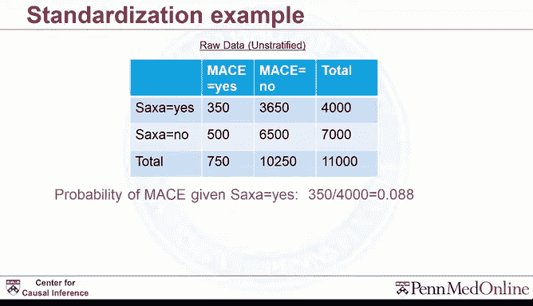

And then we could calculate the probability of the outcome given saxolypton。

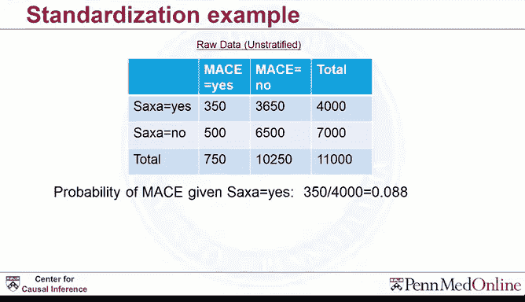

So whatever we say given。That just means restrict to that subpopulation。 So in this case。

 we say given sex elippt and equal， yes。 So given means。

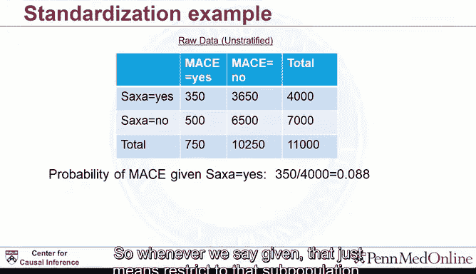

Restrict this row。Given sex elyton equals yes means just look at that row。

And then if we want to know the probability of mace， we would just take how many had mace。

 which is 3，50。

And we would divide by the total population size of sexolipptton users， which is 4000。

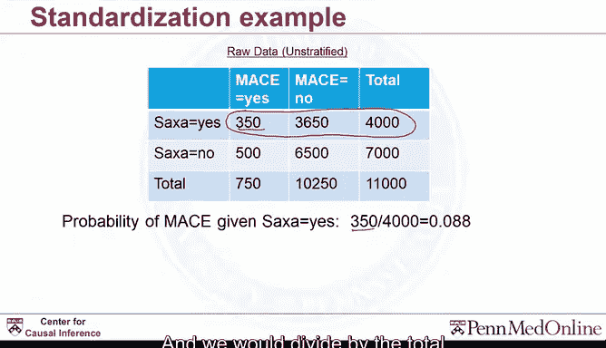

We carry out the division and we get a probability of 0。088 or。About 8。

8% of sexaxolippton users ended up having the outcome。

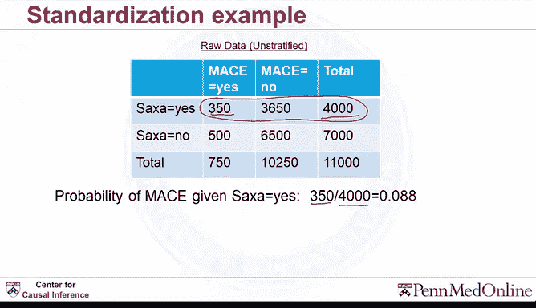

We also now can consider cilypin users。So now we're conditioning oncilyptin。

 so we will restrict to this row。And the probability of mace for cilypin users， well。

 500 of the cieglyptin users had the outcome of mace。And then 7000 is the population size。

 and we get a probability of。071 so what we see is in our raw data。We see that 7。

1% of seglypin users had the outcome versus 8。8% of saxolypin users。

And so just based on this raw data， it looks like saxolypton users are doing worse。

The problem is we don't know if that's due to saxolyptin being less effective thancelyptin or if it's because。

Perhaps sexeglyptin was preferentially assigned to people who were sort of worse off。

 so maybe sicker patients were given sexolyptin。So in general。

 sxaglypton was observed to have higher risk， but we're not quite sure why at this point。

So what we would want to do then is stratify on our x variable， so our x variable is prior OED use。

So we have our table on the right is the prior OAD use equal yes people。

And this table on the left is a prior OE U SQL no group。So we just。

 that's what we mean by stratifying， we're just creating now 2，2 by two tables。 instead of one。

 we're stratifying on x X here is prior Oad use。And what it turns out that So users are more likely to have prior OAD use。

 and we can basically see that by if you look at the total number of saxolypin users who had prior OAD use。

It's 3000。The total number of saxolyton users who did not have prior Oed use is 1000。

Whereas for Clypin， it's 3000 versus 4000。 So if you look at those ratios。

 what we see is that the majority of saxolypin users。Had private Oad use。

 whereas the majority of cilyptin users had。I did not have prior to use。Also。

 people with prior OA use are at higher risk for mace， regardless of treatment。So here。

What we can see is that。So we're looking at people with prior OAD use。

And we're looking at them the risk of maze。 And so we see that， in general。If you had prior OED。

 you SQL no。Your risk of mace was。2，50 out of 5000。Whereas if prior use was equal to yes。

 it was 600 out of 6000。And we see， in general， a higher rate of。Maace， if you were prior O userer。

Next， we're going to actually carry out。The first step that we need to do if we're going to standardize and that's to compute the probability of Macce within each group。

So we can begin on our table on the left here， and we're interested in the probability of mace if sex equals yes。

So we're going to be focused here。So。On this left hand table。

 this is the group of people who had no prior E use， and we see that。Among sexaxa users。

 sexax elippton users。There were 50。Out of100。That had the outcome。Similarly， if we restrict to。

The sippting group， which is here。We get 200。あ。Out of 4，000。Which is 5%。

 so what we see is in this left hand table， we see that the risk of mace。I's 5%。

 regardless if you use saxlypin or ciiplypin。So once we stratify。

 we're actually on the left hand table seen， no difference in the right of the outcome。

While we have a similar story on the right hand table。Now if we look at saxolypton users。We have 300。

Out of 3000 that have。Maace that have the outcome。And for Ceglyton users， we restrict to this row。

 and it's 300。Out of 3000。And that's 10%。 And so what we see is that。Among prior OE users。

 which is the right hand table， we also see that the risk of mace is 10%， regardless of treatment。

So if we put these two， if we think about these two tables collectively。

 what we see is that in either。Group。In either cellpopulation based on X， based on prior Oed use。

The risk of Macce is the same regardless of whether you get saxylyptton orcetiplyptin。 So now。

 in contrast to the prior table that didn't stratify。

 it looks like there's no difference in terms of treatment effectiveness。

Whereas if you sort of naively。Didn't stratify Empire OED use。

 it looked like sxaglypptin was a less effective medication。Next， we're going to。

Take look at the mean of the potential outcomes among saxolippton users。So。😊，On the previous slide。

 we were just looking at the rates of the outcome in these different subpopulations。

 but those were always conditional on X。 And remember we we want to marginalize。 We want to have a。

Expected value of a potential outcome。 that's not condition an onx。

So we're going to have to marginalize。 And so next， we'll go through how to do that。

 So our goal here。Is this potential outcome， which is the expected value of why if everyone in our population had hypothetically been assigned sex elipptants。

 that's what we want to know。The way we're going to do that is by calculating the expected value of y among saxlypin users at each level of x。

And then take weighted average of those based on。The size of those corresponding populations。

So let's first we'll walk through each component here。

 So first we're going to focus on sexolypton users in the prior OadD。呃。Equal， yes， group。

So what we do is first， we calculate the expected value here。We're just doing this component。

And that's just 300 out of 3000。That's what we've seen before。

 That's just your risk of the outcome if you're in the saxonlypin group and you have prior Oed group。

Prior， do you sQL yes。So that's that we've seen before。I should mention that that this whole。

Equation here is exactly the one we saw a few slides ago where we're averaging over the distribution of x。

 averaging over the marginal distribution of x。 It's an expected value。

Times the probability of that value of x plus the expected value times that the probability of that x。

So it's just a weighted average。 And that's what we're trying to calculate。Filling in these pieces。

So next， we'll fill in the next piece。So， next， we want。This one。Prior Oad use equal。

 What's the probability of prior Oad D use equal Yes， Okay， In other words。

 what proportion of our whole population。Our whole population is 11000 people。

What proportion of them have prior OED use， and that'll tell us the probability of prior OED use。

Well， the proportion of them that do。Or the number of them that have it is here，6，6000。

So we have 6000 out of a total of 11000。 That's a proportion that have prior Oed use。

 So that's the number we're going to fill in there。Next， we'll step through。The same thing for。

The prior O D use equal no group。 So now we're focused on this subpopulation。

 Our first calculation is。Is just what we saw before，50 out of 1000。 That's the expected value of。

 of y， given。Given s elypton and given prior Oads。 So we walked through this before that's 50 out of 1 thousand00。

And next we're going to need to know well， what proportion of the population。

Is the prior OAD use equal node group？And that's just。5000。

Which is a total number who had no prior Oed use。Divided by our total sample size， which is 11000。

 which is just the sum of these two。So you'll notice now we've filled in all four of those components and we just read them right off of these tables。

And what that will do with then is we can calculate that and actually get an expected value。

Of the outcome， which the outcome here is essentially。

 you could think of it as the probability of mace。If everybody had been assigned sex elippton。

And that happens to be if you do the calculation， about 7。7%。

Now you could carry out the same calculation for the cilypting group。

So now we would be talking about the expected value。Of the outcome， which is mace here。

 if everybody had possibly contrary effect， then assigned ciiplyptton。

 we can basically walk through the exact same steps。

 but now restricting to the second rows of these columns where we're dealing with ciiplypton so。

We could just。al we had already walked through these calculations for the other group。

 so it's probably not necessary to deletete all the details here， but I'll just mention one of them。

So， for example。Probability prior OED use equal yes well this is just the same as what we saw in the previous example right。

 this hasn't changed， this is our population probability of being in the prior OED group use group。

And that's 6000 divided by 6000 plus 5000。So that's that。

 and we had previously on other slides calculated this one。

So we've actually already done these calculations before we just have to put them together。

And we end up with。7。7%。So what we can see here is that。Once we marginalize， we end up with。

The mean of the expected value。For seglyptin， ancieglyptin is exactly the same。 It's 7。7%。

In each group， so in other words， the potential outcome is exactly the same if you gave everybody saxlypton versus everybody ciiplypton。

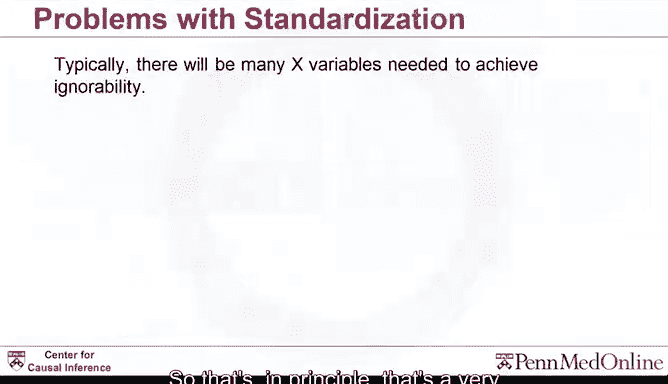

So， that's。In principle， that's a very effective way to get at causal effects。

 we find these important x variables。

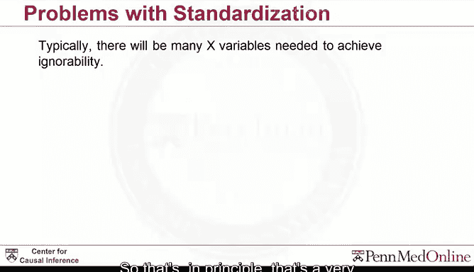

That we need to make the iorability assumption hold， we stratify， we average。

 and then we can get a causal effect。However。This becomes problematic very quickly。

 because you can imagine having many X variables。You might need many X variables to achieve iorability。

 So when practice a clinician might not just look at。Your history of medication use。

 but they might look at your history of many variables and even your own preferences and your general health。

 your age， so there might be a big collection of variables that we need to control for。

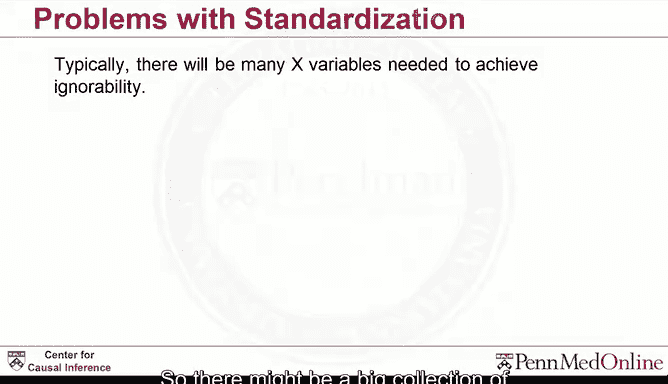

So if we tried to stratify， we would basically have many empty cells。

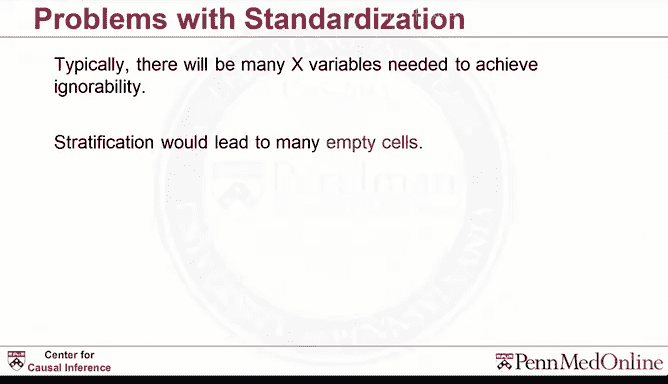

What we mean by many empty cells is there there'll be combinations of x variables for which we just have no data。

 There's no people that have that combination。 So there's no way for us to calculate a mean。

 and then average。

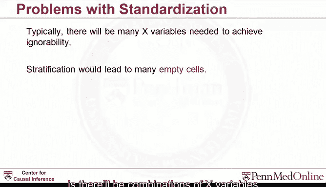

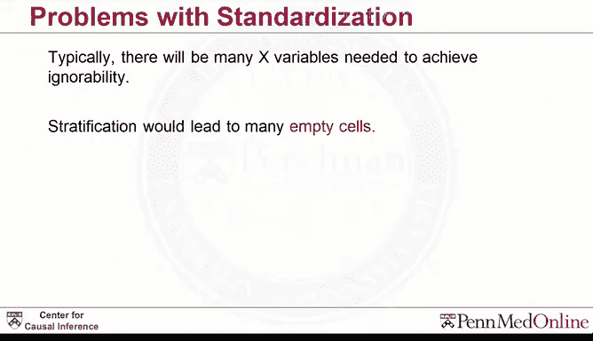

So for example， if you stratify on age and blood pressure。

There will probably be many combinations of age and blood pressure for which you just have no data。

 for which there's just no people。So it becomes problematic very quickly。

So we're going to need alternatives to standardization。

The concept of standardization is extremely important because we're going to keep that concept throughout the course。

 we're always going to be doing something that's trying to get at standardization。

 but we're going to have to do something a little different。

 We're going to have to do things that are slightly different。

So in much of the remainder of the course we're going to explore different options。

 so with standardization as sort of the ideal situation。

 if hypothetically you could have that much data， we're going to think of alternatives and in particular we're going to focus on matching inverse probability of treatment weighting and propensity score methods when it comes to observational studies。

And we'll also look at。Instrumental variable methods， which is。

Which is getting at what to do if you might have natural experiments where there might be some variable that you could be thought of as a randomizer。

