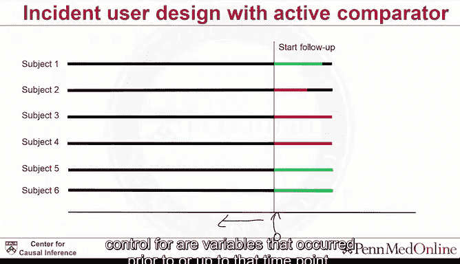

# 宾夕法尼亚大学《因果推断速成课程｜A Crash Course in Causality》中英字幕 - P8：08_01_08_新用户与主动比较器设计.zh_en - GPT中英字幕课程资源 - BV1Ft42137BF

In this video we will focus on two designs， the incident user design and also the active comparator design。

 and so the objectives are to understand the basic idea of incident user designs and what problems they help avoid and then also to look at active comparator designs and to understand how they help to reduce confounding。

So to begin we'll think about cross- sectionional looks at treatment and what I mean by that is if you think about a snapshot just at a given time you have a population of people and some people might be treated and some people might not be and so it's just a snapshot and it's not really thinking about what led up to that in the whole history of their treatments so as an example。

 let's suppose we were interested in the causal effect of practicing yoga。

 maybe on blood pressure so blood pressure might be the outcome and maybe you think that practicing yoga would reduce blood pressure so imagine you want to study that。

And so you might have a population of people and some people are practicing yoga and some are not。

So that's what I mean by cross- sectional you're just sort of taking a snapshot and seeing who's practicing versus who's not for people who are not currently practicing yoga they might they might have in the past right so some might have practiced yoga in the past and some might not have。

And also those who are currently practicing might have been practicing for a long time。

 or they might be beginners。And so there's these questions of imagine that there's among people who aren't currently practicing but did in the past。

 why did they stop so maybe for some people yoga is anxiety inducing so it causes them stress and maybe those people stopped practicing yoga right so these people who maybe where yoga might have raised their blood pressure or something they ended up stopping。

So there's a lot of examples you could think of like that。Also。

 the people who have been practicing yoga for a long time。

 they might be a lot different than people who just recently started or people who have never started。

 So there's so there's these various types of selection bias that's difficult to control for if you're。

If you're sort of taking this snapshot and。And just looking at current treatment， yes or no。

And not really thinking about this whole history。So we can look at it as an example here of six hypothetical people。

 so I'm calling them subjects one to six。And what I'm using in this is two different colors。

 so black is representing。Not practicing yoga， and red represents that you are practicing yoga。

So you'll see this first person， subject one。And this is time on this axis。 So over time。

 they just never practice yoga。Whereas subject two， you'll see that。

There was a period of time where they were practicing yoga， and then they stopped。So over here。

 they stopped， and this was before they started practicing yoga。And so， person 3。

They weren't for a while， but now they're currently practicing yoga。

And I'm saying that this vertical bar here is the start of follow up。

So imagine I'm taking a snapshot at this point in time right here。So if I do that。

 I'll see that there are two people currently practicing yoga。Right， and then there are。These others。

So we have four people who are not two people who are。

 but you'll notice that for the people who are not。

 they have very different histories of whether or not they practice yoga for how long。

And so this for the reasons I mentioned on the previous slide this could cause some problems if you look at subject number two。

 for example， they gave yoga a try for a brief period of time and stopped so why did they stop maybe this maybe it wasn't working well for them so we're。

We're sort of going to treat them if we take a snapshot。

 we're going to treat them as somebody who isn't practicing yoga。

Even though they actually at one point tried it and perhaps just didn't like it or maybe it didn't work well for them。

Another thing to consider is this person subject six， you'll notice say practice for a long time。

Well， if yoga has benefits， maybe out at this time point。

They're still experiencing some of those benefits， right， So maybe it did lower their blood pressure。

 And even though they stopped， maybe they're still having some benefits from it。

 So there could be this lingering treatment effect for them。 So that's another thing to think about。

 So these cross sectional looks at treatment can cause some problems because you have sort of leftover treatment effects that might still be there。

 Or you might also have the selection bias where。You know。

 people who it wasn't working for stopped and the people who it was working for are continuing to do it。

So one way to get around this potentially is what's known as an incident user design。

So this is basically then going to focus on。People who are newly initiating treatment。

And so this is also known as a new user design。So rather than think of treated people as anybody who is currently treated regardless of how long they've been doing it。

Willll focus on just new initiators。 So incident users or new users。

 So when the yoga example will be interested in people who initiate yoga and then。

Will look at their outcomes， say blood pressure at some sort of predetermined period of time after they initiate yoga。

Then in this case， the causal effect we might be interested in is among people who have not practiced yoga in the past what is the causal effect of practicing yoga so we've changed the well to some degree we' sort of change the causal effect that we're interested in。

 you know we're now interested in the causal effect of initiation but by doing this and changing the causal question slightly we actually end up with a cleaner problem to some degree so' we are able to get rid of the issue we just previously talked about。

And here's how this might look in a picture。So again， we have six subjects。

And you'll notice that some of them。So， subjects。One， five， and six， you know。

 they're not practicing yoga， this is the start time of our study。And then there's subjects 2，3。

 and4。 So we've basically aligned it。We've aligned their time zero， their start time of follow up。

At the time that they initiated yoga。And so you'll notice that this person person is subject two。

They did eventually quit， they stopped to practicing yoga， but for our purposes， that doesn't matter。

 this is more of an intention treat kind of setting where we're just looking at what is the causal effect of initiating。

And so， that's。What we're doing， but you'll notice that。

This is cleaner in the sense that none of the people who are in are sort of。

Practicing yoga group have a history of yoga， this is all we've aligned to start a follow up at the time they initiate。

So there's one problem where one challenge here though is that if your comparison group is no treatment。

 then it's not always clear what their time zero should be like when should you start following up time with them So for the treated subjects it's clear what the start of follow up is their time zero their start followup is when they initiate treatment but for the other subjects it's not as clear there are lots of ways you can do it such as。

Matching on various characteristics。But it's not quite as clear。

An alternative is to have an active comparator， so as opposed to no treatment。

 which we'll think of as not an active comparator， it's definitely much cleaner to have some kind of active comparator。

So in the yoga example， you might want to compare yoga to some other。

Type of exercise or intervention， so I'm using an example of Zumba fitness。

Some people might initiate yoga。 Some people might。

Start taking a Zooumba class and then you might be interested in well。Which ones more beneficial。

 So would be a direct comparison of the two。So this will be known as an active Compator design where you're comparing two active interventions。

 two active treatments， or two exposures。And one nice thing about active comparative designs is that there's typically going to be a lot less confounding。

So if you're comparing people who practice yoga to people who don't do any exercise or people or just to everybody else。

 they might be a lot different。But if you're comparing people who are taking two different types of fitness classes。

 they might be a lot more like each other。So that's one example you also could think about the medication example。

 let's say we're comparing two different medications。

 so let's say we're comparing loop diuretics to people who take ACce inhibitors so these are both treatments for high blood pressure。

Well， people who take loop diuretics and people who take ace inhibitors are probably a lot more a like。

Then people who don't take any blood pressure medications。

So by having an active comparator in a lot of cases we're actually reducing the amount of confounding。

 what these groups are going to tend to be a lot more alike。

But we should note that we're also changing the causal question or we're looking at a different causal question。

 and I'm saying that it's more narrow in some sense。

 so if we're comparing the effect of yoga to the effect of Zumba。

 that's a much different question than comparing the effect of yoga to all everything else or to note exercise。

Comparing loop diuretic states inhibitors is a much different question than comparing loop diuretics to no treatment。

So it really depends on what you're interested in， are you interested in these sort of direct comparisons？

Of active types of treatments。So some of it is a question of what kind of causal a question you want answered。

But if you might be interested in。Comparing two active treatments。

 the act of comparator design has a lot of benefits， especially in terms of reducing confounding。

So you can combine an incident user design with an active comparativearator design。

 and I would argue that these are extremely useful for causal inference in practice。

What I typically have done as far as。Real examples where I've worked on causal inference problems。

 we almost always use incident user designs with an active comparator。

So this figure is basically showing two treatments where one treatment is green and one treatment is red。

 so this could be yoga versus Zumba， or it could be two different drugs。

And so you'll notice here that。Everybody before we initiate treatment。

 so this is the treatment initiation time， everybody's time zero before that sort of looking backwards。

Everybody was treatment free， meaning by treatment free。

 I mean they weren't taking either of the active treatments。

 so they weren't practicing yoga or Zumba in this or they weren't taking loop diuretics or ACce inhibitors。

 say well they were totally free of either of those types of treatments。But then at time zero。

 they initiate something， so they initiate green or red， Zumba or yoga。And then we follow them up。

So at the time zero at this baseline time here。Where people are initiating treatment。

 what we're imagining is that。You knowThere's basically some kind of treatment decision there might be confounding involved。

 but presumably， know， people could have chosen either one。

And hopefully these people are somewhat similar now because they are choosing one or the other。

 and we can control for the confounding variables and confounders。

Would be variables that were measured up to this time 0。 So I'll call this time 0。

 So the kinds of variables that we want to control for are variables that are that occurred。Prior to。

 we're up to that time point。

So just some other things to think about。In some cases。

 you can't actually implement an incident user design。

 so sometimes there's just never a treatment free or an exposure free period。

 So imagine you're interested in the causal effect of some kind of air pollution。Well， typically。

 there's not going to be any period of time where people had no exposure。So in that case。

 you wouldn't be able to have a incident user design。

There's also in terms of active comparators you just might not be interested in。

Comparing to some active treatment， you really might be interested in unexposed。So you might not be。

You know， interested in comparing。You know， tobacco smoke to chew tobacco you might really be interested into in tobacco smoke to know。

Tobacco of any type， you know， so you might your interest might be in the unexposed。

 so you're not always going to have an active comparator。

And I also should mention that we focused entirely on sort of this decision to initiate a treatment so far。

Throughout the course here we'll be focused on these sort of point treatment settings where we're interested in exposed versus unexposed or we're interested in comparing two treatments。

More as in， initiation of treatment kind of design or intention to treat kind of design but。

There are causal methods that can handle time varying treatments where we might be looking at the causal effect of。

Treatments over time， so maybe always treat over a full year versus never treat over a full year。

 So there are causal and methods that can do that， but we're not focused on those at this point。

 but just as an awareness。Isue that you can vote that there are methods that can handle looking at causal effective whole treatment regimens over time。

