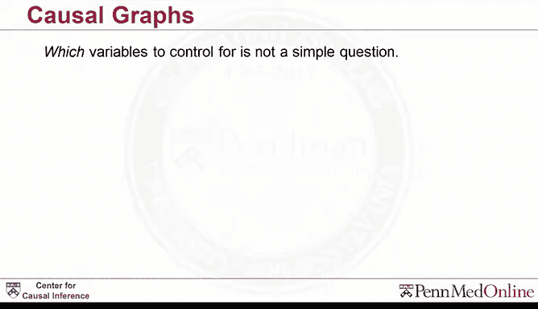

# 宾夕法尼亚大学《因果推断速成课程｜A Crash Course in Causality》中英字幕 - P9：09_02_01_混杂因素.zh_en - GPT中英字幕课程资源 - BV1Ft42137BF

Hi， this video is on confounding。In this video， we're going to briefly discuss what confounding is。

And however it relates to the iorability assumption。

We're also going to use that information to motivate why we will want to learn about causal graphs。

 which will be covered in future videos。As a brief review。

 we are interested in the relationship between means of different potential outcomes。

So potential outcomes are outcomes that you would observe if you set treatment to certain values。

Such as treated versus untreated。 so for example， we might be interested in the mean difference。

In the outcome， if everybody was treated versus if no one was treated。As we've seen previously。

To be able to estimate this from observational data， we will need to make several assumptions。

 including iorability Iorability refers to the treatment assignment being independent of potential outcomes conditional on some set of covariates X。

As an example， suppose treatment assignment depends on the potential outcomes。So in this case。

 the iorability assumption would be violated so that sicker patients are more likely to be treated。

It's also true that treated patients。Might be at higher risk of a bad outcome。

We would therefore need to account for these pretreatment differences in health。

 but now suppose X consisted of several measures of health。History of various diseases， age， weight。

 smoking， alcohol use， and so on。Imagine we've captured。A large number of these measures of health。

And we'll just call that collection of variables X。It then could be the case that within levels of x。

In other words， people who are the same age have the same history of comorbidities。

 are of the same weight， same smoking history and so on。

 it might be the case that within those levels of x。

 the sicker patients are not actually more likely to get treatment so that's what we would mean by ignoreorability in that we cannot actually ignore treatment assignment in general。

 in this case， sicker patients are more likely to get treated。

And are more likely to have a bad outcome， but if we capture enough information in this case about the health of the individuals。

 then as long as we condition on that， we're able to say that treatment assignment as random so if we make the population of patients homogeneous enough then we could think of treatment assignment is random in that case we would consider treatment assignment iorable meaning the iorability assumption would hold now we should think about confounding in the previous example you could generally think of health as a confounder because it was affecting the probability of treatment and the outcome itself in general you could think of confounders as variables that affect both treatment and the outcome it's an important to note that when we say that when we say it affects the outcome we mean independent of treatment in other words not through its impact on treatment。

In this first example I'll give here， this is something that would actually not be a confounder。

 so imagine if treatment assignment was actually random。

Which you could think of as being based on a coin flip。In that case， treatment assignment。

This mechanism， the coin flip。Would affect treatment， but it should not affect the outcome。

And there's no reason to think that a coin flip would affect your typical outcome。So in this case。

 the variable would not be a confounder， the coin flip itself。

 the assignment mechanism would not be a confounder because it's only affecting treatment and not affecting the outcome。

Another example of something that's not a confounder would be if people with a history of cancer are with the family history of cancer are more likely to develop cancer in this case。

 let's say that cancer is the outcome。But perhaps family history was not a factor in the treatment decision。

In that case。The variable that we're thinking of here。

 family history of cancer would affect just the outcome and not the treatment decision。

So it's not a confounder， and in fact， a variable that only affects the outcome is sometimes referred to as a risk factor。

So this is not a variable that we would need to worry about when it comes to the iorability assumption。

Finally， imagine that older people are at higher risk of cardiovascular disease。

 which here is the outcome， but are also more likely to receive statins， which here is the treatment。

In that case， age would be a confounder， age is affecting both the treatment decision。

 which here is whether or not to receive statins and is also directly affecting the outcome。

 which is cardiovascular disease。So when it comes to confounder control。

 we are interested in first identifying a set of variables X that will make the iorability assumption hold。

So remember the Iorability assumption is saying that treatment assignment is random given X。

And x is a collection of variables。 So the question is， what collection of variables？

So we would need to identify what that collection of variables is。

If we're able to find a set of variables like this。

 then that's sufficient to control for confounding。We're also interested in statistical methods。

 imagine that we have these variables X。So the iorability assumption would hold。

Then we have hope of estimating causal effects， but what are the actual statistical methods that we would use to do this。

 so that will be a focus later in the course。Finally， we come to causal graphs。Casal graphs。

 which we'll introduce in a future video。It will be used to help us identify which variables we will need to control for。

So this is actually not an easy question， so what is the collection of variables？

That would make the iorability assumption hold。

And we will see that causal graphs will help us to answer that question。So again。

 the goal is to find a set of variables X that will achieve iorability。

Which is equivalent to saying that we'll find a set of variables X that will be sufficient to control for confounding。

Casal graphs are going to help us answer this question。

 and it will also help to formalize these key ideas。

