# 宾夕法尼亚大学【中英⚡GPU编程｜CIS5650 2024 GPU Programming】 p01 P1 2024-08-28 - Lecture 1 CUDA Introduction 1 -BV1JeMnzFEWv_p1-

我上。All right hellello everybody let's get started welcome to our new fall semester here at Penn fantastic to see all of you in the class here today so we'll get started with the 565 first lecture today of course it'll be a lot of introduction and then we'll also get into some early Quda learning。

I know three hours is a very long time， we'll take a break for sure。

 likely between the first introduction and then as we get into Ka。

Few logistics I'll just share right off the top I am recording so don't have to worry about taking pictures of the slides that are already available so let me just pull up my browser and I'll show you a few things。

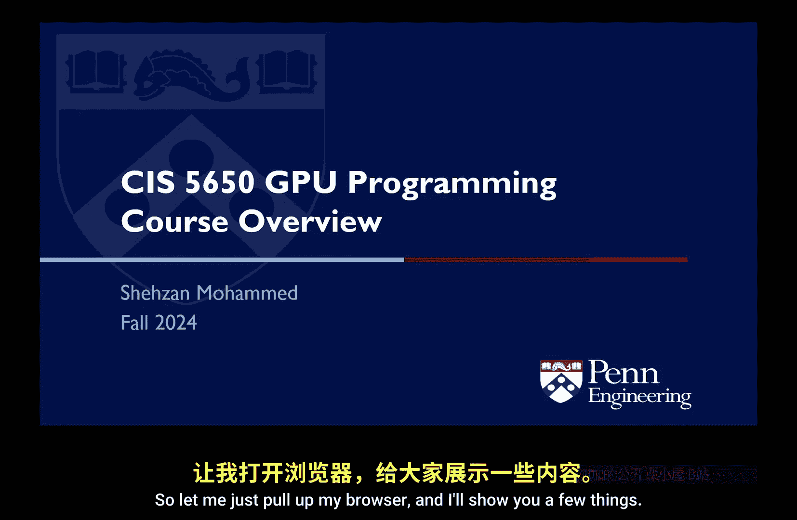

By now， all of you should be。Aware of the website， of course。

 so all of the links that you need will be handy。

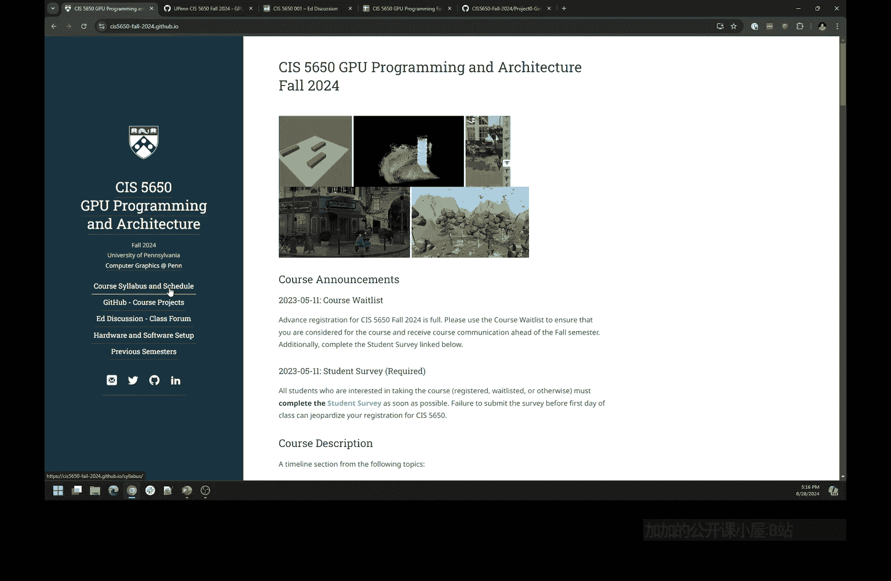

嗯。Our GiHub is available as well project zero and project one are both out don't worry about hey。

 project ones already out we'll do the recitation next week you'll have enough time to finish it。

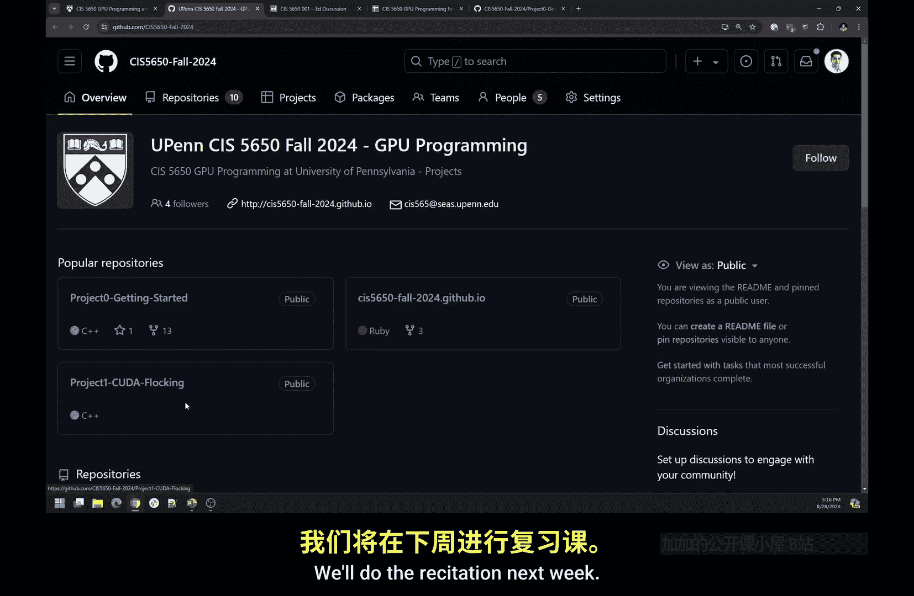

At discussion， those of you who were registered and were in Canvas already were pulled in。

Those of you who are waitlisted I' add you probably after the class in the evening so you can add questions as well。

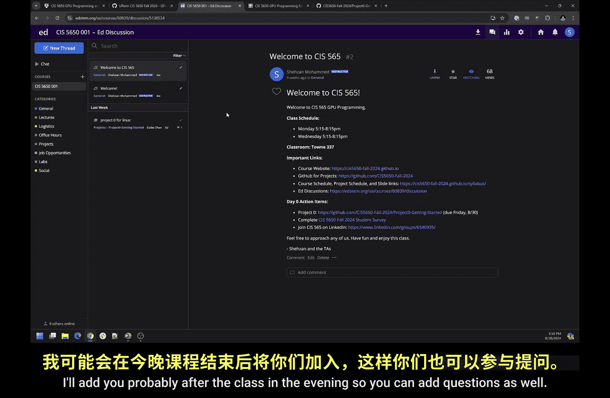

Our schedule is available again on the website so if you go to Co syllabus and schedule you'll see the Google sheet here and I've already linked to the slide for today so each class right before class starts I link to the slides so all of you have access to it if you want to take notes and stuff。

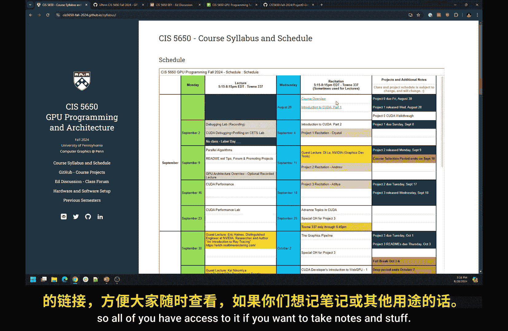

嗯。And then finally， you Project Ze， if you're not already downloaded and tested your laptops with this。

 please do that then make sure that you're ready to go on all the hardware and software front for the rest of the course。

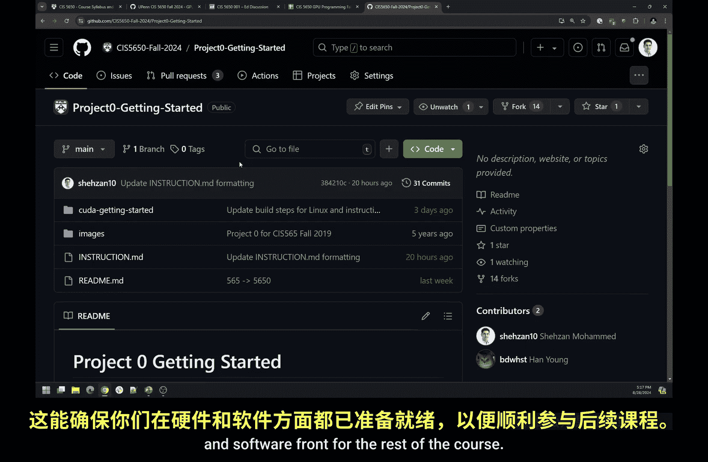

All right， so with that let's get started sorry one more thing if you have a question raise your hand ask no problem the only thing I'll say is for the first few lectures。

 just say your name so that I get to know you by your name as well that'll help us throughout the semester for various reasons that I'll share later。

Okay， all right， so let's get started。I呀。

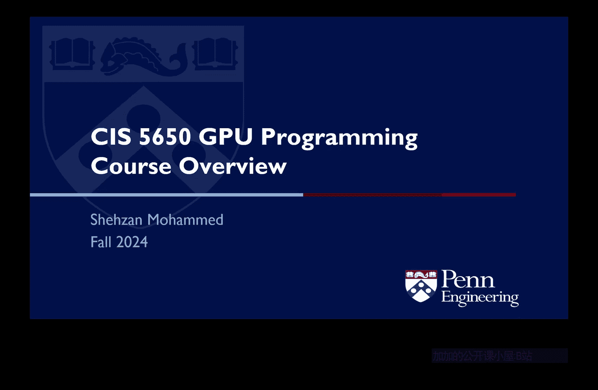

All right。So a little bit about me why am I teaching this class most of you have probably never seen it before I know a few of you have so my name is Shahzaan Muhammad I currently work for a company called Cium it's a software technology company making geospatial software so imagine Google Earth but in a more open platform way for everybody in fact recently Google open all of the Google Earths data using our platform so now people can build 3D geospatial applications using that there I serve as VP of product and engineering I started off in these chairs about 15 years ago no not for 14 years ago I graduated CGGT in 2013 since then I spent a little bit of time at arrayF and then moved to Cium where I was doing a bunch of programming then started doing a little bit of product。

😊，And now taking care of all of the productele engineering。So if you're wondering。

 why is the vice President of Product and Engineing teaching GPU programming？

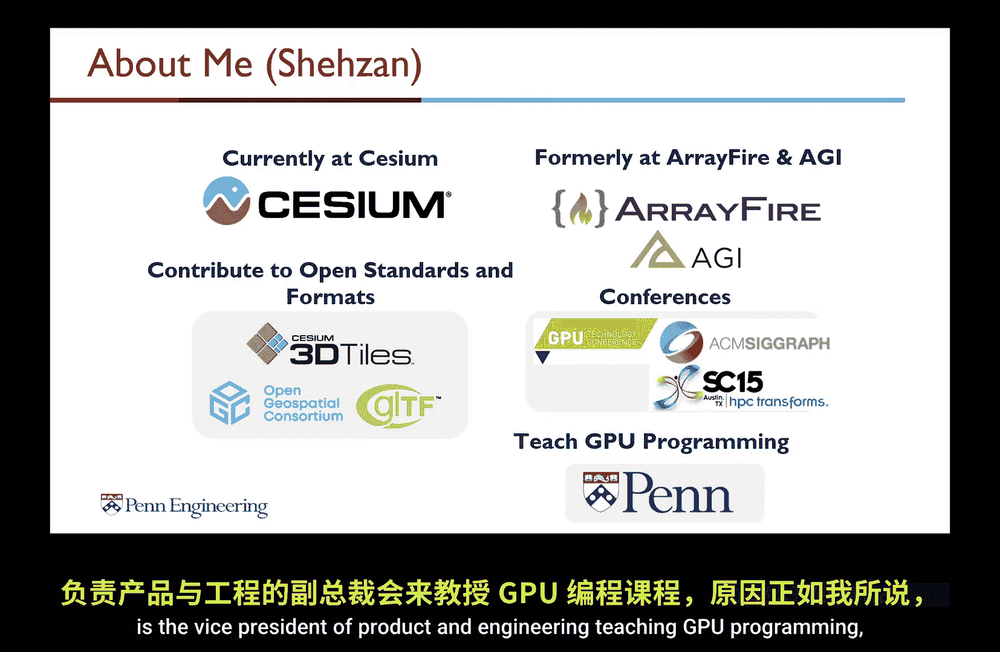

That's because like I said I was in your seats and then my first job was literally writing GPU programs so AFI is one of the best and still the best open source GPU libraries for QudDa OpenCL and other backends that does a lot of vector matrix linear GP solutions where you don't have to write the GPU programs all you do is call an API like a plus B and it all happens on the GPU I left afi at the end of 2016 and it's pretty crazy to think that I'm still the second highest contributor there I wish somebody overtook me but still there I'll keep that as a badge of Hoauna。

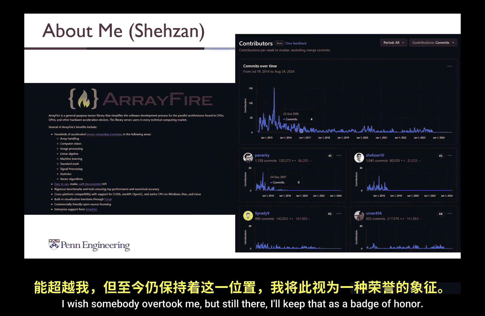

嗯。All right last thing I'm not a PhD I've been called a lot of different titles that I'm not honorable of so you can call me Shaazan if you feel like you need to give me a title Mr or Sir is perfectly fine Im not one for lofty titles so feel free to be more casual with me than maybe you have with other professors。

😊。

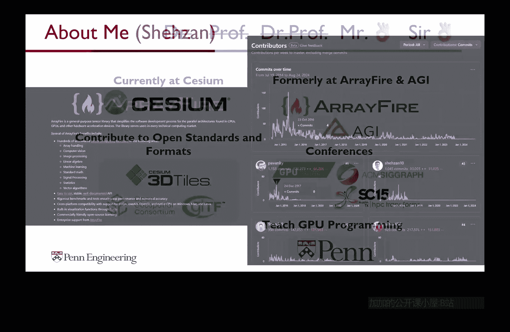

嗯。I'll introduce our TAs， we have a fantastic team of A+ TAs this year really proud of them and what they're going to be able to do we have Crystal in the back and Han as well so both of them interned at Samsung this past summer and then other T still at NviDdia he's wrapping up his internship in the next two weeks and he'll be joining us after that all of them did fantastic in last year's class and have really positive internships that they're going to be able to help you from the other thing that I'll say is all of them are working on either upgrading our old projects or adding new projects that are super exciting for this year so you guys will be both in a way receiving the latest and greatest projects but also a little bit of guinea pigs as well but we'll try to minimize any risk to you。

嗯。So that's about our Ts。And then。Very quickly， because this class is very collaborative。

 I want to ask a question of are there any students who looking around you don't see a former classmate。

 a former or current friend or anybody， just raise your hand so that you know other people can come say hi。

Rsite high so that other peopleaver can come say hi。All right。

 we have a few so you guys know who to go talk to during the break。

So most of the projects that we start with are individual。

 but they are going to be collaborated in a way where you'll be discussing problems and solutions together and then the final projects of course will be a lot more collaborative where we have teams of two or three working together。

All right let's get into the course logistics spoke about the website that's going to be our home I had a question earlier about if you're not using Canvas how are we doing it so course website remains a home I'd like to keep the course public should anybody outside want to use the resources I believe education should be you know available and accessible to everybody so all of our resources will be there。

All of our projects will be on GitHub， they' are all public。You are free to keep them public。

 which is what。I think 98% of students throughout my teaching time have done。

It's it's also great because most of you are going to be interviewing right either for full time roles。

 most of you for full time roles and then some of you for internships and one of the questions you'll get asked most frequently is hey。

 can we have a project example， a code example， a writing example？

The best thing is at the end of this class you'll have all of these you'll have five regular projects you'll have a final project all on GitHub and all you'll have to do is send a link and that also add credibility because they can see the history。

 they can see your work and that's been a real positive when you've seen students go from the class to industry that's something they always command was a really good part of the class anybody who's new to Gi。

Wow， so this is really interesting back when I was taking the class。

 everybody was new to it maybe there was one student who had learned it and this is back in 2012 right。

 and it's fantastic to see all of you already know it。

 we don't have to do like a tutorial on it or anything。

Our forum will be on Ed like I said if most of you should be subscribed already if you're not by today evening I'll go in and add the waitlisted students into there as well so you should have access to please use it for all of the discussions especially things that are helpful to other students that you think other students may run into please ask there if there's something you discussed in office hours one on one with our Ts or with me that you think will be helpful to to other students please go post it on there this is something that happens a lot in the industry right like when you work for a company that is all you're doing you're sharing information so that everybody is successful。

That's what I want to happen in this class is that all of you succeed later I'm sure I have a slide where I say I don't do Bel curves。

 your grade is your grade so you helping other students does not take away from your grade it's making sure that everybody is learning and participating in the class。

We also have a LinkedIn group for all the alumni so please add yourself to that it's an invitation base so if your request I'll add you to it。

 then you'll be able to connect to other alumni for jobs and interviews and other things。

Any questions so far？Okay。Lecture so we we have two lecture times one is Monday 515 to 815 and then we have another one on Wednesday where。

Officially， the cross registrar says it's 515 to 645 because it's a recitation because we need to。

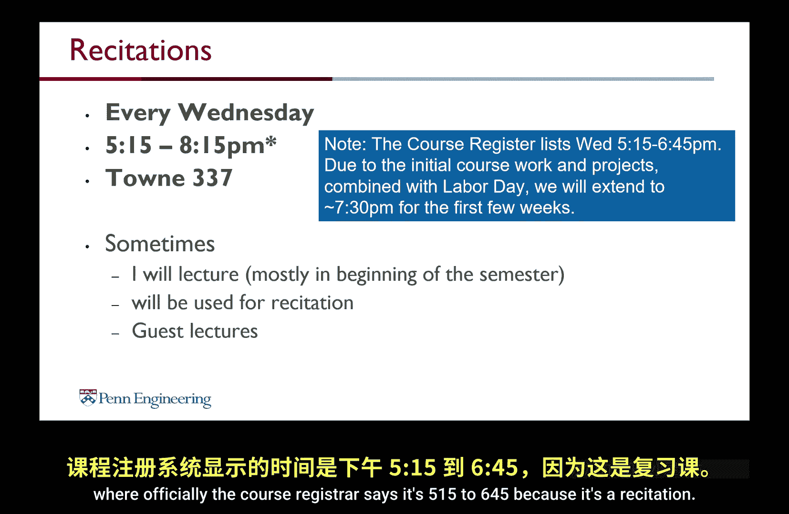