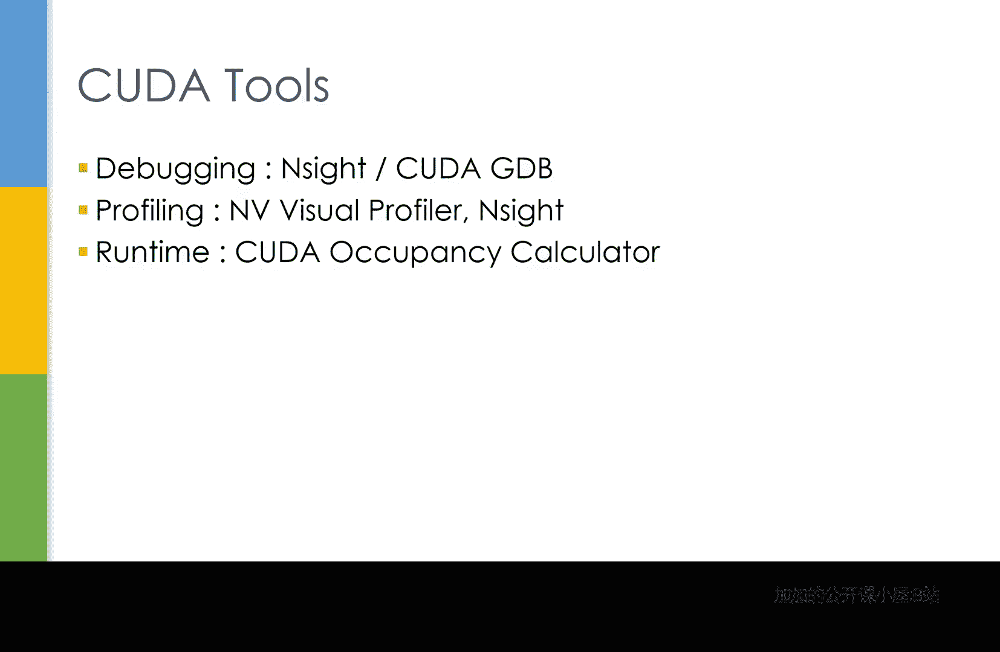
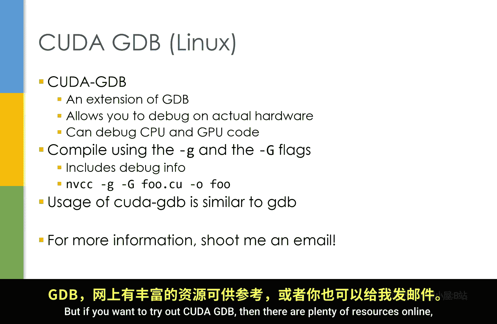
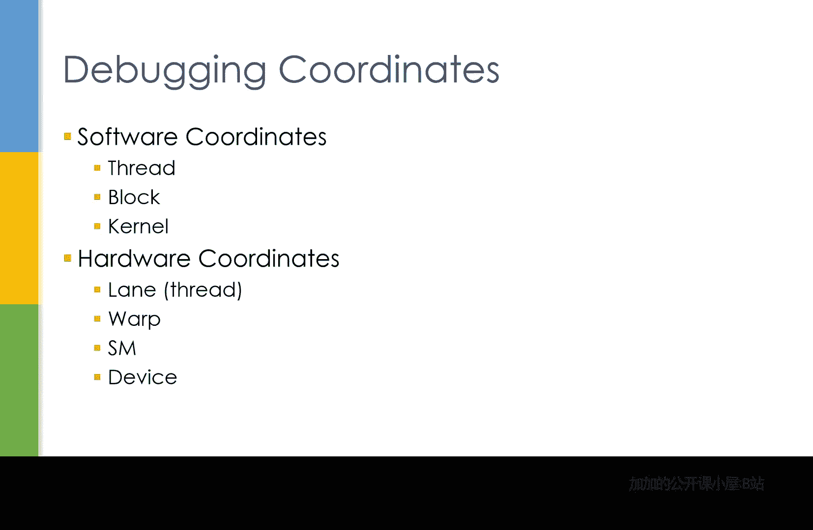
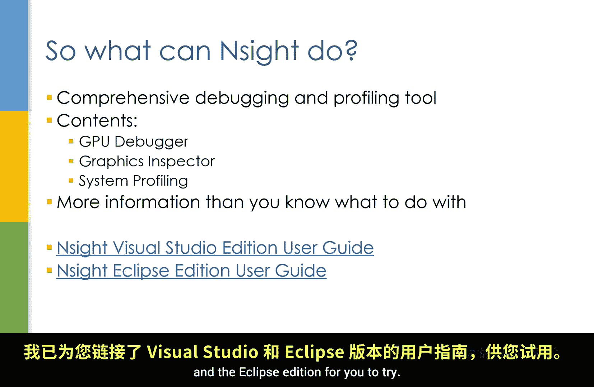
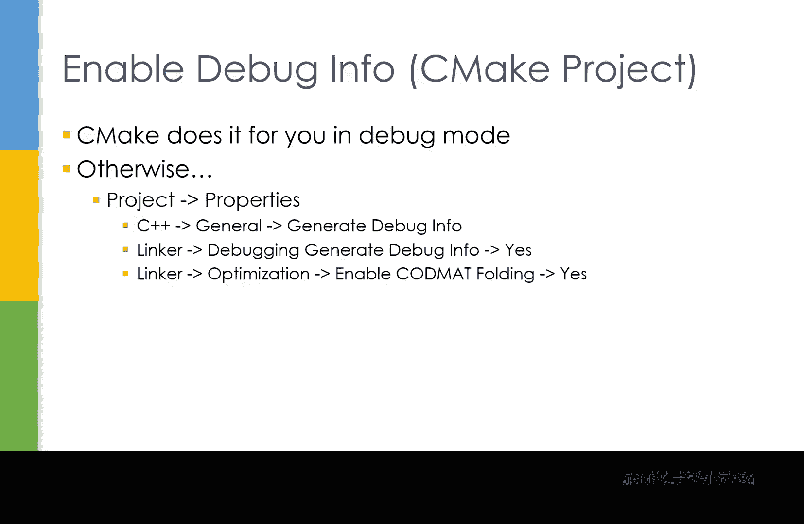
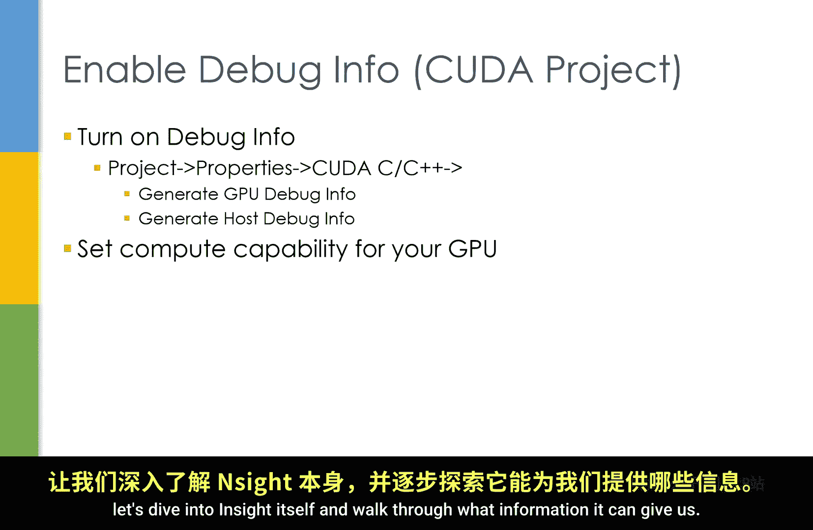
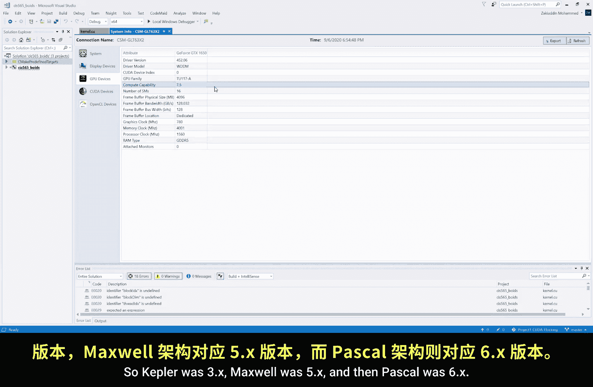

# 宾夕法尼亚大学【中英⚡GPU编程｜CIS5650 2024 GPU Programming】 p02 P2 CUDA Debugging Lab -BV1JeMnzFEWv_p2-

Welcome， if we went to this recorded session of the 565 coa debarking lab。

 we start with a few slides to give you an overall view of what Qa debarking looks like。

 and then we'll dive deep into showing what the visual studio insight can actually do。

So on today's list is talking a little bit about debugging tools on a very high level overview。

 part about the visual Studio a debugger a little bit to show you how the CPU side of debugging works and the insight debugger to show you what the Qa side of debuing looks like and how how to manage millions of threads running at the same time。

So with these tools you can do， you can figure out things like incorrect launch configuration。

 your thread increasess， block ins， you can figure out synchronization problems oromics and find where your problem lies and correct that。

So in practice， most of us probably follow this order of debugging as soon as something's not working。

 you probably add a see out or a printf and figure out what the values are where and this works but it doesn't scale for that having a proper debugger like the visual through be a debugger is much better because you get to walk through it in practice I always recommend that if you're writing any kind of algorithm it is always good to walk through the debugger to ensure that your algorithm is working as expected even if the output is you think is correct。

 make sure that you're walking through the debugger and evaluating each step。However。

 when it comes to GPU programming， visual should Studio your debugger doesn't cut it。

 although it can do multistared programming on the CPU side。

 it can do it can debug the kuda side of things because it needs access to those resources。

 that's where endight comes in， which allows you to debug the kuda side of programming along with profiling and other graphics tools。

So other debugging tools that exist on the whole side are the visual through your debuer。

 as we spoke about， GDP on Linux。On the device side， we have the Inight Pur Studio Ed。

 Insight Es edition， and QUDA GDP， which is essentially GDP， but for QUDA programming。

So this is something we'll discuss in class about which which debuing tools do we know and commonly use print F out S3。

 these are all programmable tools， so essentially you' are putting these in your code to get some sort of an output breakpoints。

 conditional breakpoints allow you to step through your code call stack shows you the function stack that you're using currently and autos local watches are windows visual Studio based windows that you can see what the variables are。

So on the Qa side， you can debug using Insight or Ka GDP to profile we have the N visual profile or NVVP for short with Insight modern tools now include In compute and inside systems to help you do deeper profiling and the QudD SDQ also provides an Excel spreadsheet called the Qa occupancy calculator where you can plug in things like how much memory you're using。

 how many registers you're using to figure out what the optimized occupancy calculators to get the launch configuration that would work best for your kernels。

So just。Going through a high level overview of Ka GDP， which is on Linux。

 because we won't dive deep into it in this recorded session。

 Ka GDP is an extension of standard GDP on Linux， which is a command line deep parking tool。

It allows you to debug code on actual GP。 So you're getting the value use read off the GPU itself。

 and it can debug both the CPU and GPU code。 So you don't have to switch between GDP and Ka GDP when you're trying to debug。

Set setting the compiled flags is easy。 You add the small G and the capital G flags to generate S debug info for both the CPU and GPU side。

And all the usage for Ker GDP is very similar to GDP itself in the sense of breakpoint shortcuts。

 walking through lines and jumping around。 So if you're used to GDP， Ker GDP could be a great tool。

I would always recommend using inside for kuda debugging， even on Linuxux。

 but if you awarded try out Ka GDP， then there are plenty of resources online or you could send me an email。

A few terms that you should know before we dive into insightsight are software coordinates and hardware coordinates thread blocks and kernels。

 you know authority we've gone through this in class on the hardware coordinates when you're debuing code。

 you're going to see these be used a lot more where a lane is。A lane where a thread is executed。

 So you're always gonna have a one to one match between lane and thread。

 Warp is a set of 32 threads that execute together， and many warps make up a block。

SM is one streaming multi process on a GPU， depending on what your GPus。

 you may have anywhere from 2 to 16 or more Ss on a device。 and of course， device is the GPU itself。

On a high level insightsight can do help with both debugging and profiling tools。

 it has a GPU debucker， a graphics inspector and system profiler and new tools also include Ins systems and Ins Ins Comp so feel free to try these out Ive linked to the user guides for both the Vi Studio and the Eclipse Ed for you to try。

So how do you set debug in for before you can actually use the inside debugggerers for all the class projects。

 we do this in Cic by adding the flags， otherwise if you're using your own projects。

 then these are some of the steps that you need to follow to enable the debug in for。

And follow these steps as well， where you're generating the debug info for both the host and GPU side and make sure to set the correct compute capability。

 because if you don't do this， you're not going to get the correct hardware codes back and you'll see bad information。

So with that， let's dive into andite itself and walk through what information it can give us。

So let's look at insight and what it can show us。 First。

 I have insight installed in my virtual studio 2017 edition。

 So I'm going to go in and go into Windows first and see system info。

 So let's walk through that first。When you open this。

 it's going to show you all the hardware information， so we start with the system tab on the left。

This is going to show you what hardware information is there for your laptop or desktop。

 so you can see the number of calls on your CPU， the total physical memory install so I have 32 G。

 it shows you hybrid graphics if that's available your Windows version and the inside versions。

The display devices tab shows you all the GPUs that are available。

 so in this case it showing me the Intel UHD graphics that I have built into my Intel CPU。

And then if you go into NVIDdia GPU devices， this is going to show you information about your specific GPU so I have a force GtX 1650 installed the driver I have installed as 452 which I believe is the latest driver model there are two driver models that NVDdia follows WDtM which stands for Windows display driver model and if you're using an NviDdia GPU for display。

 that's the model it's going have and the other one is TCC which stands for Tesla compute cluster So if you have GPUs that don't have displays or are using a remote GPU sometimes these GPU can go into the Tcc mode。

 which means they don't run graphics applications but can do computebased Quda applications。

The Kuda device index starts from zero and implementcrements for each individual Ka GPU you have。

 I have only one GPU， so that's going to remain zero。

The GPU family gives you information about the GPU's architecture。

 so my 1650 GP is a touring class architecture so and the architecture specific architecture in touring is 117 A。

 so if you have a pastal GPU is going to start with a P Kepler GPU is going to start with a K。

 Max GPUs will have Max architecture codes。This compute capability is important to note it defines the architecture once again。

 but in a way that the system can read， you can find this on the web as well what your compute capability is so Kepler was 3 point x Maxwell was 5 point x and the parcal was。

