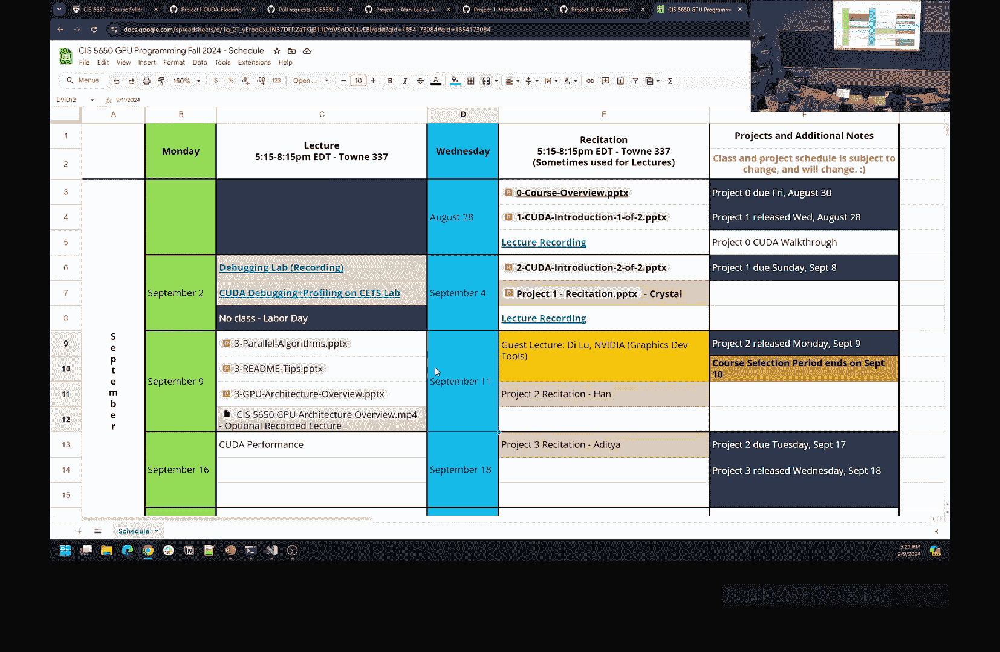
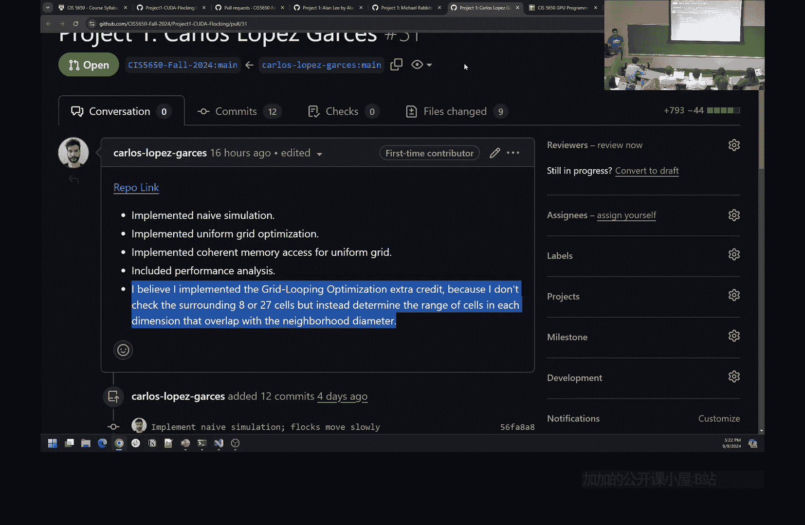
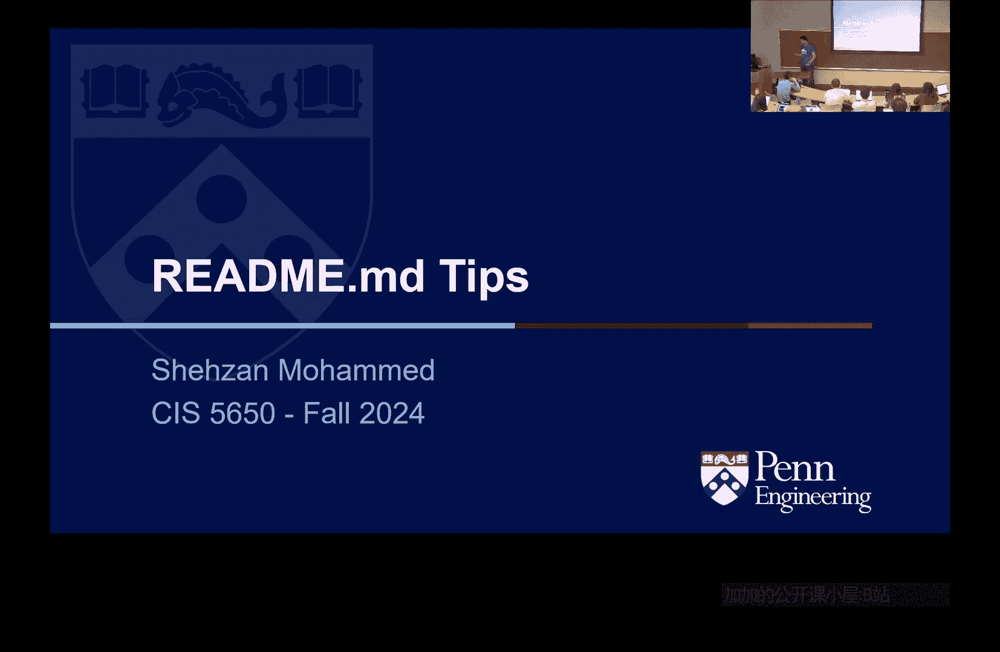
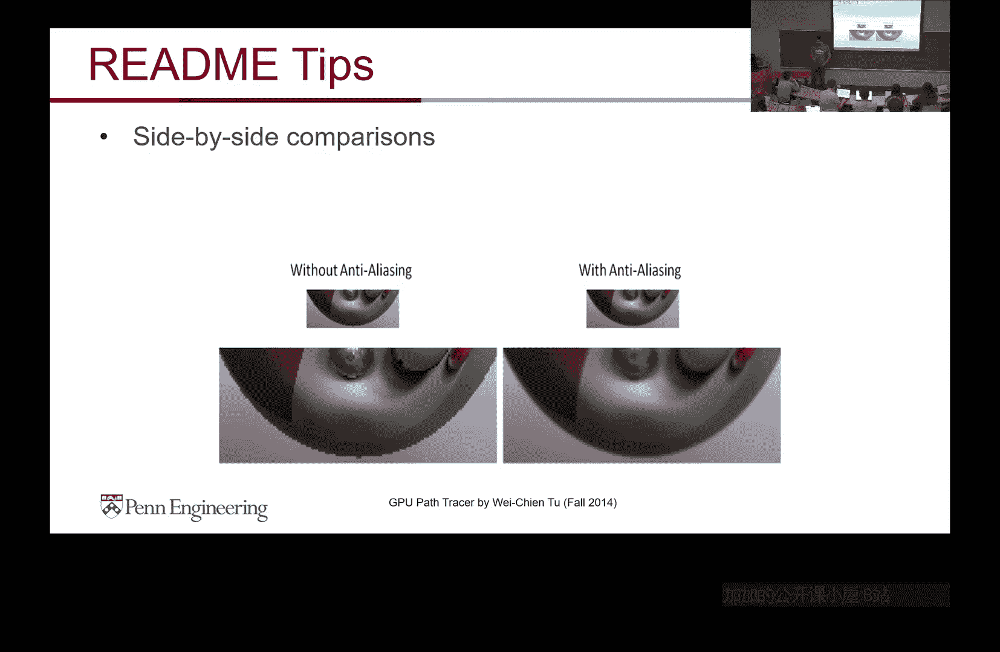

# 宾夕法尼亚大学【中英⚡GPU编程｜CIS5650 2024 GPU Programming】 p04 P4 2024-09-09 - Lecture 3 Parallel Algorithms -BV1JeMnzFEWv_p4-

Okay all right， so for recordings I'll start with the schedule so we are here on September 9th。

 so today we'll cover a couple of decks， we'll cover parallel algorithms and we'll cover the readme tips so that'll help just think about how you did your read me again no wrong answers it's more about how do you improve。

Normally before this lecture， I would do a GPU architecture overview on lecture。

 but this year what I've decided is that。It's great to have that but I don't need to do it as a full in class just so that I can teach new topics I web GPU and Vcan。

 so to make space for that we've made this a recorded lecture it's good for you to watch but it's not mandatory it's not going to affect any project it's more of a theoretical lecture on how GPUs are built essentially and I don't mean in how theyre manufactured I mean more in the sense of how did we come from the 90s where you had you Pentium core Intel CPUUs and video cards essentially not GPUs video cards。

to having very powerful GP is now how at the scale and stuff so that gives a little bit of understanding of why is the warp 32 of 32 threads you know why is single precision floating point faster than double precision floating point and so on so that's recorded from 2022 so feel free to watch that at any time。

嗯。Allright。Project 2 is out so its available for you to see here this does work with WSL for those of you who want to use it because it doesnt have a graphics output when I tested project 2 it worked so if you want to try it out using WSL and Kuda fine to do that。

Okay projectject one good good feedback from all of you so a bunch of pull requests open I'll just show a few pull requests that I thought were well written the descriptions doesn't mean others were bad I've just pulled out like three random ones that I thought were well written to just showcase how how you should be writing these first by Alan and I'll zoom in here you know it talks about the features completed and then some feedback which is always very helpful like I said。

嗯。Mike also highlighted the extra credit completed so that tells the TAs when they're grading and finally from Carlos。

 there's a note about doing extra credit but he wasn't entirely sure so again。

 good to communicate that to the TA so that when they are grading the projects。

 they know what to look at。I haven't looked at all the read mes。

 so Im not I don't have them pulled up maybe in the next class I'll pull up some good readms and also show you about those。

Any questions on this？

O。All right， so let's jump into。The treatment tips。

So this this is short deck and it's independent of GPU programming itself。

 it does obviously borrow a lot from GPU programming。

 but you can use this for any project that you're working on and really talks about。

And don't take this the wrong way， it talks about how to market your project。😡。

And I'll get to why in a little bit。So what？What does the read me do for a project。

 what does it actually try to communicate， what do you guys think？What should be in a good dream me？

Yeah。这于什么。And so， instruction of public。Use how you can pull the steps。不分能。Okay。

 summary of the project and how to build and run it Matt I have some background understand。

Whateverinology whatever the project background on technical terms， Paulina。好吧。

So how much of a great work you've done， Yeah， All， and， known issues and bugs， yeah。😊，要是。

License information very important here。😊，other things that should be in readby。demoA demo， yes。

All right， maybe one or two more。Yeah， in？Expected output is a good one yeah so so yeah all of you're right and sometimes you might think oh this might make my read me too long but there's different ways to break it out for example you may say most of the people who are seeing this re are not going to be nondevelopers or I'll put the build steps in a different file or vice versa you may say most most people who are seeing my report developers so I'll put the build step first so there's different ways to slice and dice that that you can think about based on your audience who's the audience for your 565 projects。

😊，Employers，Employs。What kind of employers and who among your employers？喂。

Anywhere from a hiring manager to an engineer。Okay， so somebody technical hiring。

Maybe one more kind of people among employers who's looking at your projects。其实。C's a company。

 but what kind of roles within companies are looking at your projects？对。HRs， yes。HRs。

 and so when you think of engineering managers versus technical leads versus engineers。And HRs。

 whats the common denominator？The common denominator is HR right among technical understanding and these are very technical projects。

 HR has the minimum understanding thats where you want to start。😊。

If the HR doesn't get your first paragraph he's going to quit how many resume is does an HR look at on a daily basis。

 maybe like tens if not hundred and they are spending a few minutes on every resume and they want to see how you stand out so the read me is a great way to make that happen。

😊。

Okay。So， the first thing you want to do。😊，Especially in your own cases is provide context for the project and maybe contact info that's why we have you fill out the top part of the readMe right with like your LinkedIn or website and stuff and then have a representative image。

 ideally the best image you've generated or a G if you want。

USo that way it really communicates what the project is about， what you've done and so on。

You can use screenshots or architecture diagrams to walk through the different features of the project。

And these are pretty much all screenshots from 565 project unless there's maybe one or two minor exceptions。

So what these kind of images do as well as。Other images that I'll show in future slides is communicate that this is an original authored work like sure it may be part of the class。

 but you've done it yourself， you understand how it works。

 you understand how each of these steps work。嗯。When you have images。

 especially when you think of people like HR。You show them a racist image。

 they may not know what all the features are。😮，Like maybe they work for a movie studio and they may get it。

 but most you know companies won't have an HR that understands the features of a rendered image。

 so highlight them。I'm showing you render dimensionmentia。

 I'm sure this applies to various other projects highlight and annotate things that are important。

Dbu screenshots are a great way to show that you understand the project and what you've done sure they may not look the prettiest。

 but it shows that you have a level of technical understanding of each of the steps and you've taken the time and thought process to evaluate it same goes for engineering managers like if I see debu screenshots for candidates I'm reviewing I love it。

It gives me an understanding that this person knows how to use a debugger。

 this person knows how to look at a problem， break it down and solve it。

 so that becomes really important。Side by side comparisons are really good。

 you know showcasing what you have improved， especially with things like extra credit or new features that make you stand apart from your classmates。

 side by side screenshots are a huge deal if you didn't have this and you just had this。

The HR would think it's pixelulated。Right？But you have to show it in a relative sense about what is the relative difference between the two so you may have absolute。

Master classes， but also showing the relative differences can get you a long way。

嗯。Bloopers， I mean have， yeah， there is a side on blooper， bloopers are always fun。Now you may think。

 oh， I'm trying to put my best foot forward， why am I showing bloopers？Again。Original authorship。

 the fact that you show a blooper means you faced a problem and you fixed it。

Right that is the message you want to send want you want to send the message that， hey。

 I understand it deeply tech。