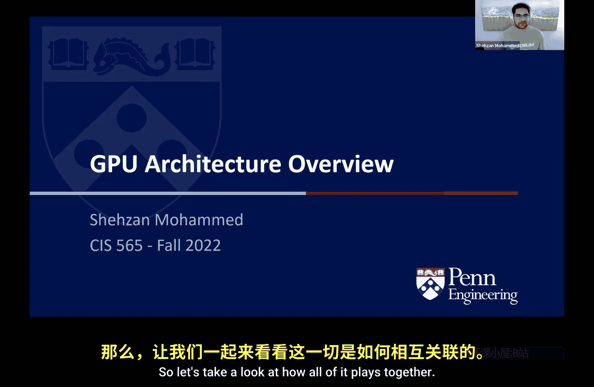
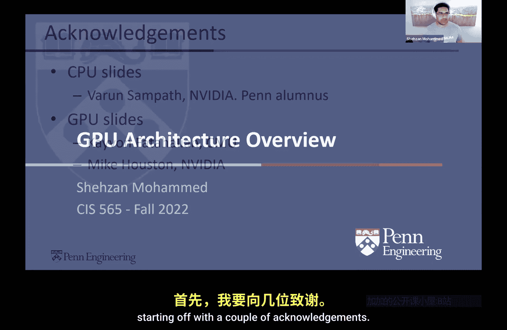
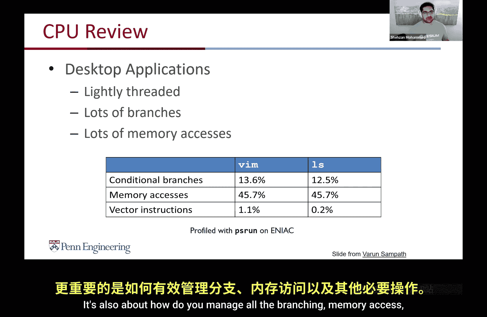

# 宾夕法尼亚大学【中英⚡GPU编程｜CIS5650 2024 GPU Programming】 p05 P5 (Optional) GPU Architecture Overview -BV1JeMnzFEWv_p5-

Hi everyone welcome to the class today unfortunately i'm not able to be there in person because I've had some emergency travel come up so what i'm going to do is I'm going to record this lecture and we'll watch it in the class you know the tea as well hosters。

The kind of the happy mistake here is that this lecture makes for a really good recording because it's very theoretical we don't necessarily discuss Quda and stuff in this lecture。

 what we're going to be doing is looking at the history of how CPUU architecture worked and how that has influenced how GPUs work and were kind of going to build our own CIS 565 GPU in this lecture。

So let's take a look at how all of it plays together。

Starting off with a couple of aments。

And then so。ThisThis wall of GPU history that was done at Microsoft I came across this。

 I believe on either Twitter or LinkedIn and it really showed how graphic standards have evolved to the left is everything in the 90s and what's in focus closest to the closest to the camera is GPUs in 2008 and you can see the 8400 GS from Android are kind of highlighted there。

And that's really where Kuda started。 That was one of the first Qa GPUs。 and of course。

 we've seen devolution since about how GPUs have grown。 So it kind gives you a sense of。

GPUs are not just modern technology， they've come a very。

 very long way and have been inspired from many generations of architecture and redesign。

So a couple of things to look at first， so GPUs and CPUs the performance。

 the compute performance at least is measured in what is known as flops。

 floating point operations per second。So this is。Essentially what you're measuring as。As。

The amount of multiplication and addition operations that you can do in the GPU。So。

So this is calculated using how many gigab flops that teraf flops we have at least today back in the day would have been megaflps therefore that probably we just flops or kiloofflps。

 so modern day GPUs certainly operate in the Terafflop range supercomputers operate in the petalflps if not the Xflps so one of Intel's big goals is to make an extraop extraop supercomputer so that's essentially10 to the power 18 gigap flops per second。

 which is absolutely incredible that would be like the amount of computer power at fingertips would be incredible。

So let's take a look at some modern hardware and how many teleflps they have so the slides are a couple of years older so you you may not see the most modern Intel NVDdia AMD hardware but it's still representative of how much of what the trends are essentially so an AMD rise in 93900 x was  one and halfterafflps and Intel line 9 199 100k which was top of the line CPU about two generations ago was 1。

22 teleflps。All right， and thenbody your GPU。Again， a couple of years old， and rxtp was 16。

3 to tariffflow that's almost 12 times10 to 12 times about what the intel and EMD cs are producing Again。

 remember that this is in terms of compute for performance if you take the。

Take the standard work that CPUs do in terms of running the operating system and stuff you're not going to be able to get that same performance。

 but if you do algorithms that are gly driven for parallel computing。

 then you're going to be able to maximize all the gigabs post on the CPU and the GPU。

 but you're going to see a bigger gain on the GPU。Similarly。

 this kind of scaling is happening on system Mon chip hardware as well， so whether it's the TeGRA。

 the Jetsons or the DriveVX that NVD is building， we are seeing the same kind of scaling happening where GPUs are able to provide a lot more compute performance。

While I don't have it in these slides， I'm pretty sure that's the same with Apple's arm architectures where they have the CPU and the GP on the same chip。

You're going to see the same numbers out in the same trends on there too。

So if we look at the way these trends are happening。

You can see that there's been an explosion since around 2008。

 2011 when GPUs really started taking off compared to the CPU。

 you can see how single precision and double precision performance for Intel CPUs are in the blue and then with Nviridia GPUs it's just keeping rising up of because the data here probably ends around 2016。

 but even then the trends have certainly continued to expand there。

And on the theoretical bandwidth side， you can still see how the bandwidth rate is increasing as well with CPUUs we are seeing DDR4 DDR5 kind of memories coming into play on the CPU side。

 but GPUs are already on DDR 5 DDR 5 high bandwidth you stacking multiple memory vertically and all of those things are giving GPUs really high bandwidth as well and with PCIE expanding so PCI4 is kind of standard now PCI5 we'd probably see in the next year or two and PCIE6 is essentially getting standardized as we speak so those are essentially with each generation are doubling the amount of bandwidth you get from copying data from CPUU to the GPU so what that means is if you had PCIE3 bus between the CPU and the GP。

いう？That would have given you somewhere around 16 gigabytes per second of overall bandwidth to copy your CPU data to the GPU。

Whereas with PCIE4， you essentially double that bandwidth， so now you can copy CPU to GPU faster。

Which means the overhead of using GPUs for improving your compute is becoming lower and lower every day。

So flops is。Great， but we also have to put it into context one of the main things that we have to think about is power and heat limits we can be especially in today's world we have to be conscious of how much energy we are using in terms of the hardware we run and what algorithms we are running on that hardware。

😊，Single core performance if you measure it has kind of been well the number is increasing it's kind of been slowing down given how power and heat limits are changing。

 you have an ultra ultra thin laptop that needss heat dissipation。

 you're probably getting a slower clock rate on your CPUU so just examples like that and then GPUs also we are starting to see how the die size or how big your chips are how much power they use what it costs。

 especially over the last couple of years has really changed the dynamic of what the cost benefit analysis of GPU performance also is。

The other thing to think about is how this works in mobile。

When you have a mobile phone and a battery installed。

 that's when performance per what becomes really important。

 where optimizing it for saving battery and doing proper compute and using it efficiently becomes really。

 really important。嗯。So let's take a look at what are the major components of a CPU more in theoretical terms。

 but essentially understanding how a CPU is divided。

 what are the considerations that go into making a CPUU。

 and this kind of gets into computer architecture class。

 but we try to keep it brief and at a high level， but essentially all leading into how GPUs are developed。

So in a lightly threaded desktop application， you know some of the most common ones are VIM。

 which is my favorite editor， LS is essentially the list of files commands in on Linux。

What you're going to see is a lot of these commands and operations are likely ted。

 they likely have a lot of branches and they access a lot of memory。

 so these are some numbers that were run by one sample back in the day about how how much memory access how many branches and how much actual compute these kind of commands are doing so if you look at this vector instructions which is kind of the instructions that GPUs are really good at is 1% or less than1% of the overall compute。

And that's really interesting because what that says is。

The job of running a command on the CPU is not necessarily always about。The highest performance。

 it's also about how do you manage all the branching， memory access and other things。

