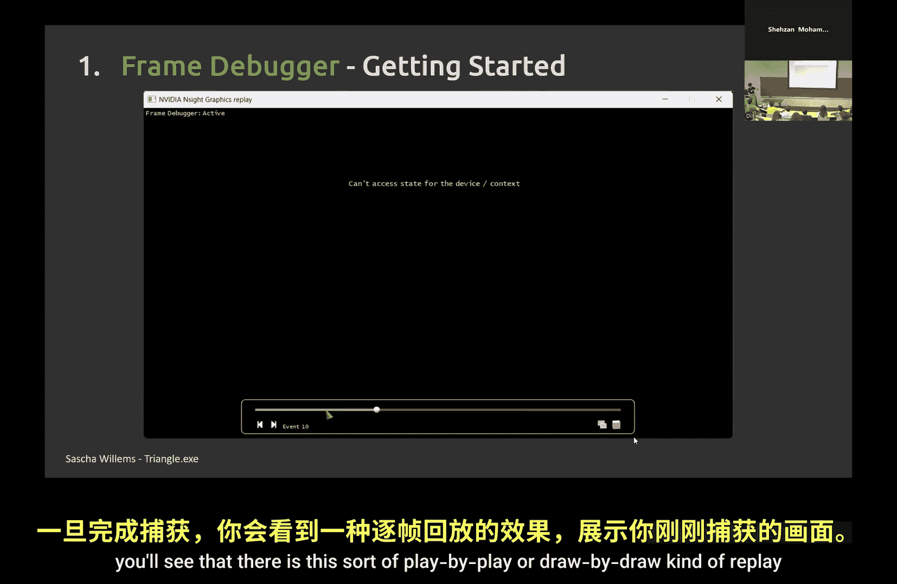
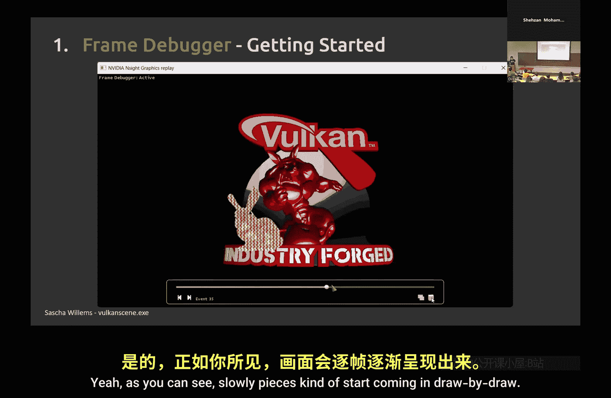
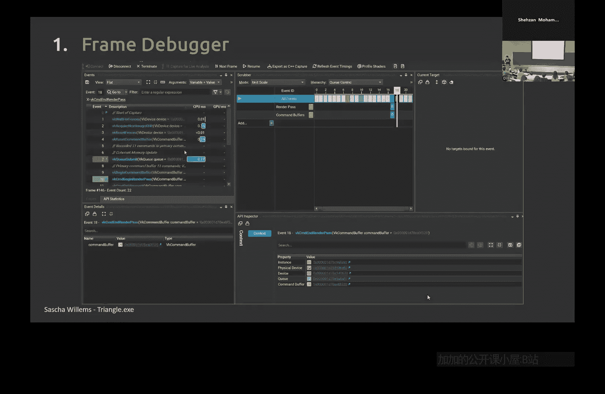
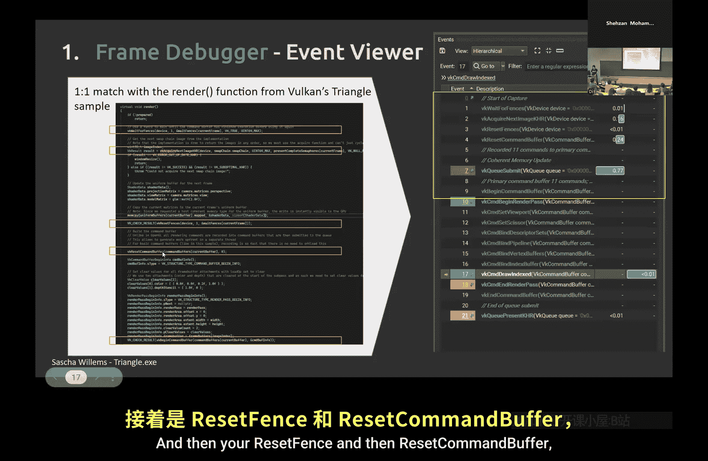

# 宾夕法尼亚大学【中英⚡GPU编程｜CIS5650 2024 GPU Programming】 p06 P6 2024-09-11 - Guest Lecture 1 NSight Graphics by Di Lu -BV1JeMnzFEWv_p6-

我事啊。ま。welcome is our first guest so just for context in the history of 565 more and bring the industry。

It's like the res I gave you last time so gas section are part of that then we were up for more than five years now so for all the guessbe very special one one of our ownD now and we here on the deaf team so we I in this classroom somewhere here usually two years ago and graduated in 2021 2022。

Undergrad， I will explain yes yeah， one of my best students worked on a pilot project that was about radar sensing。

And then join that video。 So really excited to have here。

 He's going to be talking to us about graphic he parking。

 So I showed a thing thing on regulara parking。What he's going to show is a lot about how graphics API are but。

 especially with a visual art for this not something pneumatic or very large data so how do we think that how being topid and stuff like that。

So you but I pleasure with you。All right， all right， hi everyone。

 some of you have probably met me at the sort of start of the event， start of the school year event。

 but most of you are new to me so hi and welcome and thank you for showing up。

So today's presentation will be on NVIDA Ins graphics and I will give you guys sort of a brief。

 well not so brief， it is one hour long total and sort of a lecture on what that is and how to use it and how to use it in your own profiling and debugging workflow。

So just a quick introduction of who I am， Professor Muhammad gave us like a really good overview of who I am。

 so my name is De and I graduated in DMD in May of 2022。

 and then I graduated from CGT the year after in 2023。

 so that means I took GPU actually in the fall of 2022 and currently I work for NVIDdia and I work on their graphicsDevelop tools team。

One of these fun facts is that during SG of this year， my team， my entire team had dinner with Dr。

 Lane and they all took a picture together that was very sweet。

 this is my coworker and this is my manager。Yeah。So first of all。

 we'll sort of talk about an overview of what I'm going to do today。

 so what is the motivation for this lecture in this class you will learn KUDA but in order to fully take advantage of the GPU you should really learn about its behaviors。

And so the overall discussion will go like this， I will talk a little bit about what En graphics is and how it fits into the sort of overall insightsight tools ecosystem and then we'll take a walkthrough of all of the UI and general features of how to use the two main features in NS graphics。

The first one is called freeing Debugger and the second one is called GPU tracece。

 my team specifically works on GPU trace， so that one will be the more like will be the bulk of today's presentation。

And then whereas the first section will mostly be like a walkthrough of the UI and in general how to use it。

So as some of you guys might know， InsSight is like you guys have probably heard of Insight in some capacity at this point in class Insight is basically the name we give to all of the tools the developer tools that we give to for so that coders can use them to basically better understand how their applications are performing and potentially also debug it so the three big ones right now are Insight systems Inight compute and In graphics。

 there is also like Insight visual Studio which are visual Studio extensions。

 but those are sort of like the starting point of how Insight used to be before kind of it really got off and became its own applications。

 but today we're mostly going to talk about Ins graphics which is a standalone application。

That you can use to profile graphics things。U so。EnSI systems is used to basically examine CPU workloads whereas EnSI compute is used to analyze coa kernels and EnI graphics like I was saying before is used in graphics and gains applications。

 so typically the workflow starts like this one would start with EnSI systems and then basically then they can figure out their CPUU Bo or GPU bound and then if you are GPU bound then you can choose for your particular use case to use EnSI compute or NI graphics。

For more detailed analysis。So Enographics has two main features well actually there's like three but the third one is is in beta mode so we're not going to talk about that today frame debugger on a very high level basically gives you a draw by drawaw pass over a single frame of your application it will allow you to check for rendering bugs and check resources in pipeline states on the GPU this can basically be really helpful when it comes to ensuring that you're using your graphics APIs properly。

And that you've done basically the right set stages for your pipeline， so for example。

 one such use case， let's say for example， you might say， oh。

 I want to use a compute shader to draw a checker pattern and then I will later on render this checker pattern to my screen。

Then you want to make sure did my compute shader actually work the way I thought it did。

 did it actually draw something that I can later read from。

 this would be a good place for you to check that。U。GPU trace， on the other hand。

 is a profiling tool， which basically means that you're using it to figure out how quickly things ran and what kinds of what the throughputs were on each of the hardware units and for your shaders also gives you like a per shader line performance information。

We'll talk about frameme debugger first and then we'll move on to GPU Trace。

For some of you guys who have used other similar tools such as like Microsoft Pics or rendernder Doc or Xcode。

 I know has some built-in tools and AMD also has their own profiling situation and even web graphics also has their own stuff。

 you probably recognize that most or some of them have these two features in sort of like an all in one situation but for N videoI we kind of like separated them into two separate applications。

So yeah， let's take a walkthrough of the frame debugger。

I'll show you some of the available functionalities。😊，So when you open up En graphics。

 the first thing you're going to see is basically the landing page right here。

 so to start a new session you'll just press the connect button。And then for each of these things。

 this is the window that's going to pop up。The connection is basically just telling you that you're allowed to also do remote debugging。

 but for most intents and purposes， the machine that you're using is the one that you're going to be launching the application from also this is where you basically paste in the path you application executable。

 your working directory any command line arguments are at my need。Then。

You'll see basically a list of the activities and from what I was mentioning before frame debugger is one of them and GPU trace is another one。

 so in this case we'll use frame debugger and you can also choose your per API settings or your general sort of how you want to make your capture and then once you're ready you can basically press along frame debugger and then this is what comes up。

Um， then once this pops up， that's your that's the application being launched。

 you can just press F11 when you're ready to make your captureer。Once you have a capture。

 you'll see that there's the sort of play by play or draw by draw kind of a replay of the frame that you just captured。

 sorry， a slightly more complicated example using the Vulcan scene。

Um， yeah， as you can see slowly the pieces kind of start coming in， draw by draw。

， So when things are popping up in this， is it like a new draw call each time， yeah。

Yeah， I will show you on the API list in a second。So the general basically the look of frame debugger is like this and we will go through basically。

 you'll see there's a lot of information， but we'll go through all of these little parts together。

Just for some general settings in the very top， disconnect basically stops the frame debugger where your program continues to run。

 terminate will just stop the program and stop the frame debugger session。

The next frame basically analyzes the next frame and then resume allows your application to resume so you can make another capture like manually。

You can also export your frame as a C++ capture so you can isolate it and step through by yourself。

And then we'll talk about profiling traders。At the end of this section and the end of the next section。

 it is a little involved。嗯。So the first thing you'll see is this event viewer。

 it's basically a list of the APIs that you've recorded to your command buffer as well as things related to setting up your command queue。

So。You can sort of use it to control and navigate your session。

 like if you click on one of these events， it's going to automatically highlight them in the other parts of the program。

And so it basically provides you a list of all commands in order of execution with respect to the frame。

Now here very difficult to see I understand， but I was hoping to show you basically a correspondence between what you expect to be writing in the code and what you can expect to see actually show up in the API list so for example in the Vulcan triangle sample in the render function the first thing you'll see is this like VK weight for fence which is at the very top right here and the VK acquire next image which is how we acquire the next render target that we want all of our command buffers to be drawing to and then。

Your reset fence and then reset command buffer which basically just cleans everything up submit any before you record any commands to it。

