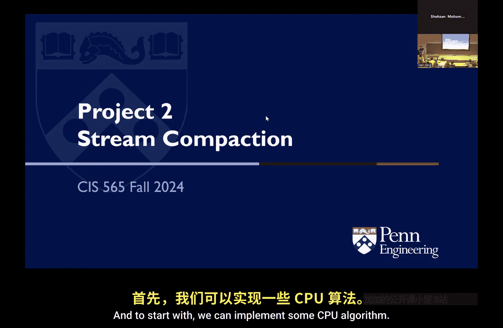
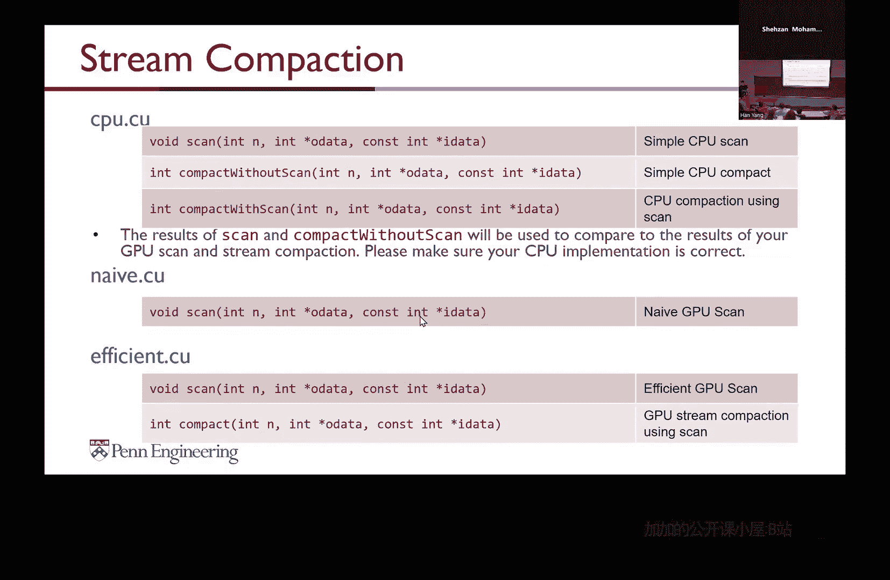

# 宾夕法尼亚大学【中英⚡GPU编程｜CIS5650 2024 GPU Programming】 p07 P7 2024-09-11 - Recitation-Project 2 -BV1JeMnzFEWv_p7-

Yeah。Hi， everyone， like this project too is going be pretty different from previous one because like previous one。

 you are not like doing。Actual like really useful computation you're just like showing some fancy results and to give you the confidence to programming codea。

 but for project to stream compaction， you are required to like implement some actual parallel algorithm。

😊，And to start with， we can implement some CPU algorithm。 So because you can sort of。

Get away with some kind of like。呃。Different kinds of problem you may encounter when you are writing Kuda。

 actually， So it is always a good practice if you are trying to implement some algorithm on GPU。

 But before that， you can always try to。Implement on the CPUs that's a great practice to do that and for the actual algorithm like Shazne already did the presentation on Monday that saved a lot of work for me so my like today's restit is going be like fairly short so you're going to implement the naive and efficient algorithm in the separate C files so your C files is going to be called by some test test files so there will be a CPU function in each of these naive and efficient C files。

And this CPU function will cause will be called by the task file so you can get the performance result。

And also the correctness of your program。And before I do you have any question for that， this page？

呃It' just。ImW alert， so。Compared to project one， which was you know random。

 this is very deterministic。 Now， that it was， but the output should always be an exactly the same result。

 So that's why doing the CPU implementation and getting it right， as that one says。

 is extremely important because it's going to compare those results。

 And if your CPU implementation strong。Then you want to if your GP implementation is carried around。

 So its important to spend some time to make sure the CP implementation located。Yeah。And after that。

 you can test s。Library for the scan and string compacttion algorithm， it is a fairly easy。

ingYou can just call the API。And。After all of this。

 you can also like try to implement some extra credits for using share memory。

 that's an optimization and also you can。After you implement your efficient。Scan with share memory。

 You can also try to use。You can also try to avoid bank conflicts in shared memory。

 which will be will I think bank conflict is a conflict that we'll be introduce in the next lecture。

Yeah， and。Here， like， we already provide some upper function for you inside a common。

Dot C and common dot age， which you can first implement first to look at those function signature and try to implement those function and you'll be like calling them a lot throughout your whole implementation。

And last， I think will be the performance timer。You can call the GPU or CPU timer inside your function calling。

And here we are using the SDD library to actually measure CPU time。And we are using Kutuda even。

 which is another very。Like useful concept for Kuda。

 so you can use this event to keep track of your Ka program。And some。Yeah。

 yeah somethingmark will be what time and So very。不常。Yeah， yeah。

 And some tips for implementation is to。When you are measuring time。

 be sure to exclude any memory operations such as like allocation or copy。

 so we only care about like the actual kernel running time。So， also。If you are finding， youre like。

Indential implementation is GPU implementation is slower than CPU。

 You might want to check your kernel dispatch where。You can check。

 is there like a lot of stresss are doing nothing so you can reduce the。

Number of stresss you're actually dispatching。Also， you can。

You can add like new files to the existing product， you can add like new Cs to this existing product。

 but currently our baseco doesn't support if youre trying to call one device function from another from another kernel inside another file。

That's not supported。 You can only call like。The same device the device function from the same file。

And。Also， the ka kernels are as synchronous。 So you might need to use a Ka device synchronize to。嗯。

To actually wait for you to finish so you can get a consistent result。

And you can use a lot of like code intrinsics， such as a Po， Po F， which is the。can。

Whichch is the internal function for KUa so you can get a more。Yeah。

 there's a floating point arrow so you can get away with it using the Kuda's internal power。

And that before like after all these tips， there is something I want to mention is that like。

After you actually implement like finish all all of your implementation。

 you can like take some time to really think about like these。Algorithm to actually compare the。

Scan and the reduction。So。I mean， you can you can like easily get lost inside the details of the implementation。

 but without like knowing like why this algorithm is designed， the way it is。

 so you can take your time to think of these questions after you have implemented this and you can have a like much。

 much more deeper understanding of it if you like really think about it。Yeah， I mean。

 don't just like focus on implementation。 And like， it is always good if you can like learn the。

Geneine idea behind parallel algorithm， if you like really。Trying to find white white。

This this algorithm is designed this way。And always test in release mode。

 this has already been mentioned by。By D， yeah。And yeah， that's it。

I will leave all the hard work to yours and good luck。What's。 are you going。Qu one。

 Bu kernels Areynchronous。That means like it is on the CPU like they'll be executing after。Yeah。

But our， but I think we are using the default stream。 The default stream will be。嚟。

SoSchronouschronousYeah。It is like it is especially true if you' are doing like GPU programming you always need to think about the synchronization between CPU and GPU。

嗯ん。好。嗯。I was going to。In part one。In by the instructions。The doing the compact with and。It says。

You will need a CPU scatter implementation for this。

I know that was。Those in particular， like a CPU。