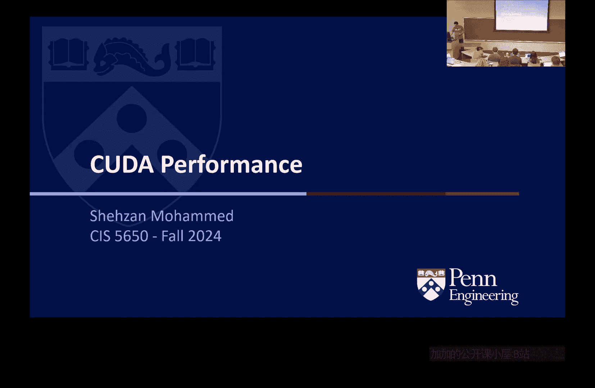
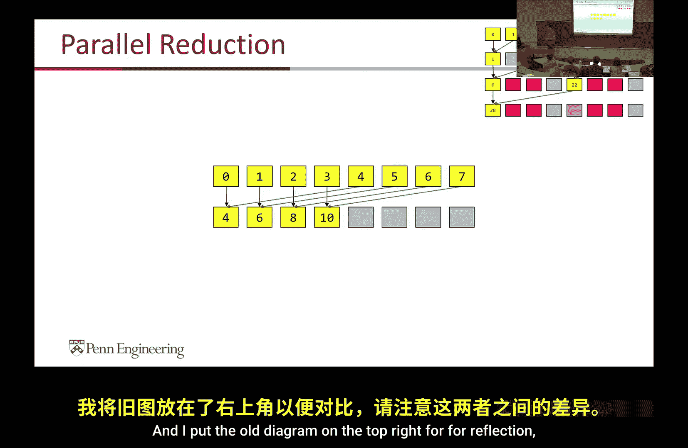

# 宾夕法尼亚大学【中英⚡GPU编程｜CIS5650 2024 GPU Programming】 p08 P8 2024-09-16 - Lecture 4 CUDA Performance -BV1JeMnzFEWv_p8-

All right， so in today's lecture we will start discussing more about performance。

 so we did intro to Kuda we did。Matrix edition SxBY matrixtrix multiplication and last week we took a look at some of the algorithms and how you take what are commonly CPU algorithms serial in most cases sequential and convert them into parallel algorithms and then add some performance right in this lecture we dive more into that performance side of things how do you take what is a9 algorithm and how do you make it faster by just thinking in a different way and thinking a lot more about memory and stuff I also caveat that usually I do coda performance in like two or two and a half lectures by calling the second part the performance lab a lot of the slides do overlap so it's like I cover them twice I'm going try a new thing this year where I may jump between those slide decks because I haven't combined them so。

Bear with me as I do that， I'll try to make the slides available as much as possible。Okay。So。

All right， so some slight acknowledgements。 So in this。

In this lecture we'll cover these kind of topics here we want to think about performance in different ways。

 we want to think about utilization which you know again if you think back to D's gear lecture there were these different vectors that De said you know we could opt our performance on so this is kind of like that maximizing utilization which is saturating the GPU and making sure that there's enough work for the GPU to do。

Maximizing memory throughput， which means optimizing the bandwidth and then maximizing instruction throughput。

 which is how do we make sure that we are essentially pipelining our instructions in a way that's optimized。

Just the basic equation of performance。If you have efficient data parallel algorithms and you combine that with an optimized GPU architecture that can add a super amount of parallelism。

 you maximize your performance。Our entire lecture is basically going to be this equation here。😊。

All right， so let's revisit parallel reductions。How many of you remember this from last lecture？

Okay not going to do a quiz， but let's let's take a look so here's here's what we did last time we had a vector here eight elements for the sake of slides but could be a lot more。

And we added two elements， then added two elements。And then added two more elements。

 right and this gave the reduction。What were some of the properties of this？

What are some things you can notice in this diagram that you can immediately call out as potentially characteristics of the algorithm or maybe even performance problems of the algorithm？

I。It's in place here， which can be good or bad depending on your workflow。在楼劳公。Yeah， exactly， look。

 this last thing， seven threads aren't doing anything。😊。

Nick you have to have like login like layers so it'll be like sync thread or your implicationss。

Other other things you notice。Number of elements is power of2 and we discussed that in the last classes for this algorithm to work。

 you always need to pad your vectors。other properties of this。Okay。嗯。

One of the other things you'll see is。The indexing pattern， right。

We are always adding to the right and the last element is where the result gets stored。Right。

What if V？Flipus。Sorry， that was dramatic。What have we flipped this？Again。

 no change in the algorithm， it's not going to change performance at all。😡。

But what it is going to do is it will build up to some of the performance improvements we want to make so again this is this is a thing you youll have to think about is that mirroring pattern as well。

So here's our algorithm， okay。😊，And here's what our equation for that will look like and this is you know within a block so we have our shared memory。

 we have our stride， we have the sync thread as you get called out and then we have this equation here so again if you look at the diagram。

Look at the look at the mods here or the indices，0，2，4，6。040 right much much easier to index。

 even if you have padding or not or powers of 2 or not， this is much easier to index。

So that's what we have here is this T， which is the index。

More two times stride equal this equal zero is bad programming。

 but I want to make it explicit here like you never have if you are writing double equals zero just don't。

😊，And this goes beyond GPU programming just don't write this part， and then you can do the sum here。

 which kind of gets you this diagram。Any questions about this？So I'll walk through here once again。

 compute partial sum， we have the stride and then the stride sync threads I think we already discussed why and then we have this so there's a question down here as stride increases what do more threads do and that was answered before that more threads don't do anything。

But let me take any other questions on this before we move on。Everybody understand。Okay， all right。

 so here's， here's a pattern of。How many threads are not doing work。

 so this is eight threads right or eight elements with eight threads。In the first iteration。

Already four threads I'm not doing anything。You have eight elements。You launch with eight threads。

And already in the first step， four threads are not doing anything。They may have read the memory。

 but they are not doing anything more。So。You really need only n by two threads for n elements。

 so that's the first optimization you want to make。In the next iteration， only threads2 and are。Now。

 in addition to 13，57，2 and6 are also not doing anything， so now you're done to 25% utilization。

You launch rate threads， now only two are doing actual work。In the final verse。

 only one thread is doing actual work， seven threads are not doing anything。

So this is pretty bad utilization of your GPU。It may still be way faster than the CPU。

 but it's pretty bad utilization and we can improve that。

So the pattern that we are noticing here is that at each iteration at each log and depth we only we are having the number of threads we use right so and this is something we want to optimize。

So。How can we tweak this implementation， what do you guys think。

 so I'll pull back here what are things we can do in this implementation to make it better？

But each to do more work。On the first iteration you。Yeah。Yeah。

 and we'll take a look later later in the slides。So I don't know if this will actually help we could but instead of saying like if equals zero do thing。

 we can just say if not equals zero return and just like stop doing computation you mean you mean for these threads。

 potentially yeah。And then you would need to get the shared memory。

So we'll get to that you'll see how next idea makes sense in a little bit。Ass it yet。

 didn you have an idea no？Any other ideas for this？Does this indexing make sense？嗯。

We might be able to like have things be like more local because like。

What do you mean by that as you go down the tree just like you have to reach further into Yeah。

 so how would how would you change this diagram？Like。

I guess possibly have a reshuffle step like at occasional intervals what is a simpler version of that idea？

嗯。I guess we can we can write to we can make it to that instead of writing to just like the cell below you just write like to sell divided by two like below you so instead of writing five here write it like on thread one on the thread one yeah。

 you're right。In this algorithm。😊，There's actually no requirement that you add neighbors。😮。

You could add any two numbers here as long as theyre in some reasonable pattern。

 you could add any any two numbers there。So let's look at a tweaked implementation， so we have again。

 our vector of eight。😊，In the next step you will do this and I put the old diagram on the top right for your for reflection。

Notice how these two are different。