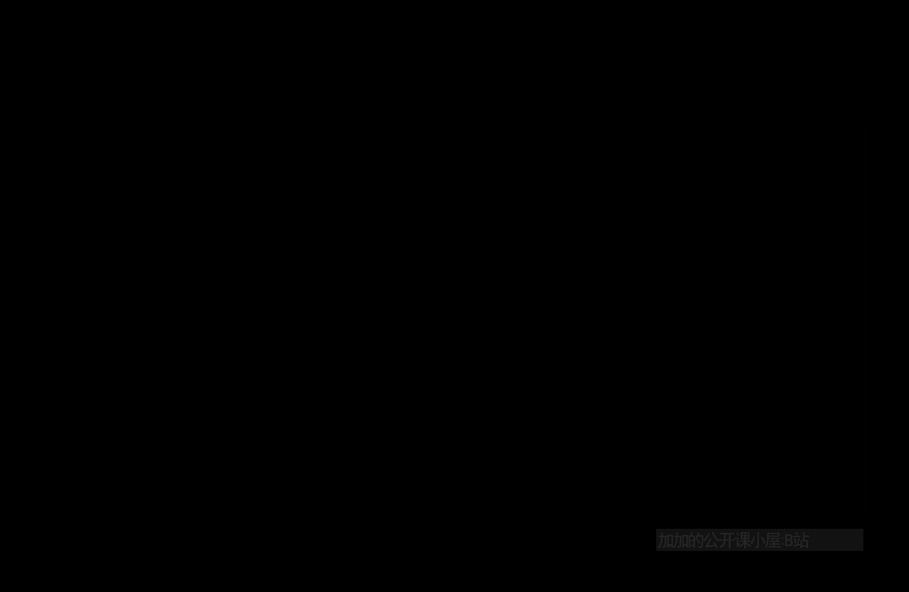
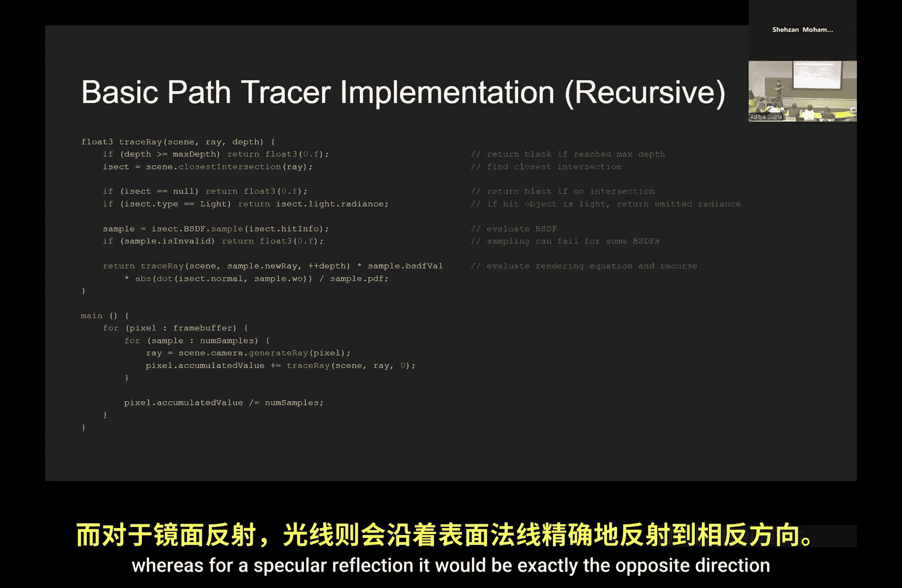

# 宾夕法尼亚大学【中英⚡GPU编程｜CIS5650 2024 GPU Programming】 p09 P9 2024-09-18 - Recitation-Project3 -BV1JeMnzFEWv_p9-

Okay。All right， hello everybody， I'm Aditia hello， yes， very good， I'm Aditia。

 some of you may know me， some of you may not， doesn't matter。

 I'm going to be doing the project dereciitation today for the Kuta path tracer。😊。

So let's just get right into it。I this that。there we go okay so agenda for today first we'll start with path tracing basics I know a lot of you may have already taken 461 so this will mostly review but it's always good to go over the basics once again we'll talk about GPU implementation specifically including general considerations and then a project based code tour we will do extra features these are extra credit things which are required up to a certain point including physically based materials。

 acceleration structures， denoising etc and then we'll have a gallery at the end of past student work that you might be inspired by。

So first， path tracing basics， what the heck is path tracing。 Well， in the real world。

 light comes from。Light sources such as the lamps in this room or the sun in the sky or whatever。

 and then it bounces around all sorts of walls and materials and things until it eventually reaches your eye or a camera and the color of the light is determined by what it hits and what it scatters through and all sorts of things。

However， we do this in reverse in path tra because if we simulated every single path of light that came out of the light。

 then a very small fraction then would even hit the camera in the first place。

 so we' be wasting a lot of power for no reason， instead we shoot rays from the camera itself。

We bounce them around the scene， like in the bottom right。

 you can see it's bouncing on like a chromroe teapot or a glass teapot or like the walls or some cloud in the sky。

And then they hit light sources， and that's how we can determine the final color of each pixel in our scene。

So light transport is calculated using our favoriteed equation， the rendering equation。

 a lot of you have probably already seen this before。

 a lot of terms in here so we'll go through each one of them briefly LO is the outgoing raddiance in the direction omega O this is just like the color of the light and the intensity of the light in that direction。

😊，LE is the emitted radiant， generally this is zero for normal materials， but for like lights。

 for example， it'll be greater than zero because they are emiting light all the time。

There is the integral over the hemisphere aligned to the surface normal。

 the surface normal is just perpendicular to the surface。

 so on this table it would be like a hemisphere that is just pointed straight up。

Then there is the incoming radance on the direction omega I。

And the bidirectional scattering distribution function， BSDF， which is。

 we'll go over this in the next slide， but it's dependent on the input and the output direction and it determines the way that the light's color changes as it bounces。

That's here。D yeah， yeah， yeah， yeah。Because all these directions are also like unit vectors do so because we're integrating over incoming directions and they're all just unit directions yeah。

And then Co datata term accounts for the fact that surfaces receive less light at glancing angles。

 And this is called Lambert's cosine law。Yeah okay so what the heck is a BSDF well it defines how light reflects off of or transmits through a surface it takes in the incoming direction and the outgoing direction so it's dependent on both directions and it usually also depends on the surface normal everything this world can be modeled using a BSDF just matters how complex it is we'll go over some examples of these in a bit later with light as well。

The terminology is not super well defined， so you might hear that the word BSDF is often used to refer to any be something DF。

 whether it be BRDF or reflection off of the surface or BTDF for transmission through a surface like glass or something。

 so just keep that in mind when you hear the word BSDF。Here's an example of one。

 this is a diffuse material probably the most common example。

 essentially it reflects uniformly in all directions。

 but the cosline term still applies so you can see at the top right that as it reflects at more glancing angles there's less light being reflected。

Examples include unfinished wood or like concrete or chalk。

And then there's some examples down here of。Just diffuse materials， even this is a diffuse material。

 but maybe some other stuff on it。Then we have specular reflection。

 this is probably the simplest one， it's just a mirror。

 it bounces the ray exactly in the opposite direction that came in or like reflected around the surface normal。

 so this is just just a mirror， very， very nice。And you can also have a color that tints the ray so you could have like a blue mirror that makes every incoming ray tinted blue as it bounces out。

This is often used in conjunction with a refraction BTDF。

 so this one is now transmitting through the material what this does is that as it transmits through the material it will change direction depending on the index of refraction。

 which is an innate property of materials。It's calculated using Snell's law。

 it's a relatively simple law， you can click the link to find out more。

It can be combined with spec reflection， like I said。

 to make glass like materials such as the example at the bottom right from my path tracer from last year。

 very simple glass ball in a cornnell box。Accurate implementation of this has to consider finall effects。

 which essentially means that the light transmitted and reflected depends on the angle of incidences。

And you can look this up again in like PBt or any resource that's out there。But of course。

 computationally integrating over every single path。

 even if it's coming from the camera first is impossible because there's infinitely many such paths。

 so we need some way of estimating the final value and the way we do that is we use Monte Carlo estimation。

 which involves taking a large amount of samples and then averaging them。

This is a little nice little function that kind of explains it F of x is the function to be integrated in this case。

 n is the number of samples you're taking。X1 through xn are the samples themselves。

And P of X is a probability distribution from which these samples are drawn。

And as you take more of these samples， the estimator value will approach the actual true integral value。

And fun fact， this is named after the Monte Carlo Caino in Monaco where I won 13 euros in the spring。

 very， very nice place， you have a chance go check it out， it's very fancy。

I think it was like the creators like uncle was a big gambler。

 and so he like named it after him or something I don't remember exactly。

 but there's like a funny story behind it。Yeah， partially the way to think about it is in a casino。

 it's all about a game of chance at random so that's what you're do says。

Add think so much randomness that。Instead so of creating infinite number of vectors through hemisphere。

 your samples become a representation hub。You know what they say the house always wins。Okay。

 one last thing for path tra basics is stochastic sample antialliasing since we're using Monte Carlo estimation antialliaing is basically free for path tra。

 all you have to do is randomly jitter the ray direction within a pixel and over time as you average out the various samples you'll get antialliasing for free you can see at the diagram there。

 if we shoot one if we shoot only one ray it'll always hit this part no matter what and you'll get jagged edges。

 but if we shoot a whole bunch of rays eventually they'll average out to like a more smooth version。

So that's all well and good， all that considered here is a basic recursive， yeah。Yes。So further out。

 the rates tend be lower， I guess。You shouldn't like it like if you look you on the right。

 you could those rains get further apart as they spread out。

It completely potentially that's an object or something。他会过的。basicallysically， I mean， yeah。

 race you you have your entire picture shooting and then within each pixel you're subdividing that area so you're essentially randomizing。

The word is not discrete right， the word is not discrete as pixels and a pixel is not as discrete as its center。

So you want to create as much distribution as possible。

And it's good that a array in the bottom left may be a different。

 slightly different than the ray in the bottom right。

 and that's what creates thatius and the smoothness。

If you wanted like more sampling density within a certain object， you could like zoom in。

 like change your camera's focal length， there's like a real camera would be。

 but the averaging is more just for like avoiding jagged edges and smoothing out the image so it looks more like a real image。

Oh， any other questions？Okay， so here is a basic pseudocode for a recursive implementation of path tracing we have this trace ray function which is our recursive function。

 if we've reached the maximum depth we just return black because we're not going to trace anymore after that。

Otherwise， we find the closest intersection in the scene。And if we hit nothing。

 then we return zero again because we haven't did anything。

 you might include like an environment light or like some kind of dome light in which case to be different。

 but for now we'll just say a zero。If we've hit a light， then we want to return the light radiance。

 this is the L term in the rendering equation。Otherwise。

 we sample the BSDF of the material that we've hit and what this does is it gives us the like throughput of the BSDF so in the case of the blackboard it'd be like mostly black。

 or in the case of this table it'd be mostly brown and it also creates a new ray direction depending on the BSDF so for Lambert it would be like uniformly distributed around the hemisphere。

 whereas for like a specular reflection it would be exactly the opposite direction once you've reflected it across the surface normal。

And lastly， we just。