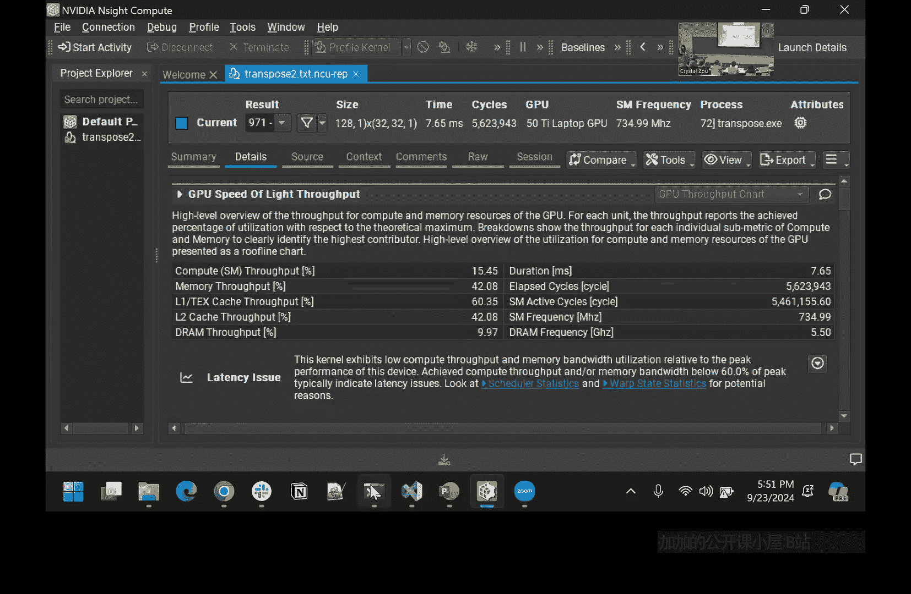
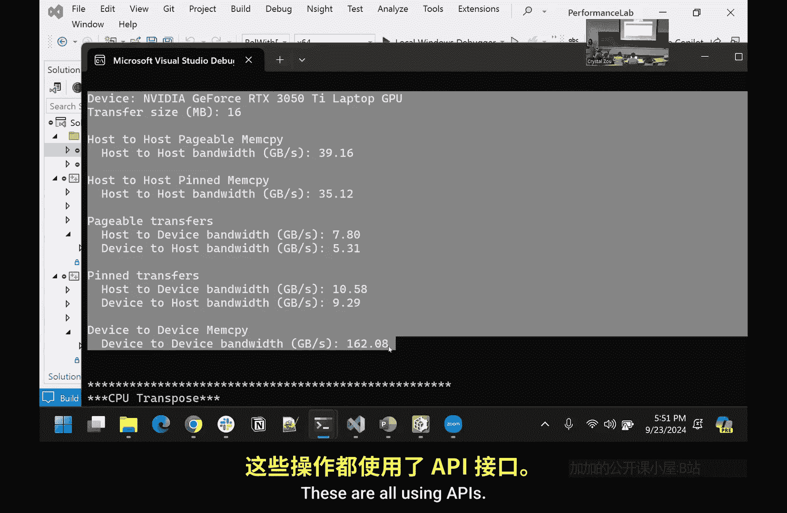

# 宾夕法尼亚大学【中英⚡GPU编程｜CIS5650 2024 GPU Programming】 p10 P10 2024-09-23 - Lecture 5 CUDA Performance Lab -BV1JeMnzFEWv_p10-

Or from the。

嗯哼哼。😊，Okay good so what can we infer from the difference between the L1 to L2 memory transfer size and L2 to device memory is that just some things is there there's some things that are cached in L1 that we don't need to go to L2 for？

Probably， that would be my guess because you may have situations where。嗯。

And I think it's more on the right side than the read side because the read side is generally optimized right side is randomizing because that's where we are changing our index。

What may happen is that something may have been cashd from an earlier war and may not may have been a cash hit rather than a cash miss。

Okay， so even though it says hit rate 0。00% on on cash。

 maybe there is and hit that okay so so what you're likely seeing is on L1 because the hit rate is zero because you're never reusing memory you're reading from A and writing to B so there's no reuse whatsoever。

Whereas for L2， you the it may have。Chaff some memory through， you know。

 what's the term I'm forgetting。 Prefeing and stuff。 So that's where you may have a head rate。O。

Any other questions？I think， no question。Okay， the other thing I'll share here is that you know you want to whenever you're profiling you want to run the kernel multiple times。

 so I'm going to jump to let's say the middle kernel which is five out of 10 runs and you want to check for that profile as well just in case there are any any differences in that。

Okay。嗯唔。The other， so if we go back up， it said check schedule statistics and war statistics。

 so let's look at schedule statistics first。And here what we are seeing is。

We've launched active ws for active active ws per schedule is 6。67。 And you can， if you highlighted。

 you can go through all of the。Actual details here。 and no eligible percentage。

 So this is really important here。 So no eligible percentage means how many times was the scheduler waiting for a war。

And no what was available。Remember when we said， hey。

 you want to have as many wars as possible to be able to take advantage of all the parallelism。

Because。A copy kernelel is so。Compute unintensive， there are no eligible board。

 even though we have like 4096 by 4096 matrix size， which is 16 million elements。

 there are no eligible war when the scheduler wants them 70% of the time。And one or more eligible。

 about 30% of the time。So that that's something you want to pay attention to when you're doing your kernel and as we go through optimizing transports。

 we'll see how that makes a difference。And then there are a few charts down here about the state of the scheduler most of the time。

 and again you can highlight these to read what they mean and get the details in that。

B see statistics is important because they will tell you。

What was happening during the life of the war， and I don't mean just the compute life。

 I mean even the weight light of the war okay？嗯。So。

One of the key things I want to show you here is by expanding this。Here， so again。

 in the copy kernel， the main operation that's happening is。

A cop is global memory read and right and as you can see， majority yeah very solid。

Just wondering how you're getting all of those statistics on your details。

So I just hit the arrow button here on the left。Is that what your question was？

W I think you have to run the full analysis then when you start the thing you have to the details have。

Mster。Yes， so if I， if I go to。New activity。T that's。 And if you go to metrics。

Now my windows are too small， but as you scroll down here youll see full and that's what you want to run。

Any other questions before I jump into Wp state statistics？Okay， so。

What I want to show you here is that because we are doing a copy kernel which where the main operation is globally memory read and write。

 the main thing that's happening in the warp is stalls right and that's kind of expected is that the stall takes so much time compared to everything else and there are different cohort boards and stuff here again you can highlight each one of them to take a look。

About what they mean but as expected most of the time during the life of the kernel all we are doing is waiting for global memory reads and writes and that's what this this summary tells us here as well on average each warp of this kernel spends 13。

7 circle in cycles being stall waiting for fixed latency execution dependency fixed latency execution dependency in this case is a global memory read or right so so again very obviously telling us or shouting at us to be like hey go fix your latency issue is add more compute or optimize it further。

All right， so。That's that there's a bunch more statistics here tell you all the launch statistics so we had grid size of 16。

000 blocks there is a question。Okay。On my machine looking at the warp state statistics。

 my stall long scoreboard is like eight times longer than stall weight and I was like wondering I'm also running the solution branch is there a reason like that might be。

So I have used the scoreboard too much。 but of course， which GP you run on changes quite a bit。

 I think I have a。30， 50 TR or something on my laptop。

 so I'm trying to see if this pop up is moving way too quickly for me to read。Sorry。

 let me when I zoom out， let me take a look at that and see， but ultimately。

What you want to take away from this is that。We're not necessarily doing something bad in the copy kernel。

The use of the copy kernel is as a reference to say what the transpose kernel should look like。

 right？So。So that's what I'm trying to set as a reference here。

 So's not about whether something is bad or not。 So even if there's a lot of stall weight。

 it is just expected stall weight。 like there's nothing we can do to。Optims that copy further。

We could if we have shared memory， all we are doing is adding an intermediate step between a global memory reader write without actually using the shared memory at all。

 so use the copy kernel as a reference， but I will come back to this scoreboard once I can read it a little bit。

Any other questions？I think no other questions。So looking at the other details here。

 so loan statistics are pretty good because itll tell you how many blocks and wars and how many registers per thread you have。

And then it'll also tell you occupancy based on your GPU and what you're running and some。

Probably suggestions of what you can use。嗯。The other thing you'll see is in the GPU and ME workload again for a copy kernel you're going to see that there's going to be a lot more weighting and a lot more global ME deed than compute cycles。

 so that's what we have here。All right， so now we've done copypyCon using this as a reference， right？

I'm going to select。A matrix transport 9。 Now， when we get matrix transport 9。By a name。

 we know it's the nightmare of doing。trans kernel， so now let's see how the inside computer tells us not or what is it complaining about okay？

So starting with the GP speed of life through foot。

 I mean it's what it's saying is the kernel exhibits low compute copy。

 but that's what it said even in the copy kernel so we know that there isn't enough work actually happening in each kernel totally fine no problem。

 but let's dig in a little bit deeper。

嗯。And so let me do this before I show you that further。W to drum。This is from Bill Studio。

To get some numbers。Okay， so。First I run some benchmarks， these are all using APIs。

 so first we have pageable。

