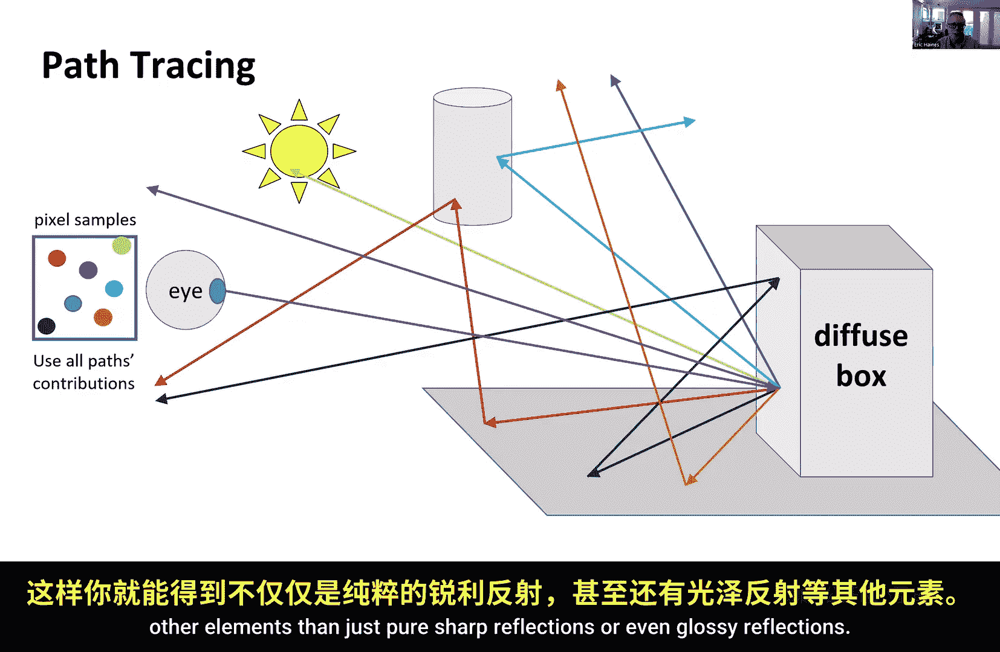

# 宾夕法尼亚大学【中英⚡GPU编程｜CIS5650 2024 GPU Programming】 p11 P11 2024-09-30 - Guest Lecture 2 Ray Tracing by Eric Haines -BV1JeMnzFEWv_p11-

All right welcome everyone to the second guest lecture of the semester we had De speak with us a few weeks ago and Eric Hainenes is also from India a distinguished researcher there with a keen interest in D tracing and drill time ray tracing to be specific Eric's got you know more years in graphics than I've been alive sorry Eric if I'm revealing your age at。

Eric was originally at Cornell and was influential in the Cornell box that all of you guys are testing right now on your path traces。

 Eric spent a very long time at Autodesk working on the one graphics APIs for that I used in MayA。

 3DS Max， Rait， all the software that you guys use today and then about five years ago。

 Eric correct me if I'm wrong， no， just about sixnap。six years ago。

 right around the time when NviDdia launched real time ray chasing with the RTX GPUs。

 Eric joined NviDdia and has been there ever since taking a lot of interest in optics。

 rayray chasing Minecraft。We learn about Eric's most recent projects in today's class Eric's also a fantastic author and educator his books realtime rendering is super popular I'm sure some of you have read it here so yeah we are very excited to have Eric here today and thankful I believe this is your sixth guest lecture in a row every year so I think that is definitely setting a class record here so thank you for all of your time and we look forward to learning from you today just logistically we have two microphones if you have a question raise your hand I'm sure Eric will be happy to take a question anytime。

Okay， I important you。All right， hold on I'm going to re reor a little bit hope there we go all right hopefully you're seeing the first slide the first slide is wrong I realized used to be October that I would give this lecture。

 but it's really not quite October yet， but that's okay。😊，So anyway， right。

 so I'm at NVDdia now and this is just a pretty picture that we did in omniverse。

 which is sort of a whole elaborate system， but the coolest thing about omniverse for me is that it is just a native ray tracer and path tracer。

 it doesn't use any rasterurization it's just always ray tracing which。

Kind of amazed me when I first heard that I'm like。

 really you're not doing any rasterization because in my mind， you still。

 I mean games are mostly just raized with maybe some ray tracecing gloss on top of them。

 but it's actually， you know possible to make products that are just pure ray trace nowadays。

 which is pretty great。So this all is going to probably put a lot of you to sleep you'll see oh I know this I know this but basically yeah ray tra what is it okay you're shooting rays you know traditionally you start from the camera you shoot array out you think of it as like I like to think of it as like a screen on a screen door that you're trying to figure out what each color is at each little square and each little pixel and so the easiest way to think about that is well what am I seeing when I first look in this direction what's the thing that's closest to me and so it's just a matter of testing a array against all the objects in the scene and what's nice about that is it' a nice atomic operation that rays can be intersected against all kinds of things like can be intersected against you know a sphere or a triangle or whatever you know some kind of curved surface or some kind of fluffy thing or whatever you like if you can figure out how to calculate the intersection of that ray with that object you can ray tra which is a really great feature。

As opposed to raturization where it's pretty much all triangles， maybe some lines or points。

 but those are that's kind of all your primitive is and then you have to teskylate everything into like a curve surface。

 well you got to turn it into you know a thousand triangles or whatever anyway。

So this is kind of where like long ago people figured， oh。

 I could do this thing called raycasting where I'm shooting rays from the camera to an object。

 seeing what's closest， and then I could also do this other thing。

It's back to 68 where you shoot a ray from the surface towards a light source and see if anything's in the way so there's either nothing in the way up here or down here this ray gets this object so this points in shadow。

so then classical ray tracing kind of started in 1980 or what we call ray tracing as opposed to ray casting and Turner Wied's seminal article which basically said。

 hey you know what I could reflect rays or I could refract rays through objects and let's see what happens with that and that's kind of actually what's interesting is it's how the ancient Greeks at one point thought about eyes is that they thought about vision as well how do eyes work oh well the eyes must be shooting out really faint photons essentially they didn't call them that but they said we must be shooting up you know some kind of things out into the world and kind of sensing the world by sending things through the eyes and that's basically we're doing with ray tracing is we're kind of reversing the process instead of tracing all the rays you from light and having all the photons bounce around and then an incredibly tiny fraction of those actually reach our eyes we said well let's try to reverse the process trace from the eyes you know those are going to be the significant ones。

And throughout all of ray tracing basically we try to think of significant rays that's going to be a theme I'm going to hit again and again and again editing anyway。

 so what's classical ray tracing well you should know it's just where you shoot a array。

And you bounce it， let's say it's a polished surface perfect mirror it bounces a ray off and you get puts in the reflection direction so just to walk through this here's a piece of glass and you can do it for refraction too So here i'm shooting ray I might shoot a chat a array back just to see what's going on on that surface and then I shoot two rays I spawn two new rays from that intersection point one's going through the glass that's a refraction one's going bouncing off the glass that's a reflection ray and then。

Again， I'll just follow the refraction ray in this case and I can again test for shadow。

I again spawnmore rays refraction reflection， I again test for shadows and in this case this one's shadowed so we'll you know have less of a contribution and then I kind of sum up all these。

 not some but sort of multiply together all these little contributions and get a final color at the eye。

Next up really on the。Sort of interesting breakthroughs was 1984 Rob Cook at Pixar came up with this idea with other people call stochastic or Pixar actually calls distribution ray tracing there I think the last company on the planet that calls it distribution ray tracing but you might run into that term the reason we don't usually call it distribution is you can think of it of a ray tracing as being distributed on a cluster or something like that so that's usually what distributed means for most people but anyway you should call like stochastic ray tracing the idea there is that hey instead of just shooting one reflection ray you should a whole bunch whole cluster of them and I kind of gather up the you know what's going on with each of those so you can get like fuzzy reflections for example or another thing you can do is get fuzzy shadows in other words for an area light that's going to give a penumbbra you the area between the umb total shadow and a fully lit you can get this。

Soft shadow， which you'll see with you any kind of areaial light source， including the sun。

So what that does is basically says， well， instead of just shooting one ray back to the light。

 I'm going to shoot a few rays back to the light and I'll again sort of see what percentage of the sun actually you know gets to this point on the surface and so the more shooting more ways you shoot。

 the better the result， but the more costly it is to get that answer。

So next thing on the history list is 1986 Kajiya Jim Kajiia at Caltech came up with this what the well I'll reference it a little bit later。

 the red ring equation， which is one of those if you only know one equation in computer graphics that's really as far as I'm concerned the one to know because it's just a way to think about light and a way to think about gathering that light and trying to figure out what's going on I'm a seeing but the idea the sort of super brute force thing that they came up with back 1986 just to see whether they could do it or not。

 was to basically say I'm going to shoot a array whenever I hit anything。

 I'm just going to shoot a burst of arrays out in all different directions and follow them like I'll follow one of them basically I'm just going to instead of really a burst I'm going to just shoot it in one direction and this is patch tracing which you all are poking it right now so I' bela the point but the idea of patch tracing is indeed that you're shooting out these rays hitting hit something and now you're going to shoot out。

More rays you're basically going to say well， you know I don't know what's going on in the environment like a ray towards the light is going to be very significant。

 but there's ray you know there's light bouncing around the the room so i'm going to shoot a bunch of other ray the original。

Form actually said， well， you know， keep bouncing around until you hit a light and well。

 if lights are really tiny in the scene， that could be a very long time here I just sort of follow them until they hit。

some surrounding you know area basically， but the idea is you're summing up you know you' basically getting all these different contributions and you're being able to get like other other elements than just pure sharp reflections or even glossy reflections you can get you know what's really going on in the scene。

 but you have to shoot them off。

