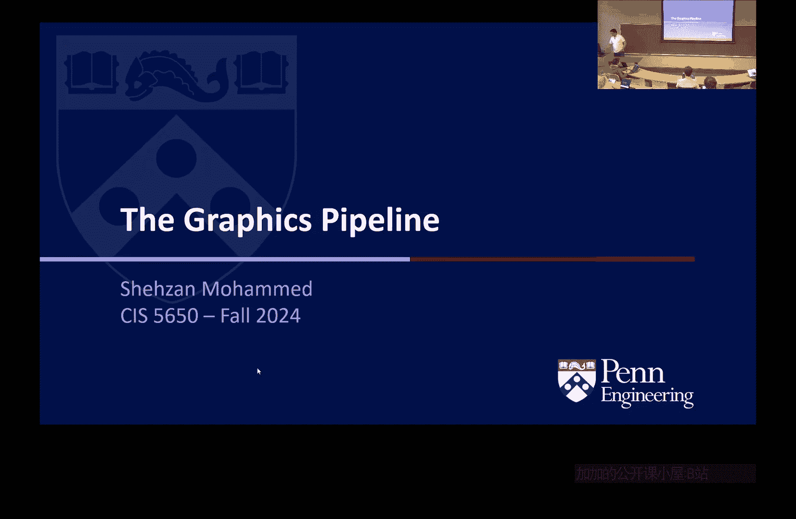
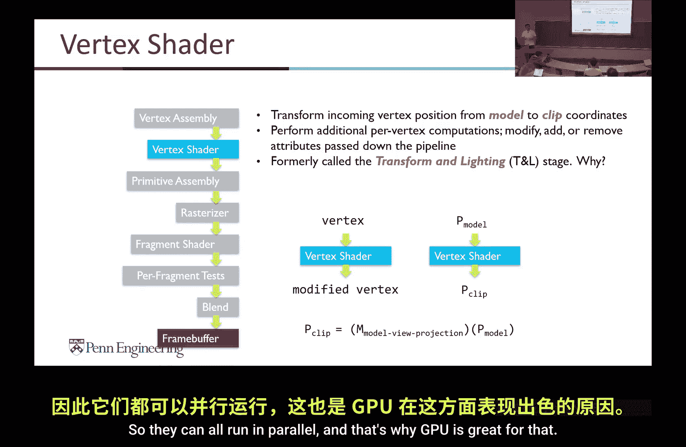

# 宾夕法尼亚大学【中英⚡GPU编程｜CIS5650 2024 GPU Programming】 p12 P12 2024-10-02 - Lecture 6 Graphics Pipeline -BV1JeMnzFEWv_p12-

来一些。All right， let's get started， I've added the slides for the schedule。

 let me know if you can't access them。So today in today's class you're going to deviate a little bit you're going to learn about the graphics pipeline as well as some forward class and deferred trade rendering options is。

Completely separate from Kuda but there' will also be components where you'll be like hey。

 that makes sense in Kuda I can see why they did that so let's get started。

Some of you may have already learned this in other classes so this might be basic but it's important that we level set everybody and today's lecture will essentially be project4 and you'll do that using web GPU so。

So feel free to ask any questions。纯粹。

All right， so we are going to learn about how the graphics pipeline map to hardware and to start with that graphics is a really big area。

 right。Eric Keyinenes on Monday kind of highlighted that in graphics you have modeling where youre actually building the 3D models。

 you have animation where youre animating those models and then there's rendering where you're converting what is virtually bits and bytes into pictures on a screen right into pixels and lights and if you want to print it into ink。

And even within that， there is photoreistic rendering， non photoreistic render。😊。

Real time rendering and not real time rendering today well focus on the real time render part about how how do you take triangles and essentially put them on the screen。

So。From a rendering perspective， the goal is how do you you have pixels on a screen。

 how do you assign these pixels some color， how do you know what should show up where？

And that's the main goal of rendering to do that。You essentially have to compute two parts one would be。

Which so just trying to get my。😔，Slis up one would be。First what is visible。

 so I'm standing here in this classroom right I can see all of you， I can see the walls。

 but I can't see what's behind that wall。So， we have to figure out what can I see I can see the tree through the window because it is transparent if it were opaque I wouldn't be able to see it so first is figure out what you can see and then second figure out okay what is the color how is it affected how what material is it how does light affected and so on。

So those are the two key parts of rendering。So we are going to walk through how the real time rendering pipeline。

 the traditional one， the standard forward rendering pipeline is going to do that。うん、それ。哦。

So here are the stages of a very traditional old school forward rendering pipeline。

 this is kind of the simplest form of it right and well start with this step called vertex assembly。

So in vertex assembly， what's happening is you have certain geometry right and you have to arrange it in a way that the computer can understand and process。

So what you are essentially doing is taking a vertex one or more ver， I suppose。

And converting them into buffers that are neatly arranged。So this is the vertex assembly part。

 this is essentially kind of what you are doing in a lot of ways where you arerranging for each pixel。

Its position X， Y， Z， a normal because you need that。

And then you also have additional values such as texture coordinates， bump coordinates， etc。

 if needed。But all of that together is the data you need for any single vertex we are not even talking triangles yet。

 you are just talking about vertex which is a point。

 so what are the properties of a point that you need to send to the GPU。嗯。あと。あ。O道。So。

This essentially taking this pipeline will essentially take what is points in space ver disease in space remember even triangles are like a human made concept in a way I guess so points in space。

And then the output has to be an image on screen or printed。

 so how do we get that so we start with the vertices。

And then we're arranging them into OpGL as position texture coordinates binomial by tangents， etc。

 so what are the properties of a point first？So that's how you want to arrange it each of these are。

A vertex will have at least one of each of these right so that's what you' are arranging and that's assuming no indices of course if you do indices and stuff it gets a little bit more data but essentially bottom line is that you take the properties of a vertex and you're arranging them so that the GPU can read it。

く。So I spoke about that anybody know the difference between a binmal and a byte tangent？喂。

Very really。Basically the same thing with the。或到时责。Yeah。

 so by tangent is a tangent by tangent is tangential to the surface it and then by normal。

Is a normal that is normal to both the tangent and the normal so if you think about your xY z coordinates on one axis you will have normal。

 one axis you will have by tangent and the other axis you will have by normal。Its binmal called no。

 there are three different things， there are three different axes。So。I think by tangent， so tangent。

 let me see if I can draw it。And again， I maybe。So if you have a circle， there's your tangt， right？

I think what normal would be， let's say this way。Okay。The by tangent would be like that。

So normal is coming out。By tangent。And then your bi normal is like that。 So it's like。

Paled to the surface， in a way。If you want to of think of this as 2D。

And then you have the normal coming out of here， so that's one way to think about it。这个关。全是。叶酸呃。Yeah。

 so this first tang that I drew is in 2D space。This could be。

 I could draw it here as well if so that I'm not confusing with parallel lines。的。

You can put a three dimensional axis at any point right so if you are putting a three dimensional axis at the center and assuming the circle is flat or let's say a triangle then what are the three axes so normal by tangent and by normal would form those axisxes。

Okay。嗯。Anybody know what these access can be used for？Or when you might use them。Nick。

 and I'll come to you guys as well。s normalormal mapping， anything else。Yes。好的。Yep。Yeah。

 exactly they use for normal and pump mapping most of the time。

 so any anything that needs work in the tangent space would you ever want to store all three？嗯，呃就。

Yeah。倒し。craft fine。 But like for space efficiency probably better exactly。 So remember， these。

 these kind of concepts apply from co as well， right， Computer is free。 If you store two axes。

 you can always compute the third， pretty much for free。Okay， all right。

 so any questions on vertex assemblies？So you kind of have vertex 0 and then vertex 1 will be offset and so on。

So no other questions on word X assembly。Okay。So now from vertex assembly what we do is the vertex shader now most of you have probably written a vertex trader in 460 at some point or a previous graphics class and what we are doing here is essentially。

Transforming a vertex position。Into from model to clip coordinates essentially so you're going from a local coordinate system to a global coordinate system and that's what a vertex shader does。

 the reason it's a shader， aK a Kuda kernel you know they derive from the same ideas right lots of data running in parallel。

 the reason it's a shader is because。You can compute all of these in parallel。

 every vertex is kind of independent of every other vertex。

 so they can all run in parallel and that's why GPU is great for that。

