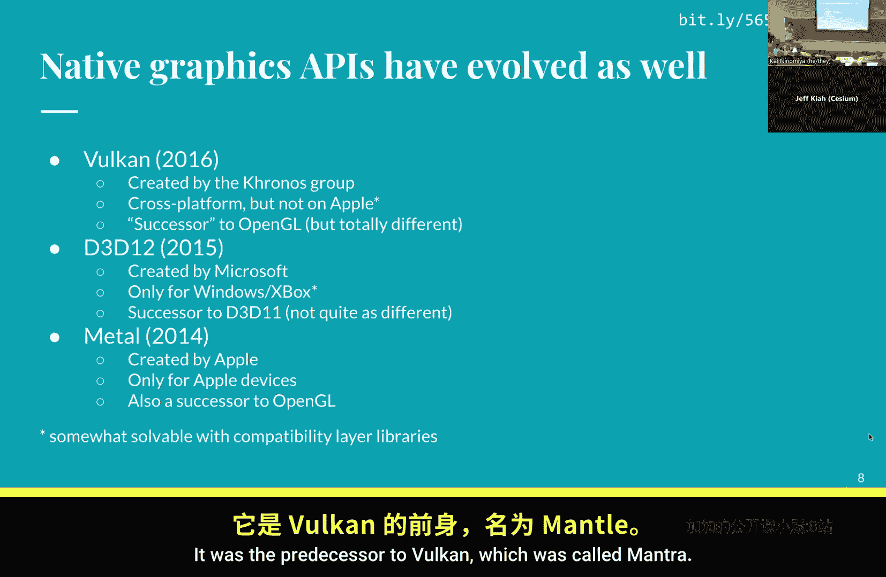

# 宾夕法尼亚大学【中英⚡GPU编程｜CIS5650 2024 GPU Programming】 p13 P13 2024-10-07 - Guest Lecture 3 WebGPU by Kai Ninomiya -BV1JeMnzFEWv_p13-

An official representative of Google。

These slides were not written by me mostly they were written by Michael worker Brandrennon Jones who gave this lecture for the past two years。

But they're really good slides， so I just took them。I I'm Kay， I use see him they them pronouns。

 I am a software engineering at Google since 2016 on the Chrome GPBU team working on Web GPU for most of that time。

I am also a Panduama was in Comp science in 2015 and master's of Comp science in 2016。

so as Ranne said， this is our team's 11th years this is 10 years since the first time that I was presented in this course and I was in that first course was I was there the first time that my team presented incidentally and we are all the way down there now there are 3D penallum represented on this list。

We one of them left recently， but we currently have two people on the team from Penn。呃。

Me and Trek and Austin A who left recently， but yeah are we have always been really excited to support this course。

 obviously。I've been on both sides of it， so it is。

you know an interesting interesting experience to like give back in this way。

 but I just wanted to celebrate that and I for fun I pulled together all the links for all the slides。

 all the past videos that exist some there's some really good stuff in there and I'll mention some of that later。

啊。So I'll be talking about generally like why we developed Web GPU and then the important stuff like core Web GPU concepts。

 some like examples and demos and like obviously pretty demos are great。

And the stuff that Brenan had had in these slides was feature state and debugging and best practices I kept both of those because they are both really useful things there's a lot of stuff that we have from past we have so much material from past lectures so there's a lot of stuff in past lectures。

That is like here's some conceptual stuff about like how these how this style of API works and all this stuff I'm not covering a ton of that I do have some bonus slides at the end which I'm pretty sure I will not cover because I'm pretty sure thiss lecture as long enough as it is。

 but there will be links to a lot of useful resources。

 so this will not be the only info that you get about WebGA。First， let's talk about WebGL。嗯。WebGL is。

The sort of。Thing that that WebGPU is the successor too。

 right like Webg has been around forever at this point， it's very ubiquitous ubiquitous。

 it's been on。Every major browser on every major platform for a good long while now。

 and that has a bit allowed。A lot of customers at WebG to do a lot with it。嗯。

It is used on products that are like used by millions of people。

 I guess probably like billion of people I don't know what the numbers are like Google Maps for example I've been using this for a long time for the various rendering of course I'm sure you're familiar with CM and like Google Earth and all these other things that also use WebGL there's tons of the sites out there I literally it was just like I want to add an example of like how influential WebGL is I stuff Google Maps there so I did this half an hour ago but。

But there's so much stuff out there it's a standard it's an open standard at the Kronos group Kronos Group is the organization did openGL and OpengelS and Vulcan and open CL and a ton of other things JL stuff that you're probably familiar with the timeline here at WebGL2 so when I started at my job I was actually working WebGL2 it was far along in the process。

 but we were trying to get it out the door on Android fully conformant passing like passing all the tests all that stuff so that was what I initially worked on at Google。

嗯。But as you can tell these some of these numbers are some of these years are a pretty long time ago。

 right， so WebGL1 was based on OpenGil E。In 2007。嗯。That was， in turn， based on。

Open GL from which originally came out in 1992 so we're like going really we're digging really really deep into like the history of this API and there's been breaking there's multiple breaking changes represented there so it's not like we it's not like we grew a thing of starting in 1992。

 but it is still like there's still a lot of concepts in there therere really baked into the way that a graphics accel worked in the 90s and that is not or like maybe the 2000s and that is not very。

That it's not a very good way to program a GPU these days。嗯。And just for fun。

 I will note that openG is based to some degree unclearar。

 I don't know exactly on Silicon Graphs I G， which came about in 1983。

 so digging really far back there。Real time graphics have obviously evolved a lot since then。

 this is just from 1993 to 2002。So not even representing that whole range。

And that's horizonizon forbidden West， PlayStation 5。 so like。for a bit of context， right。

 like this thing on the left。Was。Could be rendered on a $250，000 workstation in 1993。

And obviously the thing on the right on a brand new console in 2022 was on a $500 piece of hardware。

So there have been a lot of advances and of course there have been huge architectural changes。

 many huge architectural changes over that time。So around 2014 to 2016。

 everybody agreed that it was time to change things。嗯m。

So I will go upwards since that's chronological in 2014 metal was released by Apple。

 it is only for Apple devices， they built it as a successor to open GL。

For a lot of reasons and of course， we soon found out that they wanted to build something that would work better with Apple Silic。

 which had not yet been released at that time。Um， similarly， Microsoft created D312。

 released that in 2015， that's of course only for Windows and Xbox。

That was a successor D3D11 Director3 had evolved more along with the time than OpenGle had so it was not quite as much of a departure did but it did change quite a lot and then Vulcan was a huge departure from OpenGle this took us a good number of years to produce。

 but it has cross platformatform across every architecture except for apples because Apple doesn't implement it。

嗯。And it is a successor to something that was fundamentally built in 1992。So。他。

the patterns of the AP it was agreed by everybody in the industry of the patterns。

That were used to designing these APIs needed to change， even in the case of like D3011。

 which wasn't too far， too far too long on the tooth yet， yeah。Yeah， it works。

wondering like how was for us that I look at that he said it appears to。

How does that even work when the industry changes so quickly that's a really good question。

The things that needed to be represented in these APIs， like the fundamental architecture changes。

Have been around for a good while at this point， I would say most of them。let's see。

 what did I say about Open jail？Like by the time of OpenG 2。0 in 2007。That's。

 that was the hardware people were making。 So people were making hardware that was like。

Fundamentally。Getting there in 2007。And。Vulcan targets open generally 2。1， which is 20。

14 is or something for mobile， but desktop was way ahead of that so there was there was like。

Probably a decade or close to a decade of like。The modern graphics hardware design before we got to the point where we were redesigning the software to match it。

So。Things don't haven't didn't actually move that fast basically is what I'm saying I don't know that much about the history of this。

 I'm not super familiar with it， but I do know that like。For example， if we look at。

At like a desktop GPU。They were evolving their architecture continuously for decades。

They were making their software work with and they were making it fast。

 and they were doing a lot of work to take the old software run and run it fast on the new stuff。

So they were able to push the hardware forward incrementally as they went。

But the fundamental changes。Were things like creating more power efficient architectures on mobile。

 which I don't have any slides about， but there are past lectures that talk more about this。啊。

That that really like the concepts became ubiquitous across multiple vendors。

 across multiple companies， a good while before we actually pushed those out into into standards。

I hope that answers your question a little rambly， but I think in the case of something like。Welcome。

 that was also the contribution that A& D made was the predecessor to。That's right， yes。

